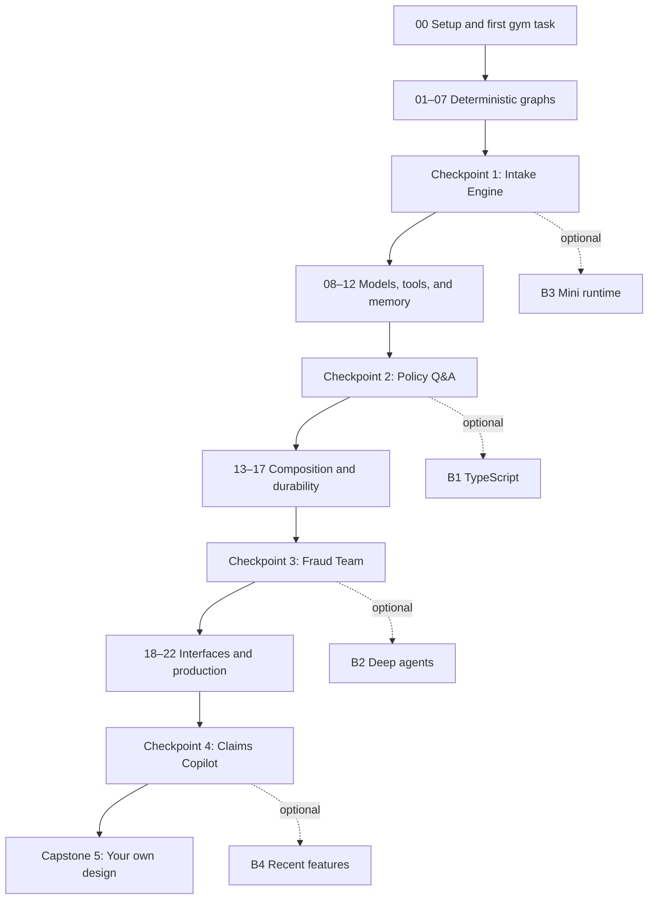

# Learning path

You will build one evolving system: the **Larkspur Claims Copilot**, using fictional claims and policies. Start with ordinary Python decisions, learn to predict graph execution, and then add models, tools, durable work, and interfaces. No insurance expertise is assumed; synthetic policy rules are supplied as testable facts, not real-world advice.

All lessons and [486 tasks](docs/GYM_TASK_CATALOG.md) are included. The [feature map](docs/FEATURE_MAP.md) links each group to its executable example and use case. See [optional dependencies](docs/OPTIONAL_DEPENDENCIES.md) before the advanced integration lessons.

## Time and routes

The requested tier estimates total **46 hours of guided lessons**. Working through the six selected tasks per core module adds approximately 35–50 hours; the four checkpoint projects add 20–30 hours. Allow roughly **100–125 hours for the guided route**, with variation by experience. Completing the entire 486-task gym, bonuses, and extended capstones is a much larger undertaking; budget another 150–250 hours for the remaining practice and extensions. These are planning estimates to refine after learner trials.

| Route | How to use it |
| --- | --- |
| Learn in order | Follow 00–22, the six selected tasks per module, and one checkpoint after each tier. |
| Practice deliberately | Filter the gym by module/type/level; alternate Predict, Fix, and Trace before reading solutions. |
| Start from a capstone | Read its prerequisite checklist, attempt it, and return to the linked feature groups when stuck. |

Each core module has 18 tasks: six per feature group. The **guided six** are IDs ending in **01, 02, 09, 10, 17, and 18**: Build, Fix, Predict, Trace, Extend, and Refactor or Design. Finishing these is a guided module milestone; completing all 18 is gym mastery. Design milestones require the rubric self-review as well as mechanical checks. Progress displays these separately. `gym drill` samples short Predict/Fix tasks only from modules with the guided milestone complete; it never marks a previously unseen advanced module as eligible.

Before the first guided milestone, revisit the supplied first-task prediction instead of running an empty drill. Afterward, start **every study day** with a 5–10 minute `uv run gym drill`, review the explanation of a miss, and finish with one sentence describing what changed in your mental model. Review days still include the drill. The drill is local and deterministic when a seed is provided, records attempts, weights weak/overdue concepts, and does not reset the learner's normal workspace files.

## What you need first

Basic Python functions, dictionaries, classes, type hints, a terminal, and basic Git. Python 3.12 is recommended. The acceptance matrix covers CPython 3.11–3.14 on Windows and Linux, plus Python 3.12 on macOS. Consult the acceptance report for actual run results.

Teach new prerequisites at their first use: simple pytest assertions in 00; graph terminology in 01; reducers and Pydantic validation in 02; messages briefly in 02 and LLMs/prompts/tool messages fully in 08–09; middleware in 10; embeddings in 11; futures in 15; async/await and MCP in 16; HTTP/SSE and UI reruns in 18; deeper testing/evaluation in 19; Docker and deployment concepts in 22. Shipped notebooks execute canonical scripts in child processes; use top-level await for your own asynchronous notebook experiments.

## Tier 1 — Graph fundamentals, no LLM

**12 hours of lessons; modules 00–07.** Nothing imports a model-provider integration. Learn the execution model by predicting state at each superstep. A superstep is a batch of eligible nodes that read the same starting state; their updates are merged before the next batch runs.

| Module | Outcome | Lesson time | Copilot version |
| --- | --- | --- | --- |
| 00 — Setup and orientation | Compare a plain claim checklist with an equivalent graph. | 60 min | 0 |
| 01 — Your first graph | Normalize a claim through a deterministic intake pipeline. | 75 min | 1 |
| 02 — State and reducers | Accumulate validation findings without losing earlier evidence. | 105 min | 1 |
| 03 — Branching and routing | Route claims to fast-track, standard, or specialist handling. | 75 min | 1 |
| 04 — Loops, parallel branches, and map-reduce | Check all attached documents and combine the findings. | 120 min | 2 |
| 05 — Persistence and threads | Continue one claim across several adjuster sessions. | 90 min | 2 |
| 06 — Human-in-the-loop with interrupts | Require adjuster approval for payouts above $5,000. | 105 min | 3 |
| 07 — Time travel, debugging, and streaming basics | Replay a disputed decision and fork it with corrected evidence. | 90 min | 3 |

### Checkpoint: Claims Intake Engine / capstone 01

A deterministic intake engine with routing, parallel document checks, SQLite checkpoints, a $5,000 approval threshold, and a disputed-claim audit. Submit a passing test report and a diagram generated from the actual graph.

You are ready for the next tier when you can:

- Explain state, partial updates, and reducer behavior without running the code. Practice: [01-03, 02-09](modules/01_your_first_graph/README.md).
- Predict legal parallel execution batches and fix conflicting writes. Practice: [04-08, 04-09, 04-10](modules/04_loops_parallel_map_reduce/README.md).
- Resume the same persisted claim across process sessions. Practice: [05-07, 05-08](modules/05_persistence_and_threads/README.md).
- Require approval and prevent duplicate effects on resume. Practice: [06-01, 06-14](modules/06_human_in_the_loop/README.md).
- Replay a historical decision and create a separate corrected fork. Practice: [07-01, 07-02](modules/07_time_travel_and_streaming/README.md).

If one criterion fails, repeat a Fix and a Trace task in that feature group, then attempt the checkpoint again with a different synthetic claim. Reading a solution counts as study, not an independent pass.

## Tier 2 — Adding LLMs

**10 hours of lessons; modules 08–12.** Scripted fake models are the default for checked work. Optional live runs use the shared factory, with Ollama as the free local provider. Teach messages and tool calls before wiring the agent loop; build the loop before showing create_agent.

| Module | Outcome | Lesson time | Copilot version |
| --- | --- | --- | --- |
| 08 — LLMs inside nodes | Extract claim facts with a model, then route with deterministic rules. | 120 min | 4 |
| 09 — Tools and the agent loop | Look up policies and calculate a synthetic payout through controlled tools. | 150 min | 5 |
| 10 — Prebuilt agents and when to drop down a level | Use create_agent while retaining deterministic claim controls. | 90 min | 5 |
| 11 — Memory | Remember contact preferences while keeping customer histories isolated. | 120 min | 6 |
| 12 — Workflow patterns with LLMs | Draft a claim letter and improve it against known policy facts. | 120 min | 6 |

### Checkpoint: Policy Q&A Agent with Memory / capstone 02

A policy Q&A agent over the five fictional policy documents, with local retrieval and citations, a fixed fake-model trajectory, customer memory, and the existing approval regression suite. Learn RAG as retrieve-then-answer before using it.

You are ready for the next tier when you can:

- Validate model extraction and preserve message identity. Practice: [08-02, 08-09](modules/08_llms_inside_nodes/README.md).
- Build and explain the tool loop, then compare a prebuilt agent. Practice: [09-07, 10-06](modules/09_tools_and_agent_loop/README.md).
- Isolate two customers' memories and account for deletion scope. Practice: [11-08, 11-16](modules/11_memory/README.md).
- Bound a letter revision workflow and verify policy facts. Practice: [12-14, 12-17](modules/12_workflow_patterns/README.md).

If one criterion fails, repeat a Fix and a Trace task in that feature group, then attempt the checkpoint again with a different synthetic claim. Reading a solution counts as study, not an independent pass.

## Tier 3 — Composing larger systems

**12 hours of lessons; modules 13–17.** Build reusable components, compare agent coordination patterns, and persist work that outlives one process. Local external-system tests use fake transports or stdio; Postgres/Docker are optional integration runs with clear prerequisites.

| Module | Outcome | Lesson time | Copilot version |
| --- | --- | --- | --- |
| 13 — Subgraphs | Reuse one fraud-review component in claim and policy workflows. | 150 min | 7 |
| 14 — Multi-agent systems | Coordinate intake, policy, fraud, and communication specialists. | 180 min | 7 |
| 15 — The Functional API | Rewrite intake with ordinary control flow while preserving durable behavior. | 120 min | 7 |
| 16 — External systems and MCP | Expose the synthetic claims system through local MCP tools. | 150 min | 7 |
| 17 — Durable execution and long-running workflows | Wait for a contractor estimate and recover after a simulated crash. | 120 min | 8 |

### Checkpoint: Fraud Investigation Team / capstone 03

A bounded supervisor team with a reusable fraud subgraph, local stdio MCP tools, a simulated three-day document wait, and a subprocess crash/recovery demonstration. Show both the checkpoint lineage and the synthetic side-effect ledger.

You are ready for the next tier when you can:

- Reuse a fraud subgraph with explicit state boundaries. Practice: [13-01, 13-08](modules/13_subgraphs/README.md).
- Explain who owns history and control at every agent handoff. Practice: [14-08, 14-10](modules/14_multi_agent_systems/README.md).
- Translate graph behavior into tasks and durable entrypoints. Practice: [15-06, 15-14](modules/15_functional_api/README.md).
- Call local MCP tools without network or credentials. Practice: [16-13, 16-14](modules/16_external_systems_and_mcp/README.md).
- Recover from a simulated crash without duplicate effects. Practice: [17-02, 17-05, 17-13](modules/17_durable_execution/README.md).

If one criterion fails, repeat a Fix and a Trace task in that feature group, then attempt the checkpoint again with a different synthetic claim. Reading a solution counts as study, not an independent pass.

## Tier 4 — Production

**12 hours of lessons; modules 18–22.** Add interfaces, tests, evaluation, diagnostics, authorization, and deployment. All graded work stays offline. Real hosted deployments and provider calls are optional, separately marked exercises.

| Module | Outcome | Lesson time | Copilot version |
| --- | --- | --- | --- |
| 18 — Streaming to user interfaces | Show claim progress and approval requests in an adjuster dashboard. | 150 min | 9 |
| 19 — Testing and evaluation | Prevent regressions in claims decisions and tool behavior. | 150 min | 9 |
| 20 — Observability and visual debugging | Find a misrouted claim using local traces and optional Studio. | 90 min | 9 |
| 21 — Security and guardrails | Keep injected claim text from authorizing payouts or crossing customer boundaries. | 150 min | 10 |
| 22 — Deployment | Run the completed Claims Copilot behind an API with durable storage and a dashboard. | 180 min | 11 |

### Checkpoint: Larkspur Claims Copilot / capstone 04

The integrated API, dashboard, persistent claims workflow, scoped tools, local evaluation gate, guardrails, and Docker Compose reference deployment. The mock deployment contract is required; Docker/Postgres and optional managed-service checks are reported separately rather than represented as passed when skipped.

You are ready for the next independent project when you can:

- Stream progress, tokens, and approvals through an async UI boundary. Practice: [18-01, 18-08, 18-14](modules/18_streaming_user_interfaces/README.md).
- Catch decision and tool-trajectory regressions with offline evaluation. Practice: [19-02, 19-14, 19-17](modules/19_testing_and_evaluation/README.md).
- Diagnose a misroute without requiring a tracing account. Practice: [20-04, 20-16](modules/20_observability_and_debugging/README.md).
- Keep prompt injection from authorizing writes or leaking customer data. Practice: [21-02, 21-08, 21-14](modules/21_security_and_guardrails/README.md).
- Explain persistence, ownership, concurrency, and recovery in deployment. Practice: [22-08, 22-10, 22-18](modules/22_deployment/README.md).

If one criterion fails, repeat a Fix and a Trace task in that feature group, then attempt the checkpoint again with a different synthetic claim. Reading a solution counts as study, not an independent pass.

## Four-week intensive schedule

Allow roughly 25–32 hours per week. Each day includes the drill routine above; project days include tests and self-review, not just implementation. A slash below joins parts of one checkpoint project rather than adding a second project.

| Day | Focus | Deliverable |
| --- | --- | --- |
| 1 | 00 + first half of 01 | Complete guided 00 tasks; normalize a synthetic claim by hand. |
| 2 | Finish 01 + first half of 02 | Draw and predict the intake graph; complete guided 01 tasks. |
| 3 | Finish 02 + 03 | Complete guided 02/03 tasks; practice all route boundaries. |
| 4 | 04 | Complete guided 04 tasks; compare parallel step batches. |
| 5 | 05 + first half of 06 | Complete guided 05 tasks; reopen SQLite state. |
| 6 | Finish 06 + 07 | Complete guided 06/07 tasks; replay and fork a claim. |
| 7 | Tier 1 checkpoint / capstone 01 | Finish the deterministic intake engine and readiness review. |
| 8 | 08 | Complete guided 08 tasks with scripted extraction. |
| 9 | 09 | Build the tool loop and complete guided 09 tasks. |
| 10 | 10 + first half of 11 | Complete guided 10 tasks; begin customer-scoped memory. |
| 11 | Finish 11 | Complete guided 11 tasks; verify two-customer isolation. |
| 12 | 12 | Complete guided 12 tasks; inspect the letter evaluator's stopping rule. |
| 13 | Tier 2 checkpoint / capstone 02 | Implement local policy retrieval with citations and memory. |
| 14 | Tier 2 checkpoint + review | Finish capstone 02; repeat weak task types from Tiers 1–2. |
| 15 | 13 | Complete guided 13 tasks; reuse one fraud subgraph twice. |
| 16 | 14 | Complete guided 14 tasks; compare team and single-agent behavior. |
| 17 | 15 | Complete guided 15 tasks; preserve intake behavior across APIs. |
| 18 | 16 | Complete guided 16 tasks; run local stdio MCP without network. |
| 19 | 17 | Complete guided 17 tasks; crash and resume a synthetic claim. |
| 20 | Tier 3 checkpoint / capstone 03 | Integrate the team, reusable subgraph, MCP tools, and durable wait. |
| 21 | Tier 3 checkpoint + review | Finish capstone 03 and record crash-recovery evidence. |
| 22 | 18 | Complete guided 18 tasks; stream and resume an approval. |
| 23 | 19 | Complete guided 19 tasks; make a deliberate quality regression fail. |
| 24 | 20 + first half of 21 | Complete guided 20 tasks; debug locally, with Studio optional. |
| 25 | Finish 21 | Complete guided 21 tasks; resist the injected claim fixture. |
| 26 | 22 | Complete guided 22 tasks; inspect deployment and recovery. |
| 27 | Tier 4 checkpoint / capstone 04 | Assemble and verify the full Claims Copilot reference behavior. |
| 28 | Tier 4 checkpoint + design review | Finish capstone 04; outline capstone 05 and select optional bonuses. |

## Eight-week part-time schedule

Allow roughly 12–16 hours per week. Split difficult days into two shorter sessions. Every cell is a study day with a daily drill once the first module is ready.

### Week 1

| Day | Work |
| --- | --- |
| 1 | 00 setup and first guided task |
| 2 | 00 gym tour and remaining guided tasks |
| 3 | 01 nodes and state |
| 4 | 01 graph wiring and guided tasks |
| 5 | 02 schemas and defaults |
| 6 | 02 reducers and state boundaries |
| 7 | 02 guided tasks; catch up and review |

### Week 2

| Day | Work |
| --- | --- |
| 8 | 03 routers and guided tasks |
| 9 | 04 loops and recursion budgets |
| 10 | 04 parallel branches and guided tasks |
| 11 | 05 persistence and guided tasks |
| 12 | 06 approval and guided tasks |
| 13 | 07 streaming, replay, and guided tasks |
| 14 | Capstone 01: assemble the intake engine |

### Week 3

| Day | Work |
| --- | --- |
| 15 | Capstone 01: test and readiness review |
| 16 | 08 messages and model boundary |
| 17 | 08 extraction and guided tasks |
| 18 | 09 tools and errors |
| 19 | 09 manual agent loop and guided tasks |
| 20 | 10 prebuilt agent and guided tasks |
| 21 | Review Tiers 1–2; compare custom and prebuilt behavior |

### Week 4

| Day | Work |
| --- | --- |
| 22 | 11 short-term memory |
| 23 | 11 Store, privacy, and guided tasks |
| 24 | 12 chains and worker orchestration |
| 25 | 12 evaluator loop and guided tasks |
| 26 | Capstone 02: local retrieval primer and policy citations |
| 27 | Capstone 02: memory and agent integration |
| 28 | Capstone 02: tests and Tier 2 readiness review |

### Week 5

| Day | Work |
| --- | --- |
| 29 | 13 shared-state subgraphs |
| 30 | 13 adapters, persistence, and guided tasks |
| 31 | 14 supervisor and scoped specialists |
| 32 | 14 handoffs and guided tasks |
| 33 | 15 entrypoints and tasks |
| 34 | 15 parallel futures and guided tasks |
| 35 | Review shared versus private histories and API choice |

### Week 6

| Day | Work |
| --- | --- |
| 36 | 16 async primer and API boundaries |
| 37 | 16 local MCP and guided tasks |
| 38 | 17 durable side effects and recovery |
| 39 | 17 long waits and guided tasks |
| 40 | Capstone 03: integrate team and MCP |
| 41 | Capstone 03: crash recovery and durable wait |
| 42 | Capstone 03: tests and Tier 3 readiness review |

### Week 7

| Day | Work |
| --- | --- |
| 43 | 18 async streams and all modes |
| 44 | 18 SSE boundary |
| 45 | 18 dashboard and guided tasks |
| 46 | 19 behavioral and durable tests |
| 47 | 19 evaluation harness and guided tasks |
| 48 | 20 local debugging and guided tasks |
| 49 | 21 injection and authorization boundaries |

### Week 8

| Day | Work |
| --- | --- |
| 50 | 21 encrypted checkpoints and guided tasks |
| 51 | 22 self-hosting and shared storage |
| 52 | 22 managed concepts and guided tasks |
| 53 | Capstone 04: integrate API and UI |
| 54 | Capstone 04: evaluation and security regression tests |
| 55 | Capstone 04: deployment checks and Tier 4 readiness |
| 56 | Capstone 05 outline, portfolio review, and optional bonus selection |

## Optional bonus route

| Module | Prerequisites | Planned lesson time | Goal |
| --- | --- | --- | --- |
| B1 — LangGraph.js | Tiers 1–2; Node.js 24 LTS; TypeScript primer | 240 min | Port core claim workflows and the tool loop to TypeScript. |
| B2 — Deep agents on LangGraph | Tiers 1–3 | 180 min | Plan a larger claim investigation using explicit planning and bounded subagents. |
| B3 — Build a mini-LangGraph | Tier 1 | 180 min | Implement a small superstep runner to understand the real runtime. |
| B4 — What's new | Tiers 1–4; read Beta labels | 180 min | Evaluate recent changes without silently changing the core course contracts. |

B1 runs with preinstalled Node dependencies and scripted models; Python launchers keep documented commands portable. B2 explicitly enables planning middleware and uses an isolated virtual filesystem. B3 is an educational runner of about 150 lines, with clearly stated limits. B4 records which features are Beta and keeps those experiments out of core readiness gates.

## Capstone 05 — Design your own

Choose a business process such as onboarding or invoice approval. Write the state and authorization boundaries, justify the orchestration choice, draw the actual graph, and build a tested reference slice before expanding it. Include failure, resume, and privacy cases, a local evaluation set, and an honest limits section. Grade the design with the supplied rubric; optional model feedback never substitutes for executable acceptance tests or your own review.

## Learning path at a glance

