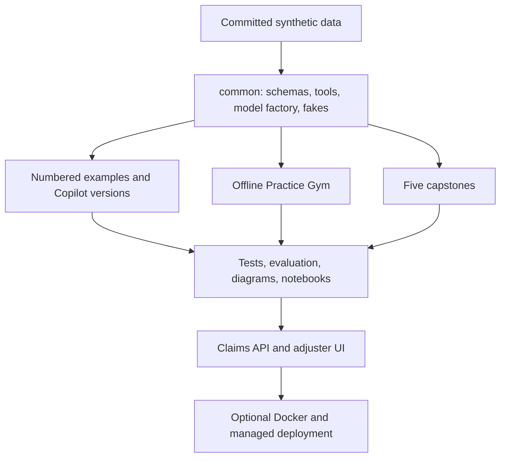

# Phase 1 plan — getting_started_with_langgraph

**Historical Phase 1 planning record.** Prepared November 5, 2026 (America/Chicago). Phase 2 has since implemented the foundation; see [the acceptance report](docs/ACCEPTANCE_REPORT.md) for current status. The phase-specific statements below preserve what was verified when this plan was written.

The course will build the Larkspur Claims Copilot through 23 core modules, four optional bonus modules, five capstones, and **486 graded practice tasks**. This phase delivers the requested design and verified dependency research. It stops before Phase 2, as requested.

## Deliverables in this phase

| Deliverable | Where to review it |
| --- | --- |
| Assumptions, architecture, phases, and acceptance gates | This plan |
| Verified versions, sources, compatibility exceptions, and stream decision | [Verification notes](docs/VERIFICATION_NOTES.md) |
| Final repository tree | [Repository tree](docs/REPOSITORY_TREE.md) |
| Every planned file, including all task leaves | [Complete manifest](docs/planning/REPOSITORY_MANIFEST.txt) |
| Feature-to-example/use-case/task/documentation mapping | [Feature map](docs/FEATURE_MAP.md) |
| Four tiers, readiness criteria, 4-week and 8-week schedules | [Learning path](LEARNING_PATH.md) |
| Full task list: ID, module, type, level, description | [Gym task catalog](docs/GYM_TASK_CATALOG.md) |
| Machine-readable curriculum | [Course catalog](docs/planning/course_catalog.json) |
| Planning checks and their limits | [Validation report](docs/planning/PLAN_VALIDATION.json) |

The 81 feature groups each have six tasks. Core modules account for 414 tasks, and bonus modules add 72. This exceeds the 140-task floor because the brief also requires six tasks per taught feature. The coverage map names the features within each group; every task must assess those features explicitly rather than carry a decorative tag.

## Assumptions and scope

1. Build in this existing workspace. The eventual public GitHub repository is named `getting_started_with_langgraph`; the local folder need not be renamed. The GitHub owner can be resolved from the connected account when publication becomes relevant. No remote repository, commit, push, or deployment is part of this planning phase.
2. Use Python 3.12 as the recommended interpreter, with a planned CPython 3.11–3.14 support matrix. The current full stack requires at least 3.11. Windows PowerShell, macOS, and Linux use the same `uv run` commands wherever possible.
3. Default walkthrough smoke runs and every graded exercise to deterministic local behavior. Tier 1 uses no model. Later lessons teach models through scripted fakes before an optional Ollama or hosted-provider run.
4. Keep all shared Python behavior in the installed `common` package. Execute numbered module examples by path; do not rely on importing numeric directory names or on the caller's current directory.
5. Use only fictional Larkspur records. Payouts are synthetic ledger entries; emails are local fixtures. Integer cents avoid floating-point money errors. Dataset rules are invented educational facts, not real insurance guidance.
6. Treat a public listing or documentation page as evidence of an available package/API, not proof that a particular account can call a hosted model. Recheck provisional model settings before creating the environment template.
7. The 46-hour tier total describes guided lessons. Selected practice and checkpoint projects make the guided route approximately 100–125 hours. Completing the full gym takes longer. The learning path distinguishes these workloads instead of suggesting all 486 tasks fit inside 46 hours.
8. The required approval boundary is the user's explicit Phase 1 instruction: stop and wait for a go-ahead. Phase 2 will begin only after that response.

## Version and API choices

The checked stable baseline is **LangGraph 1.2.20**, **LangChain 1.4.9**, and **langchain-core 1.7.6**. The complete table covers 44 Python packages and the optional TypeScript stack, with version-specific registry sources and proposed ranges. The combined Python ranges resolve successfully; runtime compatibility is still to be tested. [Version table and resolver evidence](docs/VERIFICATION_NOTES.md#versions-and-compatibility).

Use **explicit v2 invocation and stream-mode output** throughout the Python core. Learners read `GraphOutput.value` and `GraphOutput.interrupts`; stream consumers inspect `type`, `ns`, and `data`, plus interrupts on values parts. This makes state, events, and human pauses distinguishable from the start. The existing default format is taught only as a recognition/migration topic. [Official streaming guide](https://docs.langchain.com/oss/python/langgraph/streaming).

Teach the newer **v3 event-streaming API as Beta** in the advanced UI/bonus material. The current guide recommends it, while the checked release note and Deep Agents navigation still identify Beta status. Record that discrepancy openly rather than inferring a stability guarantee. Beta DeltaChannel is also isolated in B4. [Event-streaming guide](https://docs.langchain.com/oss/python/langgraph/event-streaming).

The requested MCP adapter requires SDK 1.x. Use adapter 0.3.2 with the compatible SDK 1.30.0, not the latest SDK 2.3.0. The integrated successor is Beta and gets a documented migration discussion. [Exact compatibility decision](docs/VERIFICATION_NOTES.md#mcp-exception).

Use direct graph/tool composition for supervisors, handoffs, and peer teams, without adding old helper packages. For deep agents, explicitly enable planning middleware and constrain filesystem/subagent capabilities. Static debugging breakpoint syntax belongs only in the migration guide to reconcile the brief's debugging lesson with its banned-spelling requirement.

## How the repository fits together

`common/copilot/v00.py` through `v11.py` capture the actual system milestones. Modules that add an explanation, refactoring, testing, or debugging capability can share a Copilot version while stating what that module contributes. Each use case imports the appropriate shared version and supplies an explicit deterministic scenario. No use case is merely a differently titled copy of unrelated sample code.

The core domain has typed claim inputs, explicit decision reasons, customer-scoped repository access, a document-review result, proposed and approved amounts, and an append-only synthetic payment ledger. Graph state carries only what the workflow needs. Runtime context supplies trusted request/customer identity and service dependencies; model text never grants permissions.

Every module starts with its Claims Copilot version banner and contains every required README section, at least three focused examples, a use case, cleared notebook, standalone quiz, tests, costs, security notes, and matching practice links. A module's detailed feature groups and exact example paths appear in the feature map. If a three-example plan would force multiple ideas into one long script, add examples rather than stretch the 120-line teaching target.

## Installation and model boundaries

Plan a small base install containing the graph/core framework, SQLite persistence, data/configuration helpers, and the gym. The default development group supplies pytest, async/socket test support, and Ruff so `uv sync` followed by the baseline checks works immediately. The base includes the LangChain framework required by fake-model agent exercises, but no provider integration is imported by Tier 1.

| Optional extra or group | Used for |
| --- | --- |
| llm, plus provider-specific extras | OpenAI, Anthropic, Google Gemini, and Ollama live integrations |
| persistence | Postgres saver and binary/pool driver support |
| mcp | Standalone MCP adapter and compatible official SDK |
| apps | FastAPI, Uvicorn, Streamlit, and HTTP test utilities |
| deploy | Local Agent Server/CLI and SDK |
| eval | Optional agentevals trajectory matcher |
| notebooks | Jupyter, nbformat, and nbclient |
| data | Regenerating synthetic PDFs |
| security | Optional encrypted checkpoint demonstration dependencies |
| bonus | Deep Agents |
| dev | Contribution tools, notebook stripping, property-based tests, full content checks |

Offline baseline tests must pass without optional installations. Optional integration-specific suites are explicitly reported as skipped when their extra is absent; an all-extras CI job installs and checks those paths. Do not use broad import-based skipping to hide a broken required module. TypeScript has a separately locked B1 package set and preinstalled Node requirement, with portable Python launchers for its commands.

The single Python model factory is built on `init_chat_model` for live use and the scripted fake classes for offline use. It supports provider/model selection from the environment, temperature zero for graded fakes, validated structured output, tool-call messages, and deterministic streaming chunks. Fakes derive from LangChain fake models and explicitly implement the binding/structured-output contracts required by the lessons; exhaustion is a clear test failure rather than silently cycling responses.

The provider defaults live only in `.env.example`: Ollama is the default provider, and an empty `LLM_MODEL` selects that provider's configured model default. After a hosted key and integration are installed, changing `LLM_PROVIDER` is the one-line switch; setting `LLM_MODEL` is an optional override. Missing keys, a stopped Ollama server, and unavailable models produce concise guidance pointing to `scripts/check_env.py`. Optional live calls use provider-supported parameters, not a universal parameter set that some models reject.

The environment template documents every variable, including provider/model defaults, optional keys, the Ollama URL, database connection settings, tracing opt-in, and encryption key input. `.env`, workspace attempts, local checkpoint files, logs, and local service state are ignored. Tests explicitly disable outbound tracing and never print key values.

The pip fallback uses `python -m venv` and `python -m pip`, with separate activation commands for PowerShell and POSIX shells. Docker and TypeScript actions are wrapped by Python scripts using subprocess argument lists, not shell-specific command composition.

## Synthetic data contract

The data generator uses a fixed seed, fixed date anchor, deterministic IDs and ordering, and stable PDF metadata. It creates:

- Five policy products with explicit coverage limits, deductibles, covered causes, and exclusions.
- A SQLite database with customers, policies, claims, claim_documents, payments, and adjusters, including 500 claims and enforced foreign keys.
- Sixty incoming submissions spanning water, theft, fire, storm, and liability, with labeled missing-data, fraud-indicator, and duplicate cases.
- Thirty synthetic documents, each in TXT and simple PDF form: ten estimates, ten receipts, and ten police summaries.
- Twenty local email fixtures, readable fraud rules, and the deliberately injected claim.
- Golden JSONL cases for routing, decisions, final state, trajectories, and security behavior.

Commit generated data so learners need not regenerate it. A manifest records fixture counts and hashes. Regeneration checks both stable logical records and artifact hashes; eliminate timestamps or metadata that would break reproducibility. Examples use isolated writable copies under workspace or temporary directories, never mutate committed fixtures. PDF checks render representative pages to verify they are readable.

## Practice Gym behavior and grading

The catalog gives every task its stable ID, module, type, level, feature group, description, and exact folder. A runtime manifest additionally declares prerequisites, runner kind, entry point, fixtures, expected outcome, hint sections, and timeout. It is the source for list filters and recommendations.

| Command | Planned behavior |
| --- | --- |
| `gym list` | Filter module, type, and difficulty; show prerequisites and guided-route tasks. |
| `gym start ID` | Copy a code starter or answer template to workspace, show the spec and next command, and protect an existing attempt. |
| `gym check ID` | Run the task against the learner's file in an isolated subprocess; report assertion diffs, timeouts, import errors, and the relevant concept. |
| `gym hint ID` | Reveal exactly one of three progressive hints and persist the hint count. |
| `gym solution ID` | Require confirmation before revealing complete code/answers and explanation; do not mark the task independently solved. |
| `gym reset ID` | Confirm replacement of the attempt, preserve a local backup, and reset relevant progress. |
| `gym progress` | Separate attempted, independently passed, solution viewed, guided milestone, and full mastery; display module/type totals. |
| `gym next` | Prefer unmet prerequisites and guided-route gaps, then weak or unfinished tasks; handle a fully complete catalog. |
| `gym drill` | Select short Predict/Fix tasks from completed guided modules, with a seed option and isolated review attempts. |

The standard learner code path is `workspace/<ID>.py`. Predict/Trace use `workspace/<ID>.answer.json` because the specification explicitly says they have no code starter. Design adds a written self-review. B1 uses a Python launcher plus the actual `.ts` attempt and grades that TypeScript implementation.

Task tests load the selected learner path rather than accidentally importing the reference solution. Validate the ID against the catalog; do not allow path traversal. A local subprocess and timeout improve isolation and feedback but are not a security boundary for arbitrary hostile Python. The course runs the learner's own local code.

Progress is a versioned JSON document saved atomically to `workspace/.progress.json`, with recovery from a malformed file and a lock/concurrency strategy. Record the attempt hash, checks, timestamps, hints, and whether a solution was revealed. Completion requires a fresh passing attempt; stale results are distinguishable after edits.

Every code starter is runnable and intentionally wrong in a documented way. The validator rejects accidental syntax/import failures as evidence of a good exercise. It runs every starter and solution in a fresh temporary workspace, confirms the expected behavioral failure or success, checks three hints and explanations, and checks coverage/type/level rules. Predict/Trace compare answers with deterministic oracle output. Design uses executable constraints and a scored self-review rubric, with no claim that an automatic pass proves architectural quality.

Concurrency tests assert superstep grouping and causal dependencies instead of arbitrary sibling arrival order. Fake models reset between tests. Side-effect tests inspect idempotency keys and the synthetic ledger, including the crash window after the external write but before checkpoint completion.

## Tests and release gates

| Gate | Required evidence |
| --- | --- |
| Base install | Clean `uv sync`; offline `uv run pytest` with no provider keys and tracing disabled |
| Code quality | `uv run ruff check .` and `uv run ruff format --check .` |
| All optional paths | Install all compatible extras; run offline module/API/MCP tests and notebook checks |
| Gym | All 486 planned tasks present; starter fails for intended reason; solution passes; three hints; coverage and grading contracts |
| Examples | `uv run python scripts/run_all_examples.py` succeeds with fakes; timeouts and expected outputs checked |
| API hygiene | Legacy-pattern scan; LangGraph/LangChain deprecation warnings become errors, including warnings attributed to callers |
| Content | Required README sections, at least four common bugs per module, five-to-eight quiz questions, 60-term glossary, 20-bug index, and accurate links |
| Reproducibility | Fixed data, empty notebook outputs, generated graph diagrams, versioned golden fixtures, lockfiles |
| Cross-platform | Ubuntu/Windows on Python 3.11–3.14; macOS Python 3.12 smoke; Node 24 B1 parity checks |
| Optional infrastructure | Clearly marked Docker/Postgres and Studio/service runs, reported separately; never pass-by-skip |
| Public release | Review the final diff, license and synthetic data, verify the actual remote owner, create/push the requested public repo, and report its URL and CI outcome |

Use ordinary cross-platform Python scripts for validation, data generation, diagrams, and links. Internal file/anchor checks run offline; public web-link checks run in a separate network-enabled CI job with sensible retry behavior. The legacy scan reads its prohibited spelling registry from the migration guide so it does not trigger on its own test data. Category-specific deprecation checks supplement module filters because stacklevel can point into course code. Beta warnings are identified explicitly and do not justify suppressing deprecations.

The quick-start acceptance trial starts from a clean clone and installed Python/uv. Measure the first graph and first passing task under ten minutes, recording environment and excluding an unbounded package-download promise. The first task is guided, runnable, and has a visible success check.

## Delivery phases

| Phase | Scope | Exit criteria |
| --- | --- | --- |
| 1 — current | Research, decisions, complete tree, feature map, learning path, full gym catalog | Planning consistency checked; stop for go-ahead |
| 2 — foundation | pyproject/lock/config; common helpers and fakes; full gym CLI; deterministic data; scripts; CI; root documents | Clean installs, foundation tests, CLI tests, data validation, dependency/API probes |
| 3 — Tier 1 | Modules 00–07 and their 144 tasks | No model-provider imports; all examples and solutions pass; starters fail correctly |
| 4 — Tier 2 | Modules 08–12 and their 90 tasks | Fake-model and tool-loop contracts pass; live paths clearly optional |
| 5 — Tier 3 | Modules 13–17 and their 90 tasks | Subgraph/team/MCP tests and crash recovery pass offline |
| 6 — Tier 4 | Modules 18–22 and their 90 tasks | UI/API/evaluation/security tests pass; deployment checks reported honestly |
| 7 — finishing | B1–B4 and 72 tasks; five full capstones; printable cheatsheets and remaining guides; final acceptance report | Full suite, all gym tasks, notebooks, links, lint, examples, and available infrastructure checks; publish the requested public repository |

Checkpoint specs and prerequisite links are introduced with each tier; Phase 7 completes the full capstone reference packages. As requested, each phase ends at a complete, reviewable boundary and waits for `continue` before the next phase.

## What is verified now, and what is not

Completed: read the full request; inspected the initially empty workspace; queried public package registries; inspected official guides, changelog, and selected API reference signatures; resolved the planned Python requirements; wrote the planning artifacts; checked documentation reachability and catalog/path consistency.

Not yet done: install the full teaching environment, create lesson or gym implementation code, generate fixtures, run course tests/Ruff/gym validation/examples, run live providers or Docker, create a GitHub repository, publish, or obtain passing remote CI. These are later-phase deliverables, not implied by this plan.

**Next step:** review this plan and reply `continue` to authorize Phase 2, the foundation.
