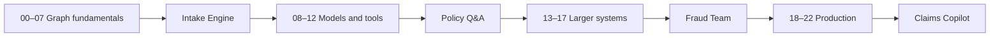

# Getting started with LangGraph

Build the fictional **Larkspur Claims Copilot** while learning to predict, test, and repair stateful workflows. You need basic Python, a terminal, and Git. No model, API key, or insurance background is needed for the quick start.

The course includes **23 core modules, four bonus modules, 486 graded tasks, 27 notebooks, and five capstones**, culminating in a streaming claims application with durable approvals. Use the [acceptance report](docs/ACCEPTANCE_REPORT.md) for measured checks and remaining integration limits.

## Five-minute quick start

Install [uv](https://docs.astral.sh/uv/getting-started/installation/) and Git, then run these commands in Windows PowerShell, macOS, or Linux. uv supplies the requested Python environment:

```text
git clone https://github.com/anandtopu/getting_started_with_langgraph.git
cd getting_started_with_langgraph
uv sync
uv run python scripts/check_env.py
uv run python scripts/first_graph.py
uv run gym start 00-01
uv run gym check 00-01
uv run gym hint 00-01
```

The starter runs but produces the wrong answer on purpose. Edit `workspace/00-01.py`, then run `uv run gym check 00-01` again. The task file and three progressive hints explain the repair. No need to install Ollama. Dependencies need a download on first installation; after that, graded work runs offline.

## What LangGraph provides

A graph connects **nodes** (Python functions) using **edges** (the next steps). Nodes read **state**, return partial updates, and execute in batches called **supersteps**. Reducers combine updates. Persistence, interrupts, and replay add durable workflow behavior. Use plain Python for a small calculation; use a graph when stateful control flow helps.

LangChain's `create_agent` builds an agent on LangGraph. LangSmith adds optional diagnostics and deployment services. All graded work in this repository stays local.



## Practice Gym

```text
uv run gym list --module 00
uv run gym list --type fix --level medium
uv run gym start 00-01
uv run gym check 00-01
uv run gym hint 00-01
uv run gym solution 00-01
uv run gym reset 00-01
uv run gym progress
uv run gym next
uv run gym drill --seed 7
```

Code attempts live in `workspace/<ID>.py`; prediction and trace answers use `.answer.json`. Solution reveal and reset ask for confirmation. Progress records hints, solution exposure, independent passes, and stale results after edits. A Design task needs both mechanical checks and the supplied self-review rubric. The gym never treats viewing a solution as an independent pass.

## Choose your route

The guided milestone in each module uses tasks ending in 01, 02, 09, 10, 17, and 18. Complete it to unlock that module's drills; work through all 18 tasks for broader practice.

- Follow the [learning path](LEARNING_PATH.md) in order, including checkpoint projects.
- Filter the [gym catalog](docs/GYM_TASK_CATALOG.md) to practice a weak concept.
- Start with the [Intake Engine](capstones/01_claims_intake_engine/README.md), [Policy Q&A](capstones/02_policy_qa_with_memory/README.md), [Fraud Team](capstones/03_fraud_investigation_team/README.md), [Claims Copilot](capstones/04_larkspur_claims_copilot/README.md), or [your own design](capstones/05_design_your_own/README.md).

| Tier | Guided lessons | Additional practice |
| --- | --- | --- |
| Graph fundamentals | 12 hours | Selected gym tasks and Intake Engine |
| Adding LLMs | 10 hours | Selected tasks and Policy Q&A |
| Larger systems | 12 hours | Selected tasks and Fraud Team |
| Production | 12 hours | Selected tasks and Claims Copilot |

The guided route including practice and projects is estimated at 100–125 hours; all 486 tasks take longer. Four- and eight-week schedules are in the learning path.

## Optional live models

Advanced local lessons use explicit [optional dependencies](docs/OPTIONAL_DEPENDENCIES.md). For the web application, see [deployment](docs/DEPLOYMENT.md). Printable [tier guides and API reference](cheatsheets/api_at_a_glance.pdf) accompany the [mental model](docs/MENTAL_MODEL.md), [30 common bugs](docs/COMMON_BUGS.md), and [glossary](docs/GLOSSARY.md).

`uv sync --extra ollama` installs the local integration. Copy `.env.example` to `.env` using Python on any OS:

```text
uv run python -c "from pathlib import Path; p=Path('.env'); p.exists() or p.write_text(Path('.env.example').read_text(encoding='utf-8'), encoding='utf-8')"
uv run python scripts/check_env.py --live
```

Install [Ollama](https://ollama.com/) separately and download the model named in the template. Hosted alternatives use `--extra openai`, `--extra anthropic`, or `--extra google`; supply the corresponding key, then change the single `LLM_PROVIDER` line. Leave `LLM_MODEL` empty to select the provider-specific default. Hosted runs incur provider charges; fakes and local Ollama use no hosted tokens.

## pip and venv fallback

Create the environment with `python -m venv .venv`.

Windows PowerShell:

```powershell
.\.venv\Scripts\Activate.ps1
python -m pip install -e .
python scripts/check_env.py
gym start 00-01
```

macOS/Linux:

```sh
source .venv/bin/activate
python -m pip install -e .
python scripts/check_env.py
gym start 00-01
```

For grading and contribution checks, install the checked tool versions with `python -m pip install "pytest>=9.2.0,<9.3" "pytest-asyncio>=1.4.1.post1,<1.5" "pytest-socket>=0.8.1,<0.9" "ruff>=0.17.4,<0.18" "reportlab>=5.1.0,<5.2"`. Run `python -m pytest`. The uv route installs these automatically.

## Verification

```text
uv run pytest
uv run ruff check .
uv run ruff format --check .
uv run python scripts/validate_gym.py
uv run python scripts/run_all_examples.py
uv run python scripts/check_links.py
uv run python scripts/check_legacy_apis.py
```

The default validator checks installed lesson groups and reports optional dependencies it skips. Its `--release` mode requires all 486 tasks and refuses missing dependencies. [Verification notes](docs/VERIFICATION_NOTES.md) and [acceptance report](docs/ACCEPTANCE_REPORT.md) distinguish measured results from future work.

## FAQ

**Do I need keys?** No. All graded exercises use deterministic Python or fake models. Live integrations are optional.

**Is this real insurance guidance?** No. Every customer, policy, company, document, and payment in the dataset is fictional. Do not use these rules for real decisions.

**Where are my attempts?** Under ignored `workspace/`. The committed dataset is read-only; work on copies.

**Why did my starter fail?** That is the exercise. Read the failure explanation, use a hint, and repair the behavior. Import errors and missing dependencies are setup errors, not successful grading.

**Are the bonuses required?** No. The core path is 00–22; TypeScript, deep agents, the mini runtime, and recent Beta APIs are optional extensions.

**Can I use a cloud account?** Yes, optionally. Never put real customer information or keys in fixtures, state, logs, or commits.

See [CONTRIBUTING.md](CONTRIBUTING.md), [CODE_OF_CONDUCT.md](CODE_OF_CONDUCT.md), and the [MIT license](LICENSE).
