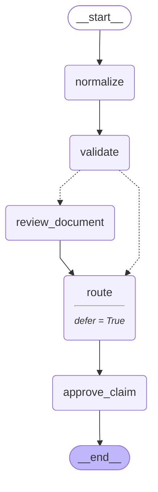

# Claims Intake Engine

Complete modules 01–07 first. Estimated project time: 4–8 hours. Default model calls are scripted and cost $0.

## User story

As an adjuster, I can reopen a high-value claim after restart, approve or reject it, and inspect its saved history.

## Acceptance criteria

Approval must preserve an explicit rejection; small eligible claims may auto-route.

- Input `{}` must satisfy `{"approved": true, "waited": true, "replay_matches": true, "replayed_nodes": ["normalize", "validate", "review_document", "route"]}`.
- Input `{"approved": false}` must satisfy `{"approved": false}`.
- Input `{"amount_cents": 10000}` must satisfy `{"approved": true, "waited": false}`.

## Architecture

Generated from the executable reference graph with `draw_mermaid()`; [source](diagram.mmd).



## Build and evaluate

Start with [starter.py](starter.py), which runs but contains a behavioral fault. Keep the `run(case)` contract. Read [the evaluation cases](eval/cases.jsonl) before coding. Use a copy in workspace to preserve your work.

```text
uv run python capstones/01_claims_intake_engine/starter.py
uv run python scripts/check_capstone.py 01 --candidate capstones/01_claims_intake_engine/starter.py
uv run python scripts/check_capstone.py 01 --candidate capstones/01_claims_intake_engine/solution.py
```

The checker loads the selected candidate, not the reference. A mechanical pass does not replace design review. Explain the state boundary, authorization source, failure recovery, and every external effect using [the rubric](rubric.md).

## Reference result

```json
{
  "approved": true,
  "route": "specialist",
  "waited": true,
  "checkpoints": 7,
  "replay_matches": true,
  "replayed_nodes": [
    "normalize",
    "validate",
    "review_document",
    "route"
  ],
  "findings": [
    "reviewed:DOC-001"
  ]
}
```

[Extend it](extend_it.md) · [Complete reference](solution.py) · [Design choices](../../docs/CHOOSING_THE_RIGHT_DESIGN.md)
