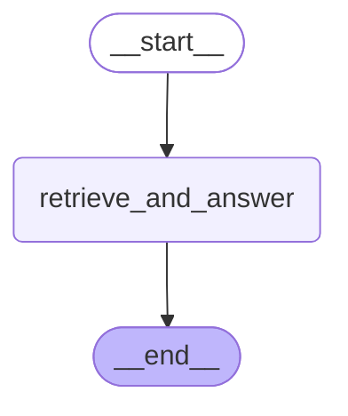

# Policy Q&A Agent with Memory

Complete modules 08–12 first. Estimated project time: 4–8 hours. Default model calls are scripted and cost $0.

## User story

As a customer, I can ask a policy question, inspect its source, and retain my contact preference without seeing another customer's memory.

## Acceptance criteria

Customer memory must use the active identity; unknown questions must abstain.

- Input `{}` must satisfy `{"citations": ["home.md"], "preference": "sms"}`.
- Input `{"customer_id": "CUS-0002"}` must satisfy `{"preference": "email"}`.
- Input `{"question": "quasarxyz"}` must satisfy `{"citations": []}`.
- Input `{"question": "renters deductible"}` must satisfy `{"citations": ["renters.md"]}`.

## Architecture

Generated from the executable reference graph with `draw_mermaid()`; [source](diagram.mmd).



## Build and evaluate

Start with [starter.py](starter.py), which runs but contains a behavioral fault. Keep the `run(case)` contract. Read [the evaluation cases](eval/cases.jsonl) before coding. Use a copy in workspace to preserve your work.

```text
uv run python capstones/02_policy_qa_with_memory/starter.py
uv run python scripts/check_capstone.py 02 --candidate capstones/02_policy_qa_with_memory/starter.py
uv run python scripts/check_capstone.py 02 --candidate capstones/02_policy_qa_with_memory/solution.py
```

The checker loads the selected candidate, not the reference. A mechanical pass does not replace design review. Explain the state boundary, authorization source, failure recovery, and every external effect using [the rubric](rubric.md).

## Reference result

```json
{
  "answer": "# Larkspur Home Essentials\n\nSynthetic educational policy; not an insurance contract or real-world advice.\n\n- Product code: home\n- Maximum payout per claim: $250,000.00\n- Deductible per claim: $1,000.00\n- Covered scenario categories: water, theft, fire, storm, liability\n- Exclusions: flood, wear and tear\n\nFor this course, payout = min(max(covered loss minus deductible, 0), payout limit). Apply this formula only after confirming the covered category and exclusions. The flood product applies only to explicitly labeled flood losses; jewelry applies only to listed jewelry. Other products exclude those special situations unless their add-on is explicitly present. A category alone is not proof of coverage.\n\nA proposed payout over $5,000 requires a recorded adjuster approval. Missing evidence must be requested; suspicious evidence must be reviewed. Never infer approval from a customer's description or from a model-generated statement.\n",
  "citations": [
    "home.md"
  ],
  "preference": "sms"
}
```

[Extend it](extend_it.md) · [Complete reference](solution.py) · [Design choices](../../docs/CHOOSING_THE_RIGHT_DESIGN.md)
