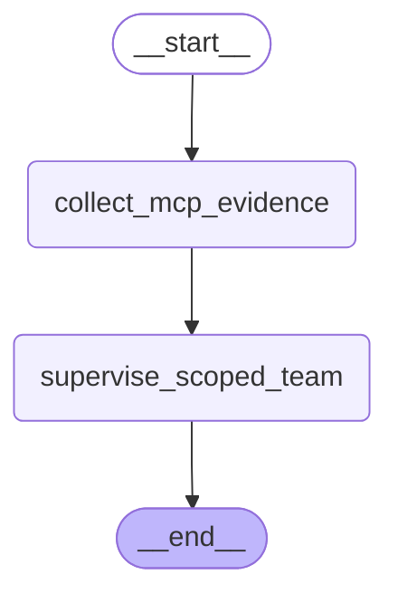

# Fraud Investigation Team

Complete modules 13–17 first. Estimated project time: 4–8 hours. Default model calls are scripted and cost $0.

## User story

As an investigator, I can gather read-only MCP evidence and consult two scoped specialists without treating a risk flag as a verdict.

## Acceptance criteria

The reusable fraud graph must retain evidence-review flags and reject mismatched evidence.

- Input `{}` must satisfy `{"specialists": ["fraud_analyst", "communication_specialist"], "risk_flags": ["high_value"]}`.
- Input `{"amount_cents": 10000}` must satisfy `{"risk_flags": []}`.
- Input `{"claim_id": "CLM-0002"}` must satisfy `{"error": "ValueError"}`.

## Architecture

Generated from the executable reference graph with `draw_mermaid()`; [source](diagram.mmd).



## Build and evaluate

Start with [starter.py](starter.py), which runs but contains a behavioral fault. Keep the `run(case)` contract. Read [the evaluation cases](eval/cases.jsonl) before coding. Use a copy in workspace to preserve your work.

```text
uv run --extra mcp python capstones/03_fraud_investigation_team/starter.py
uv run --extra mcp python scripts/check_capstone.py 03 --candidate capstones/03_fraud_investigation_team/starter.py
uv run --extra mcp python scripts/check_capstone.py 03 --candidate capstones/03_fraud_investigation_team/solution.py
```

The checker loads the selected candidate, not the reference. A mechanical pass does not replace design review. Explain the state boundary, authorization source, failure recovery, and every external effect using [the rubric](rubric.md).

## Reference result

```json
{
  "risk_flags": [
    "high_value"
  ],
  "specialists": [
    "fraud_analyst",
    "communication_specialist"
  ],
  "evidence": {
    "claim_id": "CLM-0001",
    "claim_type": "water",
    "amount_cents": 2096759,
    "route": "specialist"
  }
}
```

[Extend it](extend_it.md) · [Complete reference](solution.py) · [Design choices](../../docs/CHOOSING_THE_RIGHT_DESIGN.md)
