# Larkspur Claims Copilot

Complete modules 18–22 first. Estimated project time: 4–8 hours. Default model calls are scripted and cost $0.

## User story

As a customer, I can submit a claim and see progress; as an adjuster, I can resume its durable wait and authorize a single synthetic effect.

## Acceptance criteria

A rejected claim must never enter the synthetic effect ledger; stale approvals and foreign access must fail.

- Input `{}` must satisfy `{"effects": 1, "foreign_status": 404, "stale_status": 409, "status": "recorded"}`.
- Input `{"approved": false}` must satisfy `{"effects": 0, "status": "not_approved", "customer_approval_status": 403}`.

## Architecture

Generated from the executable reference graph with `draw_mermaid()`; [source](diagram.mmd).

```mermaid
---
config:
  flowchart:
    curve: linear
---
graph TD;
	__start__([<p>__start__</p>]):::first
	publish_summary(publish_summary)
	__end__([<p>__end__</p>]):::last
	__start__ --> secure_claim\3aauthorize_intake;
	secure_claim\3aapprove_payment --> publish_summary;
	publish_summary --> __end__;
	subgraph secure_claim
	secure_claim\3aauthorize_intake(authorize_intake)
	secure_claim\3aapprove_payment(approve_payment)
	secure_claim\3aauthorize_intake --> secure_claim\3areview\3aannounce;
	secure_claim\3areview\3acomplete_review --> secure_claim\3aapprove_payment;
	subgraph review
	secure_claim\3areview\3aannounce(announce)
	secure_claim\3areview\3acomplete_review(complete_review)
	secure_claim\3areview\3aannounce --> secure_claim\3areview\3adurable_review\3aawait_estimate;
	secure_claim\3areview\3adurable_review\3areview_claim\3aconsult_specialists --> secure_claim\3areview\3acomplete_review;
	subgraph durable_review
	secure_claim\3areview\3adurable_review\3aawait_estimate(await_estimate)
	secure_claim\3areview\3adurable_review\3aawait_estimate --> secure_claim\3areview\3adurable_review\3areview_claim\3aintake_policy_memory\3aintake_and_evidence\3aintake\3aextract;
	subgraph review_claim
	secure_claim\3areview\3adurable_review\3areview_claim\3aconsult_specialists(consult_specialists)
	secure_claim\3areview\3adurable_review\3areview_claim\3afraud_review\3ainspect_evidence --> secure_claim\3areview\3adurable_review\3areview_claim\3aconsult_specialists;
	secure_claim\3areview\3adurable_review\3areview_claim\3aintake_policy_memory\3adraft_letter --> secure_claim\3areview\3adurable_review\3areview_claim\3afraud_review\3ainspect_evidence;
	subgraph intake_policy_memory
	secure_claim\3areview\3adurable_review\3areview_claim\3aintake_policy_memory\3aremember(remember)
	secure_claim\3areview\3adurable_review\3areview_claim\3aintake_policy_memory\3adraft_letter(draft_letter)
	secure_claim\3areview\3adurable_review\3areview_claim\3aintake_policy_memory\3aintake_and_evidence\3apolicy_agent --> secure_claim\3areview\3adurable_review\3areview_claim\3aintake_policy_memory\3aremember;
	secure_claim\3areview\3adurable_review\3areview_claim\3aintake_policy_memory\3aremember --> secure_claim\3areview\3adurable_review\3areview_claim\3aintake_policy_memory\3adraft_letter;
	subgraph intake_and_evidence
	secure_claim\3areview\3adurable_review\3areview_claim\3aintake_policy_memory\3aintake_and_evidence\3apolicy_agent(policy_agent)
	secure_claim\3areview\3adurable_review\3areview_claim\3aintake_policy_memory\3aintake_and_evidence\3aintake\3aprocess_claim\3aapprove_claim --> secure_claim\3areview\3adurable_review\3areview_claim\3aintake_policy_memory\3aintake_and_evidence\3apolicy_agent;
	subgraph intake
	secure_claim\3areview\3adurable_review\3areview_claim\3aintake_policy_memory\3aintake_and_evidence\3aintake\3aextract(extract)
	secure_claim\3areview\3adurable_review\3areview_claim\3aintake_policy_memory\3aintake_and_evidence\3aintake\3aextract --> secure_claim\3areview\3adurable_review\3areview_claim\3aintake_policy_memory\3aintake_and_evidence\3aintake\3aprocess_claim\3anormalize;
	subgraph process_claim
	secure_claim\3areview\3adurable_review\3areview_claim\3aintake_policy_memory\3aintake_and_evidence\3aintake\3aprocess_claim\3anormalize(normalize)
	secure_claim\3areview\3adurable_review\3areview_claim\3aintake_policy_memory\3aintake_and_evidence\3aintake\3aprocess_claim\3avalidate(validate)
	secure_claim\3areview\3adurable_review\3areview_claim\3aintake_policy_memory\3aintake_and_evidence\3aintake\3aprocess_claim\3areview_document(review_document)
	secure_claim\3areview\3adurable_review\3areview_claim\3aintake_policy_memory\3aintake_and_evidence\3aintake\3aprocess_claim\3aroute(route<hr/><small><em>defer = True</em></small>)
	secure_claim\3areview\3adurable_review\3areview_claim\3aintake_policy_memory\3aintake_and_evidence\3aintake\3aprocess_claim\3aapprove_claim(approve_claim)
	secure_claim\3areview\3adurable_review\3areview_claim\3aintake_policy_memory\3aintake_and_evidence\3aintake\3aprocess_claim\3anormalize --> secure_claim\3areview\3adurable_review\3areview_claim\3aintake_policy_memory\3aintake_and_evidence\3aintake\3aprocess_claim\3avalidate;
	secure_claim\3areview\3adurable_review\3areview_claim\3aintake_policy_memory\3aintake_and_evidence\3aintake\3aprocess_claim\3areview_document --> secure_claim\3areview\3adurable_review\3areview_claim\3aintake_policy_memory\3aintake_and_evidence\3aintake\3aprocess_claim\3aroute;
	secure_claim\3areview\3adurable_review\3areview_claim\3aintake_policy_memory\3aintake_and_evidence\3aintake\3aprocess_claim\3aroute --> secure_claim\3areview\3adurable_review\3areview_claim\3aintake_policy_memory\3aintake_and_evidence\3aintake\3aprocess_claim\3aapprove_claim;
	secure_claim\3areview\3adurable_review\3areview_claim\3aintake_policy_memory\3aintake_and_evidence\3aintake\3aprocess_claim\3avalidate -.-> secure_claim\3areview\3adurable_review\3areview_claim\3aintake_policy_memory\3aintake_and_evidence\3aintake\3aprocess_claim\3areview_document;
	secure_claim\3areview\3adurable_review\3areview_claim\3aintake_policy_memory\3aintake_and_evidence\3aintake\3aprocess_claim\3avalidate -.-> secure_claim\3areview\3adurable_review\3areview_claim\3aintake_policy_memory\3aintake_and_evidence\3aintake\3aprocess_claim\3aroute;
	end
	end
	end
	end
	end
	end
	end
	end
	classDef default fill:#f2f0ff,line-height:1.2
	classDef first fill-opacity:0
	classDef last fill:#bfb6fc

```



## Build and evaluate

Start with [starter.py](starter.py), which runs but contains a behavioral fault. Keep the `run(case)` contract. Read [the evaluation cases](eval/cases.jsonl) before coding. Use a copy in workspace to preserve your work.

```text
uv run --extra apps python capstones/04_larkspur_claims_copilot/starter.py
uv run --extra apps python scripts/check_capstone.py 04 --candidate capstones/04_larkspur_claims_copilot/starter.py
uv run --extra apps python scripts/check_capstone.py 04 --candidate capstones/04_larkspur_claims_copilot/solution.py
```

The checker loads the selected candidate, not the reference. A mechanical pass does not replace design review. Explain the state boundary, authorization source, failure recovery, and every external effect using [the rubric](rubric.md).

## Reference result

```json
{
  "created": 201,
  "foreign_status": 404,
  "customer_approval_status": 403,
  "stale_status": 409,
  "effects": 1,
  "status": "recorded",
  "progress_events": 2
}
```

[Extend it](extend_it.md) · [Complete reference](solution.py) · [Design choices](../../docs/CHOOSING_THE_RIGHT_DESIGN.md)

## Run the complete application

The solution exercises the real HTTP handlers in process. [FastAPI](../../apps/api.py), [dashboard](../../apps/dashboard.py), [server lifecycle](../../apps/server.py), and [Compose](../../compose.yaml) form the deployable application. Follow [deployment instructions](../../docs/DEPLOYMENT.md) for Postgres, streaming, restart recovery, credentials, and operational limits.
