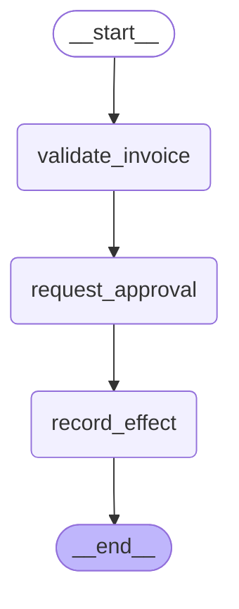

# Design Your Own: Invoice Approval

Complete modules 18–22 first. Estimated project time: 4–8 hours. Default model calls are scripted and cost $0.

## User story

As an invoice owner, I can request approval; only an authenticated approver may decide, and replay cannot duplicate the effect.

## Acceptance criteria

Only positive integer amounts and explicit authorized approvals may produce effects.

- Input `{}` must satisfy `{"approved": true, "effects": 1}`.
- Input `{"approved": false}` must satisfy `{"approved": false, "effects": 0}`.
- Input `{"role": "customer"}` must satisfy `{"error": "PermissionError"}`.
- Input `{"amount_cents": -1}` must satisfy `{"error": "ValueError"}`.
- Input `{"amount_cents": true}` must satisfy `{"error": "ValueError"}`.
- Input `{"approved": "yes"}` must satisfy `{"error": "ValueError"}`.

## Architecture

Generated from the executable reference graph with `draw_mermaid()`; [source](diagram.mmd).



## Build and evaluate

Start with [starter.py](starter.py), which runs but contains a behavioral fault. Keep the `run(case)` contract. Read [the evaluation cases](eval/cases.jsonl) before coding. Use a copy in workspace to preserve your work.

```text
uv run python capstones/05_design_your_own/starter.py
uv run python scripts/check_capstone.py 05 --candidate capstones/05_design_your_own/starter.py
uv run python scripts/check_capstone.py 05 --candidate capstones/05_design_your_own/solution.py
```

The checker loads the selected candidate, not the reference. A mechanical pass does not replace design review. Explain the state boundary, authorization source, failure recovery, and every external effect using [the rubric](rubric.md).

## Reference result

```json
{
  "approved": true,
  "effects": 1
}
```

[Extend it](extend_it.md) · [Complete reference](solution.py) · [Design choices](../../docs/CHOOSING_THE_RIGHT_DESIGN.md)

## Your design document

Choose a business process and write: actors and trust boundaries; state schema and reducers; success and rejection paths; thread identity; durable waits; effect idempotency; data retention; failure tests; and deployment choice. The invoice reference is one worked example. If you choose another domain, replace the evaluation set with independently justified requirements before coding.
