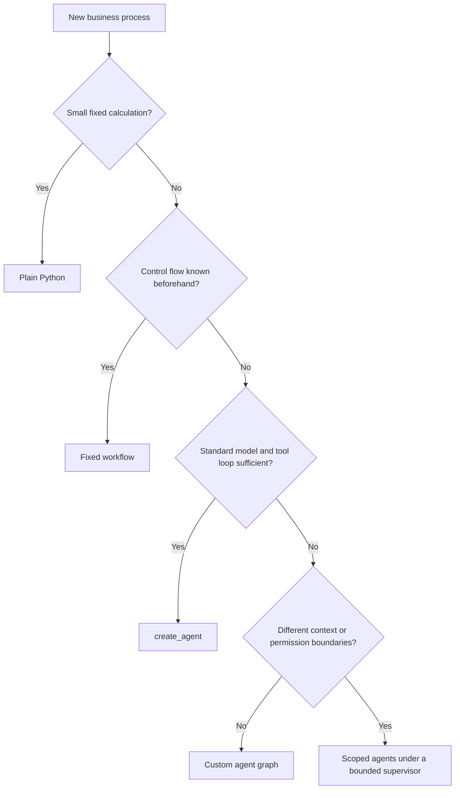
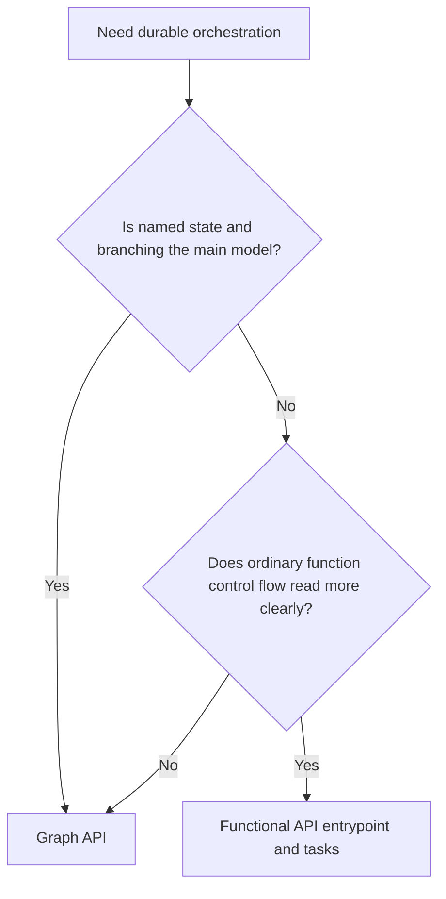
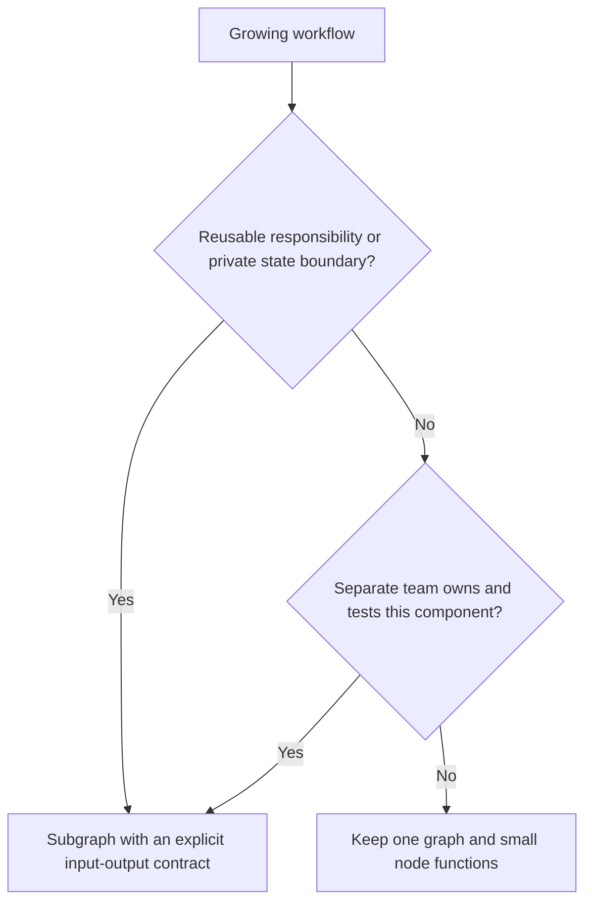

# Choose the smallest design that meets the requirement

These are conceptual decision diagrams. Start with an observable requirement: a pause, recovery after failure, dynamic tool selection, or separately testable ownership. A graph is not a requirement by itself.

A payout formula belongs in a pure function. Gathering documents, waiting for an estimate, and asking an adjuster are workflow steps. Policy Q&A can use an agent to choose a read-only retrieval tool. An agent that must follow a precise approval protocol may need explicit graph nodes around its tool loop. Multiple agents are useful when specialists need different tools or private context; they add calls, latency, and coordination failures.

Both APIs use durable execution. Graph nodes make state transitions and possible routes visible. Functional tasks preserve results across re-entry while normal Python expresses orchestration. Neither API makes arbitrary external effects automatically safe to repeat. Test the failure boundary, not just the syntax.

Use a shared-schema subgraph only for genuinely shared fields. Use an adapter when private messages or internal bookkeeping must stay private. Decide whether the child inherits the parent's checkpoint lifecycle or owns independent threads before adding persistence.

For every design, write five answers: who can start it; who can resume it; what is saved; what might repeat; and how you detect a duplicate effect. Compare your answers with the [capstone rubric](../capstones/05_design_your_own/rubric.md) and [official workflows and agents guide](https://docs.langchain.com/oss/python/langgraph/workflows-agents).
