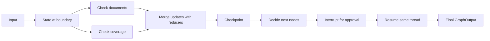

# One invocation, several saved boundaries

Think of a claim folder moving between desks. **State** is the folder's contents. A **channel** is one named field and its update rule. A **node** reads the folder and returns only the fields it changes. An **edge** schedules later work; it does not carry a private copy of all the data.

This is a conceptual execution diagram. Executable graph diagrams are beside the module examples.

| Superstep | What nodes can see | What becomes visible afterward |
| --- | --- | --- |
| 0 | Initial claim | Normalized fields |
| 1 | Both checks see the same normalized claim | Both check results merge |
| 2 | The decision sees merged findings | A route or an approval request |

A reducer combines writes, such as appending findings. Without a reducer, two simultaneous writes to one ordinary field conflict. A node cannot see a sibling's unfinished update. A normal sequential edge moves work into a later superstep; `Send` creates independently parameterized work.

A **checkpoint** records a recoverable execution boundary. A **thread ID** chooses the sequence of checkpoints for one conversation or business process. Reusing a thread intentionally continues its state; inventing a new ID starts separate history. A checkpoint is not an external payment receipt.

`graph.invoke(input, config, version="v2")` runs until completion or interruption. Read `result.value` for state and `result.interrupts` for requests. An interrupt saves a wait; it does not hold a Python stack alive. Resume the same thread with `Command(resume=...)`. The interrupted node starts again, so work before the interrupt may repeat. Put repeatable work there; protect external effects with a durable idempotency key.

Streaming observes this execution. In v2, each part contains `type`, `ns`, and `data`: the kind of observation, its subgraph namespace, and its payload. Updates report changes; values report state; messages report model chunks. Streaming does not itself make execution durable. Saving a checkpoint does not make a stream a replayable event log.

[Practice reducers](../modules/02_state_and_reducers/README.md) · [Course feature map](FEATURE_MAP.md) · [Official Graph API](https://docs.langchain.com/oss/python/langgraph/graph-api)
