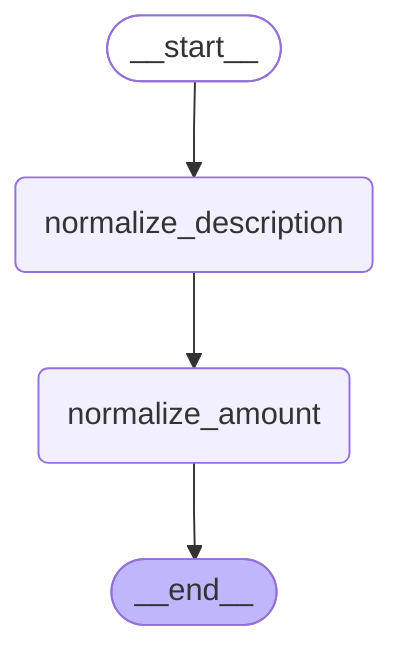
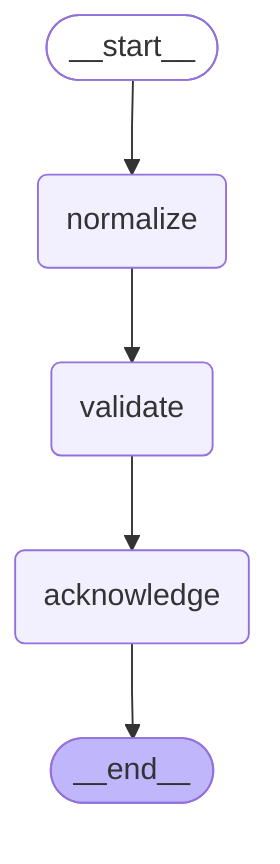
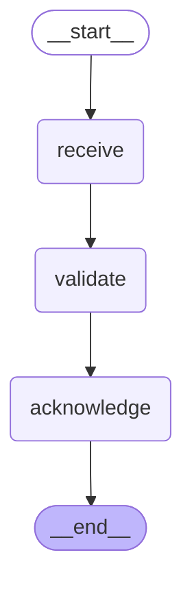

# 01 — Your first graph

> After this module you can normalize a claim through a deterministic intake pipeline.

**Time:** 75 minutes · **Level:** Beginner · **LLM needed:** No live model · **Cost:** $0 with the included fakes.

**Larkspur Claims Copilot v01** · Practice takes additional time.

## Prerequisites

Complete [Setup and orientation](../00_setup/README.md). Read dictionary keys, functions, and Python type hints comfortably. Run uv sync from the repository root.

Optional installation requirements are listed in [the setup guide](../../docs/OPTIONAL_DEPENDENCIES.md). Use `uv run --no-sync` after installing extras so subsequent commands retain that environment.

## Learning objectives

- Implement and explain StateGraph; TypedDict state; nodes as functions; partial node updates.
- Implement and explain add_node; add_edge; START and END; compile; invoke with GraphOutput.value.
- Implement and explain get_graph().draw_mermaid(); graph visualization; sequential supersteps.

## The big idea

Normalize a claim through a deterministic intake pipeline. Predict the state before running code, then compare the observed result. A state is the data visible to a node; a node is one unit of work; an edge selects later work. A checkpoint is a saved state boundary, not a promise that an external effect happened exactly once.

## How it works

### Intake Nodes

State is the information available to a graph. TypedDict documents its keys. A node is a function that reads state and returns only the keys it changes; the graph merges those updates instead of replacing the whole state.

Each desk adds a note to the same claim folder rather than throwing the folder away.



### Wire Pipeline

Edges declare which node can run next. START is the entry point and END marks termination. compile checks the graph and creates an executable object. Explicit v2 invoke returns GraphOutput; its value is the final state.

A checklist needs arrows as well as boxes; an unconnected desk never receives the folder.



### Draw And Explain

A generated diagram shows the compiled edges rather than a hand-drawn guess. In a sequential graph each node runs in a later superstep, a batch of work that sees the previous batch's committed updates. Updates reveal which node actually ran.

Compare the building plan with the visitor log: one describes possibilities, the other records a visit.



## Key APIs at a glance

| API / executable example | What it does | When to use it |
| --- | --- | --- |
| StateGraph — [01_intake_nodes.py](examples/01_intake_nodes.py) | StateGraph; TypedDict state; nodes as functions; partial node updates | State is the information available to a graph. |
| StateGraph — [02_wire_pipeline.py](examples/02_wire_pipeline.py) | add_node; add_edge; START and END; compile; invoke with GraphOutput.value | Edges declare which node can run next. |
| StateGraph — [03_draw_and_explain.py](examples/03_draw_and_explain.py) | get_graph().draw_mermaid(); graph visualization; sequential supersteps | A generated diagram shows the compiled edges rather than a hand-drawn guess. |

## Walkthrough

Run commands from the repository root; the same commands work in PowerShell, macOS, and Linux. Open the source alongside the output. Find the state declaration, node functions, graph connections, and invocation. For a failure, start with the earliest changed field or scheduled node.

```text
uv run python modules/01_your_first_graph/examples/01_intake_nodes.py
```

**Predict, then run:** for {"claim_id": "CLM-0001", "description": "  Pipe burst  ", "amount_cents": "125000"}, write the resulting fields and any expected error. Then test the boundary cases in tests/intake_nodes.json.

<details>
<summary>Reveal the checked result</summary>

```json
{
  "value": {
    "claim_id": "CLM-0001",
    "description": "Pipe burst",
    "amount_cents": 125000
  }
}
```

State is the information available to a graph. TypedDict documents its keys. A node is a function that reads state and returns only the keys it changes; the graph merges those updates instead of replacing the whole state.

</details>

```text
uv run python modules/01_your_first_graph/examples/02_wire_pipeline.py
```

**Predict, then run:** for {"claim_id": "CLM-0001", "description": " Water leak ", "steps": []}, write the resulting fields and any expected error. Then test the boundary cases in tests/wire_pipeline.json.

<details>
<summary>Reveal the checked result</summary>

```json
{
  "value": {
    "claim_id": "CLM-0001",
    "description": "Water leak",
    "status": "ready",
    "acknowledged": true,
    "steps": [
      "normalize",
      "validate",
      "acknowledge"
    ]
  }
}
```

Edges declare which node can run next. START is the entry point and END marks termination. compile checks the graph and creates an executable object. Explicit v2 invoke returns GraphOutput; its value is the final state.

</details>

```text
uv run python modules/01_your_first_graph/examples/03_draw_and_explain.py
```

**Predict, then run:** for {"claim_id": "CLM-0001", "description": "Pipe burst"}, write the resulting fields and any expected error. Then test the boundary cases in tests/draw_and_explain.json.

<details>
<summary>Reveal the checked result</summary>

```json
{
  "value": {
    "steps": [
      "receive",
      "validate",
      "acknowledge"
    ],
    "updates": [
      {
        "receive": {
          "received": true
        }
      },
      {
        "validate": {
          "valid": true
        }
      },
      {
        "acknowledge": {
          "acknowledged": true
        }
      }
    ]
  }
}
```

A generated diagram shows the compiled edges rather than a hand-drawn guess. In a sequential graph each node runs in a later superstep, a batch of work that sees the previous batch's committed updates. Updates reveal which node actually ran.

</details>

When build_graph needs no arguments, its generated Mermaid diagram is saved beside the example. A diagram records possible edges; a runtime stream records executed work. A single sequence advances one node per superstep. Parallel nodes see the same previous boundary, so they cannot read a sibling's unfinished update.

## When to use it, and when not to

Use these contracts when the claim needs the state or control-flow behavior described above. Keep pure arithmetic and validation in ordinary functions that can be tested independently. A graph, checkpoint, or extra agent adds operational choices; justify it with a concrete failure, pause, branch, or reuse requirement.

## Real-world use case

Normalize a claim through a deterministic intake pipeline. The executable milestone uses only fictional records and the shared v01 implementation. [Read the use case](use_case/claims_copilot.py).

```text
uv run python modules/01_your_first_graph/use_case/claims_copilot.py
```

Sample output from the synthetic default case:

```json
{
  "claim": {
    "amount_cents": 2096759,
    "claim_id": "CLM-0001",
    "claim_type": "water",
    "customer_id": "CUS-0001",
    "description": "Pipe burst",
    "documents": [
      "DOC-001"
    ],
    "duplicate_of": null,
    "fraud_indicators": [],
    "loss_date": "2026-01-01",
    "policy_id": "POL-0001"
  },
  "missing": [],
  "route": "specialist",
  "audit": [
    "normalized",
    "validated",
    "routed"
  ],
  "findings": []
}
```

A real team would connect this boundary to validated records and authenticated roles, then retain the same rejection, ownership, and recovery checks.

## Common bugs

| Symptom or broken contract | Cause and repair | Practice |
| --- | --- | --- |
| Observed `{"value": {"claim_id": "CLM-0001", "description": "  Pipe burst  ", "amount_cents": 125000}}`. Normalize the description while preserving unrelated state. | Restore `state["description"].strip()` and check the boundary cases. | [01-01](../../gym/tasks/01/01-01_intake_nodes_build/task.md) |
| Observed `{"error": "InvalidUpdateError"}`. A graph node must return a mapping of state updates. | Restore `return {"amount_cents": int(amount)}` and check the boundary cases. | [01-02](../../gym/tasks/01/01-02_intake_nodes_fix/task.md) |
| Observed `{"value": {"claim_id": "CLM-0001", "description": "Water leak", "status": "ready", "steps": ["normalize", "validate"]}}`. The acknowledgment must be reachable. | Restore `graph.add_edge("validate", "acknowledge")` and check the boundary cases. | [01-07](../../gym/tasks/01/01-07_wire_pipeline_build/task.md) |
| Observed `{"value": {"claim_id": "CLM-0001", "description": "Water leak", "acknowledged": true, "steps": ["normalize", "acknowledge"]}}`. Validation must occur before acknowledging the claim. | Restore `graph.add_edge("normalize", "validate")` and check the boundary cases. | [01-08](../../gym/tasks/01/01-08_wire_pipeline_fix/task.md) |
| Observed `{"value": {"steps": ["receive", "acknowledge"], "updates": [{"receive": {"received": true}}, {"acknowledge": {"acknowledged": true}}]}}`. The diagram must include validation on the executed route. | Restore `graph.add_edge("receive", "validate")` and check the boundary cases. | [01-13](../../gym/tasks/01/01-13_draw_and_explain_build/task.md) |
| Observed `{"value": {"steps": ["receive", "validate"], "updates": [{"receive": {"received": true}}, {"validate": {"valid": true}}]}}`. The intended final node must be connected. | Restore `graph.add_edge("validate", "acknowledge")` and check the boundary cases. | [01-14](../../gym/tasks/01/01-14_draw_and_explain_fix/task.md) |

## Practice

- [01-01 — build, easy](../../gym/tasks/01/01-01_intake_nodes_build/task.md): Build intake nodes: Normalize the description while preserving unrelated state.
- [01-02 — fix, medium](../../gym/tasks/01/01-02_intake_nodes_fix/task.md): Fix intake nodes: A graph node must return a mapping of state updates.
- [01-03 — predict, easy](../../gym/tasks/01/01-03_intake_nodes_predict/task.md): Predict intake nodes across the declared cases
- [01-04 — trace, medium](../../gym/tasks/01/01-04_intake_nodes_trace/task.md): Trace intake nodes: A graph node must return a mapping of state updates.
- [01-05 — extend, hard](../../gym/tasks/01/01-05_intake_nodes_extend/task.md): Extend intake nodes: An amount update must not erase the claim identifier.
- [01-06 — refactor, hard](../../gym/tasks/01/01-06_intake_nodes_refactor/task.md): Refactor intake nodes: Refactor mutation into a pure partial update.
- [01-07 — build, easy](../../gym/tasks/01/01-07_wire_pipeline_build/task.md): Build wire pipeline: The acknowledgment must be reachable.
- [01-08 — fix, medium](../../gym/tasks/01/01-08_wire_pipeline_fix/task.md): Fix wire pipeline: Validation must occur before acknowledging the claim.
- [01-09 — predict, easy](../../gym/tasks/01/01-09_wire_pipeline_predict/task.md): Predict wire pipeline across the declared cases
- [01-10 — trace, medium](../../gym/tasks/01/01-10_wire_pipeline_trace/task.md): Trace wire pipeline: Validation must occur before acknowledging the claim.
- [01-11 — extend, hard](../../gym/tasks/01/01-11_wire_pipeline_extend/task.md): Extend wire pipeline: A completed acknowledgment must be visible in output.
- [01-12 — refactor, hard](../../gym/tasks/01/01-12_wire_pipeline_refactor/task.md): Refactor wire pipeline: Refactoring must preserve the complete execution sequence.
- [01-13 — build, easy](../../gym/tasks/01/01-13_draw_and_explain_build/task.md): Build draw and explain: The diagram must include validation on the executed route.
- [01-14 — fix, medium](../../gym/tasks/01/01-14_draw_and_explain_fix/task.md): Fix draw and explain: The intended final node must be connected.
- [01-15 — predict, easy](../../gym/tasks/01/01-15_draw_and_explain_predict/task.md): Predict draw and explain across the declared cases
- [01-16 — trace, medium](../../gym/tasks/01/01-16_draw_and_explain_trace/task.md): Trace draw and explain: The intended final node must be connected.
- [01-17 — extend, hard](../../gym/tasks/01/01-17_draw_and_explain_extend/task.md): Extend draw and explain: Eligibility evidence must affect the validation result.
- [01-18 — design, hard](../../gym/tasks/01/01-18_draw_and_explain_design/task.md): Design draw and explain and justify the boundary policies

Start with tasks 01, 02, 09, 10, 17, and 18 in this module. Finish the other tasks for full practice. Hints are progressive; solution exposure is recorded. Predict and Trace tasks use answer JSON, not a code starter.

## Quiz

Predict first; explain in your own words.

1. Explain the contract in 01_intake_nodes.py using one claim from its input cases.
2. Diagnose this broken behavior: A graph node must return a mapping of state updates. Which observation distinguishes the repair from a default-case-only fix?
3. Explain the contract in 02_wire_pipeline.py using one claim from its input cases.
4. Diagnose this broken behavior: Validation must occur before acknowledging the claim. Which observation distinguishes the repair from a default-case-only fix?
5. Explain the contract in 03_draw_and_explain.py using one claim from its input cases.
6. Diagnose this broken behavior: The intended final node must be connected. Which observation distinguishes the repair from a default-case-only fix?

<details>
<summary>Answers</summary>

1. State is the information available to a graph. TypedDict documents its keys. A node is a function that reads state and returns only the keys it changes; the graph merges those updates instead of replacing the whole state.
2. A graph node must return a mapping of state updates. Compare the normal case with the boundary fixtures and identify the first differing update.
3. Edges declare which node can run next. START is the entry point and END marks termination. compile checks the graph and creates an executable object. Explicit v2 invoke returns GraphOutput; its value is the final state.
4. Validation must occur before acknowledging the claim. Compare the normal case with the boundary fixtures and identify the first differing update.
5. A generated diagram shows the compiled edges rather than a hand-drawn guess. In a sequential graph each node runs in a later superstep, a batch of work that sees the previous batch's committed updates. Updates reveal which node actually ran.
6. The intended final node must be connected. Compare the normal case with the boundary fixtures and identify the first differing update.

</details>

## Cost and safety

The default commands cost $0: deterministic Python and, in model lessons, scripted local fakes. They consume no hosted tokens and make no real payments or emails. Optional live experiments use the provider configured in .env; a short one-to-four-call exercise is usually cents, but verify your provider's current token prices and set a budget. Ollama can run locally without a hosted bill. Temporary checkpoint files are isolated from the committed dataset. Keep real customer details and credentials out of graph state.

## Key takeaways

- State visibility and update rules determine what a node can safely assume.
- Check normal, missing, boundary, and failure cases before trusting a workflow.
- Separate observed execution from diagrams, predictions, and durable history.
- Model output is evidence to validate, never an authorization grant.
- A saved checkpoint and an external effect have separate durability boundaries.

## Go deeper

- [intake nodes official guide](https://docs.langchain.com/oss/python/langgraph/graph-api)
- [wire pipeline official guide](https://docs.langchain.com/oss/python/langgraph/graph-api-control-flow)
- [draw and explain official guide](https://docs.langchain.com/oss/python/langgraph/graph-api)

## Next:

Continue to [module 02: State and reducers](../../modules/02_state_and_reducers/README.md).
