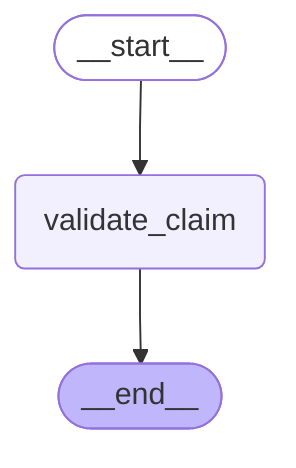
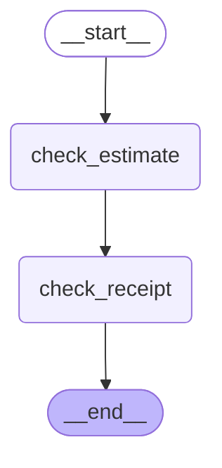
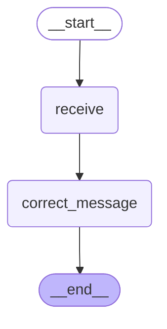

# 02 — State and reducers

> After this module you can accumulate validation findings without losing earlier evidence.

**Time:** 105 minutes · **Level:** Beginner · **LLM needed:** No live model · **Cost:** $0 with the included fakes.

**Larkspur Claims Copilot v01** · Practice takes additional time.

## Prerequisites

Complete [Your first graph](../01_your_first_graph/README.md). Read dictionary keys, functions, and Python type hints comfortably. Run uv sync from the repository root.

Optional installation requirements are listed in [the setup guide](../../docs/OPTIONAL_DEPENDENCIES.md). Use `uv run --no-sync` after installing extras so subsequent commands retain that environment.

## Learning objectives

- Implement and explain TypedDict, dataclass, and Pydantic schemas; defaults; input validation; v2 output coercion.
- Implement and explain Overwrite channels; Annotated reducers; operator.add; custom reducers; associativity.
- Implement and explain Input and output schemas; private state channels; MessagesState introduction; add_messages introduction.

## The big idea

Accumulate validation findings without losing earlier evidence. Predict the state before running code, then compare the observed result. A state is the data visible to a node; a node is one unit of work; an edge selects later work. A checkpoint is a saved state boundary, not a promise that an external effect happened exactly once.

## How it works

### Schema Contracts

TypedDict describes a dictionary for type checking; it does not validate values at runtime. Dataclasses give attribute access and defaults. Pydantic checks fields at the boundary. With explicit v2 output, preserve the schema's object type before extracting its fields.

A form template, a filled form object, and a clerk checking the form are different services.



### Reducer Findings

A channel is one state field together with its update rule. The default rule overwrites. An Annotated reducer combines the old and new values. Associativity means grouping updates differently does not change the result, which matters when branches complete in batches.

Merge independent evidence envelopes without treating the last envelope as the whole case.



### State Boundaries

Input and output schemas define an API boundary; private channels can still exist inside the graph. Messages are records with roles, text, and IDs. add_messages appends new IDs and replaces an existing ID, so correcting one message need not duplicate it.

The customer copy of a file omits the adjuster's internal worksheet.



## Key APIs at a glance

| API / executable example | What it does | When to use it |
| --- | --- | --- |
| StateGraph — [01_schema_contracts.py](examples/01_schema_contracts.py) | TypedDict, dataclass, and Pydantic schemas; defaults; input validation; v2 output coercion | TypedDict describes a dictionary for type checking; it does not validate values at runtime. |
| StateGraph — [02_reducer_findings.py](examples/02_reducer_findings.py) | Overwrite channels; Annotated reducers; operator.add; custom reducers; associativity | A channel is one state field together with its update rule. |
| AnyMessage, HumanMessage, StateGraph, add_messages — [03_state_boundaries.py](examples/03_state_boundaries.py) | Input and output schemas; private state channels; MessagesState introduction; add_messages introduction | Input and output schemas define an API boundary; private channels can still exist inside the graph. |

## Walkthrough

Run commands from the repository root; the same commands work in PowerShell, macOS, and Linux. Open the source alongside the output. Find the state declaration, node functions, graph connections, and invocation. For a failure, start with the earliest changed field or scheduled node.

```text
uv run python modules/02_state_and_reducers/examples/01_schema_contracts.py
```

**Predict, then run:** for {"kind": "pydantic", "amount_cents": 125000, "claim_id": "CLM-0001"}, write the resulting fields and any expected error. Then test the boundary cases in tests/schema_contracts.json.

<details>
<summary>Reveal the checked result</summary>

```json
{
  "value": {
    "output_type": "ClaimModel",
    "value": {
      "claim_id": "CLM-0001",
      "amount_cents": 125000,
      "status": "validated"
    }
  }
}
```

TypedDict describes a dictionary for type checking; it does not validate values at runtime. Dataclasses give attribute access and defaults. Pydantic checks fields at the boundary. With explicit v2 output, preserve the schema's object type before extracting its fields.

</details>

```text
uv run python modules/02_state_and_reducers/examples/02_reducer_findings.py
```

**Predict, then run:** for {"first": {"id": "receipt", "severity": 1}, "second": {"id": "receipt", "severity": 3}}, write the resulting fields and any expected error. Then test the boundary cases in tests/reducer_findings.json.

<details>
<summary>Reveal the checked result</summary>

```json
{
  "value": {
    "findings": [
      {
        "id": "receipt",
        "severity": 3
      }
    ],
    "log": [
      "estimate",
      "receipt"
    ],
    "last": "receipt"
  }
}
```

A channel is one state field together with its update rule. The default rule overwrites. An Annotated reducer combines the old and new values. Associativity means grouping updates differently does not change the result, which matters when branches complete in batches.

</details>

```text
uv run python modules/02_state_and_reducers/examples/03_state_boundaries.py
```

**Predict, then run:** for {"claim_id": "CLM-0001", "text": "  Pipe burst  "}, write the resulting fields and any expected error. Then test the boundary cases in tests/state_boundaries.json.

<details>
<summary>Reveal the checked result</summary>

```json
{
  "value": {
    "fields": [
      "claim_id",
      "messages"
    ],
    "claim_id": "CLM-0001",
    "messages": [
      {
        "id": "customer-1",
        "content": "Pipe burst"
      }
    ]
  }
}
```

Input and output schemas define an API boundary; private channels can still exist inside the graph. Messages are records with roles, text, and IDs. add_messages appends new IDs and replaces an existing ID, so correcting one message need not duplicate it.

</details>

When build_graph needs no arguments, its generated Mermaid diagram is saved beside the example. A diagram records possible edges; a runtime stream records executed work. A single sequence advances one node per superstep. Parallel nodes see the same previous boundary, so they cannot read a sibling's unfinished update.

## When to use it, and when not to

Use these contracts when the claim needs the state or control-flow behavior described above. Keep pure arithmetic and validation in ordinary functions that can be tested independently. A graph, checkpoint, or extra agent adds operational choices; justify it with a concrete failure, pause, branch, or reuse requirement.

## Real-world use case

Accumulate validation findings without losing earlier evidence. The executable milestone uses only fictional records and the shared v01 implementation. [Read the use case](use_case/claims_copilot.py).

```text
uv run python modules/02_state_and_reducers/use_case/claims_copilot.py
```

Sample output from the synthetic default case:

```json
{
  "missing": [
    "description",
    "loss_date"
  ],
  "findings": [
    "missing:description",
    "missing:loss_date"
  ],
  "audit": [
    "normalized",
    "validated",
    "routed"
  ]
}
```

A real team would connect this boundary to validated records and authenticated roles, then retain the same rejection, ownership, and recovery checks.

## Common bugs

| Symptom or broken contract | Cause and repair | Practice |
| --- | --- | --- |
| Observed `{"value": {"output_type": "ClaimModel", "value": {"claim_id": "CLM-0001", "amount_cents": 125000, "status": "received"}}}`. A successful validation node must record its result. | Restore `return {"status": "validated"}` and check the boundary cases. | [02-01](../../gym/tasks/02/02-01_schema_contracts_build/task.md) |
| Observed `{"error": "ValueError"}`. Use Pydantic field access or model_dump instead of losing validated values. | Restore `return state.model_dump()` and check the boundary cases. | [02-02](../../gym/tasks/02/02-02_schema_contracts_fix/task.md) |
| Observed `{"value": {"findings": [{"id": "receipt", "severity": 3}], "log": ["estimate", "receipt"], "last": "receipt"}}`. A merge must preserve evidence from earlier updates. | Restore `indexed = {item["id"]: dict(item) for item in left}` and check the boundary cases. | [02-07](../../gym/tasks/02/02-07_reducer_findings_build/task.md) |
| Observed `{"value": {"findings": [{"id": "receipt", "severity": 3}], "log": ["estimate", "estimate", "receipt"], "last": "receipt"}}`. Return new evidence only; the reducer already has previous values. | Restore `"log": ["receipt"]` and check the boundary cases. | [02-08](../../gym/tasks/02/02-08_reducer_findings_fix/task.md) |
| Observed `{"value": {"fields": ["claim_id", "messages", "private_notes", "text"], "claim_id": "CLM-0001", "messages": [{"id": "customer-1", "content": "Pipe burst"}]}}`. Internal channels must not become public output. | Restore `output_schema=Output` and check the boundary cases. | [02-13](../../gym/tasks/02/02-13_state_boundaries_build/task.md) |
| Observed `{"value": {"fields": ["claim_id", "messages"], "claim_id": "CLM-0001", "messages": [{"id": "customer-1", "content": "  Pipe burst  "}, {"id": "customer-2", "content": "Pipe burst"}]}}`. Use the same message ID to replace the original message. | Restore `state["text"].strip(), id="customer-1"` and check the boundary cases. | [02-14](../../gym/tasks/02/02-14_state_boundaries_fix/task.md) |

## Practice

- [02-01 — build, easy](../../gym/tasks/02/02-01_schema_contracts_build/task.md): Build schema contracts: A successful validation node must record its result.
- [02-02 — fix, medium](../../gym/tasks/02/02-02_schema_contracts_fix/task.md): Fix schema contracts: Use Pydantic field access or model_dump instead of losing validated values.
- [02-03 — predict, easy](../../gym/tasks/02/02-03_schema_contracts_predict/task.md): Predict schema contracts across the declared cases
- [02-04 — trace, medium](../../gym/tasks/02/02-04_schema_contracts_trace/task.md): Trace schema contracts: Use Pydantic field access or model_dump instead of losing validated values.
- [02-05 — extend, hard](../../gym/tasks/02/02-05_schema_contracts_extend/task.md): Extend schema contracts: The positive-amount contract excludes zero.
- [02-06 — refactor, hard](../../gym/tasks/02/02-06_schema_contracts_refactor/task.md): Refactor schema contracts: Converting schema styles must preserve valid values.
- [02-07 — build, easy](../../gym/tasks/02/02-07_reducer_findings_build/task.md): Build reducer findings: A merge must preserve evidence from earlier updates.
- [02-08 — fix, medium](../../gym/tasks/02/02-08_reducer_findings_fix/task.md): Fix reducer findings: Return new evidence only; the reducer already has previous values.
- [02-09 — predict, easy](../../gym/tasks/02/02-09_reducer_findings_predict/task.md): Predict reducer findings across the declared cases
- [02-10 — trace, medium](../../gym/tasks/02/02-10_reducer_findings_trace/task.md): Trace reducer findings: Return new evidence only; the reducer already has previous values.
- [02-11 — extend, hard](../../gym/tasks/02/02-11_reducer_findings_extend/task.md): Extend reducer findings: Severity must not decrease when a later finding is weaker.
- [02-12 — refactor, hard](../../gym/tasks/02/02-12_reducer_findings_refactor/task.md): Refactor reducer findings: Canonical presentation must not depend on arrival order.
- [02-13 — build, easy](../../gym/tasks/02/02-13_state_boundaries_build/task.md): Build state boundaries: Internal channels must not become public output.
- [02-14 — fix, medium](../../gym/tasks/02/02-14_state_boundaries_fix/task.md): Fix state boundaries: Use the same message ID to replace the original message.
- [02-15 — predict, easy](../../gym/tasks/02/02-15_state_boundaries_predict/task.md): Predict state boundaries across the declared cases
- [02-16 — trace, medium](../../gym/tasks/02/02-16_state_boundaries_trace/task.md): Trace state boundaries: Use the same message ID to replace the original message.
- [02-17 — extend, hard](../../gym/tasks/02/02-17_state_boundaries_extend/task.md): Extend state boundaries: Customer-facing correction must normalize text.
- [02-18 — refactor, hard](../../gym/tasks/02/02-18_state_boundaries_refactor/task.md): Refactor state boundaries: A refactored input boundary must still supply the fields its nodes read.

Start with tasks 01, 02, 09, 10, 17, and 18 in this module. Finish the other tasks for full practice. Hints are progressive; solution exposure is recorded. Predict and Trace tasks use answer JSON, not a code starter.

## Quiz

Predict first; explain in your own words.

1. Explain the contract in 01_schema_contracts.py using one claim from its input cases.
2. Diagnose this broken behavior: Use Pydantic field access or model_dump instead of losing validated values. Which observation distinguishes the repair from a default-case-only fix?
3. Explain the contract in 02_reducer_findings.py using one claim from its input cases.
4. Diagnose this broken behavior: Return new evidence only; the reducer already has previous values. Which observation distinguishes the repair from a default-case-only fix?
5. Explain the contract in 03_state_boundaries.py using one claim from its input cases.
6. Diagnose this broken behavior: Use the same message ID to replace the original message. Which observation distinguishes the repair from a default-case-only fix?

<details>
<summary>Answers</summary>

1. TypedDict describes a dictionary for type checking; it does not validate values at runtime. Dataclasses give attribute access and defaults. Pydantic checks fields at the boundary. With explicit v2 output, preserve the schema's object type before extracting its fields.
2. Use Pydantic field access or model_dump instead of losing validated values. Compare the normal case with the boundary fixtures and identify the first differing update.
3. A channel is one state field together with its update rule. The default rule overwrites. An Annotated reducer combines the old and new values. Associativity means grouping updates differently does not change the result, which matters when branches complete in batches.
4. Return new evidence only; the reducer already has previous values. Compare the normal case with the boundary fixtures and identify the first differing update.
5. Input and output schemas define an API boundary; private channels can still exist inside the graph. Messages are records with roles, text, and IDs. add_messages appends new IDs and replaces an existing ID, so correcting one message need not duplicate it.
6. Use the same message ID to replace the original message. Compare the normal case with the boundary fixtures and identify the first differing update.

</details>

## Cost and safety

The default commands cost $0: deterministic Python and, in model lessons, scripted local fakes. They consume no hosted tokens and make no real payments or emails. Optional live experiments use the provider configured in .env; a short one-to-four-call exercise is usually cents, but verify your provider's current token prices and set a budget. Ollama can run locally without a hosted bill. Temporary checkpoint files are isolated from the committed dataset. Keep real customer details and credentials out of graph state.

## Key takeaways

- State visibility and update rules determine what a node can safely assume.
- Check normal, missing, boundary, and failure cases before trusting a workflow.
- Separate observed execution from diagrams, predictions, and durable history.
- Model output is evidence to validate, never an authorization grant.
- A saved checkpoint and an external effect have separate durability boundaries.

## Go deeper

- [schema contracts official guide](https://docs.langchain.com/oss/python/langgraph/graph-api-state)
- [reducer findings official guide](https://docs.langchain.com/oss/python/langgraph/graph-api-state)
- [state boundaries official guide](https://docs.langchain.com/oss/python/langgraph/graph-api-state)

## Next:

Continue to [module 03: Branching and routing](../../modules/03_branching_and_routing/README.md).
