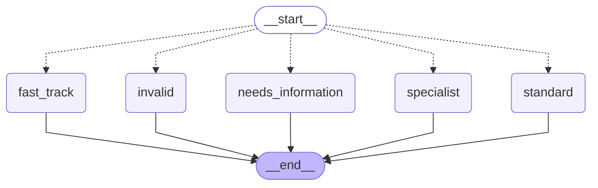
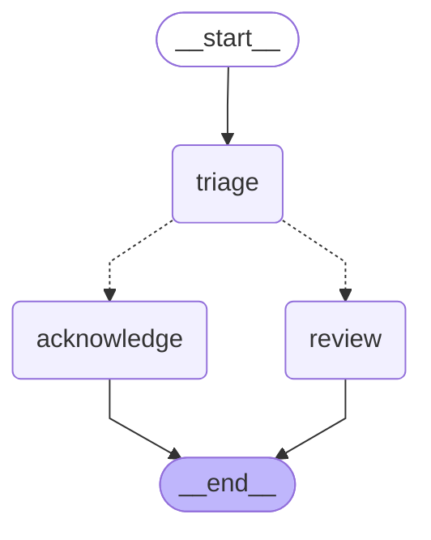
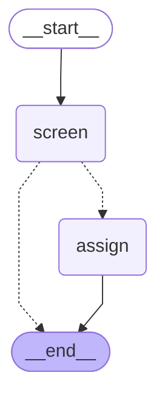

# 03 — Branching and routing

> After this module you can route claims to fast-track, standard, or specialist handling.

**Time:** 75 minutes · **Level:** Beginner · **LLM needed:** No live model · **Cost:** $0 with the included fakes.

**Larkspur Claims Copilot v01** · Practice takes additional time.

## Prerequisites

Complete [State and reducers](../02_state_and_reducers/README.md). Read dictionary keys, functions, and Python type hints comfortably. Run uv sync from the repository root.

Optional installation requirements are listed in [the setup guide](../../docs/OPTIONAL_DEPENDENCIES.md). Use `uv run --no-sync` after installing extras so subsequent commands retain that environment.

## Learning objectives

- Implement and explain Conditional edges; routing functions; path maps; state-based routing.
- Implement and explain Command.update; Command.goto; destination annotations; avoiding duplicate routing.
- Implement and explain Routing to END; total routers; threshold testing; business decisions versus model guesses.

## The big idea

Route claims to fast-track, standard, or specialist handling. Predict the state before running code, then compare the observed result. A state is the data visible to a node; a node is one unit of work; an edge selects later work. A checkpoint is a saved state boundary, not a promise that an external effect happened exactly once.

## How it works

### Conditional Router

A routing function chooses a label from current state. A path map connects that label to a real node. A total router has an outcome for every accepted input, including zero, missing evidence, unknown categories, and malformed amounts.

A sorting desk labels envelopes; the delivery map tells the courier which desk each label means.



### Command Routes

Command combines state updates with a routing instruction. Its destination annotation helps describe possible edges. A static edge still runs even when a Command chooses another node, so use one routing mechanism at a decision point.

One dispatch slip records both the reason and the next desk; a second independent slip can send the same case twice.



### Early Exit

Termination is a routing outcome, not an exceptional Python crash. Screen invalid and duplicate claims before assigning work. The returned state should still explain why a claim ended so an adjuster can inspect it.

A rejected form still receives a reason stamp before leaving the queue.



## Key APIs at a glance

| API / executable example | What it does | When to use it |
| --- | --- | --- |
| StateGraph — [01_conditional_router.py](examples/01_conditional_router.py) | Conditional edges; routing functions; path maps; state-based routing | A routing function chooses a label from current state. |
| StateGraph, Command — [02_command_routes.py](examples/02_command_routes.py) | Command.update; Command.goto; destination annotations; avoiding duplicate routing | Command combines state updates with a routing instruction. |
| StateGraph — [03_early_exit.py](examples/03_early_exit.py) | Routing to END; total routers; threshold testing; business decisions versus model guesses | Termination is a routing outcome, not an exceptional Python crash. |

## Walkthrough

Run commands from the repository root; the same commands work in PowerShell, macOS, and Linux. Open the source alongside the output. Find the state declaration, node functions, graph connections, and invocation. For a failure, start with the earliest changed field or scheduled node.

```text
uv run python modules/03_branching_and_routing/examples/01_conditional_router.py
```

**Predict, then run:** for {"claim_type": "water", "amount_cents": 100000, "missing": []}, write the resulting fields and any expected error. Then test the boundary cases in tests/conditional_router.json.

<details>
<summary>Reveal the checked result</summary>

```json
{
  "value": {
    "claim_type": "water",
    "amount_cents": 100000,
    "missing": [],
    "route": "fast_track"
  }
}
```

A routing function chooses a label from current state. A path map connects that label to a real node. A total router has an outcome for every accepted input, including zero, missing evidence, unknown categories, and malformed amounts.

</details>

```text
uv run python modules/03_branching_and_routing/examples/02_command_routes.py
```

**Predict, then run:** for {"claim_id": "CLM-0001", "suspicious": true}, write the resulting fields and any expected error. Then test the boundary cases in tests/command_routes.json.

<details>
<summary>Reveal the checked result</summary>

```json
{
  "value": {
    "claim_id": "CLM-0001",
    "suspicious": true,
    "reason": "indicator",
    "visited": [
      "review"
    ]
  }
}
```

Command combines state updates with a routing instruction. Its destination annotation helps describe possible edges. A static edge still runs even when a Command chooses another node, so use one routing mechanism at a decision point.

</details>

```text
uv run python modules/03_branching_and_routing/examples/03_early_exit.py
```

**Predict, then run:** for {"claim_id": "CLM-0001", "amount_cents": 0, "duplicate_of": null}, write the resulting fields and any expected error. Then test the boundary cases in tests/early_exit.json.

<details>
<summary>Reveal the checked result</summary>

```json
{
  "value": {
    "claim_id": "CLM-0001",
    "amount_cents": 0,
    "duplicate_of": null,
    "reason": "eligible",
    "assigned": true
  }
}
```

Termination is a routing outcome, not an exceptional Python crash. Screen invalid and duplicate claims before assigning work. The returned state should still explain why a claim ended so an adjuster can inspect it.

</details>

When build_graph needs no arguments, its generated Mermaid diagram is saved beside the example. A diagram records possible edges; a runtime stream records executed work. A single sequence advances one node per superstep. Parallel nodes see the same previous boundary, so they cannot read a sibling's unfinished update.

## When to use it, and when not to

Use these contracts when the claim needs the state or control-flow behavior described above. Keep pure arithmetic and validation in ordinary functions that can be tested independently. A graph, checkpoint, or extra agent adds operational choices; justify it with a concrete failure, pause, branch, or reuse requirement.

## Real-world use case

Route claims to fast-track, standard, or specialist handling. The executable milestone uses only fictional records and the shared v01 implementation. [Read the use case](use_case/claims_copilot.py).

```text
uv run python modules/03_branching_and_routing/use_case/claims_copilot.py
```

Sample output from the synthetic default case:

```json
{
  "100000": "fast_track",
  "100001": "standard",
  "500001": "specialist"
}
```

A real team would connect this boundary to validated records and authenticated roles, then retain the same rejection, ownership, and recovery checks.

## Common bugs

| Symptom or broken contract | Cause and repair | Practice |
| --- | --- | --- |
| Observed `{"value": {"claim_type": "water", "amount_cents": 100000, "missing": [], "route": "standard"}}`. The exact fast-track threshold is inclusive. | Restore `amount <= 100000` and check the boundary cases. | [03-01](../../gym/tasks/03/03-01_conditional_router_build/task.md) · [Related Fix 03-02](../../gym/tasks/03/03-02_conditional_router_fix/task.md) |
| Observed `{"value": {"claim_type": "water", "amount_cents": 100000, "missing": [], "route": "specialist"}}`. Path-map values must match each intended destination. | Restore `{label: label for label in destinations}` and check the boundary cases. | [03-02](../../gym/tasks/03/03-02_conditional_router_fix/task.md) |
| Observed `{"value": {"claim_id": "CLM-0001", "suspicious": true, "reason": "indicator", "visited": ["acknowledge"]}}`. Suspicious evidence must affect the selected destination. | Restore `"review" if state["suspicious"] else "acknowledge"` and check the boundary cases. | [03-07](../../gym/tasks/03/03-07_command_routes_build/task.md) · [Related Fix 03-08](../../gym/tasks/03/03-08_command_routes_fix/task.md) |
| Observed `{"value": {"claim_id": "CLM-0001", "suspicious": true, "reason": "indicator", "visited": ["acknowledge", "review"]}}`. A competing static edge schedules an extra acknowledgment. | Restore `graph.add_edge(START, "triage")` and check the boundary cases. | [03-08](../../gym/tasks/03/03-08_command_routes_fix/task.md) |
| Observed `{"value": {"claim_id": "CLM-0001", "amount_cents": 0, "duplicate_of": null, "reason": "eligible", "assigned": true}}`. Rejected claims must stop before assignment. | Restore `"assign" if state["reason"] == "eligible" else END` and check the boundary cases. | [03-13](../../gym/tasks/03/03-13_early_exit_build/task.md) · [Related Fix 03-14](../../gym/tasks/03/03-14_early_exit_fix/task.md) |
| Observed `{"value": {"claim_id": "CLM-0001", "amount_cents": 0, "duplicate_of": null, "reason": "invalid", "assigned": false}}`. Zero is a defined boundary, not an omitted case. | Restore `amount < 0` and check the boundary cases. | [03-14](../../gym/tasks/03/03-14_early_exit_fix/task.md) |

## Practice

- [03-01 — build, easy](../../gym/tasks/03/03-01_conditional_router_build/task.md): Build conditional router: The exact fast-track threshold is inclusive.
- [03-02 — fix, medium](../../gym/tasks/03/03-02_conditional_router_fix/task.md): Fix conditional router: Path-map values must match each intended destination.
- [03-03 — predict, easy](../../gym/tasks/03/03-03_conditional_router_predict/task.md): Predict conditional router across the declared cases
- [03-04 — trace, medium](../../gym/tasks/03/03-04_conditional_router_trace/task.md): Trace conditional router: Path-map values must match each intended destination.
- [03-05 — extend, hard](../../gym/tasks/03/03-05_conditional_router_extend/task.md): Extend conditional router: High-value claims require specialist review.
- [03-06 — refactor, hard](../../gym/tasks/03/03-06_conditional_router_refactor/task.md): Refactor conditional router: Refactoring must retain the missing-evidence route.
- [03-07 — build, easy](../../gym/tasks/03/03-07_command_routes_build/task.md): Build command routes: Suspicious evidence must affect the selected destination.
- [03-08 — fix, medium](../../gym/tasks/03/03-08_command_routes_fix/task.md): Fix command routes: A competing static edge schedules an extra acknowledgment.
- [03-09 — predict, easy](../../gym/tasks/03/03-09_command_routes_predict/task.md): Predict command routes across the declared cases
- [03-10 — trace, medium](../../gym/tasks/03/03-10_command_routes_trace/task.md): Trace command routes: A competing static edge schedules an extra acknowledgment.
- [03-11 — extend, hard](../../gym/tasks/03/03-11_command_routes_extend/task.md): Extend command routes: The recorded reason must explain the actual decision.
- [03-12 — refactor, hard](../../gym/tasks/03/03-12_command_routes_refactor/task.md): Refactor command routes: Equivalent control flow must not duplicate work.
- [03-13 — build, easy](../../gym/tasks/03/03-13_early_exit_build/task.md): Build early exit: Rejected claims must stop before assignment.
- [03-14 — fix, medium](../../gym/tasks/03/03-14_early_exit_fix/task.md): Fix early exit: Zero is a defined boundary, not an omitted case.
- [03-15 — predict, easy](../../gym/tasks/03/03-15_early_exit_predict/task.md): Predict early exit across the declared cases
- [03-16 — trace, medium](../../gym/tasks/03/03-16_early_exit_trace/task.md): Trace early exit: Zero is a defined boundary, not an omitted case.
- [03-17 — extend, hard](../../gym/tasks/03/03-17_early_exit_extend/task.md): Extend early exit: Duplicate submissions need an explicit terminal reason.
- [03-18 — design, hard](../../gym/tasks/03/03-18_early_exit_design/task.md): Design early exit and justify the boundary policies

Start with tasks 01, 02, 09, 10, 17, and 18 in this module. Finish the other tasks for full practice. Hints are progressive; solution exposure is recorded. Predict and Trace tasks use answer JSON, not a code starter.

## Quiz

Predict first; explain in your own words.

1. Explain the contract in 01_conditional_router.py using one claim from its input cases.
2. Diagnose this broken behavior: Path-map values must match each intended destination. Which observation distinguishes the repair from a default-case-only fix?
3. Explain the contract in 02_command_routes.py using one claim from its input cases.
4. Diagnose this broken behavior: A competing static edge schedules an extra acknowledgment. Which observation distinguishes the repair from a default-case-only fix?
5. Explain the contract in 03_early_exit.py using one claim from its input cases.
6. Diagnose this broken behavior: Zero is a defined boundary, not an omitted case. Which observation distinguishes the repair from a default-case-only fix?

<details>
<summary>Answers</summary>

1. A routing function chooses a label from current state. A path map connects that label to a real node. A total router has an outcome for every accepted input, including zero, missing evidence, unknown categories, and malformed amounts.
2. Path-map values must match each intended destination. Compare the normal case with the boundary fixtures and identify the first differing update.
3. Command combines state updates with a routing instruction. Its destination annotation helps describe possible edges. A static edge still runs even when a Command chooses another node, so use one routing mechanism at a decision point.
4. A competing static edge schedules an extra acknowledgment. Compare the normal case with the boundary fixtures and identify the first differing update.
5. Termination is a routing outcome, not an exceptional Python crash. Screen invalid and duplicate claims before assigning work. The returned state should still explain why a claim ended so an adjuster can inspect it.
6. Zero is a defined boundary, not an omitted case. Compare the normal case with the boundary fixtures and identify the first differing update.

</details>

## Cost and safety

The default commands cost $0: deterministic Python and, in model lessons, scripted local fakes. They consume no hosted tokens and make no real payments or emails. Optional live experiments use the provider configured in .env; a short one-to-four-call exercise is usually cents, but verify your provider's current token prices and set a budget. Ollama can run locally without a hosted bill. Temporary checkpoint files are isolated from the committed dataset. Keep real customer details and credentials out of graph state.

## Key takeaways

- State visibility and update rules determine what a node can safely assume.
- Check normal, missing, boundary, and failure cases before trusting a workflow.
- Separate observed execution from diagrams, predictions, and durable history.
- Model output is evidence to validate, never an authorization grant.
- A saved checkpoint and an external effect have separate durability boundaries.

## Go deeper

- [conditional router official guide](https://docs.langchain.com/oss/python/langgraph/graph-api-control-flow)
- [command routes official guide](https://docs.langchain.com/oss/python/langgraph/graph-api-send-command)
- [early exit official guide](https://docs.langchain.com/oss/python/langgraph/graph-api-control-flow)

## Next:

Continue to [module 04: Loops, parallel branches, and map-reduce](../../modules/04_loops_parallel_map_reduce/README.md).
