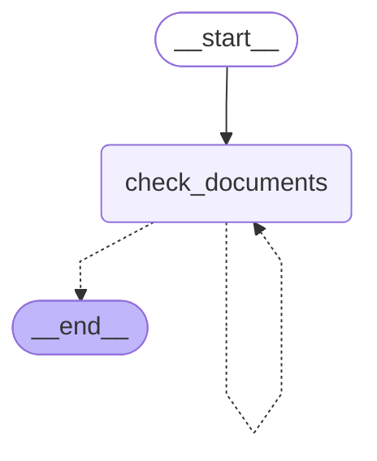
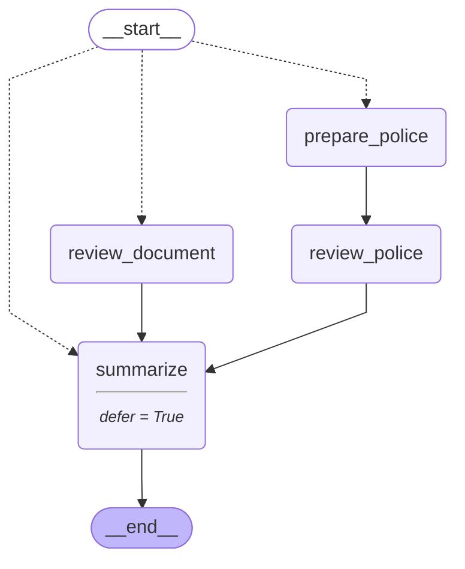

# 04 — Loops, parallel branches, and map-reduce

> After this module you can check all attached documents and combine the findings.

**Time:** 120 minutes · **Level:** Beginner · **LLM needed:** No live model · **Cost:** $0 with the included fakes.

**Larkspur Claims Copilot v02** · Practice takes additional time.

## Prerequisites

Complete [Branching and routing](../03_branching_and_routing/README.md). Read dictionary keys, functions, and Python type hints comfortably. Run uv sync from the repository root.

Optional installation requirements are listed in [the setup guide](../../docs/OPTIONAL_DEPENDENCIES.md). Use `uv run --no-sync` after installing extras so subsequent commands retain that environment.

## Learning objectives

- Implement and explain Loops with exit conditions; recursion_limit; GraphRecursionError.
- Implement and explain Fan-out and fan-in; parallel supersteps; InvalidUpdateError; Send map-reduce; deferred nodes.
- Implement and explain RetryPolicy; node caching; CachePolicy; cache keys and TTL; pure versus side-effecting nodes.

## The big idea

Check all attached documents and combine the findings. Predict the state before running code, then compare the observed result. A state is the data visible to a node; a node is one unit of work; an edge selects later work. A checkpoint is a saved state boundary, not a promise that an external effect happened exactly once.

## How it works

### Bounded Rechecks

A loop is an edge back to earlier work. Business state must move toward an exit. recursion_limit is a runtime backstop measured in graph steps, not a replacement for a document-recheck budget.

A clerk can request missing evidence three times; the building's emergency stop is a different control.



### Fan Out Fan In

Send creates one worker invocation per item with its own input. Parallel workers need a reducer when they write the same channel. defer waits for pending work, which matters when one branch takes more steps than another.

An adjuster collects reports from several specialists and signs only after the slowest specialist finishes.



### Retry And Cache

Retry a transient failure only when repeating the operation is safe. A cache stores a node result under a key; the key must include every input that changes that result. TTL expires a result after a duration, and an injected clock makes that behavior testable without sleeping.

A policy lookup card belongs to a customer and policy version, not just the shelf where it was found.

## Key APIs at a glance

| API / executable example | What it does | When to use it |
| --- | --- | --- |
| StateGraph — [01_bounded_rechecks.py](examples/01_bounded_rechecks.py) | Loops with exit conditions; recursion_limit; GraphRecursionError | A loop is an edge back to earlier work. |
| StateGraph, Send — [02_fan_out_fan_in.py](examples/02_fan_out_fan_in.py) | Fan-out and fan-in; parallel supersteps; InvalidUpdateError; Send map-reduce; deferred nodes | Send creates one worker invocation per item with its own input. |
| StateGraph, CachePolicy, RetryPolicy — [03_retry_and_cache.py](examples/03_retry_and_cache.py) | RetryPolicy; node caching; CachePolicy; cache keys and TTL; pure versus side-effecting nodes | Retry a transient failure only when repeating the operation is safe. |

## Walkthrough

Run commands from the repository root; the same commands work in PowerShell, macOS, and Linux. Open the source alongside the output. Find the state declaration, node functions, graph connections, and invocation. For a failure, start with the earliest changed field or scheduled node.

```text
uv run python modules/04_loops_parallel_map_reduce/examples/01_bounded_rechecks.py
```

**Predict, then run:** for {"history": [false, false, true], "budget": 3}, write the resulting fields and any expected error. Then test the boundary cases in tests/bounded_rechecks.json.

<details>
<summary>Reveal the checked result</summary>

```json
{
  "value": {
    "history": [
      false,
      false,
      true
    ],
    "budget": 3,
    "attempts": 3,
    "status": "ready",
    "trace": [
      "missing",
      "missing",
      "received"
    ]
  }
}
```

A loop is an edge back to earlier work. Business state must move toward an exit. recursion_limit is a runtime backstop measured in graph steps, not a replacement for a document-recheck budget.

</details>

```text
uv run python modules/04_loops_parallel_map_reduce/examples/02_fan_out_fan_in.py
```

**Predict, then run:** for {"documents": [{"id": "DOC-001", "kind": "estimate"}, {"id": "DOC-021", "kind": "police"}]}, write the resulting fields and any expected error. Then test the boundary cases in tests/fan_out_fan_in.json.

<details>
<summary>Reveal the checked result</summary>

```json
{
  "value": {
    "findings": [
      "DOC-001",
      "DOC-021"
    ],
    "summaries": [
      [
        "DOC-001",
        "DOC-021"
      ]
    ]
  }
}
```

Send creates one worker invocation per item with its own input. Parallel workers need a reducer when they write the same channel. defer waits for pending work, which matters when one branch takes more steps than another.

</details>

```text
uv run python modules/04_loops_parallel_map_reduce/examples/03_retry_and_cache.py
```

**Predict, then run:** for {"customer_id": "CUS-0001", "policy_version": 1, "amount_cents": 125000, "ttl": 10, "advance": 10}, write the resulting fields and any expected error. Then test the boundary cases in tests/retry_and_cache.json.

<details>
<summary>Reveal the checked result</summary>

```json
{
  "value": {
    "covered": [
      true,
      true,
      true,
      false
    ],
    "lookup_calls": 4
  }
}
```

Retry a transient failure only when repeating the operation is safe. A cache stores a node result under a key; the key must include every input that changes that result. TTL expires a result after a duration, and an injected clock makes that behavior testable without sleeping.

</details>

When build_graph needs no arguments, its generated Mermaid diagram is saved beside the example. A diagram records possible edges; a runtime stream records executed work. A single sequence advances one node per superstep. Parallel nodes see the same previous boundary, so they cannot read a sibling's unfinished update.

## When to use it, and when not to

Use these contracts when the claim needs the state or control-flow behavior described above. Keep pure arithmetic and validation in ordinary functions that can be tested independently. A graph, checkpoint, or extra agent adds operational choices; justify it with a concrete failure, pause, branch, or reuse requirement.

## Real-world use case

Check all attached documents and combine the findings. The executable milestone uses only fictional records and the shared v02 implementation. [Read the use case](use_case/claims_copilot.py).

```text
uv run python modules/04_loops_parallel_map_reduce/use_case/claims_copilot.py
```

Sample output from the synthetic default case:

```json
{
  "route": "specialist",
  "findings": [
    "reviewed:DOC-001",
    "reviewed:DOC-011",
    "reviewed:DOC-021"
  ]
}
```

A real team would connect this boundary to validated records and authenticated roles, then retain the same rejection, ownership, and recovery checks.

## Common bugs

| Symptom or broken contract | Cause and repair | Practice |
| --- | --- | --- |
| Observed `{"value": {"history": [false, false, true], "budget": 3, "attempts": 3, "status": "exhausted", "trace": ["missing", "missing", "missing"]}}`. Received evidence must terminate the recheck loop. | Restore `index < len(state["history"]) and state["history"][index]` and check the boundary cases. | [04-01](../../gym/tasks/04/04-01_bounded_rechecks_build/task.md) |
| Observed `{"error": "GraphRecursionError"}`. Without a changing retry counter, the graph reaches its recursion limit. | Restore `"attempts": index + 1` and check the boundary cases. | [04-02](../../gym/tasks/04/04-02_bounded_rechecks_fix/task.md) |
| Observed `{"value": {"findings": ["DOC-021"], "summaries": [["DOC-021"]]}}`. Each worker must contribute its own document evidence. | Restore `return {"findings": [state["document"]["id"]]}` and check the boundary cases. | [04-07](../../gym/tasks/04/04-07_fan_out_fan_in_build/task.md) |
| Observed `{"value": {"findings": ["DOC-021"], "summaries": [["DOC-021"]]}}`. Parallel writes to an overwrite channel conflict. | Restore `findings: Annotated[list[str], operator.add]` and check the boundary cases. | [04-08](../../gym/tasks/04/04-08_fan_out_fan_in_fix/task.md) |
| Observed `{"error": "ConnectionError"}`. A bounded retry must recover from the injected transient read failure. | Restore `max_attempts=2` and check the boundary cases. | [04-13](../../gym/tasks/04/04-13_retry_and_cache_build/task.md) |
| Observed `{"value": {"covered": [true, true, true, true], "lookup_calls": 3}}`. Customer identity belongs in the cache key. | Restore `[state["customer_id"], state["policy_version"], state["amount_cents"]]` and check the boundary cases. | [04-14](../../gym/tasks/04/04-14_retry_and_cache_fix/task.md) |

## Practice

- [04-01 — build, easy](../../gym/tasks/04/04-01_bounded_rechecks_build/task.md): Build bounded rechecks: Received evidence must terminate the recheck loop.
- [04-02 — fix, medium](../../gym/tasks/04/04-02_bounded_rechecks_fix/task.md): Fix bounded rechecks: Without a changing retry counter, the graph reaches its recursion limit.
- [04-03 — predict, easy](../../gym/tasks/04/04-03_bounded_rechecks_predict/task.md): Predict bounded rechecks across the declared cases
- [04-04 — trace, medium](../../gym/tasks/04/04-04_bounded_rechecks_trace/task.md): Trace bounded rechecks: Without a changing retry counter, the graph reaches its recursion limit.
- [04-05 — extend, hard](../../gym/tasks/04/04-05_bounded_rechecks_extend/task.md): Extend bounded rechecks: The business budget needs an explicit exhausted outcome.
- [04-06 — refactor, hard](../../gym/tasks/04/04-06_bounded_rechecks_refactor/task.md): Refactor bounded rechecks: Equivalent loops must preserve the exact attempt budget.
- [04-07 — build, easy](../../gym/tasks/04/04-07_fan_out_fan_in_build/task.md): Build fan out fan in: Each worker must contribute its own document evidence.
- [04-08 — fix, medium](../../gym/tasks/04/04-08_fan_out_fan_in_fix/task.md): Fix fan out fan in: Parallel writes to an overwrite channel conflict.
- [04-09 — predict, easy](../../gym/tasks/04/04-09_fan_out_fan_in_predict/task.md): Predict fan out fan in across the declared cases
- [04-10 — trace, medium](../../gym/tasks/04/04-10_fan_out_fan_in_trace/task.md): Trace fan out fan in: Parallel writes to an overwrite channel conflict.
- [04-11 — extend, hard](../../gym/tasks/04/04-11_fan_out_fan_in_extend/task.md): Extend fan out fan in: The deeper police branch must finish before summary.
- [04-12 — refactor, hard](../../gym/tasks/04/04-12_fan_out_fan_in_refactor/task.md): Refactor fan out fan in: Do not treat arrival order as the public result order.
- [04-13 — build, easy](../../gym/tasks/04/04-13_retry_and_cache_build/task.md): Build retry and cache: A bounded retry must recover from the injected transient read failure.
- [04-14 — fix, medium](../../gym/tasks/04/04-14_retry_and_cache_fix/task.md): Fix retry and cache: Customer identity belongs in the cache key.
- [04-15 — predict, easy](../../gym/tasks/04/04-15_retry_and_cache_predict/task.md): Predict retry and cache across the declared cases
- [04-16 — trace, medium](../../gym/tasks/04/04-16_retry_and_cache_trace/task.md): Trace retry and cache: Customer identity belongs in the cache key.
- [04-17 — extend, hard](../../gym/tasks/04/04-17_retry_and_cache_extend/task.md): Extend retry and cache: The cache must observe the injected clock advancing.
- [04-18 — design, hard](../../gym/tasks/04/04-18_retry_and_cache_design/task.md): Design retry and cache and justify the boundary policies

Start with tasks 01, 02, 09, 10, 17, and 18 in this module. Finish the other tasks for full practice. Hints are progressive; solution exposure is recorded. Predict and Trace tasks use answer JSON, not a code starter.

## Quiz

Predict first; explain in your own words.

1. Explain the contract in 01_bounded_rechecks.py using one claim from its input cases.
2. Diagnose this broken behavior: Without a changing retry counter, the graph reaches its recursion limit. Which observation distinguishes the repair from a default-case-only fix?
3. Explain the contract in 02_fan_out_fan_in.py using one claim from its input cases.
4. Diagnose this broken behavior: Parallel writes to an overwrite channel conflict. Which observation distinguishes the repair from a default-case-only fix?
5. Explain the contract in 03_retry_and_cache.py using one claim from its input cases.
6. Diagnose this broken behavior: Customer identity belongs in the cache key. Which observation distinguishes the repair from a default-case-only fix?

<details>
<summary>Answers</summary>

1. A loop is an edge back to earlier work. Business state must move toward an exit. recursion_limit is a runtime backstop measured in graph steps, not a replacement for a document-recheck budget.
2. Without a changing retry counter, the graph reaches its recursion limit. Compare the normal case with the boundary fixtures and identify the first differing update.
3. Send creates one worker invocation per item with its own input. Parallel workers need a reducer when they write the same channel. defer waits for pending work, which matters when one branch takes more steps than another.
4. Parallel writes to an overwrite channel conflict. Compare the normal case with the boundary fixtures and identify the first differing update.
5. Retry a transient failure only when repeating the operation is safe. A cache stores a node result under a key; the key must include every input that changes that result. TTL expires a result after a duration, and an injected clock makes that behavior testable without sleeping.
6. Customer identity belongs in the cache key. Compare the normal case with the boundary fixtures and identify the first differing update.

</details>

## Cost and safety

The default commands cost $0: deterministic Python and, in model lessons, scripted local fakes. They consume no hosted tokens and make no real payments or emails. Optional live experiments use the provider configured in .env; a short one-to-four-call exercise is usually cents, but verify your provider's current token prices and set a budget. Ollama can run locally without a hosted bill. Temporary checkpoint files are isolated from the committed dataset. Keep real customer details and credentials out of graph state.

## Key takeaways

- State visibility and update rules determine what a node can safely assume.
- Check normal, missing, boundary, and failure cases before trusting a workflow.
- Separate observed execution from diagrams, predictions, and durable history.
- Model output is evidence to validate, never an authorization grant.
- A saved checkpoint and an external effect have separate durability boundaries.

## Go deeper

- [bounded rechecks official guide](https://docs.langchain.com/oss/python/langgraph/graph-api-control-flow)
- [fan out fan in official guide](https://docs.langchain.com/oss/python/langgraph/graph-api-send-command)
- [retry and cache official guide](https://docs.langchain.com/oss/python/langgraph/graph-api-nodes)

## Next:

Continue to [module 05: Persistence and threads](../../modules/05_persistence_and_threads/README.md).
