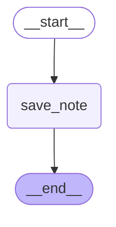
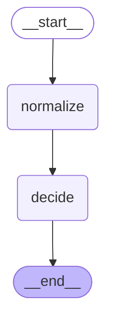

# 05 — Persistence and threads

> After this module you can continue one claim across several adjuster sessions.

**Time:** 90 minutes · **Level:** Beginner · **LLM needed:** No live model · **Cost:** $0 with the included fakes.

**Larkspur Claims Copilot v02** · Practice takes additional time.

## Prerequisites

Complete [Loops, parallel branches, and map-reduce](../04_loops_parallel_map_reduce/README.md). Read dictionary keys, functions, and Python type hints comfortably. Run uv sync from the repository root.

Optional installation requirements are listed in [the setup guide](../../docs/OPTIONAL_DEPENDENCIES.md). Use `uv run --no-sync` after installing extras so subsequent commands retain that environment.

New to pytest, type validation, chat messages, tools, or async Python? Read the relevant section of [the beginner bridge](../../docs/BEGINNER_BRIDGE.md) when that concept first appears.

## Learning objectives

- Implement and explain InMemorySaver; checkpointer compilation; thread_id; config; continuing versus resuming.
- Implement and explain SqliteSaver; checkpoint resource lifetimes; persistence across processes; SQLite Windows locking.
- Implement and explain StateSnapshot; get_state; get_state_history; update_state; durability sync, async, and exit.

## The big idea

Continue one claim across several adjuster sessions. Predict the state before running code, then compare the observed result. A state is the data visible to a node; a node is one unit of work; an edge selects later work. A checkpoint is a saved state boundary, not a promise that an external effect happened exactly once.

## How it works

### Thread Identity

A checkpointer saves graph state under a thread ID. New input on that thread starts another run against its saved state. Resuming a pending operation is different: use the saved continuation or an interrupt response rather than pretending it is a new claim.

The thread ID is the claim-folder number; reuse another customer's number and you open the wrong folder.



### Sqlite Lifetime

Memory persistence ends with its process. A SQLite saver stores checkpoints on disk and must remain open for every invocation that uses it. Explicit context managers release connections, including on Windows where open files can prevent cleanup.

A desk notebook disappears with the desk; a closed archive file can be reopened by the next shift.

### Inspect Checkpoints

A StateSnapshot contains values, pending next nodes, metadata, and a parent configuration. update_state writes a new checkpoint; it does not edit old history. Durability chooses when checkpoint writes complete, which changes failure exposure rather than business routing.

Correct an audit ledger by adding a new entry with a parent reference instead of erasing an old entry.



## Key APIs at a glance

| API / executable example | What it does | When to use it |
| --- | --- | --- |
| InMemorySaver, StateGraph — [01_thread_identity.py](examples/01_thread_identity.py) | InMemorySaver; checkpointer compilation; thread_id; config; continuing versus resuming | A checkpointer saves graph state under a thread ID. |
| SqliteSaver, StateGraph — [02_sqlite_lifetime.py](examples/02_sqlite_lifetime.py) | SqliteSaver; checkpoint resource lifetimes; persistence across processes; SQLite Windows locking | Memory persistence ends with its process. |
| InMemorySaver, StateGraph — [03_inspect_checkpoints.py](examples/03_inspect_checkpoints.py) | StateSnapshot; get_state; get_state_history; update_state; durability sync, async, and exit | A StateSnapshot contains values, pending next nodes, metadata, and a parent configuration. |

## Walkthrough

Run commands from the repository root; the same commands work in PowerShell, macOS, and Linux. Open the source alongside the output. Find the state declaration, node functions, graph connections, and invocation. For a failure, start with the earliest changed field or scheduled node.

```text
uv run --no-sync python modules/05_persistence_and_threads/examples/01_thread_identity.py
```

**Predict, then run:** for {"first_id": "CLM-0001", "second_id": "CLM-0002"}, write the resulting fields and any expected error. Then test the boundary cases in tests/thread_identity.json.

<details>
<summary>Reveal the checked result</summary>

```json
{
  "value": {
    "first_notes": [
      "received",
      "estimate attached"
    ],
    "second_notes": [
      "other customer"
    ]
  }
}
```

A checkpointer saves graph state under a thread ID. New input on that thread starts another run against its saved state. Resuming a pending operation is different: use the saved continuation or an interrupt response rather than pretending it is a new claim.

</details>

```text
uv run --no-sync python modules/05_persistence_and_threads/examples/02_sqlite_lifetime.py
```

**Predict, then run:** for {"claim_id": "CLM-0001"}, write the resulting fields and any expected error. Then test the boundary cases in tests/sqlite_lifetime.json.

<details>
<summary>Reveal the checked result</summary>

```json
{
  "value": {
    "first_notes": [
      "received"
    ],
    "second_notes": [
      "received",
      "estimate attached"
    ],
    "closed": true
  }
}
```

Memory persistence ends with its process. A SQLite saver stores checkpoints on disk and must remain open for every invocation that uses it. Explicit context managers release connections, including on Windows where open files can prevent cleanup.

</details>

```text
uv run --no-sync python modules/05_persistence_and_threads/examples/03_inspect_checkpoints.py
```

**Predict, then run:** for {"amount_cents": 100000, "corrected_amount": 200000, "durability": "sync"}, write the resulting fields and any expected error. Then test the boundary cases in tests/inspect_checkpoints.json.

<details>
<summary>Reveal the checked result</summary>

```json
{
  "value": {
    "original": "fast_track",
    "corrected": "standard",
    "pending_after_edit": [
      "decide"
    ],
    "parent_exists": true,
    "saved_steps": [
      -1,
      0,
      1,
      2
    ]
  }
}
```

A StateSnapshot contains values, pending next nodes, metadata, and a parent configuration. update_state writes a new checkpoint; it does not edit old history. Durability chooses when checkpoint writes complete, which changes failure exposure rather than business routing.

</details>

When build_graph needs no arguments, its generated Mermaid diagram is saved beside the example. A diagram records possible edges; a runtime stream records executed work. A single sequence advances one node per superstep. Parallel nodes see the same previous boundary, so they cannot read a sibling's unfinished update.

## When to use it, and when not to

Use these contracts when the claim needs the state or control-flow behavior described above. Keep pure arithmetic and validation in ordinary functions that can be tested independently. A graph, checkpoint, or extra agent adds operational choices; justify it with a concrete failure, pause, branch, or reuse requirement.

## Real-world use case

Continue one claim across several adjuster sessions. The executable milestone uses only fictional records and the shared v02 implementation. [Read the use case](use_case/claims_copilot.py).

```text
uv run python modules/05_persistence_and_threads/use_case/claims_copilot.py
```

Sample output from the synthetic default case:

```json
{
  "audit": [
    "normalized",
    "validated",
    "routed"
  ],
  "checkpoints": 11
}
```

A real team would connect this boundary to validated records and authenticated roles, then retain the same rejection, ownership, and recovery checks.

## Common bugs

| Symptom or broken contract | Cause and repair | Practice |
| --- | --- | --- |
| Observed `{"error": "ValueError"}`. Saved notes must survive a second invocation on the same graph. | Restore `checkpointer=InMemorySaver()` and check the boundary cases. | [05-01](../../gym/tasks/05/05-01_thread_identity_build/task.md) · Related Fix: [05-02](../../gym/tasks/05/05-02_thread_identity_fix/task.md) |
| Observed `{"error": "ValueError"}`. A persisted invocation needs an explicit thread identifier. | Restore `{"thread_id": "claim:" + claim_id}` and check the boundary cases. | [05-02](../../gym/tasks/05/05-02_thread_identity_fix/task.md) · Related Fix: [05-02](../../gym/tasks/05/05-02_thread_identity_fix/task.md) |
| Observed `{"value": {"first_notes": ["received"], "second_notes": ["estimate attached"], "closed": true}}`. A restarted process must merge the new note with stored notes. | Restore `notes: Annotated[list[str], operator.add]` and check the boundary cases. | [05-07](../../gym/tasks/05/05-07_sqlite_lifetime_build/task.md) · Related Fix: [05-08](../../gym/tasks/05/05-08_sqlite_lifetime_fix/task.md) |
| Observed `{"error": "RuntimeError"}`. A compiled graph cannot use a saver whose connection has closed. | Restore `with SqliteSaver.from_conn_string(database) as saver:         result = build_graph(saver).invoke(payload, config, version="v2").value` and check the boundary cases. | [05-08](../../gym/tasks/05/05-08_sqlite_lifetime_fix/task.md) · Related Fix: [05-08](../../gym/tasks/05/05-08_sqlite_lifetime_fix/task.md) |
| Observed `{"value": {"original": "fast_track", "corrected": "fast_track", "pending_after_edit": ["decide"], "parent_exists": true, "saved_steps": [-1, 0, 1, 2]}}`. The corrected checkpoint must contain the replacement evidence. | Restore `case["corrected_amount"]` and check the boundary cases. | [05-13](../../gym/tasks/05/05-13_inspect_checkpoints_build/task.md) · Related Fix: [05-14](../../gym/tasks/05/05-14_inspect_checkpoints_fix/task.md) |
| Observed `{"value": {"original": "fast_track", "corrected": "fast_track", "pending_after_edit": ["decide"], "parent_exists": true, "saved_steps": [-1, 0, 1, 2]}}`. Continue the configuration returned by update_state, not an unrelated checkpoint. | Restore `graph.invoke(None, corrected, version="v2")` and check the boundary cases. | [05-14](../../gym/tasks/05/05-14_inspect_checkpoints_fix/task.md) · Related Fix: [05-14](../../gym/tasks/05/05-14_inspect_checkpoints_fix/task.md) |

## Practice

- [05-01 — build, easy](../../gym/tasks/05/05-01_thread_identity_build/task.md): Build thread identity: Saved notes must survive a second invocation on the same graph.
- [05-02 — fix, medium](../../gym/tasks/05/05-02_thread_identity_fix/task.md): Fix thread identity: A persisted invocation needs an explicit thread identifier.
- [05-03 — predict, easy](../../gym/tasks/05/05-03_thread_identity_predict/task.md): Predict thread identity across the declared cases
- [05-04 — trace, medium](../../gym/tasks/05/05-04_thread_identity_trace/task.md): Diagnose thread identity from execution evidence
- [05-05 — extend, hard](../../gym/tasks/05/05-05_thread_identity_extend/task.md): Extend thread identity: Add run_batch(cases) to preview independent claims in input order. Preserve run(case), isolate mutable inputs, return value/error records, handle an empty batch, and continue after a rejected claim.
- [05-06 — refactor, hard](../../gym/tasks/05/05-06_thread_identity_refactor/task.md): Refactor thread identity: Separate input preparation from orchestration in prepare_case(case). Preserve all results/errors, distinguish None from {}, and copy nested inputs so caller data and shared defaults stay independent.
- [05-07 — build, easy](../../gym/tasks/05/05-07_sqlite_lifetime_build/task.md): Build sqlite lifetime: A restarted process must merge the new note with stored notes.
- [05-08 — fix, medium](../../gym/tasks/05/05-08_sqlite_lifetime_fix/task.md): Fix sqlite lifetime: A compiled graph cannot use a saver whose connection has closed.
- [05-09 — predict, easy](../../gym/tasks/05/05-09_sqlite_lifetime_predict/task.md): Predict sqlite lifetime across the declared cases
- [05-10 — trace, medium](../../gym/tasks/05/05-10_sqlite_lifetime_trace/task.md): Diagnose sqlite lifetime from execution evidence
- [05-11 — extend, hard](../../gym/tasks/05/05-11_sqlite_lifetime_extend/task.md): Extend sqlite lifetime: Add run_batch(cases) to preview independent claims in input order. Preserve run(case), isolate mutable inputs, return value/error records, handle an empty batch, and continue after a rejected claim.
- [05-12 — refactor, hard](../../gym/tasks/05/05-12_sqlite_lifetime_refactor/task.md): Refactor sqlite lifetime: Separate input preparation from orchestration in prepare_case(case). Preserve all results/errors, distinguish None from {}, and copy nested inputs so caller data and shared defaults stay independent.
- [05-13 — build, easy](../../gym/tasks/05/05-13_inspect_checkpoints_build/task.md): Build inspect checkpoints: The corrected checkpoint must contain the replacement evidence.
- [05-14 — fix, medium](../../gym/tasks/05/05-14_inspect_checkpoints_fix/task.md): Fix inspect checkpoints: Continue the configuration returned by update_state, not an unrelated checkpoint.
- [05-15 — predict, easy](../../gym/tasks/05/05-15_inspect_checkpoints_predict/task.md): Predict inspect checkpoints across the declared cases
- [05-16 — trace, medium](../../gym/tasks/05/05-16_inspect_checkpoints_trace/task.md): Diagnose inspect checkpoints from execution evidence
- [05-17 — extend, hard](../../gym/tasks/05/05-17_inspect_checkpoints_extend/task.md): Extend inspect checkpoints: Add run_batch(cases) to preview independent claims in input order. Preserve run(case), isolate mutable inputs, return value/error records, handle an empty batch, and continue after a rejected claim.
- [05-18 — design, hard](../../gym/tasks/05/05-18_inspect_checkpoints_design/task.md): Design inspect checkpoints and justify the boundary policies

Start with tasks 01, 02, 09, 10, 17, and 18 in this module. Finish the other tasks for full practice. Hints are progressive; solution exposure is recorded. Predict and Trace tasks use answer JSON, not a code starter.

## Quiz

Predict first; explain in your own words.

1. Explain the contract in 01_thread_identity.py using one claim from its input cases.
2. Diagnose this broken behavior: A persisted invocation needs an explicit thread identifier. Which observation distinguishes the repair from a default-case-only fix?
3. Explain the contract in 02_sqlite_lifetime.py using one claim from its input cases.
4. Diagnose this broken behavior: A compiled graph cannot use a saver whose connection has closed. Which observation distinguishes the repair from a default-case-only fix?
5. Explain the contract in 03_inspect_checkpoints.py using one claim from its input cases.
6. Diagnose this broken behavior: Continue the configuration returned by update_state, not an unrelated checkpoint. Which observation distinguishes the repair from a default-case-only fix?

<details>
<summary>Answers</summary>

1. A checkpointer saves graph state under a thread ID. New input on that thread starts another run against its saved state. Resuming a pending operation is different: use the saved continuation or an interrupt response rather than pretending it is a new claim.
2. A persisted invocation needs an explicit thread identifier. Compare the normal case with the boundary fixtures and identify the first differing update.
3. Memory persistence ends with its process. A SQLite saver stores checkpoints on disk and must remain open for every invocation that uses it. Explicit context managers release connections, including on Windows where open files can prevent cleanup.
4. A compiled graph cannot use a saver whose connection has closed. Compare the normal case with the boundary fixtures and identify the first differing update.
5. A StateSnapshot contains values, pending next nodes, metadata, and a parent configuration. update_state writes a new checkpoint; it does not edit old history. Durability chooses when checkpoint writes complete, which changes failure exposure rather than business routing.
6. Continue the configuration returned by update_state, not an unrelated checkpoint. Compare the normal case with the boundary fixtures and identify the first differing update.

</details>

## Cost and safety

The default commands cost $0: deterministic Python and, in model lessons, scripted local fakes. They consume no hosted tokens and make no real payments or emails. Optional live experiments use the provider configured in .env; a short one-to-four-call exercise is usually cents, but verify your provider's current token prices and set a budget. Ollama can run locally without a hosted bill. Temporary checkpoint files are isolated from the committed dataset. Keep real customer details and credentials out of graph state.

## Key takeaways

- State visibility and update rules determine what a node can safely assume.
- Check normal, missing, boundary, and failure cases before trusting a workflow.
- Separate observed execution from diagrams, predictions, and durable history.
- Model output is evidence to validate, never an authorization grant.
- A saved checkpoint and an external effect have separate durability boundaries.

## Go deeper

- [thread identity official guide](https://docs.langchain.com/oss/python/langgraph/checkpointers)
- [sqlite lifetime official guide](https://docs.langchain.com/oss/python/langgraph/checkpointers)
- [inspect checkpoints official guide](https://docs.langchain.com/oss/python/langgraph/checkpointers)

## Next:

Continue to [module 06: Human-in-the-loop with interrupts](../../modules/06_human_in_the_loop/README.md).
