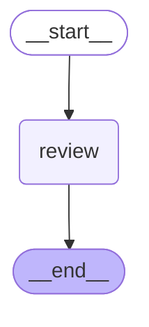
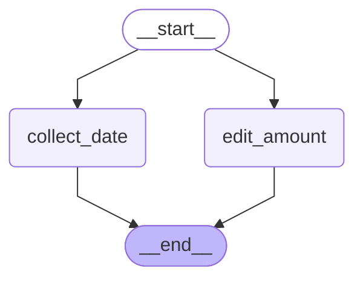

# 06 — Human-in-the-loop with interrupts

> After this module you can require adjuster approval for payouts above $5,000.

**Time:** 105 minutes · **Level:** Beginner · **LLM needed:** No live model · **Cost:** $0 with the included fakes.

**Larkspur Claims Copilot v03** · Practice takes additional time.

## Prerequisites

Complete [Persistence and threads](../05_persistence_and_threads/README.md). Read dictionary keys, functions, and Python type hints comfortably. Run uv sync from the repository root.

Optional installation requirements are listed in [the setup guide](../../docs/OPTIONAL_DEPENDENCIES.md). Use `uv run --no-sync` after installing extras so subsequent commands retain that environment.

## Learning objectives

- Implement and explain interrupt(); Command(resume=...); checkpointer requirement; v2 interrupt output.
- Implement and explain Editing through resume; missing-input interrupts; multiple interrupts; ID-based resume mapping.
- Implement and explain Interrupted-node restart semantics; idempotent side effects; deterministic interrupt order; debugging breakpoint distinction.

## The big idea

Require adjuster approval for payouts above $5,000. Predict the state before running code, then compare the observed result. A state is the data visible to a node; a node is one unit of work; an edge selects later work. A checkpoint is a saved state boundary, not a promise that an external effect happened exactly once.

## How it works

### Approve Or Reject

interrupt pauses graph work and returns a request to the caller. A checkpointer and stable thread preserve that pause. Command(resume=...) supplies the response; the interrupted node restarts, so validate the response rather than trusting its shape.

Put the claim in an approval tray, retaining its folder number, then continue when the adjuster returns a signed decision.



### Collect And Edit

Parallel pauses can be answered with an interrupt-ID-to-response map. IDs identify requests; list order does not. Validate each edited value against its own schema and business limit before merging it into state.

Return two forms using their tracking numbers instead of assuming they arrived in desk order.



### Safe Reentry

On resume, Python starts the interrupted node again. Code before interrupt can therefore repeat. Move effects after validated approval into separate checkpointed work, and use a stable idempotency key because a crash can occur after a write but before its checkpoint.

A clerk rereads the form after approval; rereading must not send a second payment notice.

## Key APIs at a glance

| API / executable example | What it does | When to use it |
| --- | --- | --- |
| InMemorySaver, StateGraph, Command, interrupt — [01_approve_or_reject.py](examples/01_approve_or_reject.py) | interrupt(); Command(resume=...); checkpointer requirement; v2 interrupt output | interrupt pauses graph work and returns a request to the caller. |
| InMemorySaver, StateGraph, Command, interrupt — [02_collect_and_edit.py](examples/02_collect_and_edit.py) | Editing through resume; missing-input interrupts; multiple interrupts; ID-based resume mapping | Parallel pauses can be answered with an interrupt-ID-to-response map. |
| InMemorySaver, StateGraph, Command, interrupt — [03_safe_reentry.py](examples/03_safe_reentry.py) | Interrupted-node restart semantics; idempotent side effects; deterministic interrupt order; debugging breakpoint distinction | On resume, Python starts the interrupted node again. |

## Walkthrough

Run commands from the repository root; the same commands work in PowerShell, macOS, and Linux. Open the source alongside the output. Find the state declaration, node functions, graph connections, and invocation. For a failure, start with the earliest changed field or scheduled node.

```text
uv run python modules/06_human_in_the_loop/examples/01_approve_or_reject.py
```

**Predict, then run:** for {"amount_cents": 600000, "decision": {"approved": true}}, write the resulting fields and any expected error. Then test the boundary cases in tests/approve_or_reject.json.

<details>
<summary>Reveal the checked result</summary>

```json
{
  "value": {
    "prompts": [
      {
        "kind": "payout_review",
        "amount_cents": 600000
      }
    ],
    "status": "approved",
    "remaining": 0
  }
}
```

interrupt pauses graph work and returns a request to the caller. A checkpointer and stable thread preserve that pause. Command(resume=...) supplies the response; the interrupted node restarts, so validate the response rather than trusting its shape.

</details>

```text
uv run python modules/06_human_in_the_loop/examples/02_collect_and_edit.py
```

**Predict, then run:** for {"loss_date": "2026-01-01", "approved_cents": 125000}, write the resulting fields and any expected error. Then test the boundary cases in tests/collect_and_edit.json.

<details>
<summary>Reveal the checked result</summary>

```json
{
  "value": {
    "prompts": [
      "approved_cents",
      "loss_date"
    ],
    "result": {
      "claim_id": "CLM-0001",
      "loss_date": "2026-01-01",
      "approved_cents": 125000
    }
  }
}
```

Parallel pauses can be answered with an interrupt-ID-to-response map. IDs identify requests; list order does not. Validate each edited value against its own schema and business limit before merging it into state.

</details>

```text
uv run python modules/06_human_in_the_loop/examples/03_safe_reentry.py
```

**Predict, then run:** for {"claim_id": "CLM-0001", "approved": true}, write the resulting fields and any expected error. Then test the boundary cases in tests/safe_reentry.json.

<details>
<summary>Reveal the checked result</summary>

```json
{
  "value": {
    "entries": 2,
    "before_approval": 0,
    "notifications": 1,
    "approved": true
  }
}
```

On resume, Python starts the interrupted node again. Code before interrupt can therefore repeat. Move effects after validated approval into separate checkpointed work, and use a stable idempotency key because a crash can occur after a write but before its checkpoint.

</details>

When build_graph needs no arguments, its generated Mermaid diagram is saved beside the example. A diagram records possible edges; a runtime stream records executed work. A single sequence advances one node per superstep. Parallel nodes see the same previous boundary, so they cannot read a sibling's unfinished update.

## When to use it, and when not to

Use these contracts when the claim needs the state or control-flow behavior described above. Keep pure arithmetic and validation in ordinary functions that can be tested independently. A graph, checkpoint, or extra agent adds operational choices; justify it with a concrete failure, pause, branch, or reuse requirement.

## Real-world use case

Require adjuster approval for payouts above $5,000. The executable milestone uses only fictional records and the shared v03 implementation. [Read the use case](use_case/claims_copilot.py).

```text
uv run python modules/06_human_in_the_loop/use_case/claims_copilot.py
```

Sample output from the synthetic default case:

```json
{
  "approved": "human_approved",
  "rejected": "human_rejected"
}
```

A real team would connect this boundary to validated records and authenticated roles, then retain the same rejection, ownership, and recovery checks.

## Common bugs

| Symptom or broken contract | Cause and repair | Practice |
| --- | --- | --- |
| Observed `{"value": {"prompts": [{"kind": "payout_review", "amount_cents": 600000}], "status": "approved", "remaining": 0}}`. A rejected proposal must not become an approved result. | Restore `"approved" if response["approved"] else "rejected"` and check the boundary cases. | [06-01](../../gym/tasks/06/06-01_approve_or_reject_build/task.md) |
| Observed `{"error": "RuntimeError"}`. An interrupt needs persistence to resume the saved task. | Restore `checkpointer=InMemorySaver()` and check the boundary cases. | [06-02](../../gym/tasks/06/06-02_approve_or_reject_fix/task.md) |
| Observed `{"value": {"prompts": ["approved_cents", "loss_date"], "result": {"claim_id": "CLM-0001", "loss_date": "2026-01-01", "approved_cents": 125000}}}`. A zero approved amount is a valid edited decision. | Restore `0 <= response <= 500000` and check the boundary cases. | [06-07](../../gym/tasks/06/06-07_collect_and_edit_build/task.md) |
| Observed `{"error": "ValueError"}`. Each interrupt must receive the response for its own request kind. | Restore `case[item.value["kind"]]` and check the boundary cases. | [06-08](../../gym/tasks/06/06-08_collect_and_edit_fix/task.md) |
| Observed `{"value": {"entries": 2, "before_approval": 0, "notifications": 1, "approved": true}}`. Rejection must not trigger the synthetic notification. | Restore `if state["approved"]:` and check the boundary cases. | [06-13](../../gym/tasks/06/06-13_safe_reentry_build/task.md) |
| Observed `{"value": {"entries": 2, "before_approval": 1, "notifications": 3, "approved": true}}`. Effects before interrupt repeat when the node restarts. | Restore `entries.append("review")` and check the boundary cases. | [06-14](../../gym/tasks/06/06-14_safe_reentry_fix/task.md) |

## Practice

- [06-01 — build, easy](../../gym/tasks/06/06-01_approve_or_reject_build/task.md): Build approve or reject: A rejected proposal must not become an approved result.
- [06-02 — fix, medium](../../gym/tasks/06/06-02_approve_or_reject_fix/task.md): Fix approve or reject: An interrupt needs persistence to resume the saved task.
- [06-03 — predict, easy](../../gym/tasks/06/06-03_approve_or_reject_predict/task.md): Predict approve or reject across the declared cases
- [06-04 — trace, medium](../../gym/tasks/06/06-04_approve_or_reject_trace/task.md): Trace approve or reject: An interrupt needs persistence to resume the saved task.
- [06-05 — extend, hard](../../gym/tasks/06/06-05_approve_or_reject_extend/task.md): Extend approve or reject: Only a validated boolean authorizes this synthetic decision.
- [06-06 — refactor, hard](../../gym/tasks/06/06-06_approve_or_reject_refactor/task.md): Refactor approve or reject: Replacing a callback must preserve the actual human response.
- [06-07 — build, easy](../../gym/tasks/06/06-07_collect_and_edit_build/task.md): Build collect and edit: A zero approved amount is a valid edited decision.
- [06-08 — fix, medium](../../gym/tasks/06/06-08_collect_and_edit_fix/task.md): Fix collect and edit: Each interrupt must receive the response for its own request kind.
- [06-09 — predict, easy](../../gym/tasks/06/06-09_collect_and_edit_predict/task.md): Predict collect and edit across the declared cases
- [06-10 — trace, medium](../../gym/tasks/06/06-10_collect_and_edit_trace/task.md): Trace collect and edit: Each interrupt must receive the response for its own request kind.
- [06-11 — extend, hard](../../gym/tasks/06/06-11_collect_and_edit_extend/task.md): Extend collect and edit: Python booleans must not pass an integer money check.
- [06-12 — design, hard](../../gym/tasks/06/06-12_collect_and_edit_design/task.md): Design collect and edit and justify the boundary policies
- [06-13 — build, easy](../../gym/tasks/06/06-13_safe_reentry_build/task.md): Build safe reentry: Rejection must not trigger the synthetic notification.
- [06-14 — fix, medium](../../gym/tasks/06/06-14_safe_reentry_fix/task.md): Fix safe reentry: Effects before interrupt repeat when the node restarts.
- [06-15 — predict, easy](../../gym/tasks/06/06-15_safe_reentry_predict/task.md): Predict safe reentry across the declared cases
- [06-16 — trace, medium](../../gym/tasks/06/06-16_safe_reentry_trace/task.md): Trace safe reentry: Effects before interrupt repeat when the node restarts.
- [06-17 — extend, hard](../../gym/tasks/06/06-17_safe_reentry_extend/task.md): Extend safe reentry: Truthiness is not validated approval.
- [06-18 — refactor, hard](../../gym/tasks/06/06-18_safe_reentry_refactor/task.md): Refactor safe reentry: Separate checkpointed work still needs an idempotent effect contract.

Start with tasks 01, 02, 09, 10, 17, and 18 in this module. Finish the other tasks for full practice. Hints are progressive; solution exposure is recorded. Predict and Trace tasks use answer JSON, not a code starter.

## Quiz

Predict first; explain in your own words.

1. Explain the contract in 01_approve_or_reject.py using one claim from its input cases.
2. Diagnose this broken behavior: An interrupt needs persistence to resume the saved task. Which observation distinguishes the repair from a default-case-only fix?
3. Explain the contract in 02_collect_and_edit.py using one claim from its input cases.
4. Diagnose this broken behavior: Each interrupt must receive the response for its own request kind. Which observation distinguishes the repair from a default-case-only fix?
5. Explain the contract in 03_safe_reentry.py using one claim from its input cases.
6. Diagnose this broken behavior: Effects before interrupt repeat when the node restarts. Which observation distinguishes the repair from a default-case-only fix?

<details>
<summary>Answers</summary>

1. interrupt pauses graph work and returns a request to the caller. A checkpointer and stable thread preserve that pause. Command(resume=...) supplies the response; the interrupted node restarts, so validate the response rather than trusting its shape.
2. An interrupt needs persistence to resume the saved task. Compare the normal case with the boundary fixtures and identify the first differing update.
3. Parallel pauses can be answered with an interrupt-ID-to-response map. IDs identify requests; list order does not. Validate each edited value against its own schema and business limit before merging it into state.
4. Each interrupt must receive the response for its own request kind. Compare the normal case with the boundary fixtures and identify the first differing update.
5. On resume, Python starts the interrupted node again. Code before interrupt can therefore repeat. Move effects after validated approval into separate checkpointed work, and use a stable idempotency key because a crash can occur after a write but before its checkpoint.
6. Effects before interrupt repeat when the node restarts. Compare the normal case with the boundary fixtures and identify the first differing update.

</details>

## Cost and safety

The default commands cost $0: deterministic Python and, in model lessons, scripted local fakes. They consume no hosted tokens and make no real payments or emails. Optional live experiments use the provider configured in .env; a short one-to-four-call exercise is usually cents, but verify your provider's current token prices and set a budget. Ollama can run locally without a hosted bill. Temporary checkpoint files are isolated from the committed dataset. Keep real customer details and credentials out of graph state.

## Key takeaways

- State visibility and update rules determine what a node can safely assume.
- Check normal, missing, boundary, and failure cases before trusting a workflow.
- Separate observed execution from diagrams, predictions, and durable history.
- Model output is evidence to validate, never an authorization grant.
- A saved checkpoint and an external effect have separate durability boundaries.

## Go deeper

- [approve or reject official guide](https://docs.langchain.com/oss/python/langgraph/interrupts)
- [collect and edit official guide](https://docs.langchain.com/oss/python/langgraph/interrupts)
- [safe reentry official guide](https://docs.langchain.com/oss/python/langgraph/interrupts)

## Next:

Continue to [module 07: Time travel, debugging, and streaming basics](../../modules/07_time_travel_and_streaming/README.md).
