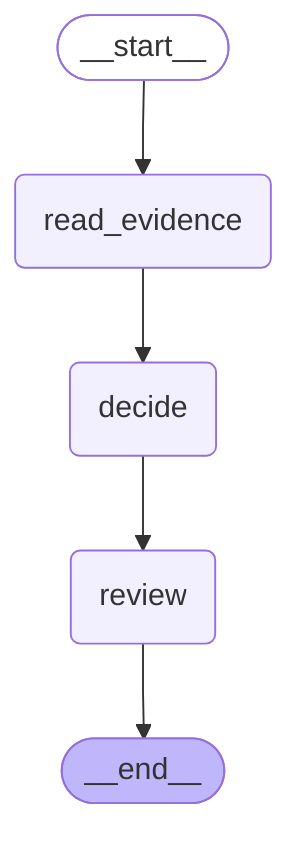
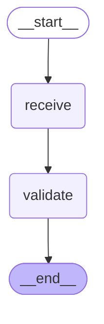
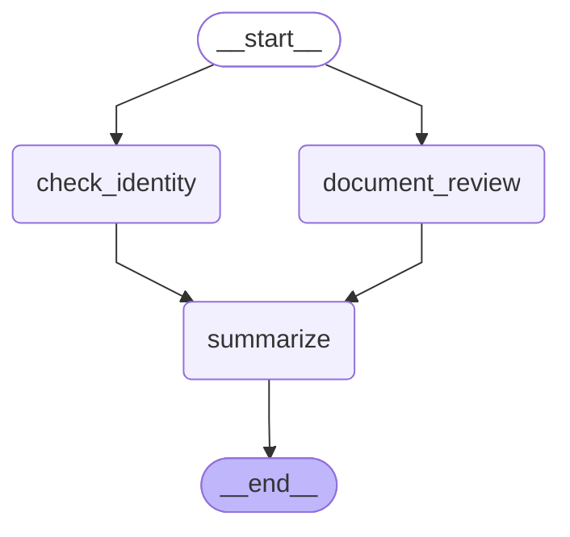

# 07 — Time travel, debugging, and streaming basics

> After this module you can replay a disputed decision and fork it with corrected evidence.

**Time:** 90 minutes · **Level:** Beginner · **LLM needed:** No live model · **Cost:** $0 with the included fakes.

**Larkspur Claims Copilot v03** · Practice takes additional time.

## Prerequisites

Complete [Human-in-the-loop with interrupts](../06_human_in_the_loop/README.md). Read dictionary keys, functions, and Python type hints comfortably. Run uv sync from the repository root.

Optional installation requirements are listed in [the setup guide](../../docs/OPTIONAL_DEPENDENCIES.md). Use `uv run --no-sync` after installing extras so subsequent commands retain that environment.

## Learning objectives

- Implement and explain Historical checkpoint replay; checkpoint_id; update_state forks; as_node; renewed interrupts.
- Implement and explain values, updates, debug, and custom stream modes; get_stream_writer; v2 StreamPart envelope.
- Implement and explain Subgraph namespace preview; parallel event ordering; error reading; stream versus checkpoint history.

## The big idea

Replay a disputed decision and fork it with corrected evidence. Predict the state before running code, then compare the observed result. A state is the data visible to a node; a node is one unit of work; an edge selects later work. A checkpoint is a saved state boundary, not a promise that an external effect happened exactly once.

## How it works

### Replay And Fork

A checkpoint configuration identifies a historical state. Replaying it reruns later work; it does not merely print an old answer. update_state with as_node forks from that checkpoint and schedules its successors. Approval encountered again is requested again.

Copy the case file at a chosen revision, attach corrected evidence, and send the copy through review.



### V2 Stream Parts

A v2 stream part has type, ns, and data fields. Updates contain a node's changed fields; values contain the visible whole state; custom events carry application progress. Interrupt metadata is separate from ordinary values and must survive UI serialization.

Keep the receipt log, the current folder, and the clerk's progress announcement in separate columns.



### Namespaces And Errors

A subgraph namespace identifies nested work. Sibling parallel events can arrive in either order; causal requirements, such as summary after both checks, are stable. A live event trace is not itself the durable checkpoint history.

Two inspectors can report in either order, but the adjuster signs after both reports arrive.



## Key APIs at a glance

| API / executable example | What it does | When to use it |
| --- | --- | --- |
| InMemorySaver, StateGraph, Command, interrupt — [01_replay_and_fork.py](examples/01_replay_and_fork.py) | Historical checkpoint replay; checkpoint_id; update_state forks; as_node; renewed interrupts | A checkpoint configuration identifies a historical state. |
| InMemorySaver, get_stream_writer, StateGraph, interrupt — [02_v2_stream_parts.py](examples/02_v2_stream_parts.py) | values, updates, debug, and custom stream modes; get_stream_writer; v2 StreamPart envelope | A v2 stream part has type, ns, and data fields. |
| StateGraph — [03_namespaces_and_errors.py](examples/03_namespaces_and_errors.py) | Subgraph namespace preview; parallel event ordering; error reading; stream versus checkpoint history | A subgraph namespace identifies nested work. |

## Walkthrough

Run commands from the repository root; the same commands work in PowerShell, macOS, and Linux. Open the source alongside the output. Find the state declaration, node functions, graph connections, and invocation. For a failure, start with the earliest changed field or scheduled node.

```text
uv run python modules/07_time_travel_and_streaming/examples/01_replay_and_fork.py
```

**Predict, then run:** for {"amount_cents": 100000, "corrected_amount": 600000}, write the resulting fields and any expected error. Then test the boundary cases in tests/replay_and_fork.json.

<details>
<summary>Reveal the checked result</summary>

```json
{
  "value": {
    "original_route": "fast_track",
    "fork_route": "specialist",
    "replay_prompts": 1,
    "fork_prompts": 1,
    "original_unchanged": true,
    "fork_parent_is_historical": true
  }
}
```

A checkpoint configuration identifies a historical state. Replaying it reruns later work; it does not merely print an old answer. update_state with as_node forks from that checkpoint and schedules its successors. Approval encountered again is requested again.

</details>

```text
uv run python modules/07_time_travel_and_streaming/examples/02_v2_stream_parts.py
```

**Predict, then run:** for {"claim_id": "CLM-0001", "review": false}, write the resulting fields and any expected error. Then test the boundary cases in tests/v2_stream_parts.json.

<details>
<summary>Reveal the checked result</summary>

```json
{
  "value": {
    "parts": [
      {
        "type": "debug",
        "namespace": [],
        "event": "checkpoint"
      },
      {
        "type": "values",
        "namespace": [],
        "status": "input",
        "interrupts": 0
      },
      {
        "type": "debug",
        "namespace": [],
        "event": "checkpoint"
      },
      {
        "type": "debug",
        "namespace": [],
        "event": "task"
      },
      {
        "type": "custom",
        "namespace": [],
        "phase": "received"
      },
      {
        "type": "updates",
        "namespace": [],
        "nodes": [
          "receive"
        ]
      },
      {
        "type": "debug",
        "namespace": [],
        "event": "task_result"
      },
      {
        "type": "values",
        "namespace": [],
        "status": "received",
        "interrupts": 0
      },
      {
        "type": "debug",
        "namespace": [],
        "event": "checkpoint"
      },
      {
        "type": "debug",
        "namespace": [],
        "event": "task"
      },
      {
        "type": "updates",
        "namespace": [],
        "nodes": [
          "validate"
        ]
      },
      {
        "type": "debug",
        "namespace": [],
        "event": "task_result"
      },
      {
        "type": "values",
        "namespace": [],
        "status": "validated",
        "interrupts": 0
      },
      {
        "type": "debug",
        "namespace": [],
        "event": "checkpoint"
      }
    ]
  }
}
```

A v2 stream part has type, ns, and data fields. Updates contain a node's changed fields; values contain the visible whole state; custom events carry application progress. Interrupt metadata is separate from ordinary values and must survive UI serialization.

</details>

```text
uv run python modules/07_time_travel_and_streaming/examples/03_namespaces_and_errors.py
```

**Predict, then run:** for {"claim_id": "CLM-0001"}, write the resulting fields and any expected error. Then test the boundary cases in tests/namespaces_and_errors.json.

<details>
<summary>Reveal the checked result</summary>

```json
{
  "value": {
    "groups": {
      "document_review": [
        "check_document"
      ],
      "parent": [
        "check_identity",
        "document_review",
        "summarize"
      ]
    },
    "summary_last": true
  }
}
```

A subgraph namespace identifies nested work. Sibling parallel events can arrive in either order; causal requirements, such as summary after both checks, are stable. A live event trace is not itself the durable checkpoint history.

</details>

When build_graph needs no arguments, its generated Mermaid diagram is saved beside the example. A diagram records possible edges; a runtime stream records executed work. A single sequence advances one node per superstep. Parallel nodes see the same previous boundary, so they cannot read a sibling's unfinished update.

## When to use it, and when not to

Use these contracts when the claim needs the state or control-flow behavior described above. Keep pure arithmetic and validation in ordinary functions that can be tested independently. A graph, checkpoint, or extra agent adds operational choices; justify it with a concrete failure, pause, branch, or reuse requirement.

## Real-world use case

Replay a disputed decision and fork it with corrected evidence. The executable milestone uses only fictional records and the shared v03 implementation. [Read the use case](use_case/claims_copilot.py).

```text
uv run python modules/07_time_travel_and_streaming/use_case/claims_copilot.py
```

Sample output from the synthetic default case:

```json
{
  "requests": [
    {
      "kind": "payout_approval",
      "claim_id": "CLM-0001",
      "amount_cents": 600000
    }
  ],
  "pending": [
    "approve_claim"
  ],
  "steps": [
    -1,
    0,
    1,
    2,
    3,
    4
  ]
}
```

A real team would connect this boundary to validated records and authenticated roles, then retain the same rejection, ownership, and recovery checks.

## Common bugs

| Symptom or broken contract | Cause and repair | Practice |
| --- | --- | --- |
| Observed `{"value": {"original_route": "fast_track", "fork_route": "fast_track", "replay_prompts": 1, "fork_prompts": 1, "original_unchanged": true, "fork_parent_is_historical": true}}`. A fork must contain the corrected evidence. | Restore `case["corrected_amount"]` and check the boundary cases. | [07-01](../../gym/tasks/07/07-01_replay_and_fork_build/task.md) · [Related Fix 07-02](../../gym/tasks/07/07-02_replay_and_fork_fix/task.md) |
| Observed `{"value": {"original_route": "fast_track", "fork_route": "fast_track", "replay_prompts": 1, "fork_prompts": 1, "original_unchanged": true, "fork_parent_is_historical": true}}`. Replay the new fork configuration, not its uncorrected parent. | Restore `graph.invoke(None, fork_config, version="v2")` and check the boundary cases. | [07-02](../../gym/tasks/07/07-02_replay_and_fork_fix/task.md) |
| Observed `{"value": {"parts": [{"type": "updates", "namespace": [], "event": "checkpoint"}, {"type": "updates", "namespace": [], "status": "input", "interrupts": 0}, {"type": "updates", "namespace": [], "event": "checkpoint"}, {"t`. A consumer must preserve the event mode. | Restore `"type": part["type"]` and check the boundary cases. | [07-07](../../gym/tasks/07/07-07_v2_stream_parts_build/task.md) · [Related Fix 07-08](../../gym/tasks/07/07-08_v2_stream_parts_fix/task.md) |
| Observed `{"value": {"parts": [{"type": "debug", "namespace": [], "event": "checkpoint"}, {"type": "values", "namespace": [], "status": "input", "interrupts": 0}, {"type": "debug", "namespace": [], "event": "checkpoint"}, {"type":`. The state payload is inside data, not at the envelope root. | Restore `part["data"].get("status", "input")` and check the boundary cases. | [07-08](../../gym/tasks/07/07-08_v2_stream_parts_fix/task.md) |
| Observed `{"value": {"groups": {"parent": ["check_identity", "document_review", "summarize"]}, "summary_last": true}}`. Nested updates require subgraph streaming. | Restore `subgraphs=True` and check the boundary cases. | [07-13](../../gym/tasks/07/07-13_namespaces_and_errors_build/task.md) · [Related Fix 07-14](../../gym/tasks/07/07-14_namespaces_and_errors_fix/task.md) |
| Observed `{"value": {"groups": {"document_review": ["check_document"], "parent": ["check_identity", "document_review", "summarize"]}, "summary_last": false}}`. Keep parent and child scopes distinct. | Restore `if not part["ns"]` and check the boundary cases. | [07-14](../../gym/tasks/07/07-14_namespaces_and_errors_fix/task.md) |

## Practice

- [07-01 — build, easy](../../gym/tasks/07/07-01_replay_and_fork_build/task.md): Build replay and fork: A fork must contain the corrected evidence.
- [07-02 — fix, medium](../../gym/tasks/07/07-02_replay_and_fork_fix/task.md): Fix replay and fork: Replay the new fork configuration, not its uncorrected parent.
- [07-03 — predict, easy](../../gym/tasks/07/07-03_replay_and_fork_predict/task.md): Predict replay and fork across the declared cases
- [07-04 — trace, medium](../../gym/tasks/07/07-04_replay_and_fork_trace/task.md): Trace replay and fork: Replay the new fork configuration, not its uncorrected parent.
- [07-05 — extend, hard](../../gym/tasks/07/07-05_replay_and_fork_extend/task.md): Extend replay and fork: Parentage must identify the selected historical evidence.
- [07-06 — refactor, hard](../../gym/tasks/07/07-06_replay_and_fork_refactor/task.md): Refactor replay and fork: Replaying a completed checkpoint is different from rerunning pending review.
- [07-07 — build, easy](../../gym/tasks/07/07-07_v2_stream_parts_build/task.md): Build v2 stream parts: A consumer must preserve the event mode.
- [07-08 — fix, medium](../../gym/tasks/07/07-08_v2_stream_parts_fix/task.md): Fix v2 stream parts: The state payload is inside data, not at the envelope root.
- [07-09 — predict, easy](../../gym/tasks/07/07-09_v2_stream_parts_predict/task.md): Predict v2 stream parts across the declared cases
- [07-10 — trace, medium](../../gym/tasks/07/07-10_v2_stream_parts_trace/task.md): Trace v2 stream parts: The state payload is inside data, not at the envelope root.
- [07-11 — extend, hard](../../gym/tasks/07/07-11_v2_stream_parts_extend/task.md): Extend v2 stream parts: Values events must retain interrupt information.
- [07-12 — refactor, hard](../../gym/tasks/07/07-12_v2_stream_parts_refactor/task.md): Refactor v2 stream parts: A unified dispatcher must preserve custom progress payloads.
- [07-13 — build, easy](../../gym/tasks/07/07-13_namespaces_and_errors_build/task.md): Build namespaces and errors: Nested updates require subgraph streaming.
- [07-14 — fix, medium](../../gym/tasks/07/07-14_namespaces_and_errors_fix/task.md): Fix namespaces and errors: Keep parent and child scopes distinct.
- [07-15 — predict, easy](../../gym/tasks/07/07-15_namespaces_and_errors_predict/task.md): Predict namespaces and errors across the declared cases
- [07-16 — trace, medium](../../gym/tasks/07/07-16_namespaces_and_errors_trace/task.md): Trace namespaces and errors: Keep parent and child scopes distinct.
- [07-17 — extend, hard](../../gym/tasks/07/07-17_namespaces_and_errors_extend/task.md): Extend namespaces and errors: Group by stable scope names while retaining raw IDs separately when needed.
- [07-18 — design, hard](../../gym/tasks/07/07-18_namespaces_and_errors_design/task.md): Design namespaces and errors and justify the boundary policies

Start with tasks 01, 02, 09, 10, 17, and 18 in this module. Finish the other tasks for full practice. Hints are progressive; solution exposure is recorded. Predict and Trace tasks use answer JSON, not a code starter.

## Quiz

Predict first; explain in your own words.

1. Explain the contract in 01_replay_and_fork.py using one claim from its input cases.
2. Diagnose this broken behavior: Replay the new fork configuration, not its uncorrected parent. Which observation distinguishes the repair from a default-case-only fix?
3. Explain the contract in 02_v2_stream_parts.py using one claim from its input cases.
4. Diagnose this broken behavior: The state payload is inside data, not at the envelope root. Which observation distinguishes the repair from a default-case-only fix?
5. Explain the contract in 03_namespaces_and_errors.py using one claim from its input cases.
6. Diagnose this broken behavior: Keep parent and child scopes distinct. Which observation distinguishes the repair from a default-case-only fix?

<details>
<summary>Answers</summary>

1. A checkpoint configuration identifies a historical state. Replaying it reruns later work; it does not merely print an old answer. update_state with as_node forks from that checkpoint and schedules its successors. Approval encountered again is requested again.
2. Replay the new fork configuration, not its uncorrected parent. Compare the normal case with the boundary fixtures and identify the first differing update.
3. A v2 stream part has type, ns, and data fields. Updates contain a node's changed fields; values contain the visible whole state; custom events carry application progress. Interrupt metadata is separate from ordinary values and must survive UI serialization.
4. The state payload is inside data, not at the envelope root. Compare the normal case with the boundary fixtures and identify the first differing update.
5. A subgraph namespace identifies nested work. Sibling parallel events can arrive in either order; causal requirements, such as summary after both checks, are stable. A live event trace is not itself the durable checkpoint history.
6. Keep parent and child scopes distinct. Compare the normal case with the boundary fixtures and identify the first differing update.

</details>

## Cost and safety

The default commands cost $0: deterministic Python and, in model lessons, scripted local fakes. They consume no hosted tokens and make no real payments or emails. Optional live experiments use the provider configured in .env; a short one-to-four-call exercise is usually cents, but verify your provider's current token prices and set a budget. Ollama can run locally without a hosted bill. Temporary checkpoint files are isolated from the committed dataset. Keep real customer details and credentials out of graph state.

## Key takeaways

- State visibility and update rules determine what a node can safely assume.
- Check normal, missing, boundary, and failure cases before trusting a workflow.
- Separate observed execution from diagrams, predictions, and durable history.
- Model output is evidence to validate, never an authorization grant.
- A saved checkpoint and an external effect have separate durability boundaries.

## Go deeper

- [replay and fork official guide](https://docs.langchain.com/oss/python/langgraph/use-time-travel)
- [v2 stream parts official guide](https://docs.langchain.com/oss/python/langgraph/streaming)
- [namespaces and errors official guide](https://docs.langchain.com/oss/python/langgraph/streaming)

## Next:

Continue to [module 08: LLMs inside nodes](../../modules/08_llms_inside_nodes/README.md).
