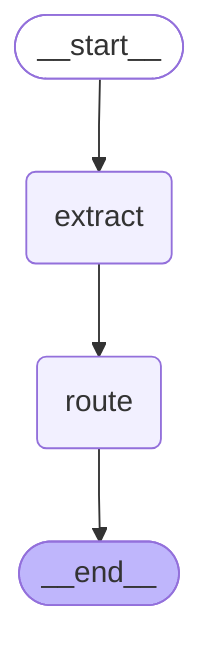
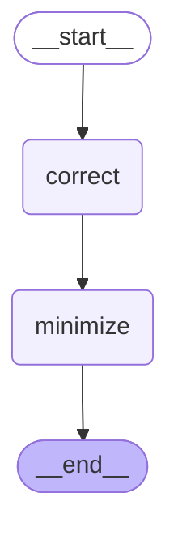
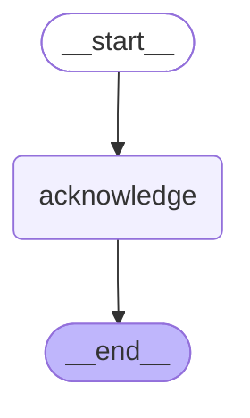

# 08 — LLMs inside nodes

> After this module you can extract claim facts with a model, then route with deterministic rules.

**Time:** 120 minutes · **Level:** Intermediate · **LLM needed:** No live model · **Cost:** $0 with the included fakes.

**Larkspur Claims Copilot v04** · Practice takes additional time.

## Prerequisites

Complete [Time travel, debugging, and streaming basics](../07_time_travel_and_streaming/README.md). Read dictionary keys, functions, and Python type hints comfortably. Run uv sync from the repository root.

Optional installation requirements are listed in [the setup guide](../../docs/OPTIONAL_DEPENDENCIES.md). Use `uv run --no-sync` after installing extras so subsequent commands retain that environment.

## Learning objectives

- Implement and explain LLM and prompt basics; init_chat_model; common model factory; provider configuration; structured output validation.
- Implement and explain MessagesState; add_messages; message IDs; RemoveMessage; human, AI, and tool messages.
- Implement and explain messages stream mode; token chunks and metadata; scripted fake chat models; structured-output and streaming fake contracts.

## The big idea

Extract claim facts with a model, then route with deterministic rules. Predict the state before running code, then compare the observed result. A state is the data visible to a node; a node is one unit of work; an edge selects later work. A checkpoint is a saved state boundary, not a promise that an external effect happened exactly once.

## How it works

### Model Boundary

A model predicts text from messages; a prompt is its instruction and evidence. Structured output parses that text into a validated schema. Validation can reject an impossible amount, but cannot prove a claim is true. The deterministic router owns the decision after extraction.

An intake clerk transcribes a form; a separate rulebook decides which desk receives it.



### Message Identity

MessagesState applies add_messages: a matching message ID replaces a message instead of appending a duplicate. RemoveMessage deletes by that same ID. Tool responses still need the tool_call_id from their AI request; message identity and tool-call identity serve different purposes.

Correct a numbered page in a folder without discarding the receipt stapled to another page.



### Tokens And Fakes

The messages stream emits a chunk and metadata inside each v2 part's data field. Assemble content in order and inspect langgraph_node to attribute it. A fake should agree between invoke and stream, including a structured JSON response; it tests orchestration, not model quality.

Reassemble numbered delivery envelopes before reading the complete letter.



## Key APIs at a glance

| API / executable example | What it does | When to use it |
| --- | --- | --- |
| AIMessage, StateGraph — [01_model_boundary.py](examples/01_model_boundary.py) | LLM and prompt basics; init_chat_model; common model factory; provider configuration; structured output validation | A model predicts text from messages; a prompt is its instruction and evidence. |
| AIMessage, HumanMessage, RemoveMessage, ToolMessage — [02_message_identity.py](examples/02_message_identity.py) | MessagesState; add_messages; message IDs; RemoveMessage; human, AI, and tool messages | MessagesState applies add_messages: a matching message ID replaces a message instead of appending a duplicate. |
| AIMessage, HumanMessage, MessagesState, StateGraph — [03_tokens_and_fakes.py](examples/03_tokens_and_fakes.py) | messages stream mode; token chunks and metadata; scripted fake chat models; structured-output and streaming fake contracts | The messages stream emits a chunk and metadata inside each v2 part's data field. |

## Walkthrough

Run commands from the repository root; the same commands work in PowerShell, macOS, and Linux. Open the source alongside the output. Find the state declaration, node functions, graph connections, and invocation. For a failure, start with the earliest changed field or scheduled node.

```text
uv run python modules/08_llms_inside_nodes/examples/01_model_boundary.py
```

**Predict, then run:** for {"claim_type": "water", "amount_cents": 125000, "confidence": 0.9}, write the resulting fields and any expected error. Then test the boundary cases in tests/model_boundary.json.

<details>
<summary>Reveal the checked result</summary>

```json
{
  "value": {
    "facts": {
      "claim_type": "water",
      "amount_cents": 125000,
      "loss_date": null,
      "confidence": 0.9
    },
    "route": "standard"
  }
}
```

A model predicts text from messages; a prompt is its instruction and evidence. Structured output parses that text into a validated schema. Validation can reject an impossible amount, but cannot prove a claim is true. The deterministic router owns the decision after extraction.

</details>

```text
uv run python modules/08_llms_inside_nodes/examples/02_message_identity.py
```

**Predict, then run:** for {"text": "Corrected: pipe burst", "remove_customer": true}, write the resulting fields and any expected error. Then test the boundary cases in tests/message_identity.json.

<details>
<summary>Reveal the checked result</summary>

```json
{
  "value": {
    "messages": [
      {
        "role": "ai",
        "id": "agent-1",
        "text": ""
      },
      {
        "role": "tool",
        "id": "tool-1",
        "text": "Synthetic policy found"
      }
    ],
    "paired": true
  }
}
```

MessagesState applies add_messages: a matching message ID replaces a message instead of appending a duplicate. RemoveMessage deletes by that same ID. Tool responses still need the tool_call_id from their AI request; message identity and tool-call identity serve different purposes.

</details>

```text
uv run python modules/08_llms_inside_nodes/examples/03_tokens_and_fakes.py
```

**Predict, then run:** for {"text": "Larkspur received your synthetic claim.", "structured": false}, write the resulting fields and any expected error. Then test the boundary cases in tests/tokens_and_fakes.json.

<details>
<summary>Reveal the checked result</summary>

```json
{
  "value": {
    "text": "Larkspur received your synthetic claim.",
    "matches_invoke": true,
    "structured": null,
    "nodes": [
      "acknowledge"
    ],
    "nonempty_chunks": 5
  }
}
```

The messages stream emits a chunk and metadata inside each v2 part's data field. Assemble content in order and inspect langgraph_node to attribute it. A fake should agree between invoke and stream, including a structured JSON response; it tests orchestration, not model quality.

</details>

When build_graph needs no arguments, its generated Mermaid diagram is saved beside the example. A diagram records possible edges; a runtime stream records executed work. A single sequence advances one node per superstep. Parallel nodes see the same previous boundary, so they cannot read a sibling's unfinished update.

## When to use it, and when not to

Use these contracts when the claim needs the state or control-flow behavior described above. Keep pure arithmetic and validation in ordinary functions that can be tested independently. A graph, checkpoint, or extra agent adds operational choices; justify it with a concrete failure, pause, branch, or reuse requirement.

## Real-world use case

Extract claim facts with a model, then route with deterministic rules. The executable milestone uses only fictional records and the shared v04 implementation. [Read the use case](use_case/claims_copilot.py).

```text
uv run python modules/08_llms_inside_nodes/use_case/claims_copilot.py
```

Sample output from the synthetic default case:

```json
{
  "extracted": {
    "claim_type": "water",
    "amount_cents": 2096759,
    "loss_date": "2026-01-01",
    "confidence": 0.95
  },
  "route": "specialist",
  "approved": true
}
```

A real team would connect this boundary to validated records and authenticated roles, then retain the same rejection, ownership, and recovery checks.

## Common bugs

| Symptom or broken contract | Cause and repair | Practice |
| --- | --- | --- |
| Observed `{"value": {"facts": {"claim_type": "water", "amount_cents": 125000, "loss_date": null, "confidence": 0.9}, "route": "standard"}}`. Send uncertain extractions to review. | Restore `facts.confidence < 0.8` and check the boundary cases. | [08-01](../../gym/tasks/08/08-01_model_boundary_build/task.md) · [Related Fix 08-02](../../gym/tasks/08/08-02_model_boundary_fix/task.md) |
| Observed `{"value": {"facts": {"claim_type": "water", "amount_cents": 125000, "loss_date": null, "confidence": 0.9}, "route": "standard"}}`. Include exactly 100000 cents in fast-track routing. | Restore `facts.amount_cents <= 100000` and check the boundary cases. | [08-02](../../gym/tasks/08/08-02_model_boundary_fix/task.md) |
| Observed `{"error": "ValueError"}`. Delete by the existing message ID. | Restore `RemoveMessage(id="customer-1")` and check the boundary cases. | [08-07](../../gym/tasks/08/08-07_message_identity_build/task.md) · [Related Fix 08-08](../../gym/tasks/08/08-08_message_identity_fix/task.md) |
| Observed `{"error": "AttributeError"}`. Correct an existing message without appending another customer message. | Restore `HumanMessage(content=case["text"], id="customer-1")` and check the boundary cases. | [08-08](../../gym/tasks/08/08-08_message_identity_fix/task.md) |
| Observed `{"value": {"text": "Larkspur  received  your  synthetic  claim. ", "matches_invoke": false, "structured": null, "nodes": ["acknowledge"], "nonempty_chunks": 5}}`. Join chunks without inserting characters that were never emitted. | Restore `text = "".join(chunks)` and check the boundary cases. | [08-13](../../gym/tasks/08/08-13_tokens_and_fakes_build/task.md) · [Related Fix 08-14](../../gym/tasks/08/08-14_tokens_and_fakes_fix/task.md) |
| Observed `{"error": "KeyError"}`. Read the documented node name from stream metadata. | Restore `metadata["langgraph_node"]` and check the boundary cases. | [08-14](../../gym/tasks/08/08-14_tokens_and_fakes_fix/task.md) |

## Practice

- [08-01 — build, easy](../../gym/tasks/08/08-01_model_boundary_build/task.md): Build model boundary: Send uncertain extractions to review.
- [08-02 — fix, medium](../../gym/tasks/08/08-02_model_boundary_fix/task.md): Fix model boundary: Include exactly 100000 cents in fast-track routing.
- [08-03 — predict, easy](../../gym/tasks/08/08-03_model_boundary_predict/task.md): Predict model boundary across the declared cases
- [08-04 — trace, medium](../../gym/tasks/08/08-04_model_boundary_trace/task.md): Trace model boundary: Include exactly 100000 cents in fast-track routing.
- [08-05 — extend, hard](../../gym/tasks/08/08-05_model_boundary_extend/task.md): Extend model boundary: Route an unknown category to review even with high confidence.
- [08-06 — refactor, hard](../../gym/tasks/08/08-06_model_boundary_refactor/task.md): Refactor model boundary: Preserve the validated amount across the model boundary.
- [08-07 — build, easy](../../gym/tasks/08/08-07_message_identity_build/task.md): Build message identity: Delete by the existing message ID.
- [08-08 — fix, medium](../../gym/tasks/08/08-08_message_identity_fix/task.md): Fix message identity: Correct an existing message without appending another customer message.
- [08-09 — predict, easy](../../gym/tasks/08/08-09_message_identity_predict/task.md): Predict message identity across the declared cases
- [08-10 — trace, medium](../../gym/tasks/08/08-10_message_identity_trace/task.md): Trace message identity: Correct an existing message without appending another customer message.
- [08-11 — extend, hard](../../gym/tasks/08/08-11_message_identity_extend/task.md): Extend message identity: Make retention conditional on the requested minimization policy.
- [08-12 — refactor, hard](../../gym/tasks/08/08-12_message_identity_refactor/task.md): Refactor message identity: Keep the corrected text when replacing a message.
- [08-13 — build, easy](../../gym/tasks/08/08-13_tokens_and_fakes_build/task.md): Build tokens and fakes: Join chunks without inserting characters that were never emitted.
- [08-14 — fix, medium](../../gym/tasks/08/08-14_tokens_and_fakes_fix/task.md): Fix tokens and fakes: Read the documented node name from stream metadata.
- [08-15 — predict, easy](../../gym/tasks/08/08-15_tokens_and_fakes_predict/task.md): Predict tokens and fakes across the declared cases
- [08-16 — trace, medium](../../gym/tasks/08/08-16_tokens_and_fakes_trace/task.md): Trace tokens and fakes: Read the documented node name from stream metadata.
- [08-17 — extend, hard](../../gym/tasks/08/08-17_tokens_and_fakes_extend/task.md): Extend tokens and fakes: Validate the fully assembled structured response.
- [08-18 — refactor, hard](../../gym/tasks/08/08-18_tokens_and_fakes_refactor/task.md): Refactor tokens and fakes: Preserve emission order while collecting token chunks.

Start with tasks 01, 02, 09, 10, 17, and 18 in this module. Finish the other tasks for full practice. Hints are progressive; solution exposure is recorded. Predict and Trace tasks use answer JSON, not a code starter.

## Quiz

Predict first; explain in your own words.

1. Explain the contract in 01_model_boundary.py using one claim from its input cases.
2. Diagnose this broken behavior: Include exactly 100000 cents in fast-track routing. Which observation distinguishes the repair from a default-case-only fix?
3. Explain the contract in 02_message_identity.py using one claim from its input cases.
4. Diagnose this broken behavior: Correct an existing message without appending another customer message. Which observation distinguishes the repair from a default-case-only fix?
5. Explain the contract in 03_tokens_and_fakes.py using one claim from its input cases.
6. Diagnose this broken behavior: Read the documented node name from stream metadata. Which observation distinguishes the repair from a default-case-only fix?

<details>
<summary>Answers</summary>

1. A model predicts text from messages; a prompt is its instruction and evidence. Structured output parses that text into a validated schema. Validation can reject an impossible amount, but cannot prove a claim is true. The deterministic router owns the decision after extraction.
2. Include exactly 100000 cents in fast-track routing. Compare the normal case with the boundary fixtures and identify the first differing update.
3. MessagesState applies add_messages: a matching message ID replaces a message instead of appending a duplicate. RemoveMessage deletes by that same ID. Tool responses still need the tool_call_id from their AI request; message identity and tool-call identity serve different purposes.
4. Correct an existing message without appending another customer message. Compare the normal case with the boundary fixtures and identify the first differing update.
5. The messages stream emits a chunk and metadata inside each v2 part's data field. Assemble content in order and inspect langgraph_node to attribute it. A fake should agree between invoke and stream, including a structured JSON response; it tests orchestration, not model quality.
6. Read the documented node name from stream metadata. Compare the normal case with the boundary fixtures and identify the first differing update.

</details>

## Cost and safety

The default commands cost $0: deterministic Python and, in model lessons, scripted local fakes. They consume no hosted tokens and make no real payments or emails. Optional live experiments use the provider configured in .env; a short one-to-four-call exercise is usually cents, but verify your provider's current token prices and set a budget. Ollama can run locally without a hosted bill. Temporary checkpoint files are isolated from the committed dataset. Keep real customer details and credentials out of graph state.

## Key takeaways

- State visibility and update rules determine what a node can safely assume.
- Check normal, missing, boundary, and failure cases before trusting a workflow.
- Separate observed execution from diagrams, predictions, and durable history.
- Model output is evidence to validate, never an authorization grant.
- A saved checkpoint and an external effect have separate durability boundaries.

## Go deeper

- [model boundary official guide](https://docs.langchain.com/oss/python/langchain/models)
- [message identity official guide](https://docs.langchain.com/oss/python/langgraph/graph-api-state)
- [tokens and fakes official guide](https://docs.langchain.com/oss/python/langgraph/streaming)

## Next:

Continue to [module 09: Tools and the agent loop](../../modules/09_tools_and_agent_loop/README.md).
