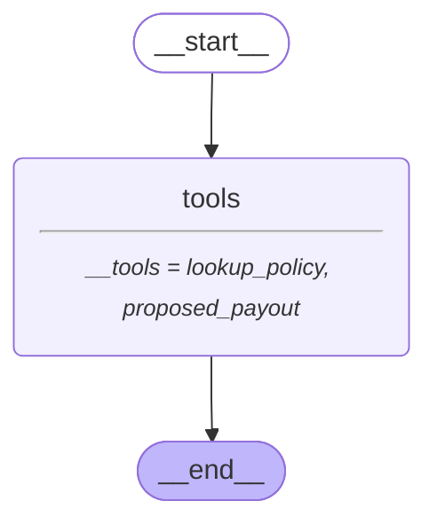
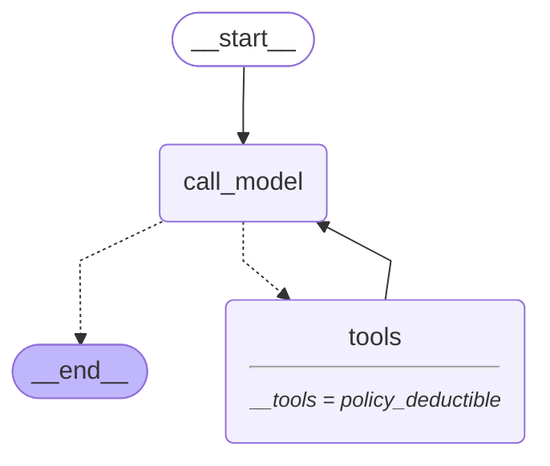
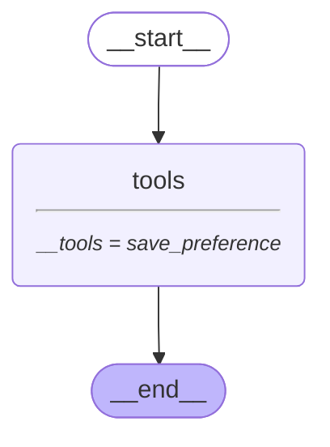

# 09 — Tools and the agent loop

> After this module you can look up policies and calculate a synthetic payout through controlled tools.

**Time:** 150 minutes · **Level:** Intermediate · **LLM needed:** No live model · **Cost:** $0 with the included fakes.

**Larkspur Claims Copilot v05** · Practice takes additional time.

## Prerequisites

Complete [LLMs inside nodes](../08_llms_inside_nodes/README.md). Read dictionary keys, functions, and Python type hints comfortably. Run uv sync from the repository root.

Optional installation requirements are listed in [the setup guide](../../docs/OPTIONAL_DEPENDENCIES.md). Use `uv run --no-sync` after installing extras so subsequent commands retain that environment.

New to pytest, type validation, chat messages, tools, or async Python? Read the relevant section of [the beginner bridge](../../docs/BEGINNER_BRIDGE.md) when that concept first appears.

After the deterministic lesson, use [the optional provider lab](../../docs/LIVE_MODEL_LAB.md) to try real extraction, scoped tool calls, and conversation memory with your configured provider. Graded results remain fake and offline.

## Learning objectives

- Implement and explain Tool definitions and schemas; tool calls; ToolMessage IDs; tool errors; deterministic policy lookup.
- Implement and explain Manual ReAct graph; model node; ToolNode; tools_condition; bounded agent loop.
- Implement and explain ToolRuntime; Runtime context; state and Store access; tool Command updates; trusted tool-call identity.

## The big idea

Look up policies and calculate a synthetic payout through controlled tools. Predict the state before running code, then compare the observed result. A state is the data visible to a node; a node is one unit of work; an edge selects later work. A checkpoint is a saved state boundary, not a promise that an external effect happened exactly once.

## How it works

### Tools And Messages

A tool's typed parameters become a schema the model can request. ToolNode runs the requested function and returns a ToolMessage with the original call ID. Expected lookup failures become error messages when error handling is enabled. A payout calculator proposes cents; it does not transfer money.

A requisition number must remain attached to its completed work order.



### Manual React

A manual agent loop alternates a model node and ToolNode. tools_condition checks the newest AI message: tool calls continue the loop, a final answer ends it. A recursion budget catches nontermination, but does not authorize tool effects or guarantee a useful answer.

The investigator requests one record, reads the result, and then writes a conclusion.



### Tool Runtime

ToolRuntime injects trusted context, graph state, the Store, and tool_call_id without exposing them as model-selectable fields. A tool returning Command can update graph state and acknowledge its own request. Customer identity belongs in authenticated context, not in an argument the model invents.

An employee badge determines the filing cabinet; the form only chooses the contact preference.



## Key APIs at a glance

| API / executable example | What it does | When to use it |
| --- | --- | --- |
| AIMessage, tool, MessagesState, StateGraph — [01_tools_and_messages.py](examples/01_tools_and_messages.py) | Tool definitions and schemas; tool calls; ToolMessage IDs; tool errors; deterministic policy lookup | A tool's typed parameters become a schema the model can request. |
| AIMessage, HumanMessage, tool, MessagesState — [02_manual_react.py](examples/02_manual_react.py) | Manual ReAct graph; model node; ToolNode; tools_condition; bounded agent loop | A manual agent loop alternates a model node and ToolNode. |
| ToolRuntime, tool, AIMessage, ToolMessage — [03_tool_runtime.py](examples/03_tool_runtime.py) | ToolRuntime; Runtime context; state and Store access; tool Command updates; trusted tool-call identity | ToolRuntime injects trusted context, graph state, the Store, and tool_call_id without exposing them as model-selectable fields. |

## Walkthrough

Run commands from the repository root; the same commands work in PowerShell, macOS, and Linux. Open the source alongside the output. Find the state declaration, node functions, graph connections, and invocation. For a failure, start with the earliest changed field or scheduled node.

```text
uv run --no-sync python modules/09_tools_and_agent_loop/examples/01_tools_and_messages.py
```

**Predict, then run:** for {"policy_id": "POL-0001", "amount_cents": 125000}, write the resulting fields and any expected error. Then test the boundary cases in tests/tools_and_messages.json.

<details>
<summary>Reveal the checked result</summary>

```json
{
  "value": {
    "results": [
      {
        "call_id": "payout-call",
        "status": "success",
        "content": "25000"
      },
      {
        "call_id": "policy-call",
        "status": "success",
        "content": "limit=25000000; deductible=100000"
      }
    ]
  }
}
```

A tool's typed parameters become a schema the model can request. ToolNode runs the requested function and returns a ToolMessage with the original call ID. Expected lookup failures become error messages when error handling is enabled. A payout calculator proposes cents; it does not transfer money.

</details>

```text
uv run --no-sync python modules/09_tools_and_agent_loop/examples/02_manual_react.py
```

**Predict, then run:** for {"policy_id": "POL-0001", "recursion_limit": 12}, write the resulting fields and any expected error. Then test the boundary cases in tests/manual_react.json.

<details>
<summary>Reveal the checked result</summary>

```json
{
  "value": {
    "roles": [
      "human",
      "ai",
      "tool",
      "ai"
    ],
    "tool_results": [
      "100000 cents"
    ],
    "final": "Use the tool result as evidence; this is not payment approval."
  }
}
```

A manual agent loop alternates a model node and ToolNode. tools_condition checks the newest AI message: tool calls continue the loop, a final answer ends it. A recursion budget catches nontermination, but does not authorize tool effects or guarantee a useful answer.

</details>

```text
uv run --no-sync python modules/09_tools_and_agent_loop/examples/03_tool_runtime.py
```

**Predict, then run:** for {"customer_id": "CUS-0001", "preference": "email"}, write the resulting fields and any expected error. Then test the boundary cases in tests/tool_runtime.json.

<details>
<summary>Reveal the checked result</summary>

```json
{
  "value": {
    "saved": {
      "value": "email"
    },
    "state_preference": "email",
    "tool_call_id": "save-1",
    "model_visible_fields": [
      "preference"
    ]
  }
}
```

ToolRuntime injects trusted context, graph state, the Store, and tool_call_id without exposing them as model-selectable fields. A tool returning Command can update graph state and acknowledge its own request. Customer identity belongs in authenticated context, not in an argument the model invents.

</details>

When build_graph needs no arguments, its generated Mermaid diagram is saved beside the example. A diagram records possible edges; a runtime stream records executed work. A single sequence advances one node per superstep. Parallel nodes see the same previous boundary, so they cannot read a sibling's unfinished update.

## When to use it, and when not to

Use these contracts when the claim needs the state or control-flow behavior described above. Keep pure arithmetic and validation in ordinary functions that can be tested independently. A graph, checkpoint, or extra agent adds operational choices; justify it with a concrete failure, pause, branch, or reuse requirement.

## Real-world use case

Look up policies and calculate a synthetic payout through controlled tools. The executable milestone uses only fictional records and the shared v05 implementation. [Read the use case](use_case/claims_copilot.py).

```text
uv run python modules/09_tools_and_agent_loop/use_case/claims_copilot.py
```

Sample output from the synthetic default case:

```json
{
  "tools": [
    "lookup_policy",
    "get_claim_history",
    "check_coverage",
    "calculate_payout"
  ],
  "explanation": "Policy evidence collected. An authorized adjuster must confirm coverage."
}
```

A real team would connect this boundary to validated records and authenticated roles, then retain the same rejection, ownership, and recovery checks.

## Common bugs

| Symptom or broken contract | Cause and repair | Practice |
| --- | --- | --- |
| Observed `{"value": {"results": [{"call_id": "payout-call", "status": "success", "content": "125000"}, {"call_id": "policy-call", "status": "success", "content": "limit=25000000; deductible=100000"}]}}`. Apply the deductible before proposing a payout. | Restore `calculate_payout(amount_cents, 200000, 100000)` and check the boundary cases. | [09-01](../../gym/tasks/09/09-01_tools_and_messages_build/task.md) · Related Fix: [09-02](../../gym/tasks/09/09-02_tools_and_messages_fix/task.md) |
| Observed `{"value": {"results": [{"call_id": "payout-call", "status": "success", "content": "25000"}, {"call_id": "policy-call", "status": "success", "content": "limit=25000000; deductible=100000"}]}}`. Return a correlated tool error for an unknown policy. | Restore `handle_tool_errors=True` and check the boundary cases. | [09-02](../../gym/tasks/09/09-02_tools_and_messages_fix/task.md) · Related Fix: [09-02](../../gym/tasks/09/09-02_tools_and_messages_fix/task.md) |
| Observed `{"value": {"roles": ["human", "ai", "tool"], "tool_results": ["100000 cents"], "final": "100000 cents"}}`. Return tool evidence to the model before ending. | Restore `graph.add_edge("tools", "call_model")` and check the boundary cases. | [09-07](../../gym/tasks/09/09-07_manual_react_build/task.md) · Related Fix: [09-08](../../gym/tasks/09/09-08_manual_react_fix/task.md) |
| Observed `{"value": {"roles": ["human", "ai", "tool", "ai"], "tool_results": ["100000 cents"], "final": "Use the tool result as evidence; this is not payment approval."}}`. Let the agent observe a policy lookup failure. | Restore `handle_tool_errors=True` and check the boundary cases. | [09-08](../../gym/tasks/09/09-08_manual_react_fix/task.md) · Related Fix: [09-08](../../gym/tasks/09/09-08_manual_react_fix/task.md) |
| Observed `{"value": {"saved": null, "state_preference": "email", "tool_call_id": "save-1", "model_visible_fields": ["preference"]}}`. Write only in the trusted customer namespace. | Restore `runtime.context.customer_id, "preferences"` and check the boundary cases. | [09-13](../../gym/tasks/09/09-13_tool_runtime_build/task.md) · Related Fix: [09-14](../../gym/tasks/09/09-14_tool_runtime_fix/task.md) |
| Observed `{"value": {"saved": {"value": "email"}, "state_preference": "phone", "tool_call_id": "save-1", "model_visible_fields": ["preference"]}}`. Keep the graph state consistent with the Store write. | Restore `"saved_preference": preference` and check the boundary cases. | [09-14](../../gym/tasks/09/09-14_tool_runtime_fix/task.md) · Related Fix: [09-14](../../gym/tasks/09/09-14_tool_runtime_fix/task.md) |

## Practice

- [09-01 — build, easy](../../gym/tasks/09/09-01_tools_and_messages_build/task.md): Build tools and messages: Apply the deductible before proposing a payout.
- [09-02 — fix, medium](../../gym/tasks/09/09-02_tools_and_messages_fix/task.md): Fix tools and messages: Return a correlated tool error for an unknown policy.
- [09-03 — predict, easy](../../gym/tasks/09/09-03_tools_and_messages_predict/task.md): Predict tools and messages across the declared cases
- [09-04 — trace, medium](../../gym/tasks/09/09-04_tools_and_messages_trace/task.md): Diagnose tools and messages from execution evidence
- [09-05 — extend, hard](../../gym/tasks/09/09-05_tools_and_messages_extend/task.md): Extend tools and messages: Add run_batch(cases) to preview independent claims in input order. Preserve run(case), isolate mutable inputs, return value/error records, handle an empty batch, and continue after a rejected claim.
- [09-06 — refactor, hard](../../gym/tasks/09/09-06_tools_and_messages_refactor/task.md): Refactor tools and messages: Separate input preparation from orchestration in prepare_case(case). Preserve all results/errors, distinguish None from {}, and copy nested inputs so caller data and shared defaults stay independent.
- [09-07 — build, easy](../../gym/tasks/09/09-07_manual_react_build/task.md): Build manual react: Return tool evidence to the model before ending.
- [09-08 — fix, medium](../../gym/tasks/09/09-08_manual_react_fix/task.md): Fix manual react: Let the agent observe a policy lookup failure.
- [09-09 — predict, easy](../../gym/tasks/09/09-09_manual_react_predict/task.md): Predict manual react across the declared cases
- [09-10 — trace, medium](../../gym/tasks/09/09-10_manual_react_trace/task.md): Diagnose manual react from execution evidence
- [09-11 — extend, hard](../../gym/tasks/09/09-11_manual_react_extend/task.md): Extend manual react: Add run_batch(cases) to preview independent claims in input order. Preserve run(case), isolate mutable inputs, return value/error records, handle an empty batch, and continue after a rejected claim.
- [09-12 — refactor, hard](../../gym/tasks/09/09-12_manual_react_refactor/task.md): Refactor manual react: Separate input preparation from orchestration in prepare_case(case). Preserve all results/errors, distinguish None from {}, and copy nested inputs so caller data and shared defaults stay independent.
- [09-13 — build, easy](../../gym/tasks/09/09-13_tool_runtime_build/task.md): Build tool runtime: Write only in the trusted customer namespace.
- [09-14 — fix, medium](../../gym/tasks/09/09-14_tool_runtime_fix/task.md): Fix tool runtime: Keep the graph state consistent with the Store write.
- [09-15 — predict, easy](../../gym/tasks/09/09-15_tool_runtime_predict/task.md): Predict tool runtime across the declared cases
- [09-16 — trace, medium](../../gym/tasks/09/09-16_tool_runtime_trace/task.md): Diagnose tool runtime from execution evidence
- [09-17 — extend, hard](../../gym/tasks/09/09-17_tool_runtime_extend/task.md): Extend tool runtime: Add run_batch(cases) to preview independent claims in input order. Preserve run(case), isolate mutable inputs, return value/error records, handle an empty batch, and continue after a rejected claim.
- [09-18 — design, hard](../../gym/tasks/09/09-18_tool_runtime_design/task.md): Design tool runtime and justify the boundary policies

Start with tasks 01, 02, 09, 10, 17, and 18 in this module. Finish the other tasks for full practice. Hints are progressive; solution exposure is recorded. Predict and Trace tasks use answer JSON, not a code starter.

## Quiz

Predict first; explain in your own words.

1. Explain the contract in 01_tools_and_messages.py using one claim from its input cases.
2. Diagnose this broken behavior: Return a correlated tool error for an unknown policy. Which observation distinguishes the repair from a default-case-only fix?
3. Explain the contract in 02_manual_react.py using one claim from its input cases.
4. Diagnose this broken behavior: Let the agent observe a policy lookup failure. Which observation distinguishes the repair from a default-case-only fix?
5. Explain the contract in 03_tool_runtime.py using one claim from its input cases.
6. Diagnose this broken behavior: Keep the graph state consistent with the Store write. Which observation distinguishes the repair from a default-case-only fix?

<details>
<summary>Answers</summary>

1. A tool's typed parameters become a schema the model can request. ToolNode runs the requested function and returns a ToolMessage with the original call ID. Expected lookup failures become error messages when error handling is enabled. A payout calculator proposes cents; it does not transfer money.
2. Return a correlated tool error for an unknown policy. Compare the normal case with the boundary fixtures and identify the first differing update.
3. A manual agent loop alternates a model node and ToolNode. tools_condition checks the newest AI message: tool calls continue the loop, a final answer ends it. A recursion budget catches nontermination, but does not authorize tool effects or guarantee a useful answer.
4. Let the agent observe a policy lookup failure. Compare the normal case with the boundary fixtures and identify the first differing update.
5. ToolRuntime injects trusted context, graph state, the Store, and tool_call_id without exposing them as model-selectable fields. A tool returning Command can update graph state and acknowledge its own request. Customer identity belongs in authenticated context, not in an argument the model invents.
6. Keep the graph state consistent with the Store write. Compare the normal case with the boundary fixtures and identify the first differing update.

</details>

## Cost and safety

The default commands cost $0: deterministic Python and, in model lessons, scripted local fakes. They consume no hosted tokens and make no real payments or emails. Optional live experiments use the provider configured in .env; a short one-to-four-call exercise is usually cents, but verify your provider's current token prices and set a budget. Ollama can run locally without a hosted bill. Temporary checkpoint files are isolated from the committed dataset. Keep real customer details and credentials out of graph state.

## Key takeaways

- State visibility and update rules determine what a node can safely assume.
- Check normal, missing, boundary, and failure cases before trusting a workflow.
- Separate observed execution from diagrams, predictions, and durable history.
- Model output is evidence to validate, never an authorization grant.
- A saved checkpoint and an external effect have separate durability boundaries.

## Go deeper

- [tools and messages official guide](https://docs.langchain.com/oss/python/langchain/tools)
- [manual react official guide](https://docs.langchain.com/oss/python/langgraph/workflows-agents)
- [tool runtime official guide](https://docs.langchain.com/oss/python/langchain/tools)

## Next:

Continue to [module 10: Prebuilt agents and when to drop down a level](../../modules/10_prebuilt_agents/README.md).
