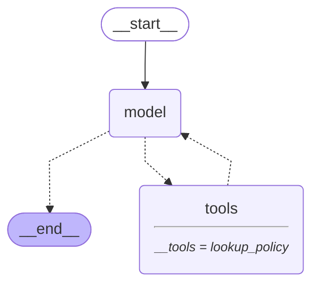
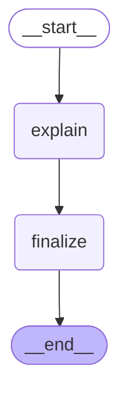

# 10 — Prebuilt agents and when to drop down a level

> After this module you can use create_agent while retaining deterministic claim controls.

**Time:** 90 minutes · **Level:** Intermediate · **LLM needed:** No live model · **Cost:** $0 with the included fakes.

**Larkspur Claims Copilot v05** · Practice takes additional time.

## Prerequisites

Complete [Tools and the agent loop](../09_tools_and_agent_loop/README.md). Read dictionary keys, functions, and Python type hints comfortably. Run uv sync from the repository root.

Optional installation requirements are listed in [the setup guide](../../docs/OPTIONAL_DEPENDENCIES.md). Use `uv run --no-sync` after installing extras so subsequent commands retain that environment.

## Learning objectives

- Implement and explain langchain.agents.create_agent; agent state; model and tools wiring; prebuilt versus custom graph.
- Implement and explain Middleware lifecycle; before/after hooks; wrap_model_call; tool/model budgets; middleware state.
- Implement and explain Agent as a graph node; shared-state agent subgraph preview; agent input/output boundaries; behavior-preserving refactoring.

## The big idea

Use create_agent while retaining deterministic claim controls. Predict the state before running code, then compare the observed result. A state is the data visible to a node; a node is one unit of work; an edge selects later work. A checkpoint is a saved state boundary, not a promise that an external effect happened exactly once.

## How it works

### Create Agent

create_agent builds a standard model/tool loop on LangGraph. Start there for ordinary tool use; use a custom StateGraph when the business process requires explicit gates or branches. The compiled agent still accepts state, can be inspected as a graph, and emits normal messages.

Use a standard service desk until the claim process needs a specially arranged sequence of desks.



### Middleware

Middleware hooks surround agent operations. before_model can update declared middleware state; wrap_model_call controls the handler; after_model observes the result. Model and tool budgets are separate: limiting one does not automatically limit the other. Hook order belongs in an explicit test.

A supervisor records entry and exit at each desk and separately counts external requests.

### Agent Composition

An adapter node converts a business question into private agent messages and returns only the public explanation. The parent retains claim identity and its own process status. Sharing every internal message is convenient but widens the context and privacy boundary unnecessarily.

A specialist sends a signed conclusion back to intake, not the entire scratch notebook.



## Key APIs at a glance

| API / executable example | What it does | When to use it |
| --- | --- | --- |
| create_agent, AIMessage, HumanMessage, tool — [01_create_agent.py](examples/01_create_agent.py) | langchain.agents.create_agent; agent state; model and tools wiring; prebuilt versus custom graph | create_agent builds a standard model/tool loop on LangGraph. |
| AgentState, create_agent, AgentMiddleware, ModelCallLimitMiddleware — [02_middleware.py](examples/02_middleware.py) | Middleware lifecycle; before/after hooks; wrap_model_call; tool/model budgets; middleware state | Middleware hooks surround agent operations. |
| create_agent, AIMessage, HumanMessage, StateGraph — [03_agent_composition.py](examples/03_agent_composition.py) | Agent as a graph node; shared-state agent subgraph preview; agent input/output boundaries; behavior-preserving refactoring | An adapter node converts a business question into private agent messages and returns only the public explanation. |

## Walkthrough

Run commands from the repository root; the same commands work in PowerShell, macOS, and Linux. Open the source alongside the output. Find the state declaration, node functions, graph connections, and invocation. For a failure, start with the earliest changed field or scheduled node.

```text
uv run python modules/10_prebuilt_agents/examples/01_create_agent.py
```

**Predict, then run:** for {"policy_id": "POL-0001"}, write the resulting fields and any expected error. Then test the boundary cases in tests/create_agent.json.

<details>
<summary>Reveal the checked result</summary>

```json
{
  "value": {
    "roles": [
      "human",
      "ai",
      "tool",
      "ai"
    ],
    "tools": [
      "lookup_policy"
    ],
    "final": "A policy lookup is evidence, not payout authorization."
  }
}
```

create_agent builds a standard model/tool loop on LangGraph. Start there for ordinary tool use; use a custom StateGraph when the business process requires explicit gates or branches. The compiled agent still accepts state, can be inspected as a graph, and emits normal messages.

</details>

```text
uv run python modules/10_prebuilt_agents/examples/02_middleware.py
```

**Predict, then run:** for {"model_limit": 3, "tool_limit": 1}, write the resulting fields and any expected error. Then test the boundary cases in tests/middleware.json.

<details>
<summary>Reveal the checked result</summary>

```json
{
  "value": {
    "events": [
      "before_model",
      "wrap_enter",
      "wrap_exit",
      "after_model",
      "tool",
      "before_model",
      "wrap_enter",
      "wrap_exit",
      "after_model"
    ],
    "model_calls": 2,
    "tool_calls": 1,
    "final": "Policy fact checked."
  }
}
```

Middleware hooks surround agent operations. before_model can update declared middleware state; wrap_model_call controls the handler; after_model observes the result. Model and tool budgets are separate: limiting one does not automatically limit the other. Hook order belongs in an explicit test.

</details>

```text
uv run python modules/10_prebuilt_agents/examples/03_agent_composition.py
```

**Predict, then run:** for {"claim_id": "CLM-0001", "question": "What evidence is missing?"}, write the resulting fields and any expected error. Then test the boundary cases in tests/agent_composition.json.

<details>
<summary>Reveal the checked result</summary>

```json
{
  "value": {
    "fields": [
      "claim_id",
      "explanation",
      "question",
      "status"
    ],
    "claim_id": "CLM-0001",
    "question": "What evidence is missing?",
    "explanation": "Please attach a dated repair estimate.",
    "status": "awaiting_evidence"
  }
}
```

An adapter node converts a business question into private agent messages and returns only the public explanation. The parent retains claim identity and its own process status. Sharing every internal message is convenient but widens the context and privacy boundary unnecessarily.

</details>

When build_graph needs no arguments, its generated Mermaid diagram is saved beside the example. A diagram records possible edges; a runtime stream records executed work. A single sequence advances one node per superstep. Parallel nodes see the same previous boundary, so they cannot read a sibling's unfinished update.

## When to use it, and when not to

Use these contracts when the claim needs the state or control-flow behavior described above. Keep pure arithmetic and validation in ordinary functions that can be tested independently. A graph, checkpoint, or extra agent adds operational choices; justify it with a concrete failure, pause, branch, or reuse requirement.

## Real-world use case

Use create_agent while retaining deterministic claim controls. The executable milestone uses only fictional records and the shared v05 implementation. [Read the use case](use_case/claims_copilot.py).

```text
uv run python modules/10_prebuilt_agents/use_case/claims_copilot.py
```

Sample output from the synthetic default case:

```json
{
  "approved": false,
  "route": "specialist",
  "explanation": "Policy evidence collected. An authorized adjuster must confirm coverage."
}
```

A real team would connect this boundary to validated records and authenticated roles, then retain the same rejection, ownership, and recovery checks.

## Common bugs

| Symptom or broken contract | Cause and repair | Practice |
| --- | --- | --- |
| Observed `{"value": {"roles": ["human", "ai"], "tools": [], "final": ""}}`. Register the requested tool with the prebuilt agent. | Restore `tools=[lookup_policy]` and check the boundary cases. | [10-01](../../gym/tasks/10/10-01_create_agent_build/task.md) |
| Observed `{"error": "ValueError"}`. Reject unknown policy IDs, not the known fixture. | Restore `if policy_id != "POL-0001":` and check the boundary cases. | [10-02](../../gym/tasks/10/10-02_create_agent_fix/task.md) |
| Observed `{"value": {"events": ["before_model", "wrap_enter", "wrap_exit", "after_model", "tool", "before_model"], "model_calls": 1, "tool_calls": 1, "final": "Model call limits exceeded: run limit (1/1)"}}`. Allow the configured number of model operations. | Restore `run_limit=model_limit` and check the boundary cases. | [10-07](../../gym/tasks/10/10-07_middleware_build/task.md) |
| Observed `{"value": {"events": ["before_model", "wrap_enter", "wrap_exit", "after_model", "tool", "before_model", "wrap_enter", "wrap_exit", "after_model"], "model_calls": 2, "tool_calls": 1, "final": "Policy fact checked."}}`. Enforce the independent tool budget. | Restore `run_limit=tool_limit` and check the boundary cases. | [10-08](../../gym/tasks/10/10-08_middleware_fix/task.md) |
| Observed `{"value": {"fields": ["claim_id", "question", "status"], "claim_id": "CLM-0001", "question": "What evidence is missing?", "status": "awaiting_evidence"}}`. Map the specialist answer into the parent explanation field. | Restore `return {"explanation": result.value["messages"][-1].content}` and check the boundary cases. | [10-13](../../gym/tasks/10/10-13_agent_composition_build/task.md) |
| Observed `{"value": {"fields": ["claim_id", "explanation", "question", "status"], "claim_id": "CLM-0001", "question": "What evidence is missing?", "explanation": "Please attach a dated repair estimate.", "status": "approved"}}`. Do not turn an explanation into payment approval. | Restore `"awaiting_evidence"` and check the boundary cases. | [10-14](../../gym/tasks/10/10-14_agent_composition_fix/task.md) |

## Practice

- [10-01 — build, easy](../../gym/tasks/10/10-01_create_agent_build/task.md): Build create agent: Register the requested tool with the prebuilt agent.
- [10-02 — fix, medium](../../gym/tasks/10/10-02_create_agent_fix/task.md): Fix create agent: Reject unknown policy IDs, not the known fixture.
- [10-03 — predict, easy](../../gym/tasks/10/10-03_create_agent_predict/task.md): Predict create agent across the declared cases
- [10-04 — trace, medium](../../gym/tasks/10/10-04_create_agent_trace/task.md): Trace create agent: Reject unknown policy IDs, not the known fixture.
- [10-05 — extend, hard](../../gym/tasks/10/10-05_create_agent_extend/task.md): Extend create agent: Pass through the requested policy instead of silently substituting another.
- [10-06 — refactor, hard](../../gym/tasks/10/10-06_create_agent_refactor/task.md): Refactor create agent: Expose the final agent answer rather than the original question.
- [10-07 — build, easy](../../gym/tasks/10/10-07_middleware_build/task.md): Build middleware: Allow the configured number of model operations.
- [10-08 — fix, medium](../../gym/tasks/10/10-08_middleware_fix/task.md): Fix middleware: Enforce the independent tool budget.
- [10-09 — predict, easy](../../gym/tasks/10/10-09_middleware_predict/task.md): Predict middleware across the declared cases
- [10-10 — trace, medium](../../gym/tasks/10/10-10_middleware_trace/task.md): Trace middleware: Enforce the independent tool budget.
- [10-11 — extend, hard](../../gym/tasks/10/10-11_middleware_extend/task.md): Extend middleware: Distinguish the after hook from the before hook in lifecycle records.
- [10-12 — design, hard](../../gym/tasks/10/10-12_middleware_design/task.md): Design middleware and justify the boundary policies
- [10-13 — build, easy](../../gym/tasks/10/10-13_agent_composition_build/task.md): Build agent composition: Map the specialist answer into the parent explanation field.
- [10-14 — fix, medium](../../gym/tasks/10/10-14_agent_composition_fix/task.md): Fix agent composition: Do not turn an explanation into payment approval.
- [10-15 — predict, easy](../../gym/tasks/10/10-15_agent_composition_predict/task.md): Predict agent composition across the declared cases
- [10-16 — trace, medium](../../gym/tasks/10/10-16_agent_composition_trace/task.md): Trace agent composition: Do not turn an explanation into payment approval.
- [10-17 — extend, hard](../../gym/tasks/10/10-17_agent_composition_extend/task.md): Extend agent composition: Select the specialist answer rather than its input question.
- [10-18 — refactor, hard](../../gym/tasks/10/10-18_agent_composition_refactor/task.md): Refactor agent composition: Preserve the parent finalization step when refactoring the adapter.

Start with tasks 01, 02, 09, 10, 17, and 18 in this module. Finish the other tasks for full practice. Hints are progressive; solution exposure is recorded. Predict and Trace tasks use answer JSON, not a code starter.

## Quiz

Predict first; explain in your own words.

1. Explain the contract in 01_create_agent.py using one claim from its input cases.
2. Diagnose this broken behavior: Reject unknown policy IDs, not the known fixture. Which observation distinguishes the repair from a default-case-only fix?
3. Explain the contract in 02_middleware.py using one claim from its input cases.
4. Diagnose this broken behavior: Enforce the independent tool budget. Which observation distinguishes the repair from a default-case-only fix?
5. Explain the contract in 03_agent_composition.py using one claim from its input cases.
6. Diagnose this broken behavior: Do not turn an explanation into payment approval. Which observation distinguishes the repair from a default-case-only fix?

<details>
<summary>Answers</summary>

1. create_agent builds a standard model/tool loop on LangGraph. Start there for ordinary tool use; use a custom StateGraph when the business process requires explicit gates or branches. The compiled agent still accepts state, can be inspected as a graph, and emits normal messages.
2. Reject unknown policy IDs, not the known fixture. Compare the normal case with the boundary fixtures and identify the first differing update.
3. Middleware hooks surround agent operations. before_model can update declared middleware state; wrap_model_call controls the handler; after_model observes the result. Model and tool budgets are separate: limiting one does not automatically limit the other. Hook order belongs in an explicit test.
4. Enforce the independent tool budget. Compare the normal case with the boundary fixtures and identify the first differing update.
5. An adapter node converts a business question into private agent messages and returns only the public explanation. The parent retains claim identity and its own process status. Sharing every internal message is convenient but widens the context and privacy boundary unnecessarily.
6. Do not turn an explanation into payment approval. Compare the normal case with the boundary fixtures and identify the first differing update.

</details>

## Cost and safety

The default commands cost $0: deterministic Python and, in model lessons, scripted local fakes. They consume no hosted tokens and make no real payments or emails. Optional live experiments use the provider configured in .env; a short one-to-four-call exercise is usually cents, but verify your provider's current token prices and set a budget. Ollama can run locally without a hosted bill. Temporary checkpoint files are isolated from the committed dataset. Keep real customer details and credentials out of graph state.

## Key takeaways

- State visibility and update rules determine what a node can safely assume.
- Check normal, missing, boundary, and failure cases before trusting a workflow.
- Separate observed execution from diagrams, predictions, and durable history.
- Model output is evidence to validate, never an authorization grant.
- A saved checkpoint and an external effect have separate durability boundaries.

## Go deeper

- [create agent official guide](https://docs.langchain.com/oss/python/langchain/agents)
- [middleware official guide](https://docs.langchain.com/oss/python/langchain/middleware/overview)
- [agent composition official guide](https://docs.langchain.com/oss/python/langchain/agents)

## Next:

Continue to [module 11: Memory](../../modules/11_memory/README.md).
