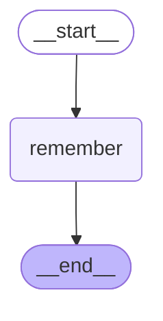

# 11 — Memory

> After this module you can remember contact preferences while keeping customer histories isolated.

**Time:** 120 minutes · **Level:** Intermediate · **LLM needed:** No live model · **Cost:** $0 with the included fakes.

**Larkspur Claims Copilot v06** · Practice takes additional time.

## Prerequisites

Complete [Prebuilt agents and when to drop down a level](../10_prebuilt_agents/README.md). Read dictionary keys, functions, and Python type hints comfortably. Run uv sync from the repository root.

Optional installation requirements are listed in [the setup guide](../../docs/OPTIONAL_DEPENDENCIES.md). Use `uv run --no-sync` after installing extras so subsequent commands retain that environment.

New to pytest, type validation, chat messages, tools, or async Python? Read the relevant section of [the beginner bridge](../../docs/BEGINNER_BRIDGE.md) when that concept first appears.

After the deterministic lesson, use [the optional provider lab](../../docs/LIVE_MODEL_LAB.md) to try real extraction, scoped tool calls, and conversation memory with your configured provider. Graded results remain fake and offline.

## Learning objectives

- Implement and explain Thread checkpoints as short-term memory; context windows; trim_messages; summarization nodes.
- Implement and explain InMemoryStore; namespaces; put, get, search, and delete; runtime.store; semantic, episodic, and procedural memory.
- Implement and explain Embeddings basics; semantic Store index; deterministic fake embeddings; memory deletion; checkpoint versus Store retention.

## The big idea

Remember contact preferences while keeping customer histories isolated. Predict the state before running code, then compare the observed result. A state is the data visible to a node; a node is one unit of work; an edge selects later work. A checkpoint is a saved state boundary, not a promise that an external effect happened exactly once.

## How it works

### Short Term Memory

Checkpoint history and model context are different collections. Trimming chooses a bounded view for one call without deleting the saved conversation. A summarization node retains a short factual digest; in this small example it joins customer statements deterministically. Production summaries need factual evaluation and a token counter appropriate to the model.

Keep the complete archive while giving the next adjuster a short briefing sheet.

### Store Namespaces

The Store holds cross-thread memories under tuple namespaces. Semantic memory stores facts, episodic memory stores events, and procedural memory stores instructions; these are application conventions rather than special database types. Customer-scoped namespaces must be enforced from trusted context. Deleting a memory is an explicit operation.

Separate facts, visit notes, and approved procedures into labeled drawers, with one cabinet per customer.



### Semantic And Privacy

An embedding maps text into numbers so the Store can rank similarity within a namespace. These transparent word vectors make the offline ranking reproducible. Store deletion does not delete old checkpoint contents: retention must handle both systems separately. Retrieval is evidence selection, never an authorization check.

A catalog search locates related folders; shredding a catalog card does not shred archived copies.

## Key APIs at a glance

| API / executable example | What it does | When to use it |
| --- | --- | --- |
| AIMessage, HumanMessage, SystemMessage, trim_messages — [01_short_term_memory.py](examples/01_short_term_memory.py) | Thread checkpoints as short-term memory; context windows; trim_messages; summarization nodes | Checkpoint history and model context are different collections. |
| StateGraph, Runtime, InMemoryStore — [02_store_namespaces.py](examples/02_store_namespaces.py) | InMemoryStore; namespaces; put, get, search, and delete; runtime.store; semantic, episodic, and procedural memory | The Store holds cross-thread memories under tuple namespaces. |
| Embeddings, InMemorySaver, StateGraph, InMemoryStore — [03_semantic_and_privacy.py](examples/03_semantic_and_privacy.py) | Embeddings basics; semantic Store index; deterministic fake embeddings; memory deletion; checkpoint versus Store retention | An embedding maps text into numbers so the Store can rank similarity within a namespace. |

## Walkthrough

Run commands from the repository root; the same commands work in PowerShell, macOS, and Linux. Open the source alongside the output. Find the state declaration, node functions, graph connections, and invocation. For a failure, start with the earliest changed field or scheduled node.

```text
uv run --no-sync python modules/11_memory/examples/01_short_term_memory.py
```

**Predict, then run:** for {"max_messages": 2, "second_text": "An estimate is now attached."}, write the resulting fields and any expected error. Then test the boundary cases in tests/short_term_memory.json.

<details>
<summary>Reveal the checked result</summary>

```json
{
  "value": {
    "saved_messages": 4,
    "model_context_sizes": [
      1,
      2
    ],
    "summary": "A pipe burst. | An estimate is now attached."
  }
}
```

Checkpoint history and model context are different collections. Trimming chooses a bounded view for one call without deleting the saved conversation. A summarization node retains a short factual digest; in this small example it joins customer statements deterministically. Production summaries need factual evaluation and a token counter appropriate to the model.

</details>

```text
uv run --no-sync python modules/11_memory/examples/02_store_namespaces.py
```

**Predict, then run:** for {"customer_id": "CUS-0001", "preference": "email"}, write the resulting fields and any expected error. Then test the boundary cases in tests/store_namespaces.json.

<details>
<summary>Reveal the checked result</summary>

```json
{
  "value": {
    "found": [
      {
        "preference": "email"
      }
    ],
    "deleted": true,
    "other": {
      "preference": "phone"
    }
  }
}
```

The Store holds cross-thread memories under tuple namespaces. Semantic memory stores facts, episodic memory stores events, and procedural memory stores instructions; these are application conventions rather than special database types. Customer-scoped namespaces must be enforced from trusted context. Deleting a memory is an explicit operation.

</details>

```text
uv run --no-sync python modules/11_memory/examples/03_semantic_and_privacy.py
```

**Predict, then run:** for {"query": "water leak", "customer_id": "CUS-0001"}, write the resulting fields and any expected error. Then test the boundary cases in tests/semantic_and_privacy.json.

<details>
<summary>Reveal the checked result</summary>

```json
{
  "value": {
    "ranking": [
      "water",
      "theft"
    ],
    "remaining": [
      "theft"
    ],
    "other_customer_visible": false,
    "checkpoint_retains_fact_after_store_delete": true,
    "checkpoint_deleted_separately": true
  }
}
```

An embedding maps text into numbers so the Store can rank similarity within a namespace. These transparent word vectors make the offline ranking reproducible. Store deletion does not delete old checkpoint contents: retention must handle both systems separately. Retrieval is evidence selection, never an authorization check.

</details>

When build_graph needs no arguments, its generated Mermaid diagram is saved beside the example. A diagram records possible edges; a runtime stream records executed work. A single sequence advances one node per superstep. Parallel nodes see the same previous boundary, so they cannot read a sibling's unfinished update.

## When to use it, and when not to

Use these contracts when the claim needs the state or control-flow behavior described above. Keep pure arithmetic and validation in ordinary functions that can be tested independently. A graph, checkpoint, or extra agent adds operational choices; justify it with a concrete failure, pause, branch, or reuse requirement.

## Real-world use case

Remember contact preferences while keeping customer histories isolated. The executable milestone uses only fictional records and the shared v06 implementation. [Read the use case](use_case/claims_copilot.py).

```text
uv run python modules/11_memory/use_case/claims_copilot.py
```

Sample output from the synthetic default case:

```json
{
  "preference": "sms",
  "audit": [
    "extracted_and_validated",
    "normalized",
    "validated",
    "routed",
    "policy_evidence_collected",
    "customer_memory_read",
    "letter_reviewed"
  ]
}
```

A real team would connect this boundary to validated records and authenticated roles, then retain the same rejection, ownership, and recovery checks.

## Common bugs

| Symptom or broken contract | Cause and repair | Practice |
| --- | --- | --- |
| Observed `{"value": {"saved_messages": 4, "model_context_sizes": [1, 4], "summary": "A pipe burst. &#124; An estimate is now attached."}}`. Bound the messages sent to the model. | Restore `max_tokens=max_messages` and check the boundary cases. | [11-01](../../gym/tasks/11/11-01_short_term_memory_build/task.md) · Related Fix: [11-02](../../gym/tasks/11/11-02_short_term_memory_fix/task.md) |
| Observed `{"value": {"saved_messages": 3, "model_context_sizes": [1, 1], "summary": "An estimate is now attached."}}`. Use a new message ID for a new turn instead of overwriting the previous turn. | Restore `id="human-2"` and check the boundary cases. | [11-02](../../gym/tasks/11/11-02_short_term_memory_fix/task.md) · Related Fix: [11-02](../../gym/tasks/11/11-02_short_term_memory_fix/task.md) |
| Observed `{"error": "AttributeError"}`. Store each customer's facts in a distinct namespace. | Restore `runtime.context.customer_id, "semantic"` and check the boundary cases. | [11-07](../../gym/tasks/11/11-07_store_namespaces_build/task.md) · Related Fix: [11-08](../../gym/tasks/11/11-08_store_namespaces_fix/task.md) |
| Observed `{"value": {"found": [{"preference": "email"}], "deleted": false, "other": {"preference": "phone"}}}`. Delete the actual memory key. | Restore `store.delete(namespace, "contact")` and check the boundary cases. | [11-08](../../gym/tasks/11/11-08_store_namespaces_fix/task.md) · Related Fix: [11-08](../../gym/tasks/11/11-08_store_namespaces_fix/task.md) |
| Observed `{"value": {"ranking": ["private", "water"], "remaining": ["theft"], "other_customer_visible": true, "checkpoint_retains_fact_after_store_delete": true, "checkpoint_deleted_separately": true}}`. Scope semantic search to the authenticated customer. | Restore `store.search(namespace, query=case["query"], limit=2)` and check the boundary cases. | [11-13](../../gym/tasks/11/11-13_semantic_and_privacy_build/task.md) · Related Fix: [11-14](../../gym/tasks/11/11-14_semantic_and_privacy_fix/task.md) |
| Observed `{"value": {"ranking": ["water", "theft"], "remaining": ["theft"], "other_customer_visible": false, "checkpoint_retains_fact_after_store_delete": true, "checkpoint_deleted_separately": false}}`. Delete checkpoint history separately from Store records. | Restore `saver.delete_thread("retention-demo")` and check the boundary cases. | [11-14](../../gym/tasks/11/11-14_semantic_and_privacy_fix/task.md) · Related Fix: [11-14](../../gym/tasks/11/11-14_semantic_and_privacy_fix/task.md) |

## Practice

- [11-01 — build, easy](../../gym/tasks/11/11-01_short_term_memory_build/task.md): Build short term memory: Bound the messages sent to the model.
- [11-02 — fix, medium](../../gym/tasks/11/11-02_short_term_memory_fix/task.md): Fix short term memory: Use a new message ID for a new turn instead of overwriting the previous turn.
- [11-03 — predict, easy](../../gym/tasks/11/11-03_short_term_memory_predict/task.md): Predict short term memory across the declared cases
- [11-04 — trace, medium](../../gym/tasks/11/11-04_short_term_memory_trace/task.md): Diagnose short term memory from execution evidence
- [11-05 — extend, hard](../../gym/tasks/11/11-05_short_term_memory_extend/task.md): Extend short term memory: Add run_batch(cases) to preview independent claims in input order. Preserve run(case), isolate mutable inputs, return value/error records, handle an empty batch, and continue after a rejected claim.
- [11-06 — refactor, hard](../../gym/tasks/11/11-06_short_term_memory_refactor/task.md): Refactor short term memory: Separate input preparation from orchestration in prepare_case(case). Preserve all results/errors, distinguish None from {}, and copy nested inputs so caller data and shared defaults stay independent.
- [11-07 — build, easy](../../gym/tasks/11/11-07_store_namespaces_build/task.md): Build store namespaces: Store each customer's facts in a distinct namespace.
- [11-08 — fix, medium](../../gym/tasks/11/11-08_store_namespaces_fix/task.md): Fix store namespaces: Delete the actual memory key.
- [11-09 — predict, easy](../../gym/tasks/11/11-09_store_namespaces_predict/task.md): Predict store namespaces across the declared cases
- [11-10 — trace, medium](../../gym/tasks/11/11-10_store_namespaces_trace/task.md): Diagnose store namespaces from execution evidence
- [11-11 — extend, hard](../../gym/tasks/11/11-11_store_namespaces_extend/task.md): Extend store namespaces: Add run_batch(cases) to preview independent claims in input order. Preserve run(case), isolate mutable inputs, return value/error records, handle an empty batch, and continue after a rejected claim.
- [11-12 — refactor, hard](../../gym/tasks/11/11-12_store_namespaces_refactor/task.md): Refactor store namespaces: Separate input preparation from orchestration in prepare_case(case). Preserve all results/errors, distinguish None from {}, and copy nested inputs so caller data and shared defaults stay independent.
- [11-13 — build, easy](../../gym/tasks/11/11-13_semantic_and_privacy_build/task.md): Build semantic and privacy: Scope semantic search to the authenticated customer.
- [11-14 — fix, medium](../../gym/tasks/11/11-14_semantic_and_privacy_fix/task.md): Fix semantic and privacy: Delete checkpoint history separately from Store records.
- [11-15 — predict, easy](../../gym/tasks/11/11-15_semantic_and_privacy_predict/task.md): Predict semantic and privacy across the declared cases
- [11-16 — trace, medium](../../gym/tasks/11/11-16_semantic_and_privacy_trace/task.md): Diagnose semantic and privacy from execution evidence
- [11-17 — extend, hard](../../gym/tasks/11/11-17_semantic_and_privacy_extend/task.md): Extend semantic and privacy: Add run_batch(cases) to preview independent claims in input order. Preserve run(case), isolate mutable inputs, return value/error records, handle an empty batch, and continue after a rejected claim.
- [11-18 — design, hard](../../gym/tasks/11/11-18_semantic_and_privacy_design/task.md): Design semantic and privacy and justify the boundary policies

Start with tasks 01, 02, 09, 10, 17, and 18 in this module. Finish the other tasks for full practice. Hints are progressive; solution exposure is recorded. Predict and Trace tasks use answer JSON, not a code starter.

## Quiz

Predict first; explain in your own words.

1. Explain the contract in 01_short_term_memory.py using one claim from its input cases.
2. Diagnose this broken behavior: Use a new message ID for a new turn instead of overwriting the previous turn. Which observation distinguishes the repair from a default-case-only fix?
3. Explain the contract in 02_store_namespaces.py using one claim from its input cases.
4. Diagnose this broken behavior: Delete the actual memory key. Which observation distinguishes the repair from a default-case-only fix?
5. Explain the contract in 03_semantic_and_privacy.py using one claim from its input cases.
6. Diagnose this broken behavior: Delete checkpoint history separately from Store records. Which observation distinguishes the repair from a default-case-only fix?

<details>
<summary>Answers</summary>

1. Checkpoint history and model context are different collections. Trimming chooses a bounded view for one call without deleting the saved conversation. A summarization node retains a short factual digest; in this small example it joins customer statements deterministically. Production summaries need factual evaluation and a token counter appropriate to the model.
2. Use a new message ID for a new turn instead of overwriting the previous turn. Compare the normal case with the boundary fixtures and identify the first differing update.
3. The Store holds cross-thread memories under tuple namespaces. Semantic memory stores facts, episodic memory stores events, and procedural memory stores instructions; these are application conventions rather than special database types. Customer-scoped namespaces must be enforced from trusted context. Deleting a memory is an explicit operation.
4. Delete the actual memory key. Compare the normal case with the boundary fixtures and identify the first differing update.
5. An embedding maps text into numbers so the Store can rank similarity within a namespace. These transparent word vectors make the offline ranking reproducible. Store deletion does not delete old checkpoint contents: retention must handle both systems separately. Retrieval is evidence selection, never an authorization check.
6. Delete checkpoint history separately from Store records. Compare the normal case with the boundary fixtures and identify the first differing update.

</details>

## Cost and safety

The default commands cost $0: deterministic Python and, in model lessons, scripted local fakes. They consume no hosted tokens and make no real payments or emails. Optional live experiments use the provider configured in .env; a short one-to-four-call exercise is usually cents, but verify your provider's current token prices and set a budget. Ollama can run locally without a hosted bill. Temporary checkpoint files are isolated from the committed dataset. Keep real customer details and credentials out of graph state.

## Key takeaways

- State visibility and update rules determine what a node can safely assume.
- Check normal, missing, boundary, and failure cases before trusting a workflow.
- Separate observed execution from diagrams, predictions, and durable history.
- Model output is evidence to validate, never an authorization grant.
- A saved checkpoint and an external effect have separate durability boundaries.

## Go deeper

- [short term memory official guide](https://docs.langchain.com/oss/python/langchain/short-term-memory)
- [store namespaces official guide](https://docs.langchain.com/oss/python/langgraph/stores)
- [semantic and privacy official guide](https://docs.langchain.com/oss/python/langgraph/memory)

## Next:

Continue to [module 12: Workflow patterns with LLMs](../../modules/12_workflow_patterns/README.md).
