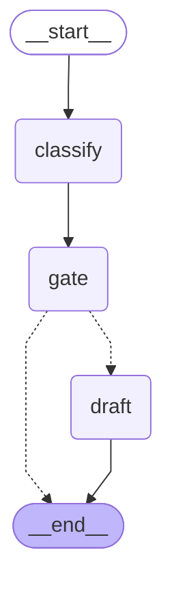
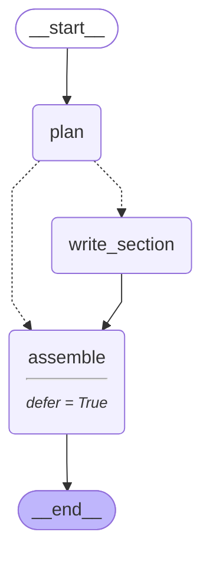

# 12 — Workflow patterns with LLMs

> After this module you can draft a claim letter and improve it against known policy facts.

**Time:** 120 minutes · **Level:** Intermediate · **LLM needed:** No live model · **Cost:** $0 with the included fakes.

**Larkspur Claims Copilot v06** · Practice takes additional time.

## Prerequisites

Complete [Memory](../11_memory/README.md). Read dictionary keys, functions, and Python type hints comfortably. Run uv sync from the repository root.

Optional installation requirements are listed in [the setup guide](../../docs/OPTIONAL_DEPENDENCIES.md). Use `uv run --no-sync` after installing extras so subsequent commands retain that environment.

## Learning objectives

- Implement and explain Prompt chaining; deterministic gates; model-based routing with validated outputs; workflow versus agent choice.
- Implement and explain Parallel LLM branches; orchestrator-worker pattern; Send with structured worker plans; result aggregation.
- Implement and explain Evaluator-optimizer loop; factual and tone criteria; iteration budgets; termination on success or exhaustion.

## The big idea

Draft a claim letter and improve it against known policy facts. Predict the state before running code, then compare the observed result. A state is the data visible to a node; a node is one unit of work; an edge selects later work. A checkpoint is a saved state boundary, not a promise that an external effect happened exactly once.

## How it works

### Chains And Gates

Prompt chaining fixes the order of model operations. A deterministic gate compares extracted facts with the authoritative policy before allowing a draft. The validated category can route work, but a model cannot override the gate. A blocked extraction should not consume a drafting call.

Verify the measurements before asking the writer to prepare a settlement letter.



### Orchestrator Workers

An orchestrator proposes a structured plan, then Send creates one worker invocation per section. Validate allowed section names, uniqueness, and size before fan-out. The reducer accumulates independent reports and a deferred assembler produces a canonical order rather than relying on worker completion timing.

An editor assigns each approved section once and assembles the returned pages by heading.



### Evaluator Optimizer

The evaluator names concrete factual and tone defects; the optimizer receives that feedback before another draft. Stop on success or a strict attempt budget. A deterministic substring check is deliberately limited: it teaches loop control and must not be mistaken for a production factuality evaluator.

A letter editor returns a short checklist, but has a fixed number of revision rounds.

## Key APIs at a glance

| API / executable example | What it does | When to use it |
| --- | --- | --- |
| AIMessage, StateGraph — [01_chains_and_gates.py](examples/01_chains_and_gates.py) | Prompt chaining; deterministic gates; model-based routing with validated outputs; workflow versus agent choice | Prompt chaining fixes the order of model operations. |
| AIMessage, StateGraph, Send — [02_orchestrator_workers.py](examples/02_orchestrator_workers.py) | Parallel LLM branches; orchestrator-worker pattern; Send with structured worker plans; result aggregation | An orchestrator proposes a structured plan, then Send creates one worker invocation per section. |
| AIMessage, StateGraph — [03_evaluator_optimizer.py](examples/03_evaluator_optimizer.py) | Evaluator-optimizer loop; factual and tone criteria; iteration budgets; termination on success or exhaustion | The evaluator names concrete factual and tone defects; the optimizer receives that feedback before another draft. |

## Walkthrough

Run commands from the repository root; the same commands work in PowerShell, macOS, and Linux. Open the source alongside the output. Find the state declaration, node functions, graph connections, and invocation. For a failure, start with the earliest changed field or scheduled node.

```text
uv run python modules/12_workflow_patterns/examples/01_chains_and_gates.py
```

**Predict, then run:** for {"category": "policy", "policy_deductible": 100000, "extracted_deductible": 100000}, write the resulting fields and any expected error. Then test the boundary cases in tests/chains_and_gates.json.

<details>
<summary>Reveal the checked result</summary>

```json
{
  "value": {
    "category": "policy",
    "extracted_deductible": 100000,
    "draft": {
      "text": "Thank you for the synthetic claim. We will review your evidence.",
      "deductible_cents": 100000
    },
    "accepted": true
  }
}
```

Prompt chaining fixes the order of model operations. A deterministic gate compares extracted facts with the authoritative policy before allowing a draft. The validated category can route work, but a model cannot override the gate. A blocked extraction should not consume a drafting call.

</details>

```text
uv run python modules/12_workflow_patterns/examples/02_orchestrator_workers.py
```

**Predict, then run:** for {"sections": ["coverage", "deductible", "exclusions"]}, write the resulting fields and any expected error. Then test the boundary cases in tests/orchestrator_workers.json.

<details>
<summary>Reveal the checked result</summary>

```json
{
  "value": {
    "sections": [
      "coverage",
      "deductible",
      "exclusions"
    ],
    "report": "Water damage is a synthetic covered cause.\nThe synthetic deductible is 100000 cents.\nFlood needs the separate add-on.",
    "model_calls": 4
  }
}
```

An orchestrator proposes a structured plan, then Send creates one worker invocation per section. Validate allowed section names, uniqueness, and size before fan-out. The reducer accumulates independent reports and a deferred assembler produces a canonical order rather than relying on worker completion timing.

</details>

```text
uv run python modules/12_workflow_patterns/examples/03_evaluator_optimizer.py
```

**Predict, then run:** for {"drafts": ["Your deductible is 90000 cents.", "Thank you. Your deductible is 100000 cents."], "budget": 3}, write the resulting fields and any expected error. Then test the boundary cases in tests/evaluator_optimizer.json.

<details>
<summary>Reveal the checked result</summary>

```json
{
  "value": {
    "accepted": true,
    "attempts": 2,
    "history": [
      {
        "attempt": 1,
        "feedback": [
          "deductible_fact",
          "respectful_tone"
        ]
      },
      {
        "attempt": 2,
        "feedback": []
      }
    ],
    "stop_reason": "accepted"
  }
}
```

The evaluator names concrete factual and tone defects; the optimizer receives that feedback before another draft. Stop on success or a strict attempt budget. A deterministic substring check is deliberately limited: it teaches loop control and must not be mistaken for a production factuality evaluator.

</details>

When build_graph needs no arguments, its generated Mermaid diagram is saved beside the example. A diagram records possible edges; a runtime stream records executed work. A single sequence advances one node per superstep. Parallel nodes see the same previous boundary, so they cannot read a sibling's unfinished update.

## When to use it, and when not to

Use these contracts when the claim needs the state or control-flow behavior described above. Keep pure arithmetic and validation in ordinary functions that can be tested independently. A graph, checkpoint, or extra agent adds operational choices; justify it with a concrete failure, pause, branch, or reuse requirement.

## Real-world use case

Draft a claim letter and improve it against known policy facts. The executable milestone uses only fictional records and the shared v06 implementation. [Read the use case](use_case/claims_copilot.py).

```text
uv run python modules/12_workflow_patterns/use_case/claims_copilot.py
```

Sample output from the synthetic default case:

```json
{
  "letter": "Thank you. Your claim is review completed. No payment has been issued.",
  "accepted": true,
  "attempts": 2
}
```

A real team would connect this boundary to validated records and authenticated roles, then retain the same rejection, ownership, and recovery checks.

## Common bugs

| Symptom or broken contract | Cause and repair | Practice |
| --- | --- | --- |
| Observed `{"value": {"category": "policy", "extracted_deductible": 100000, "draft": {"text": "Thank you for the synthetic claim. We will review your evidence.", "deductible_cents": 100000}, "accepted": true}}`. Reject contradictory extracted facts before drafting. | Restore `state["extracted_deductible"] == case["policy_deductible"]` and check the boundary cases. | [12-01](../../gym/tasks/12/12-01_chains_and_gates_build/task.md) |
| Observed `{"value": {"category": "policy", "extracted_deductible": 100000, "draft": {"text": "Thank you for the synthetic claim. We will review your evidence.", "deductible_cents": 100000}, "accepted": true}}`. Stop the chain when the fact gate fails. | Restore `"draft" if state["accepted"] else END` and check the boundary cases. | [12-02](../../gym/tasks/12/12-02_chains_and_gates_fix/task.md) |
| Observed `{"value": {"sections": ["exclusions"], "report": "Flood needs the separate add-on.", "model_calls": 2}}`. Accumulate every worker result instead of overwriting sibling reports. | Restore `operator.add]` and check the boundary cases. | [12-07](../../gym/tasks/12/12-07_orchestrator_workers_build/task.md) |
| Observed `{"value": {"sections": ["coverage", "deductible", "exclusions"], "report": "Water damage is a synthetic covered cause.\nThe synthetic deductible is 100000 cents.\nFlood needs the separate add-on.", "model_calls": 4}}`. Reject a plan that delegates the same section twice. | Restore `if len(value) != len(set(value)):` and check the boundary cases. | [12-08](../../gym/tasks/12/12-08_orchestrator_workers_fix/task.md) |
| Observed `{"value": {"accepted": true, "attempts": 2, "history": [{"attempt": 1, "feedback": ["deductible_fact", "respectful_tone"]}, {"attempt": 2, "feedback": []}], "stop_reason": "accepted"}}`. Stop unsuccessful revision at the configured budget. | Restore `state["attempts"] >= state["budget"]` and check the boundary cases. | [12-13](../../gym/tasks/12/12-13_evaluator_optimizer_build/task.md) |
| Observed `{"value": {"accepted": true, "attempts": 2, "history": [{"attempt": 1, "feedback": ["respectful_tone"]}, {"attempt": 2, "feedback": []}], "stop_reason": "accepted"}}`. Require the authoritative deductible fact. | Restore `"100000 cents" not in state["draft"]` and check the boundary cases. | [12-14](../../gym/tasks/12/12-14_evaluator_optimizer_fix/task.md) |

## Practice

- [12-01 — build, easy](../../gym/tasks/12/12-01_chains_and_gates_build/task.md): Build chains and gates: Reject contradictory extracted facts before drafting.
- [12-02 — fix, medium](../../gym/tasks/12/12-02_chains_and_gates_fix/task.md): Fix chains and gates: Stop the chain when the fact gate fails.
- [12-03 — predict, easy](../../gym/tasks/12/12-03_chains_and_gates_predict/task.md): Predict chains and gates across the declared cases
- [12-04 — trace, medium](../../gym/tasks/12/12-04_chains_and_gates_trace/task.md): Trace chains and gates: Stop the chain when the fact gate fails.
- [12-05 — extend, hard](../../gym/tasks/12/12-05_chains_and_gates_extend/task.md): Extend chains and gates: Validate the routing category against an explicit allowlist.
- [12-06 — design, hard](../../gym/tasks/12/12-06_chains_and_gates_design/task.md): Design chains and gates and justify the boundary policies
- [12-07 — build, easy](../../gym/tasks/12/12-07_orchestrator_workers_build/task.md): Build orchestrator workers: Accumulate every worker result instead of overwriting sibling reports.
- [12-08 — fix, medium](../../gym/tasks/12/12-08_orchestrator_workers_fix/task.md): Fix orchestrator workers: Reject a plan that delegates the same section twice.
- [12-09 — predict, easy](../../gym/tasks/12/12-09_orchestrator_workers_predict/task.md): Predict orchestrator workers across the declared cases
- [12-10 — trace, medium](../../gym/tasks/12/12-10_orchestrator_workers_trace/task.md): Trace orchestrator workers: Reject a plan that delegates the same section twice.
- [12-11 — extend, hard](../../gym/tasks/12/12-11_orchestrator_workers_extend/task.md): Extend orchestrator workers: Assemble reports by stable section identity.
- [12-12 — refactor, hard](../../gym/tasks/12/12-12_orchestrator_workers_refactor/task.md): Refactor orchestrator workers: Run every approved worker in the plan.
- [12-13 — build, easy](../../gym/tasks/12/12-13_evaluator_optimizer_build/task.md): Build evaluator optimizer: Stop unsuccessful revision at the configured budget.
- [12-14 — fix, medium](../../gym/tasks/12/12-14_evaluator_optimizer_fix/task.md): Fix evaluator optimizer: Require the authoritative deductible fact.
- [12-15 — predict, easy](../../gym/tasks/12/12-15_evaluator_optimizer_predict/task.md): Predict evaluator optimizer across the declared cases
- [12-16 — trace, medium](../../gym/tasks/12/12-16_evaluator_optimizer_trace/task.md): Trace evaluator optimizer: Require the authoritative deductible fact.
- [12-17 — extend, hard](../../gym/tasks/12/12-17_evaluator_optimizer_extend/task.md): Extend evaluator optimizer: Keep the respectful-tone criterion separate from the factual criterion.
- [12-18 — refactor, hard](../../gym/tasks/12/12-18_evaluator_optimizer_refactor/task.md): Refactor evaluator optimizer: Stop immediately once both criteria pass.

Start with tasks 01, 02, 09, 10, 17, and 18 in this module. Finish the other tasks for full practice. Hints are progressive; solution exposure is recorded. Predict and Trace tasks use answer JSON, not a code starter.

## Quiz

Predict first; explain in your own words.

1. Explain the contract in 01_chains_and_gates.py using one claim from its input cases.
2. Diagnose this broken behavior: Stop the chain when the fact gate fails. Which observation distinguishes the repair from a default-case-only fix?
3. Explain the contract in 02_orchestrator_workers.py using one claim from its input cases.
4. Diagnose this broken behavior: Reject a plan that delegates the same section twice. Which observation distinguishes the repair from a default-case-only fix?
5. Explain the contract in 03_evaluator_optimizer.py using one claim from its input cases.
6. Diagnose this broken behavior: Require the authoritative deductible fact. Which observation distinguishes the repair from a default-case-only fix?

<details>
<summary>Answers</summary>

1. Prompt chaining fixes the order of model operations. A deterministic gate compares extracted facts with the authoritative policy before allowing a draft. The validated category can route work, but a model cannot override the gate. A blocked extraction should not consume a drafting call.
2. Stop the chain when the fact gate fails. Compare the normal case with the boundary fixtures and identify the first differing update.
3. An orchestrator proposes a structured plan, then Send creates one worker invocation per section. Validate allowed section names, uniqueness, and size before fan-out. The reducer accumulates independent reports and a deferred assembler produces a canonical order rather than relying on worker completion timing.
4. Reject a plan that delegates the same section twice. Compare the normal case with the boundary fixtures and identify the first differing update.
5. The evaluator names concrete factual and tone defects; the optimizer receives that feedback before another draft. Stop on success or a strict attempt budget. A deterministic substring check is deliberately limited: it teaches loop control and must not be mistaken for a production factuality evaluator.
6. Require the authoritative deductible fact. Compare the normal case with the boundary fixtures and identify the first differing update.

</details>

## Cost and safety

The default commands cost $0: deterministic Python and, in model lessons, scripted local fakes. They consume no hosted tokens and make no real payments or emails. Optional live experiments use the provider configured in .env; a short one-to-four-call exercise is usually cents, but verify your provider's current token prices and set a budget. Ollama can run locally without a hosted bill. Temporary checkpoint files are isolated from the committed dataset. Keep real customer details and credentials out of graph state.

## Key takeaways

- State visibility and update rules determine what a node can safely assume.
- Check normal, missing, boundary, and failure cases before trusting a workflow.
- Separate observed execution from diagrams, predictions, and durable history.
- Model output is evidence to validate, never an authorization grant.
- A saved checkpoint and an external effect have separate durability boundaries.

## Go deeper

- [chains and gates official guide](https://docs.langchain.com/oss/python/langgraph/workflows-agents)
- [orchestrator workers official guide](https://docs.langchain.com/oss/python/langgraph/workflows-agents)
- [evaluator optimizer official guide](https://docs.langchain.com/oss/python/langgraph/workflows-agents)

## Next:

Continue to [module 13: Subgraphs](../../modules/13_subgraphs/README.md).
