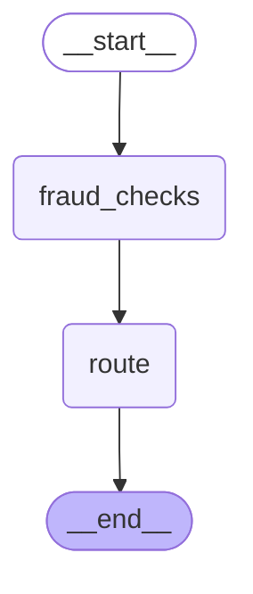
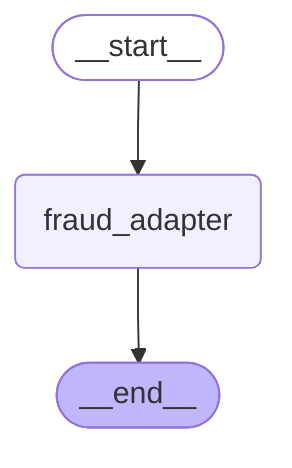
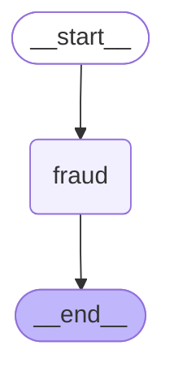

# 13 — Subgraphs

> After this module you can reuse one fraud-review component in claim and policy workflows.

**Time:** 150 minutes · **Level:** Advanced · **LLM needed:** No live model · **Cost:** $0 with the included fakes.

**Larkspur Claims Copilot v07** · Practice takes additional time.

## Prerequisites

Complete [Workflow patterns with LLMs](../12_workflow_patterns/README.md). Read dictionary keys, functions, and Python type hints comfortably. Run uv sync from the repository root.

Optional installation requirements are listed in [the setup guide](../../docs/OPTIONAL_DEPENDENCIES.md). Use `uv run --no-sync` after installing extras so subsequent commands retain that environment.

## Learning objectives

- Implement and explain Compiled subgraph as node; shared state keys; parent reducers; reuse across workflows.
- Implement and explain Calling a subgraph inside a node; input/output schema conversion; private child state; context boundaries.
- Implement and explain Inherited checkpointers; per-invocation versus persistent subgraphs; nested interrupts; get_state subgraphs; stream namespaces.

## The big idea

Reuse one fraud-review component in claim and policy workflows. Predict the state before running code, then compare the observed result. A state is the data visible to a node; a node is one unit of work; an edge selects later work. A checkpoint is a saved state boundary, not a promise that an external effect happened exactly once.

## How it works

### Shared Subgraph

A compiled subgraph can be a parent node when their state keys agree. Its updates still meet the parent's reducers. This fraud checker is reused for claims and new policies; its idempotent flag reducer avoids duplicating shared evidence when the child returns accumulated state.

Two departments reuse the same inspection desk and agree on the labels in its folder.



### Schema Adapters

When parent and child schemas differ, call the child inside an adapter node. Map the input fields explicitly, then return only the public finding. Private child fields should not become parent state just because a dictionary is convenient to copy.

Send a specialist a scoped work order and receive a conclusion without copying the private notebook.



### Subgraph Persistence

A parent checkpointer propagates into its child. A child compiled with the default per-invocation behavior starts fresh for each invocation; checkpointer=True gives the child persistent state across calls. While paused, get_state(subgraphs=True) exposes the nested task snapshot. Streaming namespaces identify which graph emitted an update.

The main case file indexes a paused specialist's folder so the adjuster can resume the right desk.



## Key APIs at a glance

| API / executable example | What it does | When to use it |
| --- | --- | --- |
| StateGraph — [01_shared_subgraph.py](examples/01_shared_subgraph.py) | Compiled subgraph as node; shared state keys; parent reducers; reuse across workflows | A compiled subgraph can be a parent node when their state keys agree. |
| StateGraph — [02_schema_adapters.py](examples/02_schema_adapters.py) | Calling a subgraph inside a node; input/output schema conversion; private child state; context boundaries | When parent and child schemas differ, call the child inside an adapter node. |
| InMemorySaver, StateGraph, Command, interrupt — [03_subgraph_persistence.py](examples/03_subgraph_persistence.py) | Inherited checkpointers; per-invocation versus persistent subgraphs; nested interrupts; get_state subgraphs; stream namespaces | A parent checkpointer propagates into its child. |

## Walkthrough

Run commands from the repository root; the same commands work in PowerShell, macOS, and Linux. Open the source alongside the output. Find the state declaration, node functions, graph connections, and invocation. For a failure, start with the earliest changed field or scheduled node.

```text
uv run python modules/13_subgraphs/examples/01_shared_subgraph.py
```

**Predict, then run:** for {"amount_cents": 600000, "documents": [], "workflow": "claim"}, write the resulting fields and any expected error. Then test the boundary cases in tests/shared_subgraph.json.

<details>
<summary>Reveal the checked result</summary>

```json
{
  "value": {
    "amount_cents": 600000,
    "documents": [],
    "flags": [
      "high_value",
      "intake_checked",
      "missing_evidence"
    ],
    "workflow": "claim",
    "destination": "claim_review"
  }
}
```

A compiled subgraph can be a parent node when their state keys agree. Its updates still meet the parent's reducers. This fraud checker is reused for claims and new policies; its idempotent flag reducer avoids duplicating shared evidence when the child returns accumulated state.

</details>

```text
uv run python modules/13_subgraphs/examples/02_schema_adapters.py
```

**Predict, then run:** for {"claim_id": "CLM-0001", "amount_cents": 600000}, write the resulting fields and any expected error. Then test the boundary cases in tests/schema_adapters.json.

<details>
<summary>Reveal the checked result</summary>

```json
{
  "value": {
    "fields": [
      "amount_cents",
      "claim_id",
      "risk"
    ],
    "claim_id": "CLM-0001",
    "amount_cents": 600000,
    "risk": "review"
  }
}
```

When parent and child schemas differ, call the child inside an adapter node. Map the input fields explicitly, then return only the public finding. Private child fields should not become parent state just because a dictionary is convenient to copy.

</details>

```text
uv run python modules/13_subgraphs/examples/03_subgraph_persistence.py
```

**Predict, then run:** for {"claim_id": "CLM-0001", "approved": false, "persistent_child": false}, write the resulting fields and any expected error. Then test the boundary cases in tests/subgraph_persistence.json.

<details>
<summary>Reveal the checked result</summary>

```json
{
  "value": {
    "child_pending": [
      "review"
    ],
    "child_claim": "CLM-0001",
    "nested_stream": true,
    "approved": false,
    "checks": 1
  }
}
```

A parent checkpointer propagates into its child. A child compiled with the default per-invocation behavior starts fresh for each invocation; checkpointer=True gives the child persistent state across calls. While paused, get_state(subgraphs=True) exposes the nested task snapshot. Streaming namespaces identify which graph emitted an update.

</details>

When build_graph needs no arguments, its generated Mermaid diagram is saved beside the example. A diagram records possible edges; a runtime stream records executed work. A single sequence advances one node per superstep. Parallel nodes see the same previous boundary, so they cannot read a sibling's unfinished update.

## When to use it, and when not to

Use these contracts when the claim needs the state or control-flow behavior described above. Keep pure arithmetic and validation in ordinary functions that can be tested independently. A graph, checkpoint, or extra agent adds operational choices; justify it with a concrete failure, pause, branch, or reuse requirement.

## Real-world use case

Reuse one fraud-review component in claim and policy workflows. The executable milestone uses only fictional records and the shared v07 implementation. [Read the use case](use_case/claims_copilot.py).

```text
uv run python modules/13_subgraphs/use_case/claims_copilot.py
```

Sample output from the synthetic default case:

```json
{
  "risk_flags": [
    "high_value"
  ],
  "claim_id": "CLM-0001"
}
```

A real team would connect this boundary to validated records and authenticated roles, then retain the same rejection, ownership, and recovery checks.

## Common bugs

| Symptom or broken contract | Cause and repair | Practice |
| --- | --- | --- |
| Observed `{"value": {"amount_cents": 600000, "documents": [], "flags": ["missing_evidence"], "workflow": "claim", "destination": "claim_review"}}`. Keep evidence already recorded by the parent. | Restore `sorted(set(old) &#124; set(new))` and check the boundary cases. | [13-01](../../gym/tasks/13/13-01_shared_subgraph_build/task.md) · [Related Fix 13-02](../../gym/tasks/13/13-02_shared_subgraph_fix/task.md) |
| Observed `{"value": {"amount_cents": 600000, "documents": [], "flags": ["intake_checked", "missing_evidence"], "workflow": "claim", "destination": "claim_review"}}`. Apply the high-value risk boundary inside the reusable child. | Restore `state["amount_cents"] > 500000` and check the boundary cases. | [13-02](../../gym/tasks/13/13-02_shared_subgraph_fix/task.md) |
| Observed `{"value": {"fields": ["amount_cents", "claim_id", "risk"], "claim_id": "CLM-0001", "amount_cents": 600000, "risk": "routine"}}`. Map the actual claim amount into the child input. | Restore `"value": state["amount_cents"]` and check the boundary cases. | [13-07](../../gym/tasks/13/13-07_schema_adapters_build/task.md) · [Related Fix 13-08](../../gym/tasks/13/13-08_schema_adapters_fix/task.md) |
| Observed `{"value": {"fields": ["amount_cents", "claim_id", "risk"], "claim_id": "CLM-0001", "amount_cents": 600000, "risk": "review"}}`. Preserve the exact review threshold. | Restore `state["value"] > 500000` and check the boundary cases. | [13-08](../../gym/tasks/13/13-08_schema_adapters_fix/task.md) |
| Observed `{"error": "AttributeError"}`. Request nested snapshots when inspecting child state. | Restore `subgraphs=True)` and check the boundary cases. | [13-13](../../gym/tasks/13/13-13_subgraph_persistence_build/task.md) · [Related Fix 13-14](../../gym/tasks/13/13-14_subgraph_persistence_fix/task.md) |
| Observed `{"value": {"child_pending": ["review"], "child_claim": "CLM-0001", "nested_stream": true, "approved": false, "checks": 1}}`. Reject a string masquerading as a human decision. | Restore `type(decision) is not bool` and check the boundary cases. | [13-14](../../gym/tasks/13/13-14_subgraph_persistence_fix/task.md) |

## Practice

- [13-01 — build, easy](../../gym/tasks/13/13-01_shared_subgraph_build/task.md): Build shared subgraph: Keep evidence already recorded by the parent.
- [13-02 — fix, medium](../../gym/tasks/13/13-02_shared_subgraph_fix/task.md): Fix shared subgraph: Apply the high-value risk boundary inside the reusable child.
- [13-03 — predict, easy](../../gym/tasks/13/13-03_shared_subgraph_predict/task.md): Predict shared subgraph across the declared cases
- [13-04 — trace, medium](../../gym/tasks/13/13-04_shared_subgraph_trace/task.md): Trace shared subgraph: Apply the high-value risk boundary inside the reusable child.
- [13-05 — extend, hard](../../gym/tasks/13/13-05_shared_subgraph_extend/task.md): Extend shared subgraph: Flag missing supporting documents.
- [13-06 — refactor, hard](../../gym/tasks/13/13-06_shared_subgraph_refactor/task.md): Refactor shared subgraph: Do not confuse an intake milestone with a risk flag.
- [13-07 — build, easy](../../gym/tasks/13/13-07_schema_adapters_build/task.md): Build schema adapters: Map the actual claim amount into the child input.
- [13-08 — fix, medium](../../gym/tasks/13/13-08_schema_adapters_fix/task.md): Fix schema adapters: Preserve the exact review threshold.
- [13-09 — predict, easy](../../gym/tasks/13/13-09_schema_adapters_predict/task.md): Predict schema adapters across the declared cases
- [13-10 — trace, medium](../../gym/tasks/13/13-10_schema_adapters_trace/task.md): Trace schema adapters: Preserve the exact review threshold.
- [13-11 — extend, hard](../../gym/tasks/13/13-11_schema_adapters_extend/task.md): Extend schema adapters: Return the public risk finding rather than private investigation notes.
- [13-12 — refactor, hard](../../gym/tasks/13/13-12_schema_adapters_refactor/task.md): Refactor schema adapters: Preserve the parent claim identity across the adapter.
- [13-13 — build, easy](../../gym/tasks/13/13-13_subgraph_persistence_build/task.md): Build subgraph persistence: Request nested snapshots when inspecting child state.
- [13-14 — fix, medium](../../gym/tasks/13/13-14_subgraph_persistence_fix/task.md): Fix subgraph persistence: Reject a string masquerading as a human decision.
- [13-15 — predict, easy](../../gym/tasks/13/13-15_subgraph_persistence_predict/task.md): Predict subgraph persistence across the declared cases
- [13-16 — trace, medium](../../gym/tasks/13/13-16_subgraph_persistence_trace/task.md): Trace subgraph persistence: Reject a string masquerading as a human decision.
- [13-17 — extend, hard](../../gym/tasks/13/13-17_subgraph_persistence_extend/task.md): Extend subgraph persistence: Include nested updates when streaming subgraphs.
- [13-18 — design, hard](../../gym/tasks/13/13-18_subgraph_persistence_design/task.md): Design subgraph persistence and justify the boundary policies

Start with tasks 01, 02, 09, 10, 17, and 18 in this module. Finish the other tasks for full practice. Hints are progressive; solution exposure is recorded. Predict and Trace tasks use answer JSON, not a code starter.

## Quiz

Predict first; explain in your own words.

1. Explain the contract in 01_shared_subgraph.py using one claim from its input cases.
2. Diagnose this broken behavior: Apply the high-value risk boundary inside the reusable child. Which observation distinguishes the repair from a default-case-only fix?
3. Explain the contract in 02_schema_adapters.py using one claim from its input cases.
4. Diagnose this broken behavior: Preserve the exact review threshold. Which observation distinguishes the repair from a default-case-only fix?
5. Explain the contract in 03_subgraph_persistence.py using one claim from its input cases.
6. Diagnose this broken behavior: Reject a string masquerading as a human decision. Which observation distinguishes the repair from a default-case-only fix?

<details>
<summary>Answers</summary>

1. A compiled subgraph can be a parent node when their state keys agree. Its updates still meet the parent's reducers. This fraud checker is reused for claims and new policies; its idempotent flag reducer avoids duplicating shared evidence when the child returns accumulated state.
2. Apply the high-value risk boundary inside the reusable child. Compare the normal case with the boundary fixtures and identify the first differing update.
3. When parent and child schemas differ, call the child inside an adapter node. Map the input fields explicitly, then return only the public finding. Private child fields should not become parent state just because a dictionary is convenient to copy.
4. Preserve the exact review threshold. Compare the normal case with the boundary fixtures and identify the first differing update.
5. A parent checkpointer propagates into its child. A child compiled with the default per-invocation behavior starts fresh for each invocation; checkpointer=True gives the child persistent state across calls. While paused, get_state(subgraphs=True) exposes the nested task snapshot. Streaming namespaces identify which graph emitted an update.
6. Reject a string masquerading as a human decision. Compare the normal case with the boundary fixtures and identify the first differing update.

</details>

## Cost and safety

The default commands cost $0: deterministic Python and, in model lessons, scripted local fakes. They consume no hosted tokens and make no real payments or emails. Optional live experiments use the provider configured in .env; a short one-to-four-call exercise is usually cents, but verify your provider's current token prices and set a budget. Ollama can run locally without a hosted bill. Temporary checkpoint files are isolated from the committed dataset. Keep real customer details and credentials out of graph state.

## Key takeaways

- State visibility and update rules determine what a node can safely assume.
- Check normal, missing, boundary, and failure cases before trusting a workflow.
- Separate observed execution from diagrams, predictions, and durable history.
- Model output is evidence to validate, never an authorization grant.
- A saved checkpoint and an external effect have separate durability boundaries.

## Go deeper

- [shared subgraph official guide](https://docs.langchain.com/oss/python/langgraph/use-subgraphs)
- [schema adapters official guide](https://docs.langchain.com/oss/python/langgraph/use-subgraphs)
- [subgraph persistence official guide](https://docs.langchain.com/oss/python/langgraph/use-subgraphs)

## Next:

Continue to [module 14: Multi-agent systems](../../modules/14_multi_agent_systems/README.md).
