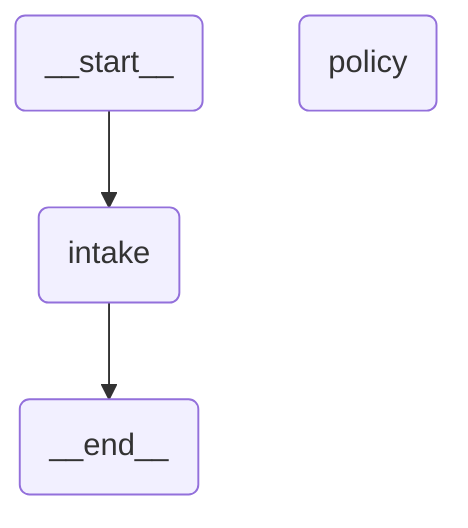
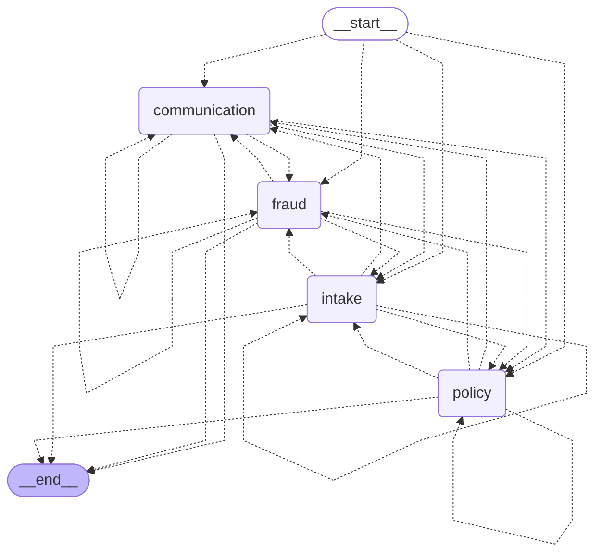

# 14 — Multi-agent systems

> After this module you can coordinate intake, policy, fraud, and communication specialists.

**Time:** 180 minutes · **Level:** Advanced · **LLM needed:** No live model · **Cost:** $0 with the included fakes.

**Larkspur Claims Copilot v07** · Practice takes additional time.

## Prerequisites

Complete [Subgraphs](../13_subgraphs/README.md). Read dictionary keys, functions, and Python type hints comfortably. Run uv sync from the repository root.

Optional installation requirements are listed in [the setup guide](../../docs/OPTIONAL_DEPENDENCIES.md). Use `uv run --no-sync` after installing extras so subsequent commands retain that environment.

## Learning objectives

- Implement and explain Supervisor pattern; agents as tools; private histories; context engineering; direct patterns versus helper packages.
- Implement and explain Command.PARENT; handoffs; shared message history; parent reducers; tool-call pairing at handoff.
- Implement and explain Swarm-style routing; active-agent state; bounded delegation; single versus multi-agent evaluation.

## The big idea

Coordinate intake, policy, fraud, and communication specialists. Predict the state before running code, then compare the observed result. A state is the data visible to a node; a node is one unit of work; an edge selects later work. A checkpoint is a saved state boundary, not a promise that an external effect happened exactly once.

## How it works

### Supervisor Tools

A supervisor may call specialists as tools. Each specialist gets a narrow evidence prompt and a private message history; the supervisor receives only the returned conclusion. This direct create_agent pattern avoids an extra helper package. More agents add calls and failure boundaries, so compare them against a single-agent baseline.

The lead adjuster asks two specialists specific questions instead of forwarding the entire customer file.

### Handoffs

Command.PARENT transfers control from a child graph to a node in its parent. The shared messages channel uses add_messages. A tool-based handoff includes both the AI request and its ToolMessage acknowledgment so the next specialist receives a valid conversation. Parent destinations must not be declared as local child nodes.

A referral changes the responsible desk and includes both the referral form and its receipt.



### Team Tradeoffs

A swarm-style team routes according to the active specialist, without requiring a central supervisor on every transition. Its business budget is distinct from the graph recursion limit. This controlled four-role comparison measures calls and completion; scripted answers do not establish that the team is smarter than the one-call baseline.

A claim folder moves between specialists, but a supervisor's budget limits how many desks it may visit.



## Key APIs at a glance

| API / executable example | What it does | When to use it |
| --- | --- | --- |
| create_agent, AIMessage, HumanMessage, tool — [01_supervisor_tools.py](examples/01_supervisor_tools.py) | Supervisor pattern; agents as tools; private histories; context engineering; direct patterns versus helper packages | A supervisor may call specialists as tools. |
| AIMessage, HumanMessage, ToolMessage, MessagesState — [02_handoffs.py](examples/02_handoffs.py) | Command.PARENT; handoffs; shared message history; parent reducers; tool-call pairing at handoff | Command.PARENT transfers control from a child graph to a node in its parent. |
| AIMessage, StateGraph, Command — [03_team_tradeoffs.py](examples/03_team_tradeoffs.py) | Swarm-style routing; active-agent state; bounded delegation; single versus multi-agent evaluation | A swarm-style team routes according to the active specialist, without requiring a central supervisor on every transition. |

## Walkthrough

Run commands from the repository root; the same commands work in PowerShell, macOS, and Linux. Open the source alongside the output. Find the state declaration, node functions, graph connections, and invocation. For a failure, start with the earliest changed field or scheduled node.

```text
uv run python modules/14_multi_agent_systems/examples/01_supervisor_tools.py
```

**Predict, then run:** for {"question": "Review policy and fraud evidence.", "private_note": "Synthetic phone: 555-0100"}, write the resulting fields and any expected error. Then test the boundary cases in tests/supervisor_tools.json.

<details>
<summary>Reveal the checked result</summary>

```json
{
  "value": {
    "specialists": [
      {
        "role": "fraud",
        "input": "Contractor estimate is missing"
      },
      {
        "role": "policy",
        "input": "Deductible: 100000 cents"
      }
    ],
    "tool_names": [
      "fraud_analyst",
      "policy_expert"
    ],
    "reports": [
      "fraud: evidence requires review",
      "policy: evidence requires review"
    ],
    "final": "Request the missing estimate before final policy review.",
    "private_note_leaked": false
  }
}
```

A supervisor may call specialists as tools. Each specialist gets a narrow evidence prompt and a private message history; the supervisor receives only the returned conclusion. This direct create_agent pattern avoids an extra helper package. More agents add calls and failure boundaries, so compare them against a single-agent baseline.

</details>

```text
uv run python modules/14_multi_agent_systems/examples/02_handoffs.py
```

**Predict, then run:** for {"claim_id": "CLM-0001", "question": "Explain the deductible."}, write the resulting fields and any expected error. Then test the boundary cases in tests/handoffs.json.

<details>
<summary>Reveal the checked result</summary>

```json
{
  "value": {
    "active_agent": "policy",
    "claim_id": "CLM-0001",
    "paired": true,
    "roles": [
      "human",
      "ai",
      "tool",
      "ai"
    ],
    "answer": "The deductible is 100000 cents."
  }
}
```

Command.PARENT transfers control from a child graph to a node in its parent. The shared messages channel uses add_messages. A tool-based handoff includes both the AI request and its ToolMessage acknowledgment so the next specialist receives a valid conversation. Parent destinations must not be declared as local child nodes.

</details>

```text
uv run python modules/14_multi_agent_systems/examples/03_team_tradeoffs.py
```

**Predict, then run:** for {"budget": 4, "start_agent": "intake"}, write the resulting fields and any expected error. Then test the boundary cases in tests/team_tradeoffs.json.

<details>
<summary>Reveal the checked result</summary>

```json
{
  "value": {
    "team_calls": 4,
    "team_complete": true,
    "reports": [
      "intake checked",
      "policy checked",
      "fraud checked",
      "communication checked"
    ],
    "single_calls": 1,
    "single_mentions_all_roles": true
  }
}
```

A swarm-style team routes according to the active specialist, without requiring a central supervisor on every transition. Its business budget is distinct from the graph recursion limit. This controlled four-role comparison measures calls and completion; scripted answers do not establish that the team is smarter than the one-call baseline.

</details>

When build_graph needs no arguments, its generated Mermaid diagram is saved beside the example. A diagram records possible edges; a runtime stream records executed work. A single sequence advances one node per superstep. Parallel nodes see the same previous boundary, so they cannot read a sibling's unfinished update.

## When to use it, and when not to

Use these contracts when the claim needs the state or control-flow behavior described above. Keep pure arithmetic and validation in ordinary functions that can be tested independently. A graph, checkpoint, or extra agent adds operational choices; justify it with a concrete failure, pause, branch, or reuse requirement.

## Real-world use case

Coordinate intake, policy, fraud, and communication specialists. The executable milestone uses only fictional records and the shared v07 implementation. [Read the use case](use_case/claims_copilot.py).

```text
uv run python modules/14_multi_agent_systems/use_case/claims_copilot.py
```

Sample output from the synthetic default case:

```json
{
  "specialists": [
    {
      "specialist": "fraud_analyst",
      "report": "Rule flags require evidence review; they are not proof of fraud."
    },
    {
      "specialist": "communication_specialist",
      "report": "The letter is respectful and makes no payment promise."
    }
  ],
  "approved": true
}
```

A real team would connect this boundary to validated records and authenticated roles, then retain the same rejection, ownership, and recovery checks.

## Common bugs

| Symptom or broken contract | Cause and repair | Practice |
| --- | --- | --- |
| Observed `{"error": "ValueError"}`. Register both specialist capabilities with the supervisor. | Restore `tools=[policy_expert, fraud_analyst]` and check the boundary cases. | [14-01](../../gym/tasks/14/14-01_supervisor_tools_build/task.md) · [Related Fix 14-02](../../gym/tasks/14/14-02_supervisor_tools_fix/task.md) |
| Observed `{"value": {"specialists": [{"role": "policy", "input": "Contractor estimate is missing"}, {"role": "policy", "input": "Deductible: 100000 cents"}], "tool_names": ["fraud_analyst", "policy_expert"], "reports": ["policy: e`. Keep specialist roles attached to the evidence they reviewed. | Restore `return specialist("fraud", "Contractor estimate is missing")` and check the boundary cases. | [14-02](../../gym/tasks/14/14-02_supervisor_tools_fix/task.md) |
| Observed `{"value": {"active_agent": "policy", "claim_id": "CLM-0001", "paired": true, "roles": ["human", "ai", "tool"], "answer": "Transferred to policy"}}`. Address the parent graph when handing off to its specialist. | Restore `graph=Command.PARENT` and check the boundary cases. | [14-07](../../gym/tasks/14/14-07_handoffs_build/task.md) · [Related Fix 14-08](../../gym/tasks/14/14-08_handoffs_fix/task.md) |
| Observed `{"value": {"active_agent": "policy", "claim_id": "CLM-0001", "paired": false, "roles": ["human", "ai", "tool", "ai"], "answer": "The deductible is 100000 cents."}}`. Pair the handoff acknowledgment with its AI request. | Restore `tool_call_id="handoff-1"` and check the boundary cases. | [14-08](../../gym/tasks/14/14-08_handoffs_fix/task.md) |
| Observed `{"value": {"team_calls": 4, "team_complete": true, "reports": ["intake checked", "policy checked", "fraud checked", "communication checked"], "single_calls": 1, "single_mentions_all_roles": true}}`. Stop delegation when the business call budget is exhausted. | Restore `state["calls"] >= state["budget"]` and check the boundary cases. | [14-13](../../gym/tasks/14/14-13_team_tradeoffs_build/task.md) · [Related Fix 14-14](../../gym/tasks/14/14-14_team_tradeoffs_fix/task.md) |
| Observed `{"value": {"team_calls": 4, "team_complete": false, "reports": ["intake checked", "intake checked", "intake checked", "intake checked"], "single_calls": 1, "single_mentions_all_roles": true}}`. Advance to the next specialist instead of handing work back to itself. | Restore `ROLES[index + 1]` and check the boundary cases. | [14-14](../../gym/tasks/14/14-14_team_tradeoffs_fix/task.md) |

## Practice

- [14-01 — build, easy](../../gym/tasks/14/14-01_supervisor_tools_build/task.md): Build supervisor tools: Register both specialist capabilities with the supervisor.
- [14-02 — fix, medium](../../gym/tasks/14/14-02_supervisor_tools_fix/task.md): Fix supervisor tools: Keep specialist roles attached to the evidence they reviewed.
- [14-03 — predict, easy](../../gym/tasks/14/14-03_supervisor_tools_predict/task.md): Predict supervisor tools across the declared cases
- [14-04 — trace, medium](../../gym/tasks/14/14-04_supervisor_tools_trace/task.md): Trace supervisor tools: Keep specialist roles attached to the evidence they reviewed.
- [14-05 — extend, hard](../../gym/tasks/14/14-05_supervisor_tools_extend/task.md): Extend supervisor tools: Give the policy specialist authoritative scoped evidence.
- [14-06 — refactor, hard](../../gym/tasks/14/14-06_supervisor_tools_refactor/task.md): Refactor supervisor tools: Return the specialist conclusion instead of its input prompt.
- [14-07 — build, easy](../../gym/tasks/14/14-07_handoffs_build/task.md): Build handoffs: Address the parent graph when handing off to its specialist.
- [14-08 — fix, medium](../../gym/tasks/14/14-08_handoffs_fix/task.md): Fix handoffs: Pair the handoff acknowledgment with its AI request.
- [14-09 — predict, easy](../../gym/tasks/14/14-09_handoffs_predict/task.md): Predict handoffs across the declared cases
- [14-10 — trace, medium](../../gym/tasks/14/14-10_handoffs_trace/task.md): Trace handoffs: Pair the handoff acknowledgment with its AI request.
- [14-11 — extend, hard](../../gym/tasks/14/14-11_handoffs_extend/task.md): Extend handoffs: Update ownership together with the handoff.
- [14-12 — refactor, hard](../../gym/tasks/14/14-12_handoffs_refactor/task.md): Refactor handoffs: Forward the complete handoff pair.
- [14-13 — build, easy](../../gym/tasks/14/14-13_team_tradeoffs_build/task.md): Build team tradeoffs: Stop delegation when the business call budget is exhausted.
- [14-14 — fix, medium](../../gym/tasks/14/14-14_team_tradeoffs_fix/task.md): Fix team tradeoffs: Advance to the next specialist instead of handing work back to itself.
- [14-15 — predict, easy](../../gym/tasks/14/14-15_team_tradeoffs_predict/task.md): Predict team tradeoffs across the declared cases
- [14-16 — trace, medium](../../gym/tasks/14/14-16_team_tradeoffs_trace/task.md): Trace team tradeoffs: Advance to the next specialist instead of handing work back to itself.
- [14-17 — extend, hard](../../gym/tasks/14/14-17_team_tradeoffs_extend/task.md): Extend team tradeoffs: Count every specialist operation against the budget.
- [14-18 — design, hard](../../gym/tasks/14/14-18_team_tradeoffs_design/task.md): Design team tradeoffs and justify the boundary policies

Start with tasks 01, 02, 09, 10, 17, and 18 in this module. Finish the other tasks for full practice. Hints are progressive; solution exposure is recorded. Predict and Trace tasks use answer JSON, not a code starter.

## Quiz

Predict first; explain in your own words.

1. Explain the contract in 01_supervisor_tools.py using one claim from its input cases.
2. Diagnose this broken behavior: Keep specialist roles attached to the evidence they reviewed. Which observation distinguishes the repair from a default-case-only fix?
3. Explain the contract in 02_handoffs.py using one claim from its input cases.
4. Diagnose this broken behavior: Pair the handoff acknowledgment with its AI request. Which observation distinguishes the repair from a default-case-only fix?
5. Explain the contract in 03_team_tradeoffs.py using one claim from its input cases.
6. Diagnose this broken behavior: Advance to the next specialist instead of handing work back to itself. Which observation distinguishes the repair from a default-case-only fix?

<details>
<summary>Answers</summary>

1. A supervisor may call specialists as tools. Each specialist gets a narrow evidence prompt and a private message history; the supervisor receives only the returned conclusion. This direct create_agent pattern avoids an extra helper package. More agents add calls and failure boundaries, so compare them against a single-agent baseline.
2. Keep specialist roles attached to the evidence they reviewed. Compare the normal case with the boundary fixtures and identify the first differing update.
3. Command.PARENT transfers control from a child graph to a node in its parent. The shared messages channel uses add_messages. A tool-based handoff includes both the AI request and its ToolMessage acknowledgment so the next specialist receives a valid conversation. Parent destinations must not be declared as local child nodes.
4. Pair the handoff acknowledgment with its AI request. Compare the normal case with the boundary fixtures and identify the first differing update.
5. A swarm-style team routes according to the active specialist, without requiring a central supervisor on every transition. Its business budget is distinct from the graph recursion limit. This controlled four-role comparison measures calls and completion; scripted answers do not establish that the team is smarter than the one-call baseline.
6. Advance to the next specialist instead of handing work back to itself. Compare the normal case with the boundary fixtures and identify the first differing update.

</details>

## Cost and safety

The default commands cost $0: deterministic Python and, in model lessons, scripted local fakes. They consume no hosted tokens and make no real payments or emails. Optional live experiments use the provider configured in .env; a short one-to-four-call exercise is usually cents, but verify your provider's current token prices and set a budget. Ollama can run locally without a hosted bill. Temporary checkpoint files are isolated from the committed dataset. Keep real customer details and credentials out of graph state.

## Key takeaways

- State visibility and update rules determine what a node can safely assume.
- Check normal, missing, boundary, and failure cases before trusting a workflow.
- Separate observed execution from diagrams, predictions, and durable history.
- Model output is evidence to validate, never an authorization grant.
- A saved checkpoint and an external effect have separate durability boundaries.

## Go deeper

- [supervisor tools official guide](https://docs.langchain.com/oss/python/langchain/multi-agent/subagents)
- [handoffs official guide](https://docs.langchain.com/oss/python/langchain/multi-agent/handoffs)
- [team tradeoffs official guide](https://docs.langchain.com/oss/python/langchain/multi-agent)

## Next:

Continue to [module 15: The Functional API](../../modules/15_functional_api/README.md).
