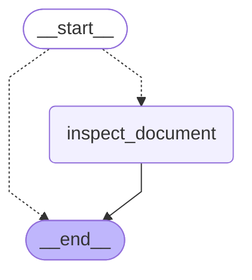

# 15 — The Functional API

> After this module you can rewrite intake with ordinary control flow while preserving durable behavior.

**Time:** 120 minutes · **Level:** Advanced · **LLM needed:** No live model · **Cost:** $0 with the included fakes.

**Larkspur Claims Copilot v07** · Practice takes additional time.

## Prerequisites

Complete [Multi-agent systems](../14_multi_agent_systems/README.md). Read dictionary keys, functions, and Python type hints comfortably. Run uv sync from the repository root.

Optional installation requirements are listed in [the setup guide](../../docs/OPTIONAL_DEPENDENCIES.md). Use `uv run --no-sync` after installing extras so subsequent commands retain that environment.

New to pytest, type validation, chat messages, tools, or async Python? Read the relevant section of [the beginner bridge](../../docs/BEGINNER_BRIDGE.md) when that concept first appears.

## Learning objectives

- Implement and explain entrypoint; task; single-input contract; task futures; result(); normal Python control flow.
- Implement and explain Starting tasks before resolving futures; parallel Functional API tasks; deterministic aggregation; graph versus functional comparison.
- Implement and explain Functional persistence; interrupts; saved task results; entrypoint replay; deterministic task ordering.

## The big idea

Rewrite intake with ordinary control flow while preserving durable behavior. Predict the state before running code, then compare the observed result. A state is the data visible to a node; a node is one unit of work; an edge selects later work. A checkpoint is a saved state boundary, not a promise that an external effect happened exactly once.

## How it works

### Entrypoints Tasks

An entrypoint accepts one serializable input and uses ordinary Python branches. A task call schedules durable work and returns a future; result() obtains its value. This supports familiar control flow without removing the need for validated inputs and deterministic replay order.

A familiar checklist can still assign tracked work orders and wait for their results.

### Parallel Futures

Create all task futures before resolving them to allow concurrent work. Collect results in a canonical order so scheduling differences do not change the business answer. The equivalent Send graph lets you compare the same finding function across the Graph and Functional APIs, including an empty document list.

Hand out every inspection assignment before waiting at the collection desk.



### Functional Resume

Resuming a Functional API interrupt restarts the entrypoint from its beginning. Completed task results are retrieved from checkpoints, so the task body need not run again. Keep task ordering deterministic and validate the resume payload. External effects still require their own idempotency at the crash window.

Reread the checklist after a pause while reusing stamped, completed work orders.

## Key APIs at a glance

| API / executable example | What it does | When to use it |
| --- | --- | --- |
| entrypoint, task — [01_entrypoints_tasks.py](examples/01_entrypoints_tasks.py) | entrypoint; task; single-input contract; task futures; result(); normal Python control flow | An entrypoint accepts one serializable input and uses ordinary Python branches. |
| entrypoint, task, StateGraph, Send — [02_parallel_futures.py](examples/02_parallel_futures.py) | Starting tasks before resolving futures; parallel Functional API tasks; deterministic aggregation; graph versus functional comparison | Create all task futures before resolving them to allow concurrent work. |
| InMemorySaver, entrypoint, task, Command — [03_functional_resume.py](examples/03_functional_resume.py) | Functional persistence; interrupts; saved task results; entrypoint replay; deterministic task ordering | Resuming a Functional API interrupt restarts the entrypoint from its beginning. |

## Walkthrough

Run commands from the repository root; the same commands work in PowerShell, macOS, and Linux. Open the source alongside the output. Find the state declaration, node functions, graph connections, and invocation. For a failure, start with the earliest changed field or scheduled node.

```text
uv run --no-sync python modules/15_functional_api/examples/01_entrypoints_tasks.py
```

**Predict, then run:** for {"claim_id": "CLM-0001", "description": "  Pipe burst  ", "amount_cents": 125000}, write the resulting fields and any expected error. Then test the boundary cases in tests/entrypoints_tasks.json.

<details>
<summary>Reveal the checked result</summary>

```json
{
  "value": {
    "claim_id": "CLM-0001",
    "description": "Pipe burst",
    "amount_cents": 125000,
    "route": "standard"
  }
}
```

An entrypoint accepts one serializable input and uses ordinary Python branches. A task call schedules durable work and returns a future; result() obtains its value. This supports familiar control flow without removing the need for validated inputs and deterministic replay order.

</details>

```text
uv run --no-sync python modules/15_functional_api/examples/02_parallel_futures.py
```

**Predict, then run:** for {"documents": ["estimate", "receipt", "police_report"]}, write the resulting fields and any expected error. Then test the boundary cases in tests/parallel_futures.json.

<details>
<summary>Reveal the checked result</summary>

```json
{
  "value": {
    "functional": [
      "estimate:ready",
      "police_report:review",
      "receipt:ready"
    ],
    "graph": [
      "estimate:ready",
      "police_report:review",
      "receipt:ready"
    ],
    "equal": true
  }
}
```

Create all task futures before resolving them to allow concurrent work. Collect results in a canonical order so scheduling differences do not change the business answer. The equivalent Send graph lets you compare the same finding function across the Graph and Functional APIs, including an empty document list.

</details>

```text
uv run --no-sync python modules/15_functional_api/examples/03_functional_resume.py
```

**Predict, then run:** for {"claim_id": "CLM-0001", "approved": true}, write the resulting fields and any expected error. Then test the boundary cases in tests/functional_resume.json.

<details>
<summary>Reveal the checked result</summary>

```json
{
  "value": {
    "interrupts": 1,
    "result": {
      "claim_id": "CLM-0001",
      "approved": true
    },
    "counts": {
      "entrypoint": 2,
      "task": 1
    }
  }
}
```

Resuming a Functional API interrupt restarts the entrypoint from its beginning. Completed task results are retrieved from checkpoints, so the task body need not run again. Keep task ordering deterministic and validate the resume payload. External effects still require their own idempotency at the crash window.

</details>

When build_graph needs no arguments, its generated Mermaid diagram is saved beside the example. A diagram records possible edges; a runtime stream records executed work. A single sequence advances one node per superstep. Parallel nodes see the same previous boundary, so they cannot read a sibling's unfinished update.

## When to use it, and when not to

Use these contracts when the claim needs the state or control-flow behavior described above. Keep pure arithmetic and validation in ordinary functions that can be tested independently. A graph, checkpoint, or extra agent adds operational choices; justify it with a concrete failure, pause, branch, or reuse requirement.

## Real-world use case

Rewrite intake with ordinary control flow while preserving durable behavior. The executable milestone uses only fictional records and the shared v07 implementation. [Read the use case](use_case/claims_copilot.py).

```text
uv run python modules/15_functional_api/use_case/claims_copilot.py
```

Sample output from the synthetic default case:

```json
{
  "route": "specialist",
  "letter": "Thank you. Your claim is review completed. No payment has been issued.",
  "risk_flags": [
    "high_value"
  ]
}
```

A real team would connect this boundary to validated records and authenticated roles, then retain the same rejection, ownership, and recovery checks.

## Common bugs

| Symptom or broken contract | Cause and repair | Practice |
| --- | --- | --- |
| Observed `{"error": "TypeError"}`. Resolve the normalization future before reading its fields. | Restore `normalize(claim).result()` and check the boundary cases. | [15-01](../../gym/tasks/15/15-01_entrypoints_tasks_build/task.md) · Related Fix: [15-02](../../gym/tasks/15/15-02_entrypoints_tasks_fix/task.md) |
| Observed `{"value": {"claim_id": "CLM-0001", "description": "Pipe burst", "amount_cents": 125000, "route": "standard"}}`. Match the Graph API fast-track boundary. | Restore `claim["amount_cents"] <= 100000` and check the boundary cases. | [15-02](../../gym/tasks/15/15-02_entrypoints_tasks_fix/task.md) · Related Fix: [15-02](../../gym/tasks/15/15-02_entrypoints_tasks_fix/task.md) |
| Observed `{"value": {"functional": ["estimate:ready", "receipt:ready", "police_report:review"], "graph": ["estimate:ready", "police_report:review", "receipt:ready"], "equal": false}}`. Canonicalize Functional API results independently of input order. | Restore `sorted(future.result() for future in futures)` and check the boundary cases. | [15-07](../../gym/tasks/15/15-07_parallel_futures_build/task.md) · Related Fix: [15-08](../../gym/tasks/15/15-08_parallel_futures_fix/task.md) |
| Observed `{"value": {"functional": ["estimate:ready", "police_report:review", "receipt:ready"], "graph": ["police_report:review"], "equal": false}}`. Preserve every parallel graph result. | Restore `operator.add]` and check the boundary cases. | [15-08](../../gym/tasks/15/15-08_parallel_futures_fix/task.md) · Related Fix: [15-08](../../gym/tasks/15/15-08_parallel_futures_fix/task.md) |
| Observed `{"error": "AttributeError"}`. Use a task boundary so completed evidence can be reused during replay. | Restore `@task     def collect_evidence` and check the boundary cases. | [15-13](../../gym/tasks/15/15-13_functional_resume_build/task.md) · Related Fix: [15-14](../../gym/tasks/15/15-14_functional_resume_fix/task.md) |
| Observed `{"value": {"interrupts": 1, "result": {"claim_id": "CLM-0001", "approved": true}, "counts": {"entrypoint": 2, "task": 1}}}`. Validate the resumed approval before returning a business result. | Restore `type(decision) is not bool` and check the boundary cases. | [15-14](../../gym/tasks/15/15-14_functional_resume_fix/task.md) · Related Fix: [15-14](../../gym/tasks/15/15-14_functional_resume_fix/task.md) |

## Practice

- [15-01 — build, easy](../../gym/tasks/15/15-01_entrypoints_tasks_build/task.md): Build entrypoints tasks: Resolve the normalization future before reading its fields.
- [15-02 — fix, medium](../../gym/tasks/15/15-02_entrypoints_tasks_fix/task.md): Fix entrypoints tasks: Match the Graph API fast-track boundary.
- [15-03 — predict, easy](../../gym/tasks/15/15-03_entrypoints_tasks_predict/task.md): Predict entrypoints tasks across the declared cases
- [15-04 — trace, medium](../../gym/tasks/15/15-04_entrypoints_tasks_trace/task.md): Diagnose entrypoints tasks from execution evidence
- [15-05 — extend, hard](../../gym/tasks/15/15-05_entrypoints_tasks_extend/task.md): Extend entrypoints tasks: Add run_batch(cases) to preview independent claims in input order. Preserve run(case), isolate mutable inputs, return value/error records, handle an empty batch, and continue after a rejected claim.
- [15-06 — refactor, hard](../../gym/tasks/15/15-06_entrypoints_tasks_refactor/task.md): Refactor entrypoints tasks: Convert the working Graph API pipeline to an entrypoint with normalize and route tasks, preserving every existing result and validation error.
- [15-07 — build, easy](../../gym/tasks/15/15-07_parallel_futures_build/task.md): Build parallel futures: Canonicalize Functional API results independently of input order.
- [15-08 — fix, medium](../../gym/tasks/15/15-08_parallel_futures_fix/task.md): Fix parallel futures: Preserve every parallel graph result.
- [15-09 — predict, easy](../../gym/tasks/15/15-09_parallel_futures_predict/task.md): Predict parallel futures across the declared cases
- [15-10 — trace, medium](../../gym/tasks/15/15-10_parallel_futures_trace/task.md): Diagnose parallel futures from execution evidence
- [15-11 — extend, hard](../../gym/tasks/15/15-11_parallel_futures_extend/task.md): Extend parallel futures: Add run_batch(cases) to preview independent claims in input order. Preserve run(case), isolate mutable inputs, return value/error records, handle an empty batch, and continue after a rejected claim.
- [15-12 — refactor, hard](../../gym/tasks/15/15-12_parallel_futures_refactor/task.md): Refactor parallel futures: Separate input preparation from orchestration in prepare_case(case). Preserve all results/errors, distinguish None from {}, and copy nested inputs so caller data and shared defaults stay independent.
- [15-13 — build, easy](../../gym/tasks/15/15-13_functional_resume_build/task.md): Build functional resume: Use a task boundary so completed evidence can be reused during replay.
- [15-14 — fix, medium](../../gym/tasks/15/15-14_functional_resume_fix/task.md): Fix functional resume: Validate the resumed approval before returning a business result.
- [15-15 — predict, easy](../../gym/tasks/15/15-15_functional_resume_predict/task.md): Predict functional resume across the declared cases
- [15-16 — trace, medium](../../gym/tasks/15/15-16_functional_resume_trace/task.md): Diagnose functional resume from execution evidence
- [15-17 — extend, hard](../../gym/tasks/15/15-17_functional_resume_extend/task.md): Extend functional resume: Add run_batch(cases) to preview independent claims in input order. Preserve run(case), isolate mutable inputs, return value/error records, handle an empty batch, and continue after a rejected claim.
- [15-18 — design, hard](../../gym/tasks/15/15-18_functional_resume_design/task.md): Design functional resume and justify the boundary policies

Start with tasks 01, 02, 09, 10, 17, and 18 in this module. Finish the other tasks for full practice. Hints are progressive; solution exposure is recorded. Predict and Trace tasks use answer JSON, not a code starter.

## Quiz

Predict first; explain in your own words.

1. Explain the contract in 01_entrypoints_tasks.py using one claim from its input cases.
2. Diagnose this broken behavior: Match the Graph API fast-track boundary. Which observation distinguishes the repair from a default-case-only fix?
3. Explain the contract in 02_parallel_futures.py using one claim from its input cases.
4. Diagnose this broken behavior: Preserve every parallel graph result. Which observation distinguishes the repair from a default-case-only fix?
5. Explain the contract in 03_functional_resume.py using one claim from its input cases.
6. Diagnose this broken behavior: Validate the resumed approval before returning a business result. Which observation distinguishes the repair from a default-case-only fix?

<details>
<summary>Answers</summary>

1. An entrypoint accepts one serializable input and uses ordinary Python branches. A task call schedules durable work and returns a future; result() obtains its value. This supports familiar control flow without removing the need for validated inputs and deterministic replay order.
2. Match the Graph API fast-track boundary. Compare the normal case with the boundary fixtures and identify the first differing update.
3. Create all task futures before resolving them to allow concurrent work. Collect results in a canonical order so scheduling differences do not change the business answer. The equivalent Send graph lets you compare the same finding function across the Graph and Functional APIs, including an empty document list.
4. Preserve every parallel graph result. Compare the normal case with the boundary fixtures and identify the first differing update.
5. Resuming a Functional API interrupt restarts the entrypoint from its beginning. Completed task results are retrieved from checkpoints, so the task body need not run again. Keep task ordering deterministic and validate the resume payload. External effects still require their own idempotency at the crash window.
6. Validate the resumed approval before returning a business result. Compare the normal case with the boundary fixtures and identify the first differing update.

</details>

## Cost and safety

The default commands cost $0: deterministic Python and, in model lessons, scripted local fakes. They consume no hosted tokens and make no real payments or emails. Optional live experiments use the provider configured in .env; a short one-to-four-call exercise is usually cents, but verify your provider's current token prices and set a budget. Ollama can run locally without a hosted bill. Temporary checkpoint files are isolated from the committed dataset. Keep real customer details and credentials out of graph state.

## Key takeaways

- State visibility and update rules determine what a node can safely assume.
- Check normal, missing, boundary, and failure cases before trusting a workflow.
- Separate observed execution from diagrams, predictions, and durable history.
- Model output is evidence to validate, never an authorization grant.
- A saved checkpoint and an external effect have separate durability boundaries.

## Go deeper

- [entrypoints tasks official guide](https://docs.langchain.com/oss/python/langgraph/functional-api)
- [parallel futures official guide](https://docs.langchain.com/oss/python/langgraph/functional-api)
- [functional resume official guide](https://docs.langchain.com/oss/python/langgraph/functional-api)

## Next:

Continue to [module 16: External systems and MCP](../../modules/16_external_systems_and_mcp/README.md).
