# 16 — External systems and MCP

> After this module you can expose the synthetic claims system through local MCP tools.

**Time:** 150 minutes · **Level:** Advanced · **LLM needed:** No live model · **Cost:** $0 with the included fakes.

**Larkspur Claims Copilot v07** · Practice takes additional time.

## Prerequisites

Complete [The Functional API](../15_functional_api/README.md). Read dictionary keys, functions, and Python type hints comfortably. Run uv sync from the repository root.

Optional installation requirements are listed in [the setup guide](../../docs/OPTIONAL_DEPENDENCIES.md). Use `uv run --no-sync` after installing extras so subsequent commands retain that environment.

## Learning objectives

- Implement and explain Async and await primer; HTTP timeouts; transient retries; idempotency keys; injectable transports.
- Implement and explain Official MCP SDK; local stdio server; tool schemas; server lifecycle; synthetic claims data permissions.
- Implement and explain langchain-mcp-adapters; MultiServerMCPClient; loading tools; async client lifetime; adapter-SDK compatibility; Beta successor awareness.

## The big idea

Expose the synthetic claims system through local MCP tools. Predict the state before running code, then compare the observed result. A state is the data visible to a node; a node is one unit of work; an edge selects later work. A checkpoint is a saved state boundary, not a promise that an external effect happened exactly once.

## How it works

Generated from this module's cumulative Claims Copilot graph. It shows component structure; only a runtime trace proves which nodes executed.

```mermaid
---
config:
  flowchart:
    curve: linear
---
graph TD;
	__start__([<p>__start__</p>]):::first
	consult_specialists(consult_specialists)
	__end__([<p>__end__</p>]):::last
	__start__ --> intake_policy_memory\3aintake_and_evidence\3aintake\3aextract;
	fraud_review\3ainspect_evidence --> consult_specialists;
	intake_policy_memory\3adraft_letter --> fraud_review\3ainspect_evidence;
	consult_specialists --> __end__;
	subgraph intake_policy_memory
	intake_policy_memory\3aremember(remember)
	intake_policy_memory\3adraft_letter(draft_letter)
	intake_policy_memory\3aintake_and_evidence\3apolicy_agent --> intake_policy_memory\3aremember;
	intake_policy_memory\3aremember --> intake_policy_memory\3adraft_letter;
	subgraph intake_and_evidence
	intake_policy_memory\3aintake_and_evidence\3apolicy_agent(policy_agent)
	intake_policy_memory\3aintake_and_evidence\3aintake\3aprocess_claim\3aapprove_claim --> intake_policy_memory\3aintake_and_evidence\3apolicy_agent;
	subgraph intake
	intake_policy_memory\3aintake_and_evidence\3aintake\3aextract(extract)
	intake_policy_memory\3aintake_and_evidence\3aintake\3aextract --> intake_policy_memory\3aintake_and_evidence\3aintake\3aprocess_claim\3anormalize;
	subgraph process_claim
	intake_policy_memory\3aintake_and_evidence\3aintake\3aprocess_claim\3anormalize(normalize)
	intake_policy_memory\3aintake_and_evidence\3aintake\3aprocess_claim\3avalidate(validate)
	intake_policy_memory\3aintake_and_evidence\3aintake\3aprocess_claim\3areview_document(review_document)
	intake_policy_memory\3aintake_and_evidence\3aintake\3aprocess_claim\3aroute(route<hr/><small><em>defer = True</em></small>)
	intake_policy_memory\3aintake_and_evidence\3aintake\3aprocess_claim\3aapprove_claim(approve_claim)
	intake_policy_memory\3aintake_and_evidence\3aintake\3aprocess_claim\3anormalize --> intake_policy_memory\3aintake_and_evidence\3aintake\3aprocess_claim\3avalidate;
	intake_policy_memory\3aintake_and_evidence\3aintake\3aprocess_claim\3areview_document --> intake_policy_memory\3aintake_and_evidence\3aintake\3aprocess_claim\3aroute;
	intake_policy_memory\3aintake_and_evidence\3aintake\3aprocess_claim\3aroute --> intake_policy_memory\3aintake_and_evidence\3aintake\3aprocess_claim\3aapprove_claim;
	intake_policy_memory\3aintake_and_evidence\3aintake\3aprocess_claim\3avalidate -.-> intake_policy_memory\3aintake_and_evidence\3aintake\3aprocess_claim\3areview_document;
	intake_policy_memory\3aintake_and_evidence\3aintake\3aprocess_claim\3avalidate -.-> intake_policy_memory\3aintake_and_evidence\3aintake\3aprocess_claim\3aroute;
	end
	end
	end
	end
	subgraph fraud_review
	fraud_review\3ainspect_evidence(inspect_evidence)
	end
	classDef default fill:#f2f0ff,line-height:1.2
	classDef first fill-opacity:0
	classDef last fill:#bfb6fc

```



### Api Boundaries

async def creates a coroutine; await lets other work proceed while a request waits. An injected HTTP transport makes failures testable without a server. Retry only transient transport failures, bound attempts and timeouts, and reuse a stable idempotency key because a missing acknowledgment may follow a successful write.

If a receipt is lost, resend the same numbered order rather than creating a second order.

### Mcp Server

MCP describes tools with names and JSON schemas. The official SDK validates requests before calling the function. This local service exposes only synthetic triage reads and capability discovery; it has no payment or arbitrary filesystem operation. stdio is the protocol channel, so diagnostics belong on stderr.

A service counter publishes a small menu of permitted requests, not keys to every office.

### Mcp Adapter

MultiServerMCPClient loads tool definitions from a real local stdio subprocess. The adapter turns them into LangChain tools while an explicit client session owns their lifetime. The pinned adapter supports MCP SDK 1.x. The newer langchain.mcp successor is Beta and is documented separately instead of silently mixing incompatible APIs.

A translator stays connected to the service desk for the entire conversation.

## Key APIs at a glance

| API / executable example | What it does | When to use it |
| --- | --- | --- |
| run(case) — [01_api_boundaries.py](examples/01_api_boundaries.py) | Async and await primer; HTTP timeouts; transient retries; idempotency keys; injectable transports | async def creates a coroutine; await lets other work proceed while a request waits. |
| run(case) — [02_mcp_server.py](examples/02_mcp_server.py) | Official MCP SDK; local stdio server; tool schemas; server lifecycle; synthetic claims data permissions | MCP describes tools with names and JSON schemas. |
| create_agent, AIMessage, HumanMessage, MultiServerMCPClient — [03_mcp_adapter.py](examples/03_mcp_adapter.py) | langchain-mcp-adapters; MultiServerMCPClient; loading tools; async client lifetime; adapter-SDK compatibility; Beta successor awareness | MultiServerMCPClient loads tool definitions from a real local stdio subprocess. |

## Walkthrough

Run commands from the repository root; the same commands work in PowerShell, macOS, and Linux. Open the source alongside the output. Find the state declaration, node functions, graph connections, and invocation. For a failure, start with the earliest changed field or scheduled node.

```text
uv run python modules/16_external_systems_and_mcp/examples/01_api_boundaries.py
```

**Predict, then run:** for {"claim_id": "CLM-0001", "transient_failures": 1, "attempts": 3}, write the resulting fields and any expected error. Then test the boundary cases in tests/api_boundaries.json.

<details>
<summary>Reveal the checked result</summary>

```json
{
  "value": {
    "accepted": true,
    "calls": 2,
    "effects": 1,
    "keys": [
      "estimate-request:CLM-0001",
      "estimate-request:CLM-0001"
    ]
  }
}
```

async def creates a coroutine; await lets other work proceed while a request waits. An injected HTTP transport makes failures testable without a server. Retry only transient transport failures, bound attempts and timeouts, and reuse a stable idempotency key because a missing acknowledgment may follow a successful write.

</details>

```text
uv run python modules/16_external_systems_and_mcp/examples/02_mcp_server.py
```

**Predict, then run:** for {"claim_id": "CLM-0001", "tool_name": "read_claim"}, write the resulting fields and any expected error. Then test the boundary cases in tests/mcp_server.json.

<details>
<summary>Reveal the checked result</summary>

```json
{
  "value": {
    "tools": [
      "list_capabilities",
      "read_claim"
    ],
    "result": {
      "claim_id": "CLM-0001",
      "claim_type": "water",
      "amount_cents": 2096759,
      "route": "specialist"
    },
    "parameters": [
      "claim_id"
    ]
  }
}
```

MCP describes tools with names and JSON schemas. The official SDK validates requests before calling the function. This local service exposes only synthetic triage reads and capability discovery; it has no payment or arbitrary filesystem operation. stdio is the protocol channel, so diagnostics belong on stderr.

</details>

```text
uv run python modules/16_external_systems_and_mcp/examples/03_mcp_adapter.py
```

**Predict, then run:** for {"claim_id": "CLM-0001"}, write the resulting fields and any expected error. Then test the boundary cases in tests/mcp_adapter.json.

<details>
<summary>Reveal the checked result</summary>

```json
{
  "value": {
    "tools": [
      "list_capabilities",
      "read_claim"
    ],
    "roles": [
      "human",
      "ai",
      "tool",
      "ai"
    ],
    "tool_call_ids": [
      "mcp-1"
    ],
    "claim": {
      "claim_id": "CLM-0001",
      "claim_type": "water",
      "amount_cents": 2096759,
      "route": "specialist"
    },
    "final": "Synthetic evidence read; no payment capability was exposed."
  }
}
```

MultiServerMCPClient loads tool definitions from a real local stdio subprocess. The adapter turns them into LangChain tools while an explicit client session owns their lifetime. The pinned adapter supports MCP SDK 1.x. The newer langchain.mcp successor is Beta and is documented separately instead of silently mixing incompatible APIs.

</details>

When build_graph needs no arguments, its generated Mermaid diagram is saved beside the example. A diagram records possible edges; a runtime stream records executed work. A single sequence advances one node per superstep. Parallel nodes see the same previous boundary, so they cannot read a sibling's unfinished update.

## When to use it, and when not to

Use these contracts when the claim needs the state or control-flow behavior described above. Keep pure arithmetic and validation in ordinary functions that can be tested independently. A graph, checkpoint, or extra agent adds operational choices; justify it with a concrete failure, pause, branch, or reuse requirement.

## Real-world use case

Expose the synthetic claims system through local MCP tools. The executable milestone uses only fictional records and the shared v07 implementation. [Read the use case](use_case/claims_copilot.py).

```text
uv run python modules/16_external_systems_and_mcp/use_case/claims_copilot.py
```

Sample output from the synthetic default case:

```json
{
  "mcp_evidence": {
    "claim_id": "CLM-0001",
    "claim_type": "water",
    "amount_cents": 2096759,
    "route": "specialist"
  },
  "risk_flags": [
    "high_value"
  ]
}
```

A real team would connect this boundary to validated records and authenticated roles, then retain the same rejection, ownership, and recovery checks.

## Common bugs

| Symptom or broken contract | Cause and repair | Practice |
| --- | --- | --- |
| Observed `{"value": {"accepted": true, "calls": 2, "effects": 2, "keys": ["estimate-request:CLM-00010", "estimate-request:CLM-00011"]}}`. Reuse the same idempotency key across a retry. | Restore `"estimate-request:" + claim_id` and check the boundary cases. | [16-01](../../gym/tasks/16/16-01_api_boundaries_build/task.md) · [Related Fix 16-02](../../gym/tasks/16/16-02_api_boundaries_fix/task.md) |
| Observed `{"error": "AssertionError"}`. Honor the bounded retry allowance after a lost acknowledgment. | Restore `range(attempts)` and check the boundary cases. | [16-02](../../gym/tasks/16/16-02_api_boundaries_fix/task.md) |
| Observed `{"error": "ToolError"}`. Invoke a tool from the published MCP registry. | Restore `server.call_tool(case["tool_name"], arguments)` and check the boundary cases. | [16-07](../../gym/tasks/16/16-07_mcp_server_build/task.md) · [Related Fix 16-08](../../gym/tasks/16/16-08_mcp_server_fix/task.md) |
| Observed `{"value": {"tools": ["list_capabilities", "read_claim"], "result": {"claim_id": "CLM-0001", "claim_type": "water", "amount_cents": 2096759, "route": "specialist"}, "parameters": ["claim_id"]}}`. Pass the requested synthetic claim through schema validation. | Restore `{"claim_id": case["claim_id"]}` and check the boundary cases. | [16-08](../../gym/tasks/16/16-08_mcp_server_fix/task.md) |
| Observed `{"error": "RuntimeError"}`. Load MCP tools before constructing the agent. | Restore `tools = await load_mcp_tools(session)` and check the boundary cases. | [16-13](../../gym/tasks/16/16-13_mcp_adapter_build/task.md) · [Related Fix 16-14](../../gym/tasks/16/16-14_mcp_adapter_fix/task.md) |
| Observed `{"value": {"tools": ["list_capabilities", "read_claim"], "roles": ["human", "ai", "tool", "ai"], "tool_call_ids": ["mcp-1"], "claim": {"claim_id": "CLM-0001", "claim_type": "water", "amount_cents": 2096759, "route": "spe`. Send the selected claim identifier to the MCP service. | Restore `"claim_id": case["claim_id"]` and check the boundary cases. | [16-14](../../gym/tasks/16/16-14_mcp_adapter_fix/task.md) |

## Practice

- [16-01 — build, easy](../../gym/tasks/16/16-01_api_boundaries_build/task.md): Build api boundaries: Reuse the same idempotency key across a retry.
- [16-02 — fix, medium](../../gym/tasks/16/16-02_api_boundaries_fix/task.md): Fix api boundaries: Honor the bounded retry allowance after a lost acknowledgment.
- [16-03 — predict, easy](../../gym/tasks/16/16-03_api_boundaries_predict/task.md): Predict api boundaries across the declared cases
- [16-04 — trace, medium](../../gym/tasks/16/16-04_api_boundaries_trace/task.md): Trace api boundaries: Honor the bounded retry allowance after a lost acknowledgment.
- [16-05 — extend, hard](../../gym/tasks/16/16-05_api_boundaries_extend/task.md): Extend api boundaries: Raise only when the transient retry budget is exhausted.
- [16-06 — refactor, hard](../../gym/tasks/16/16-06_api_boundaries_refactor/task.md): Refactor api boundaries: Return the actual service acknowledgment after a successful attempt.
- [16-07 — build, easy](../../gym/tasks/16/16-07_mcp_server_build/task.md): Build mcp server: Invoke a tool from the published MCP registry.
- [16-08 — fix, medium](../../gym/tasks/16/16-08_mcp_server_fix/task.md): Fix mcp server: Pass the requested synthetic claim through schema validation.
- [16-09 — predict, easy](../../gym/tasks/16/16-09_mcp_server_predict/task.md): Predict mcp server across the declared cases
- [16-10 — trace, medium](../../gym/tasks/16/16-10_mcp_server_trace/task.md): Trace mcp server: Pass the requested synthetic claim through schema validation.
- [16-11 — extend, hard](../../gym/tasks/16/16-11_mcp_server_extend/task.md): Extend mcp server: Dispatch both registered tools rather than only read_claim.
- [16-12 — refactor, hard](../../gym/tasks/16/16-12_mcp_server_refactor/task.md): Refactor mcp server: Publish the complete permitted capability list.
- [16-13 — build, easy](../../gym/tasks/16/16-13_mcp_adapter_build/task.md): Build mcp adapter: Load MCP tools before constructing the agent.
- [16-14 — fix, medium](../../gym/tasks/16/16-14_mcp_adapter_fix/task.md): Fix mcp adapter: Send the selected claim identifier to the MCP service.
- [16-15 — predict, easy](../../gym/tasks/16/16-15_mcp_adapter_predict/task.md): Predict mcp adapter across the declared cases
- [16-16 — trace, medium](../../gym/tasks/16/16-16_mcp_adapter_trace/task.md): Trace mcp adapter: Send the selected claim identifier to the MCP service.
- [16-17 — extend, hard](../../gym/tasks/16/16-17_mcp_adapter_extend/task.md): Extend mcp adapter: Preserve the declared request identity through the adapter.
- [16-18 — design, hard](../../gym/tasks/16/16-18_mcp_adapter_design/task.md): Design mcp adapter and justify the boundary policies

Start with tasks 01, 02, 09, 10, 17, and 18 in this module. Finish the other tasks for full practice. Hints are progressive; solution exposure is recorded. Predict and Trace tasks use answer JSON, not a code starter.

## Quiz

Predict first; explain in your own words.

1. Explain the contract in 01_api_boundaries.py using one claim from its input cases.
2. Diagnose this broken behavior: Honor the bounded retry allowance after a lost acknowledgment. Which observation distinguishes the repair from a default-case-only fix?
3. Explain the contract in 02_mcp_server.py using one claim from its input cases.
4. Diagnose this broken behavior: Pass the requested synthetic claim through schema validation. Which observation distinguishes the repair from a default-case-only fix?
5. Explain the contract in 03_mcp_adapter.py using one claim from its input cases.
6. Diagnose this broken behavior: Send the selected claim identifier to the MCP service. Which observation distinguishes the repair from a default-case-only fix?

<details>
<summary>Answers</summary>

1. async def creates a coroutine; await lets other work proceed while a request waits. An injected HTTP transport makes failures testable without a server. Retry only transient transport failures, bound attempts and timeouts, and reuse a stable idempotency key because a missing acknowledgment may follow a successful write.
2. Honor the bounded retry allowance after a lost acknowledgment. Compare the normal case with the boundary fixtures and identify the first differing update.
3. MCP describes tools with names and JSON schemas. The official SDK validates requests before calling the function. This local service exposes only synthetic triage reads and capability discovery; it has no payment or arbitrary filesystem operation. stdio is the protocol channel, so diagnostics belong on stderr.
4. Pass the requested synthetic claim through schema validation. Compare the normal case with the boundary fixtures and identify the first differing update.
5. MultiServerMCPClient loads tool definitions from a real local stdio subprocess. The adapter turns them into LangChain tools while an explicit client session owns their lifetime. The pinned adapter supports MCP SDK 1.x. The newer langchain.mcp successor is Beta and is documented separately instead of silently mixing incompatible APIs.
6. Send the selected claim identifier to the MCP service. Compare the normal case with the boundary fixtures and identify the first differing update.

</details>

## Cost and safety

The default commands cost $0: deterministic Python and, in model lessons, scripted local fakes. They consume no hosted tokens and make no real payments or emails. Optional live experiments use the provider configured in .env; a short one-to-four-call exercise is usually cents, but verify your provider's current token prices and set a budget. Ollama can run locally without a hosted bill. Temporary checkpoint files are isolated from the committed dataset. Keep real customer details and credentials out of graph state.

## Key takeaways

- State visibility and update rules determine what a node can safely assume.
- Check normal, missing, boundary, and failure cases before trusting a workflow.
- Separate observed execution from diagrams, predictions, and durable history.
- Model output is evidence to validate, never an authorization grant.
- A saved checkpoint and an external effect have separate durability boundaries.

## Go deeper

- [api boundaries official guide](https://docs.langchain.com/oss/python/langgraph/fault-tolerance)
- [mcp server official guide](https://docs.langchain.com/oss/python/langchain/mcp)
- [mcp adapter official guide](https://docs.langchain.com/oss/python/langchain/mcp)

## Next:

Continue to [module 17: Durable execution and long-running workflows](../../modules/17_durable_execution/README.md).
