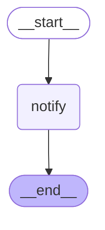

# 18 — Streaming to user interfaces

> After this module you can show claim progress and approval requests in an adjuster dashboard.

**Time:** 150 minutes · **Level:** Advanced · **LLM needed:** No live model · **Cost:** $0 with the included fakes.

**Larkspur Claims Copilot v09** · Practice takes additional time.

## Prerequisites

Complete [Durable execution and long-running workflows](../17_durable_execution/README.md). Read dictionary keys, functions, and Python type hints comfortably. Run uv sync from the repository root.

Optional installation requirements are listed in [the setup guide](../../docs/OPTIONAL_DEPENDENCIES.md). Use `uv run --no-sync` after installing extras so subsequent commands retain that environment.

New to pytest, type validation, chat messages, tools, or async Python? Read the relevant section of [the beginner bridge](../../docs/BEGINNER_BRIDGE.md) when that concept first appears.

## Learning objectives

- Implement and explain ainvoke; astream; async context propagation; all seven stream modes; v2 serialization; cancellation.
- Implement and explain FastAPI streaming responses; server-sent event framing; JSON-safe serialization; reconnect semantics; authenticated thread ownership.
- Implement and explain Streamlit state; progress and token rendering; approve/reject controls; stale interrupt detection; Beta v3 stream projections.

## The big idea

Show claim progress and approval requests in an adjuster dashboard. Predict the state before running code, then compare the observed result. A state is the data visible to a node; a node is one unit of work; an edge selects later work. A checkpoint is a saved state boundary, not a promise that an external effect happened exactly once.

## How it works

### Async Streams

ainvoke awaits one result; astream yields intermediate parts. Pass RunnableConfig into async model calls for explicit context propagation. The seven v2 modes expose different views, so count types rather than assuming one common payload. Cancellation must await cleanup; a browser disconnect is not proof that an external effect was rolled back.

Watch the service desks work while retaining a final receipt, and close every open folder when stopping early.



### Sse Api

An SSE frame ends with a blank line and carries JSON on its data line. JSON escaping keeps embedded newlines inside one frame. The real FastAPI routes authenticate callers, check thread ownership, and bind resumed decisions to the current interrupt ID. Reconnect by reading a snapshot; this demo does not promise durable replay from Last-Event-ID.

A numbered progress bulletin is useful only when it goes to the right customer and references the current approval form.

### Adjuster Dashboard

The dashboard is a projection of server events: append progress and text, replace pending approvals when a new snapshot arrives. Streamlit session state remembers the selected thread between UI reruns. Client-side controls improve usability, while the API independently rejects stale or unauthorized decisions. Beta v3 typed projections are explored in B4; this UI uses stable v2-derived SSE.

Replace an outdated approval form when the desk sends a corrected one instead of keeping both forms active.

## Key APIs at a glance

| API / executable example | What it does | When to use it |
| --- | --- | --- |
| AIMessage, HumanMessage, RunnableConfig, InMemorySaver — [01_async_streams.py](examples/01_async_streams.py) | ainvoke; astream; async context propagation; all seven stream modes; v2 serialization; cancellation | ainvoke awaits one result; astream yields intermediate parts. |
| run(case) — [02_sse_api.py](examples/02_sse_api.py) | FastAPI streaming responses; server-sent event framing; JSON-safe serialization; reconnect semantics; authenticated thread ownership | An SSE frame ends with a blank line and carries JSON on its data line. |
| run(case) — [03_adjuster_dashboard.py](examples/03_adjuster_dashboard.py) | Streamlit state; progress and token rendering; approve/reject controls; stale interrupt detection; Beta v3 stream projections | The dashboard is a projection of server events: append progress and text, replace pending approvals when a new snapshot arrives. |

## Walkthrough

Run commands from the repository root; the same commands work in PowerShell, macOS, and Linux. Open the source alongside the output. Find the state declaration, node functions, graph connections, and invocation. For a failure, start with the earliest changed field or scheduled node.

```text
uv run --no-sync python modules/18_streaming_user_interfaces/examples/01_async_streams.py
```

**Predict, then run:** for {"text": "Your estimate is ready.", "cancel": true}, write the resulting fields and any expected error. Then test the boundary cases in tests/async_streams.json.

<details>
<summary>Reveal the checked result</summary>

```json
{
  "value": {
    "kinds": [
      "checkpoints",
      "custom",
      "debug",
      "messages",
      "tasks",
      "updates",
      "values"
    ],
    "text": "Your estimate is ready.",
    "matches_invoke": true,
    "cancelled_cleanly": true
  }
}
```

ainvoke awaits one result; astream yields intermediate parts. Pass RunnableConfig into async model calls for explicit context propagation. The seven v2 modes expose different views, so count types rather than assuming one common payload. Cancellation must await cleanup; a browser disconnect is not proof that an external effect was rolled back.

</details>

```text
uv run --no-sync python modules/18_streaming_user_interfaces/examples/02_sse_api.py
```

**Predict, then run:** for {"approved": true, "stale": true, "note": "Estimate\nreceived"}, write the resulting fields and any expected error. Then test the boundary cases in tests/sse_api.json.

<details>
<summary>Reveal the checked result</summary>

```json
{
  "value": {
    "created": 201,
    "foreign_status": 404,
    "customer_approval_status": 403,
    "stale_status": 409,
    "effects": 1,
    "status": "recorded",
    "progress_events": 2,
    "framing_roundtrip": true,
    "frame_count": 1
  }
}
```

An SSE frame ends with a blank line and carries JSON on its data line. JSON escaping keeps embedded newlines inside one frame. The real FastAPI routes authenticate callers, check thread ownership, and bind resumed decisions to the current interrupt ID. Reconnect by reading a snapshot; this demo does not promise durable replay from Last-Event-ID.

</details>

```text
uv run --no-sync python modules/18_streaming_user_interfaces/examples/03_adjuster_dashboard.py
```

**Predict, then run:** for {"chunks": ["Estimate ", "received."], "submitted_id": "old-approval"}, write the resulting fields and any expected error. Then test the boundary cases in tests/adjuster_dashboard.json.

<details>
<summary>Reveal the checked result</summary>

```json
{
  "value": {
    "progress": [
      "review_documents"
    ],
    "text": "Estimate received.",
    "current_ids": [
      "current-approval"
    ],
    "can_submit": false
  }
}
```

The dashboard is a projection of server events: append progress and text, replace pending approvals when a new snapshot arrives. Streamlit session state remembers the selected thread between UI reruns. Client-side controls improve usability, while the API independently rejects stale or unauthorized decisions. Beta v3 typed projections are explored in B4; this UI uses stable v2-derived SSE.

</details>

When build_graph needs no arguments, its generated Mermaid diagram is saved beside the example. A diagram records possible edges; a runtime stream records executed work. A single sequence advances one node per superstep. Parallel nodes see the same previous boundary, so they cannot read a sibling's unfinished update.

## When to use it, and when not to

Use these contracts when the claim needs the state or control-flow behavior described above. Keep pure arithmetic and validation in ordinary functions that can be tested independently. A graph, checkpoint, or extra agent adds operational choices; justify it with a concrete failure, pause, branch, or reuse requirement.

## Real-world use case

Show claim progress and approval requests in an adjuster dashboard. The executable milestone uses only fictional records and the shared v09 implementation. [Read the use case](use_case/claims_copilot.py).

```text
uv run python modules/18_streaming_user_interfaces/use_case/claims_copilot.py
```

Sample output from the synthetic default case:

```json
{
  "created": 201,
  "foreign_status": 404,
  "customer_approval_status": 403,
  "stale_status": 409,
  "effects": 1,
  "status": "recorded",
  "progress_events": 2
}
```

A real team would connect this boundary to validated records and authenticated roles, then retain the same rejection, ownership, and recovery checks.

## Common bugs

| Symptom or broken contract | Cause and repair | Practice |
| --- | --- | --- |
| Observed `{"value": {"kinds": ["checkpoints", "custom", "debug", "messages", "tasks", "updates", "values"], "text": "", "matches_invoke": false, "cancelled_cleanly": true}}`. Accumulate chunks instead of replacing the previous text. | Restore `text += part["data"][0].content` and check the boundary cases. | [18-01](../../gym/tasks/18/18-01_async_streams_build/task.md) · Related Fix: [18-02](../../gym/tasks/18/18-02_async_streams_fix/task.md) |
| Observed `{"value": {"kinds": ["updates"], "text": "", "matches_invoke": false, "cancelled_cleanly": true}}`. Request the intended seven stream projections. | Restore `stream_mode=MODES` and check the boundary cases. | [18-02](../../gym/tasks/18/18-02_async_streams_fix/task.md) · Related Fix: [18-02](../../gym/tasks/18/18-02_async_streams_fix/task.md) |
| Observed `{"value": {"created": 201, "foreign_status": 404, "customer_approval_status": 403, "stale_status": 409, "effects": 1, "status": "recorded", "progress_events": 2, "framing_roundtrip": false, "frame_count": 1}}`. Preserve the exact event payload through SSE encoding. | Restore `encode_event("progress", {"node": case["note"]}, 1)` and check the boundary cases. | [18-07](../../gym/tasks/18/18-07_sse_api_build/task.md) · Related Fix: [18-08](../../gym/tasks/18/18-08_sse_api_fix/task.md) |
| Observed `{"value": {"created": 201, "foreign_status": 404, "customer_approval_status": 403, "stale_status": 409, "effects": 1, "status": "recorded", "progress_events": 2, "framing_roundtrip": true, "frame_count": 1}}`. Carry a rejection through the authenticated workflow. | Restore `approve=case["approved"]` and check the boundary cases. | [18-08](../../gym/tasks/18/18-08_sse_api_fix/task.md) · Related Fix: [18-08](../../gym/tasks/18/18-08_sse_api_fix/task.md) |
| Observed `{"value": {"progress": ["review_documents"], "text": "Estimate ", "current_ids": ["current-approval"], "can_submit": false}}`. Render every received text chunk in order. | Restore `for chunk in case["chunks"]:` and check the boundary cases. | [18-13](../../gym/tasks/18/18-13_adjuster_dashboard_build/task.md) · Related Fix: [18-14](../../gym/tasks/18/18-14_adjuster_dashboard_fix/task.md) |
| Observed `{"value": {"progress": ["review_documents"], "text": "Estimate received.", "current_ids": ["old-approval"], "can_submit": true}}`. Replace the stale approval identity with the current snapshot. | Restore `"id": "current-approval", "request"` and check the boundary cases. | [18-14](../../gym/tasks/18/18-14_adjuster_dashboard_fix/task.md) · Related Fix: [18-14](../../gym/tasks/18/18-14_adjuster_dashboard_fix/task.md) |

## Practice

- [18-01 — build, easy](../../gym/tasks/18/18-01_async_streams_build/task.md): Build async streams: Accumulate chunks instead of replacing the previous text.
- [18-02 — fix, medium](../../gym/tasks/18/18-02_async_streams_fix/task.md): Fix async streams: Request the intended seven stream projections.
- [18-03 — predict, easy](../../gym/tasks/18/18-03_async_streams_predict/task.md): Predict async streams across the declared cases
- [18-04 — trace, medium](../../gym/tasks/18/18-04_async_streams_trace/task.md): Diagnose async streams from execution evidence
- [18-05 — extend, hard](../../gym/tasks/18/18-05_async_streams_extend/task.md): Extend async streams: Add run_batch(cases) to preview independent claims in input order. Preserve run(case), isolate mutable inputs, return value/error records, handle an empty batch, and continue after a rejected claim.
- [18-06 — refactor, hard](../../gym/tasks/18/18-06_async_streams_refactor/task.md): Refactor async streams: Separate input preparation from orchestration in prepare_case(case). Preserve all results/errors, distinguish None from {}, and copy nested inputs so caller data and shared defaults stay independent.
- [18-07 — build, easy](../../gym/tasks/18/18-07_sse_api_build/task.md): Build sse api: Preserve the exact event payload through SSE encoding.
- [18-08 — fix, medium](../../gym/tasks/18/18-08_sse_api_fix/task.md): Fix sse api: Carry a rejection through the authenticated workflow.
- [18-09 — predict, easy](../../gym/tasks/18/18-09_sse_api_predict/task.md): Predict sse api across the declared cases
- [18-10 — trace, medium](../../gym/tasks/18/18-10_sse_api_trace/task.md): Diagnose sse api from execution evidence
- [18-11 — extend, hard](../../gym/tasks/18/18-11_sse_api_extend/task.md): Extend sse api: Add run_batch(cases) to preview independent claims in input order. Preserve run(case), isolate mutable inputs, return value/error records, handle an empty batch, and continue after a rejected claim.
- [18-12 — refactor, hard](../../gym/tasks/18/18-12_sse_api_refactor/task.md): Refactor sse api: Separate input preparation from orchestration in prepare_case(case). Preserve all results/errors, distinguish None from {}, and copy nested inputs so caller data and shared defaults stay independent.
- [18-13 — build, easy](../../gym/tasks/18/18-13_adjuster_dashboard_build/task.md): Build adjuster dashboard: Render every received text chunk in order.
- [18-14 — fix, medium](../../gym/tasks/18/18-14_adjuster_dashboard_fix/task.md): Fix adjuster dashboard: Replace the stale approval identity with the current snapshot.
- [18-15 — predict, easy](../../gym/tasks/18/18-15_adjuster_dashboard_predict/task.md): Predict adjuster dashboard across the declared cases
- [18-16 — trace, medium](../../gym/tasks/18/18-16_adjuster_dashboard_trace/task.md): Diagnose adjuster dashboard from execution evidence
- [18-17 — extend, hard](../../gym/tasks/18/18-17_adjuster_dashboard_extend/task.md): Extend adjuster dashboard: Add run_batch(cases) to preview independent claims in input order. Preserve run(case), isolate mutable inputs, return value/error records, handle an empty batch, and continue after a rejected claim.
- [18-18 — design, hard](../../gym/tasks/18/18-18_adjuster_dashboard_design/task.md): Design adjuster dashboard and justify the boundary policies

Start with tasks 01, 02, 09, 10, 17, and 18 in this module. Finish the other tasks for full practice. Hints are progressive; solution exposure is recorded. Predict and Trace tasks use answer JSON, not a code starter.

## Quiz

Predict first; explain in your own words.

1. Explain the contract in 01_async_streams.py using one claim from its input cases.
2. Diagnose this broken behavior: Request the intended seven stream projections. Which observation distinguishes the repair from a default-case-only fix?
3. Explain the contract in 02_sse_api.py using one claim from its input cases.
4. Diagnose this broken behavior: Carry a rejection through the authenticated workflow. Which observation distinguishes the repair from a default-case-only fix?
5. Explain the contract in 03_adjuster_dashboard.py using one claim from its input cases.
6. Diagnose this broken behavior: Replace the stale approval identity with the current snapshot. Which observation distinguishes the repair from a default-case-only fix?

<details>
<summary>Answers</summary>

1. ainvoke awaits one result; astream yields intermediate parts. Pass RunnableConfig into async model calls for explicit context propagation. The seven v2 modes expose different views, so count types rather than assuming one common payload. Cancellation must await cleanup; a browser disconnect is not proof that an external effect was rolled back.
2. Request the intended seven stream projections. Compare the normal case with the boundary fixtures and identify the first differing update.
3. An SSE frame ends with a blank line and carries JSON on its data line. JSON escaping keeps embedded newlines inside one frame. The real FastAPI routes authenticate callers, check thread ownership, and bind resumed decisions to the current interrupt ID. Reconnect by reading a snapshot; this demo does not promise durable replay from Last-Event-ID.
4. Carry a rejection through the authenticated workflow. Compare the normal case with the boundary fixtures and identify the first differing update.
5. The dashboard is a projection of server events: append progress and text, replace pending approvals when a new snapshot arrives. Streamlit session state remembers the selected thread between UI reruns. Client-side controls improve usability, while the API independently rejects stale or unauthorized decisions. Beta v3 typed projections are explored in B4; this UI uses stable v2-derived SSE.
6. Replace the stale approval identity with the current snapshot. Compare the normal case with the boundary fixtures and identify the first differing update.

</details>

## Cost and safety

The default commands cost $0: deterministic Python and, in model lessons, scripted local fakes. They consume no hosted tokens and make no real payments or emails. Optional live experiments use the provider configured in .env; a short one-to-four-call exercise is usually cents, but verify your provider's current token prices and set a budget. Ollama can run locally without a hosted bill. Temporary checkpoint files are isolated from the committed dataset. Keep real customer details and credentials out of graph state.

## Key takeaways

- State visibility and update rules determine what a node can safely assume.
- Check normal, missing, boundary, and failure cases before trusting a workflow.
- Separate observed execution from diagrams, predictions, and durable history.
- Model output is evidence to validate, never an authorization grant.
- A saved checkpoint and an external effect have separate durability boundaries.

## Go deeper

- [async streams official guide](https://docs.langchain.com/oss/python/langgraph/streaming)
- [sse api official guide](https://docs.langchain.com/oss/python/langgraph/streaming)
- [adjuster dashboard official guide](https://docs.langchain.com/oss/python/langgraph/event-streaming)

## Next:

Continue to [module 19: Testing and evaluation](../../modules/19_testing_and_evaluation/README.md).
