# 19 — Testing and evaluation

> After this module you can prevent regressions in claims decisions and tool behavior.

**Time:** 150 minutes · **Level:** Advanced · **LLM needed:** No live model · **Cost:** $0 with the included fakes.

**Larkspur Claims Copilot v09** · Practice takes additional time.

## Prerequisites

Complete [Streaming to user interfaces](../18_streaming_user_interfaces/README.md). Read dictionary keys, functions, and Python type hints comfortably. Run uv sync from the repository root.

Optional installation requirements are listed in [the setup guide](../../docs/OPTIONAL_DEPENDENCIES.md). Use `uv run --no-sync` after installing extras so subsequent commands retain that environment.

New to pytest, type validation, chat messages, tools, or async Python? Read the relevant section of [the beginner bridge](../../docs/BEGINNER_BRIDGE.md) when that concept first appears.

## Learning objectives

- Implement and explain pytest primer in depth; node unit tests; graph tests; fake models; routing and final-state assertions.
- Implement and explain Interrupt/resume tests; checkpoint assertions; superstep-aware snapshots; reducer properties; subprocess isolation.
- Implement and explain Local evaluation harness; golden JSONL cases; trajectory matching; agentevals; optional LangSmith evaluation.

## The big idea

Prevent regressions in claims decisions and tool behavior. Predict the state before running code, then compare the observed result. A state is the data visible to a node; a node is one unit of work; an edge selects later work. A checkpoint is a saved state boundary, not a promise that an external effect happened exactly once.

## How it works

### Test Graph Behavior

A pytest test is a function whose assertions express requirements. Parametrized tests run it over many inputs. Compare pure node rules and whole graphs against independently specified boundary outcomes; comparing two copies of the same implementation can preserve the same bug. Fake models make orchestration tests repeatable, not model accuracy measurable.

Check a ruler against known measurements instead of checking it against a second copy of the same misprinted ruler.

### Test Durable Execution

Durable tests assert the state before a pause, the pending node, and the resumed result. Snapshot only stable semantic fields, not random checkpoint IDs or timestamps. Reducer algebra can be checked over many generated inputs: associativity and idempotence protect parallel and replay behavior. The process-death test in module 17 covers a failure an in-memory mock cannot reproduce.

Inspect the waiting shelf before and after an approval rather than checking only the final receipt.

### Trajectory Evals

A trajectory is the sequence of tool requests, separate from the final answer. agentevals can compare strict order, unordered calls, subsets, or supersets. Exact argument matching catches the right tool used on the wrong policy. Choose the matching rule from the business requirement; parallel independent calls may legitimately change order.

Review both the investigator's conclusion and the records they actually requested.

The checked-in diagram was generated from the executable lesson or cumulative Copilot graph. Edges describe possible work; inspect the runtime trace to see what ran.

```mermaid
---
config:
  flowchart:
    curve: linear
---
graph TD;
	__start__([<p>__start__</p>]):::first
	announce(announce)
	complete_review(complete_review)
	__end__([<p>__end__</p>]):::last
	__start__ --> announce;
	announce --> durable_review\3aawait_estimate;
	durable_review\3areview_claim\3aconsult_specialists --> complete_review;
	complete_review --> __end__;
	subgraph durable_review
	durable_review\3aawait_estimate(await_estimate)
	durable_review\3aawait_estimate --> durable_review\3areview_claim\3aintake_policy_memory\3aauthorize_customer;
	subgraph review_claim
	durable_review\3areview_claim\3aconsult_specialists(consult_specialists)
	durable_review\3areview_claim\3afraud_review\3ainspect_evidence --> durable_review\3areview_claim\3aconsult_specialists;
	durable_review\3areview_claim\3aintake_policy_memory\3adraft_letter --> durable_review\3areview_claim\3afraud_review\3ainspect_evidence;
	subgraph intake_policy_memory
	durable_review\3areview_claim\3aintake_policy_memory\3aauthorize_customer(authorize_customer)
	durable_review\3areview_claim\3aintake_policy_memory\3aremember(remember)
	durable_review\3areview_claim\3aintake_policy_memory\3adraft_letter(draft_letter)
	durable_review\3areview_claim\3aintake_policy_memory\3aauthorize_customer --> durable_review\3areview_claim\3aintake_policy_memory\3aintake_and_evidence\3aintake\3aextract;
	durable_review\3areview_claim\3aintake_policy_memory\3aintake_and_evidence\3apolicy_agent --> durable_review\3areview_claim\3aintake_policy_memory\3aremember;
	durable_review\3areview_claim\3aintake_policy_memory\3aremember --> durable_review\3areview_claim\3aintake_policy_memory\3adraft_letter;
	subgraph intake_and_evidence
	durable_review\3areview_claim\3aintake_policy_memory\3aintake_and_evidence\3apolicy_agent(policy_agent)
	durable_review\3areview_claim\3aintake_policy_memory\3aintake_and_evidence\3aintake\3aprocess_claim\3aapprove_claim --> durable_review\3areview_claim\3aintake_policy_memory\3aintake_and_evidence\3apolicy_agent;
	subgraph intake
	durable_review\3areview_claim\3aintake_policy_memory\3aintake_and_evidence\3aintake\3aextract(extract)
	durable_review\3areview_claim\3aintake_policy_memory\3aintake_and_evidence\3aintake\3aextract --> durable_review\3areview_claim\3aintake_policy_memory\3aintake_and_evidence\3aintake\3aprocess_claim\3anormalize;
	subgraph process_claim
	durable_review\3areview_claim\3aintake_policy_memory\3aintake_and_evidence\3aintake\3aprocess_claim\3anormalize(normalize)
	durable_review\3areview_claim\3aintake_policy_memory\3aintake_and_evidence\3aintake\3aprocess_claim\3avalidate(validate)
	durable_review\3areview_claim\3aintake_policy_memory\3aintake_and_evidence\3aintake\3aprocess_claim\3areview_document(review_document)
	durable_review\3areview_claim\3aintake_policy_memory\3aintake_and_evidence\3aintake\3aprocess_claim\3aroute(route<hr/><small><em>defer = True</em></small>)
	durable_review\3areview_claim\3aintake_policy_memory\3aintake_and_evidence\3aintake\3aprocess_claim\3aapprove_claim(approve_claim)
	durable_review\3areview_claim\3aintake_policy_memory\3aintake_and_evidence\3aintake\3aprocess_claim\3anormalize --> durable_review\3areview_claim\3aintake_policy_memory\3aintake_and_evidence\3aintake\3aprocess_claim\3avalidate;
	durable_review\3areview_claim\3aintake_policy_memory\3aintake_and_evidence\3aintake\3aprocess_claim\3areview_document --> durable_review\3areview_claim\3aintake_policy_memory\3aintake_and_evidence\3aintake\3aprocess_claim\3aroute;
	durable_review\3areview_claim\3aintake_policy_memory\3aintake_and_evidence\3aintake\3aprocess_claim\3aroute --> durable_review\3areview_claim\3aintake_policy_memory\3aintake_and_evidence\3aintake\3aprocess_claim\3aapprove_claim;
	durable_review\3areview_claim\3aintake_policy_memory\3aintake_and_evidence\3aintake\3aprocess_claim\3avalidate -.-> durable_review\3areview_claim\3aintake_policy_memory\3aintake_and_evidence\3aintake\3aprocess_claim\3areview_document;
	durable_review\3areview_claim\3aintake_policy_memory\3aintake_and_evidence\3aintake\3aprocess_claim\3avalidate -.-> durable_review\3areview_claim\3aintake_policy_memory\3aintake_and_evidence\3aintake\3aprocess_claim\3aroute;
	end
	end
	end
	end
	end
	end
	classDef default fill:#f2f0ff,line-height:1.2
	classDef first fill-opacity:0
	classDef last fill:#bfb6fc

```



## Key APIs at a glance

| API / executable example | What it does | When to use it |
| --- | --- | --- |
| run(case) — [01_test_graph_behavior.py](examples/01_test_graph_behavior.py) | pytest primer in depth; node unit tests; graph tests; fake models; routing and final-state assertions | A pytest test is a function whose assertions express requirements. |
| Command — [02_test_durable_execution.py](examples/02_test_durable_execution.py) | Interrupt/resume tests; checkpoint assertions; superstep-aware snapshots; reducer properties; subprocess isolation | Durable tests assert the state before a pause, the pending node, and the resumed result. |
| AIMessage — [03_trajectory_evals.py](examples/03_trajectory_evals.py) | Local evaluation harness; golden JSONL cases; trajectory matching; agentevals; optional LangSmith evaluation | A trajectory is the sequence of tool requests, separate from the final answer. |

## Walkthrough

Run commands from the repository root; the same commands work in PowerShell, macOS, and Linux. Open the source alongside the output. Find the state declaration, node functions, graph connections, and invocation. For a failure, start with the earliest changed field or scheduled node.

```text
uv run --no-sync python modules/19_testing_and_evaluation/examples/01_test_graph_behavior.py
```

**Predict, then run:** for {"amounts": [100000, 100001, 500001, true]}, write the resulting fields and any expected error. Then test the boundary cases in tests/test_graph_behavior.json.

<details>
<summary>Reveal the checked result</summary>

```json
{
  "value": {
    "rows": [
      {
        "amount": 100000,
        "expected": "fast_track",
        "rule": "fast_track",
        "graph": "fast_track"
      },
      {
        "amount": 100001,
        "expected": "standard",
        "rule": "standard",
        "graph": "standard"
      },
      {
        "amount": 500001,
        "expected": "specialist",
        "rule": "specialist",
        "graph": "specialist"
      },
      {
        "amount": true,
        "expected": "invalid",
        "rule": "invalid",
        "graph": "invalid"
      }
    ],
    "passed": true
  }
}
```

A pytest test is a function whose assertions express requirements. Parametrized tests run it over many inputs. Compare pure node rules and whole graphs against independently specified boundary outcomes; comparing two copies of the same implementation can preserve the same bug. Fake models make orchestration tests repeatable, not model accuracy measurable.

</details>

```text
uv run --no-sync python modules/19_testing_and_evaluation/examples/02_test_durable_execution.py
```

**Predict, then run:** for {"approved": false, "groups": [["receipt"], ["estimate", "receipt"], ["policy"]]}, write the resulting fields and any expected error. Then test the boundary cases in tests/test_durable_execution.json.

<details>
<summary>Reveal the checked result</summary>

```json
{
  "value": {
    "paused": true,
    "pending_before": [
      "approve_claim"
    ],
    "pending_after": [],
    "approved": false,
    "associative": true,
    "merged": [
      "estimate",
      "policy",
      "receipt"
    ]
  }
}
```

Durable tests assert the state before a pause, the pending node, and the resumed result. Snapshot only stable semantic fields, not random checkpoint IDs or timestamps. Reducer algebra can be checked over many generated inputs: associativity and idempotence protect parallel and replay behavior. The process-death test in module 17 covers a failure an in-memory mock cannot reproduce.

</details>

```text
uv run --no-sync python modules/19_testing_and_evaluation/examples/03_trajectory_evals.py
```

**Predict, then run:** for {"tools": ["lookup_policy", "check_coverage"], "mode": "strict", "policy_id": "POL-0001"}, write the resulting fields and any expected error. Then test the boundary cases in tests/trajectory_evals.json.

<details>
<summary>Reveal the checked result</summary>

```json
{
  "value": {
    "score": true,
    "key": "trajectory_strict_match"
  }
}
```

A trajectory is the sequence of tool requests, separate from the final answer. agentevals can compare strict order, unordered calls, subsets, or supersets. Exact argument matching catches the right tool used on the wrong policy. Choose the matching rule from the business requirement; parallel independent calls may legitimately change order.

</details>

When build_graph needs no arguments, its generated Mermaid diagram is saved beside the example. A diagram records possible edges; a runtime stream records executed work. A single sequence advances one node per superstep. Parallel nodes see the same previous boundary, so they cannot read a sibling's unfinished update.

## When to use it, and when not to

Use these contracts when the claim needs the state or control-flow behavior described above. Keep pure arithmetic and validation in ordinary functions that can be tested independently. A graph, checkpoint, or extra agent adds operational choices; justify it with a concrete failure, pause, branch, or reuse requirement.

## Real-world use case

Prevent regressions in claims decisions and tool behavior. The executable milestone uses only fictional records and the shared v09 implementation. [Read the use case](use_case/claims_copilot.py).

```text
uv run python modules/19_testing_and_evaluation/use_case/claims_copilot.py
```

Sample output from the synthetic default case:

```json
{
  "cases": 60,
  "correct": 60,
  "accuracy": 1.0,
  "failures": []
}
```

A real team would connect this boundary to validated records and authenticated roles, then retain the same rejection, ownership, and recovery checks.

## Common bugs

| Symptom or broken contract | Cause and repair | Practice |
| --- | --- | --- |
| Observed `{"value": {"rows": [{"amount": 100000, "expected": "standard", "rule": "fast_track", "graph": "fast_track"}, {"amount": 100001, "expected": "standard", "rule": "standard", "graph": "standard"}, {"amount": 500001, "expect`. Specify the inclusive fast-track boundary in the test oracle. | Restore `amount <= 100000` and check the boundary cases. | [19-01](../../gym/tasks/19/19-01_test_graph_behavior_build/task.md) · Related Fix: [19-02](../../gym/tasks/19/19-02_test_graph_behavior_fix/task.md) |
| Observed `{"value": {"rows": [{"amount": 100000, "expected": "fast_track", "rule": "fast_track", "graph": "fast_track"}, {"amount": 100001, "expected": "standard", "rule": "standard", "graph": "standard"}, {"amount": 500001, "expe`. Include boolean cents in invalid-input coverage. | Restore `type(amount) is not int` and check the boundary cases. | [19-02](../../gym/tasks/19/19-02_test_graph_behavior_fix/task.md) · Related Fix: [19-02](../../gym/tasks/19/19-02_test_graph_behavior_fix/task.md) |
| Observed `{"value": {"paused": true, "pending_before": ["approve_claim"], "pending_after": [], "approved": true, "associative": true, "merged": ["estimate", "policy", "receipt"]}}`. Test rejection as well as approval on resume. | Restore `"approved": case["approved"]` and check the boundary cases. | [19-07](../../gym/tasks/19/19-07_test_durable_execution_build/task.md) · Related Fix: [19-08](../../gym/tasks/19/19-08_test_durable_execution_fix/task.md) |
| Observed `{"value": {"paused": true, "pending_before": [], "pending_after": [], "approved": false, "associative": true, "merged": ["estimate", "policy", "receipt"]}}`. Capture the pre-resume pending state before it changes. | Restore `"pending_before": list(before.next)` and check the boundary cases. | [19-08](../../gym/tasks/19/19-08_test_durable_execution_fix/task.md) · Related Fix: [19-08](../../gym/tasks/19/19-08_test_durable_execution_fix/task.md) |
| Observed `{"value": {"score": true, "key": "trajectory_unordered_match"}}`. Respect strict ordering when the evaluation contract requests it. | Restore `trajectory_match_mode=case["mode"]` and check the boundary cases. | [19-13](../../gym/tasks/19/19-13_trajectory_evals_build/task.md) · Related Fix: [19-14](../../gym/tasks/19/19-14_trajectory_evals_fix/task.md) |
| Observed `{"value": {"score": true, "key": "trajectory_strict_match"}}`. Check the policy arguments, not only tool names. | Restore `tool_args_match_mode="exact"` and check the boundary cases. | [19-14](../../gym/tasks/19/19-14_trajectory_evals_fix/task.md) · Related Fix: [19-14](../../gym/tasks/19/19-14_trajectory_evals_fix/task.md) |

## Practice

- [19-01 — build, easy](../../gym/tasks/19/19-01_test_graph_behavior_build/task.md): Build test graph behavior: Specify the inclusive fast-track boundary in the test oracle.
- [19-02 — fix, medium](../../gym/tasks/19/19-02_test_graph_behavior_fix/task.md): Fix test graph behavior: Include boolean cents in invalid-input coverage.
- [19-03 — predict, easy](../../gym/tasks/19/19-03_test_graph_behavior_predict/task.md): Predict test graph behavior across the declared cases
- [19-04 — trace, medium](../../gym/tasks/19/19-04_test_graph_behavior_trace/task.md): Diagnose test graph behavior from execution evidence
- [19-05 — extend, hard](../../gym/tasks/19/19-05_test_graph_behavior_extend/task.md): Extend test graph behavior: Add run_batch(cases) to preview independent claims in input order. Preserve run(case), isolate mutable inputs, return value/error records, handle an empty batch, and continue after a rejected claim.
- [19-06 — refactor, hard](../../gym/tasks/19/19-06_test_graph_behavior_refactor/task.md): Refactor test graph behavior: Separate input preparation from orchestration in prepare_case(case). Preserve all results/errors, distinguish None from {}, and copy nested inputs so caller data and shared defaults stay independent.
- [19-07 — build, easy](../../gym/tasks/19/19-07_test_durable_execution_build/task.md): Build test durable execution: Test rejection as well as approval on resume.
- [19-08 — fix, medium](../../gym/tasks/19/19-08_test_durable_execution_fix/task.md): Fix test durable execution: Capture the pre-resume pending state before it changes.
- [19-09 — predict, easy](../../gym/tasks/19/19-09_test_durable_execution_predict/task.md): Predict test durable execution across the declared cases
- [19-10 — trace, medium](../../gym/tasks/19/19-10_test_durable_execution_trace/task.md): Diagnose test durable execution from execution evidence
- [19-11 — extend, hard](../../gym/tasks/19/19-11_test_durable_execution_extend/task.md): Extend test durable execution: Add run_batch(cases) to preview independent claims in input order. Preserve run(case), isolate mutable inputs, return value/error records, handle an empty batch, and continue after a rejected claim.
- [19-12 — refactor, hard](../../gym/tasks/19/19-12_test_durable_execution_refactor/task.md): Refactor test durable execution: Separate input preparation from orchestration in prepare_case(case). Preserve all results/errors, distinguish None from {}, and copy nested inputs so caller data and shared defaults stay independent.
- [19-13 — build, easy](../../gym/tasks/19/19-13_trajectory_evals_build/task.md): Build trajectory evals: Respect strict ordering when the evaluation contract requests it.
- [19-14 — fix, medium](../../gym/tasks/19/19-14_trajectory_evals_fix/task.md): Fix trajectory evals: Check the policy arguments, not only tool names.
- [19-15 — predict, easy](../../gym/tasks/19/19-15_trajectory_evals_predict/task.md): Predict trajectory evals across the declared cases
- [19-16 — trace, medium](../../gym/tasks/19/19-16_trajectory_evals_trace/task.md): Diagnose trajectory evals from execution evidence
- [19-17 — extend, hard](../../gym/tasks/19/19-17_trajectory_evals_extend/task.md): Extend trajectory evals: Add run_batch(cases) to preview independent claims in input order. Preserve run(case), isolate mutable inputs, return value/error records, handle an empty batch, and continue after a rejected claim.
- [19-18 — design, hard](../../gym/tasks/19/19-18_trajectory_evals_design/task.md): Design trajectory evals and justify the boundary policies

Start with tasks 01, 02, 09, 10, 17, and 18 in this module. Finish the other tasks for full practice. Hints are progressive; solution exposure is recorded. Predict and Trace tasks use answer JSON, not a code starter.

## Quiz

Predict first; explain in your own words.

1. Explain the contract in 01_test_graph_behavior.py using one claim from its input cases.
2. Diagnose this broken behavior: Include boolean cents in invalid-input coverage. Which observation distinguishes the repair from a default-case-only fix?
3. Explain the contract in 02_test_durable_execution.py using one claim from its input cases.
4. Diagnose this broken behavior: Capture the pre-resume pending state before it changes. Which observation distinguishes the repair from a default-case-only fix?
5. Explain the contract in 03_trajectory_evals.py using one claim from its input cases.
6. Diagnose this broken behavior: Check the policy arguments, not only tool names. Which observation distinguishes the repair from a default-case-only fix?

<details>
<summary>Answers</summary>

1. A pytest test is a function whose assertions express requirements. Parametrized tests run it over many inputs. Compare pure node rules and whole graphs against independently specified boundary outcomes; comparing two copies of the same implementation can preserve the same bug. Fake models make orchestration tests repeatable, not model accuracy measurable.
2. Include boolean cents in invalid-input coverage. Compare the normal case with the boundary fixtures and identify the first differing update.
3. Durable tests assert the state before a pause, the pending node, and the resumed result. Snapshot only stable semantic fields, not random checkpoint IDs or timestamps. Reducer algebra can be checked over many generated inputs: associativity and idempotence protect parallel and replay behavior. The process-death test in module 17 covers a failure an in-memory mock cannot reproduce.
4. Capture the pre-resume pending state before it changes. Compare the normal case with the boundary fixtures and identify the first differing update.
5. A trajectory is the sequence of tool requests, separate from the final answer. agentevals can compare strict order, unordered calls, subsets, or supersets. Exact argument matching catches the right tool used on the wrong policy. Choose the matching rule from the business requirement; parallel independent calls may legitimately change order.
6. Check the policy arguments, not only tool names. Compare the normal case with the boundary fixtures and identify the first differing update.

</details>

## Cost and safety

The default commands cost $0: deterministic Python and, in model lessons, scripted local fakes. They consume no hosted tokens and make no real payments or emails. Optional live experiments use the provider configured in .env; a short one-to-four-call exercise is usually cents, but verify your provider's current token prices and set a budget. Ollama can run locally without a hosted bill. Temporary checkpoint files are isolated from the committed dataset. Keep real customer details and credentials out of graph state.

## Key takeaways

- State visibility and update rules determine what a node can safely assume.
- Check normal, missing, boundary, and failure cases before trusting a workflow.
- Separate observed execution from diagrams, predictions, and durable history.
- Model output is evidence to validate, never an authorization grant.
- A saved checkpoint and an external effect have separate durability boundaries.

## Go deeper

- [test graph behavior official guide](https://docs.langchain.com/oss/python/langgraph/test)
- [test durable execution official guide](https://docs.langchain.com/oss/python/langgraph/test)
- [trajectory evals official guide](https://docs.langchain.com/oss/python/langchain/test)

## Next:

Continue to [module 20: Observability and visual debugging](../../modules/20_observability_and_debugging/README.md).
