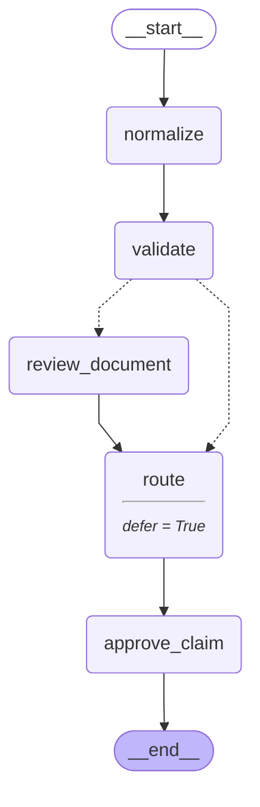
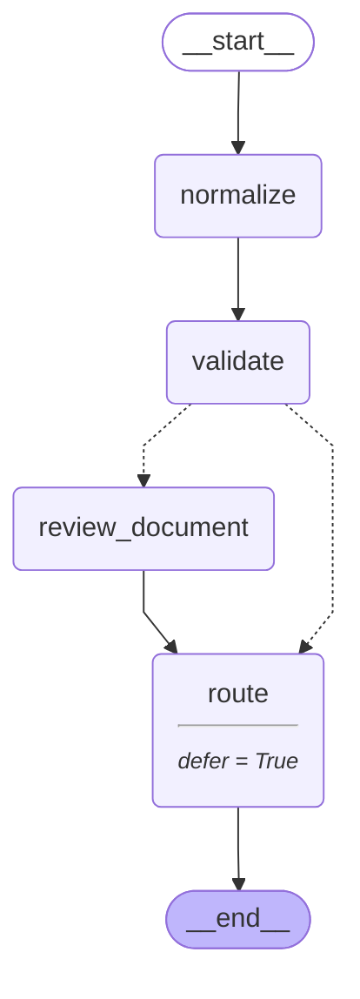

# 20 — Observability and visual debugging

> After this module you can find a misrouted claim using local traces and optional Studio.

**Time:** 90 minutes · **Level:** Advanced · **LLM needed:** No live model · **Cost:** $0 with the included fakes.

**Larkspur Claims Copilot v09** · Practice takes additional time.

## Prerequisites

Complete [Testing and evaluation](../19_testing_and_evaluation/README.md). Read dictionary keys, functions, and Python type hints comfortably. Run uv sync from the repository root.

Optional installation requirements are listed in [the setup guide](../../docs/OPTIONAL_DEPENDENCIES.md). Use `uv run --no-sync` after installing extras so subsequent commands retain that environment.

New to pytest, type validation, chat messages, tools, or async Python? Read the relevant section of [the beginner bridge](../../docs/BEGINNER_BRIDGE.md) when that concept first appears.

## Learning objectives

- Implement and explain langgraph.json; langgraph dev; graph export; Studio; local/offline alternative; static debugging breakpoints.
- Implement and explain Structured logging; correlation IDs; thread and run identifiers; redaction; observability without accounts.
- Implement and explain Optional LangSmith tracing; account requirements; local trace replay; trace metadata; time-travel debugging.

## The big idea

Find a misrouted claim using local traces and optional Studio. Predict the state before running code, then compare the observed result. A state is the data visible to a node; a node is one unit of work; an edge selects later work. A checkpoint is a saved state boundary, not a promise that an external effect happened exactly once.

## How it works

### Local Visual Debugging

langgraph.json maps a public graph name to a Python export. The local Agent Server hosts that graph; Studio adds a visual client and may require an account. Without Studio, draw_mermaid, updates, and checkpoint snapshots still reveal the route and pause. The export leaves persistence to the server instead of constructing its own competing saver.

A process map and a dated case file can diagnose a wrong desk assignment even without a visual control room.



### Structured Logs

Structured logs are small machine-readable records correlated by thread and run. An allowlist excludes raw prompts, contact details, and credentials rather than hoping a redactor recognizes every secret. Random run identifiers belong in operational logs but should be normalized out of teaching snapshots.

A tracking slip names the case and desk, without photocopying the customer's private paperwork.

### Optional Tracing

LangSmith tracing is optional and independent of checkpoint persistence. A local trace can show an old route, locate the checkpoint before routing, fork with corrected data, and retain the original history. This example explicitly disables remote tracing. Enable hosted tracing only for sanitized data and an account you intend to use.

Keep the original case file and attach a corrected branch instead of erasing the disputed decision.



## Key APIs at a glance

| API / executable example | What it does | When to use it |
| --- | --- | --- |
| run(case) — [01_local_visual_debugging.py](examples/01_local_visual_debugging.py) | langgraph.json; langgraph dev; graph export; Studio; local/offline alternative; static debugging breakpoints | langgraph.json maps a public graph name to a Python export. |
| run(case) — [02_structured_logs.py](examples/02_structured_logs.py) | Structured logging; correlation IDs; thread and run identifiers; redaction; observability without accounts | Structured logs are small machine-readable records correlated by thread and run. |
| run(case) — [03_optional_tracing.py](examples/03_optional_tracing.py) | Optional LangSmith tracing; account requirements; local trace replay; trace metadata; time-travel debugging | LangSmith tracing is optional and independent of checkpoint persistence. |

## Walkthrough

Run commands from the repository root; the same commands work in PowerShell, macOS, and Linux. Open the source alongside the output. Find the state declaration, node functions, graph connections, and invocation. For a failure, start with the earliest changed field or scheduled node.

```text
uv run --no-sync python modules/20_observability_and_debugging/examples/01_local_visual_debugging.py
```

**Predict, then run:** for {"amount_cents": 600000, "reported_route": "fast_track"}, write the resulting fields and any expected error. Then test the boundary cases in tests/local_visual_debugging.json.

<details>
<summary>Reveal the checked result</summary>

```json
{
  "value": {
    "export_exists": true,
    "symbol": "graph",
    "diagram_has_approval": true,
    "actual_route": "specialist",
    "misrouted": true,
    "paused": true
  }
}
```

langgraph.json maps a public graph name to a Python export. The local Agent Server hosts that graph; Studio adds a visual client and may require an account. Without Studio, draw_mermaid, updates, and checkpoint snapshots still reveal the route and pause. The export leaves persistence to the server instead of constructing its own competing saver.

</details>

```text
uv run --no-sync python modules/20_observability_and_debugging/examples/02_structured_logs.py
```

**Predict, then run:** for {"thread_id": "claim-thread", "run_id": "review-1", "description": "Synthetic contact: 555-0100", "api_key": "synthetic-secret"}, write the resulting fields and any expected error. Then test the boundary cases in tests/structured_logs.json.

<details>
<summary>Reveal the checked result</summary>

```json
{
  "value": {
    "records": [
      {
        "event": "node_finished",
        "node": "normalize",
        "run_id": "review-1",
        "status": "ok",
        "thread_id": "claim-thread"
      },
      {
        "event": "node_finished",
        "node": "route",
        "run_id": "review-1",
        "status": "ok",
        "thread_id": "claim-thread"
      },
      {
        "event": "node_finished",
        "node": "approve_claim",
        "run_id": "review-1",
        "status": "ok",
        "thread_id": "claim-thread"
      }
    ],
    "raw_text_logged": false,
    "credential_logged": false
  }
}
```

Structured logs are small machine-readable records correlated by thread and run. An allowlist excludes raw prompts, contact details, and credentials rather than hoping a redactor recognizes every secret. Random run identifiers belong in operational logs but should be normalized out of teaching snapshots.

</details>

```text
uv run --no-sync python modules/20_observability_and_debugging/examples/03_optional_tracing.py
```

**Predict, then run:** for {"corrected_cents": 50000}, write the resulting fields and any expected error. Then test the boundary cases in tests/optional_tracing.json.

<details>
<summary>Reveal the checked result</summary>

```json
{
  "value": {
    "original_route": "specialist",
    "forked_route": "fast_track",
    "fork_pending": [
      "route"
    ],
    "history_retained": true,
    "remote_tracing": false
  }
}
```

LangSmith tracing is optional and independent of checkpoint persistence. A local trace can show an old route, locate the checkpoint before routing, fork with corrected data, and retain the original history. This example explicitly disables remote tracing. Enable hosted tracing only for sanitized data and an account you intend to use.

</details>

When build_graph needs no arguments, its generated Mermaid diagram is saved beside the example. A diagram records possible edges; a runtime stream records executed work. A single sequence advances one node per superstep. Parallel nodes see the same previous boundary, so they cannot read a sibling's unfinished update.

## When to use it, and when not to

Use these contracts when the claim needs the state or control-flow behavior described above. Keep pure arithmetic and validation in ordinary functions that can be tested independently. A graph, checkpoint, or extra agent adds operational choices; justify it with a concrete failure, pause, branch, or reuse requirement.

## Real-world use case

Find a misrouted claim using local traces and optional Studio. The executable milestone uses only fictional records and the shared v09 implementation. [Read the use case](use_case/claims_copilot.py).

```text
uv run python modules/20_observability_and_debugging/use_case/claims_copilot.py
```

Sample output from the synthetic default case:

```json
{
  "original_route": "specialist",
  "forked_route": "fast_track",
  "fork_pending": [
    "route"
  ],
  "history_retained": true,
  "remote_tracing": false
}
```

A real team would connect this boundary to validated records and authenticated roles, then retain the same rejection, ownership, and recovery checks.

## Common bugs

| Symptom or broken contract | Cause and repair | Practice |
| --- | --- | --- |
| Observed `{"error": "KeyError"}`. Resolve the graph name declared in the server configuration. | Restore `config["graphs"]["claims"]` and check the boundary cases. | [20-01](../../gym/tasks/20/20-01_local_visual_debugging_build/task.md) · Related Fix: [20-02](../../gym/tasks/20/20-02_local_visual_debugging_fix/task.md) |
| Observed `{"value": {"export_exists": true, "symbol": "graph", "diagram_has_approval": true, "actual_route": "fast_track", "misrouted": false, "paused": false}}`. Debug the supplied claim amount rather than a substituted value. | Restore `"amount_cents": case["amount_cents"]` and check the boundary cases. | [20-02](../../gym/tasks/20/20-02_local_visual_debugging_fix/task.md) · Related Fix: [20-02](../../gym/tasks/20/20-02_local_visual_debugging_fix/task.md) |
| Observed `{"value": {"records": [{"event": "unknown", "node": "normalize", "run_id": "review-1", "status": "ok", "thread_id": "claim-thread"}, {"event": "unknown", "node": "route", "run_id": "review-1", "status": "ok", "thread_id"`. Use the documented event category for node completion. | Restore `"event": "node_finished"` and check the boundary cases. | [20-07](../../gym/tasks/20/20-07_structured_logs_build/task.md) · Related Fix: [20-08](../../gym/tasks/20/20-08_structured_logs_fix/task.md) |
| Observed `{"value": {"records": [{"event": "node_finished", "node": "normalize", "run_id": "review-1", "status": "ok", "thread_id": "claim-thread"}, {"event": "node_finished", "node": "normalize", "run_id": "review-1", "status": "`. Attach each log record to its actual node. | Restore `"node": node` and check the boundary cases. | [20-08](../../gym/tasks/20/20-08_structured_logs_fix/task.md) · Related Fix: [20-08](../../gym/tasks/20/20-08_structured_logs_fix/task.md) |
| Observed `{"value": {"original_route": "specialist", "forked_route": "specialist", "fork_pending": ["route"], "history_retained": true, "remote_tracing": false}}`. Apply the corrected amount to the fork before resuming routing. | Restore `case["corrected_cents"]` and check the boundary cases. | [20-13](../../gym/tasks/20/20-13_optional_tracing_build/task.md) · Related Fix: [20-14](../../gym/tasks/20/20-14_optional_tracing_fix/task.md) |
| Observed `{"value": {"original_route": "specialist", "forked_route": "fast_track", "fork_pending": ["normalize"], "history_retained": true, "remote_tracing": false}}`. Fork at the intended pre-routing boundary. | Restore `"route" in item.next` and check the boundary cases. | [20-14](../../gym/tasks/20/20-14_optional_tracing_fix/task.md) · Related Fix: [20-14](../../gym/tasks/20/20-14_optional_tracing_fix/task.md) |

## Practice

- [20-01 — build, easy](../../gym/tasks/20/20-01_local_visual_debugging_build/task.md): Build local visual debugging: Resolve the graph name declared in the server configuration.
- [20-02 — fix, medium](../../gym/tasks/20/20-02_local_visual_debugging_fix/task.md): Fix local visual debugging: Debug the supplied claim amount rather than a substituted value.
- [20-03 — predict, easy](../../gym/tasks/20/20-03_local_visual_debugging_predict/task.md): Predict local visual debugging across the declared cases
- [20-04 — trace, medium](../../gym/tasks/20/20-04_local_visual_debugging_trace/task.md): Diagnose local visual debugging from execution evidence
- [20-05 — extend, hard](../../gym/tasks/20/20-05_local_visual_debugging_extend/task.md): Extend local visual debugging: Add run_batch(cases) to preview independent claims in input order. Preserve run(case), isolate mutable inputs, return value/error records, handle an empty batch, and continue after a rejected claim.
- [20-06 — refactor, hard](../../gym/tasks/20/20-06_local_visual_debugging_refactor/task.md): Refactor local visual debugging: Separate input preparation from orchestration in prepare_case(case). Preserve all results/errors, distinguish None from {}, and copy nested inputs so caller data and shared defaults stay independent.
- [20-07 — build, easy](../../gym/tasks/20/20-07_structured_logs_build/task.md): Build structured logs: Use the documented event category for node completion.
- [20-08 — fix, medium](../../gym/tasks/20/20-08_structured_logs_fix/task.md): Fix structured logs: Attach each log record to its actual node.
- [20-09 — predict, easy](../../gym/tasks/20/20-09_structured_logs_predict/task.md): Predict structured logs across the declared cases
- [20-10 — trace, medium](../../gym/tasks/20/20-10_structured_logs_trace/task.md): Diagnose structured logs from execution evidence
- [20-11 — extend, hard](../../gym/tasks/20/20-11_structured_logs_extend/task.md): Extend structured logs: Add run_batch(cases) to preview independent claims in input order. Preserve run(case), isolate mutable inputs, return value/error records, handle an empty batch, and continue after a rejected claim.
- [20-12 — refactor, hard](../../gym/tasks/20/20-12_structured_logs_refactor/task.md): Refactor structured logs: Separate input preparation from orchestration in prepare_case(case). Preserve all results/errors, distinguish None from {}, and copy nested inputs so caller data and shared defaults stay independent.
- [20-13 — build, easy](../../gym/tasks/20/20-13_optional_tracing_build/task.md): Build optional tracing: Apply the corrected amount to the fork before resuming routing.
- [20-14 — fix, medium](../../gym/tasks/20/20-14_optional_tracing_fix/task.md): Fix optional tracing: Fork at the intended pre-routing boundary.
- [20-15 — predict, easy](../../gym/tasks/20/20-15_optional_tracing_predict/task.md): Predict optional tracing across the declared cases
- [20-16 — trace, medium](../../gym/tasks/20/20-16_optional_tracing_trace/task.md): Diagnose optional tracing from execution evidence
- [20-17 — extend, hard](../../gym/tasks/20/20-17_optional_tracing_extend/task.md): Extend optional tracing: Add run_batch(cases) to preview independent claims in input order. Preserve run(case), isolate mutable inputs, return value/error records, handle an empty batch, and continue after a rejected claim.
- [20-18 — design, hard](../../gym/tasks/20/20-18_optional_tracing_design/task.md): Design optional tracing and justify the boundary policies

Start with tasks 01, 02, 09, 10, 17, and 18 in this module. Finish the other tasks for full practice. Hints are progressive; solution exposure is recorded. Predict and Trace tasks use answer JSON, not a code starter.

## Quiz

Predict first; explain in your own words.

1. Explain the contract in 01_local_visual_debugging.py using one claim from its input cases.
2. Diagnose this broken behavior: Debug the supplied claim amount rather than a substituted value. Which observation distinguishes the repair from a default-case-only fix?
3. Explain the contract in 02_structured_logs.py using one claim from its input cases.
4. Diagnose this broken behavior: Attach each log record to its actual node. Which observation distinguishes the repair from a default-case-only fix?
5. Explain the contract in 03_optional_tracing.py using one claim from its input cases.
6. Diagnose this broken behavior: Fork at the intended pre-routing boundary. Which observation distinguishes the repair from a default-case-only fix?

<details>
<summary>Answers</summary>

1. langgraph.json maps a public graph name to a Python export. The local Agent Server hosts that graph; Studio adds a visual client and may require an account. Without Studio, draw_mermaid, updates, and checkpoint snapshots still reveal the route and pause. The export leaves persistence to the server instead of constructing its own competing saver.
2. Debug the supplied claim amount rather than a substituted value. Compare the normal case with the boundary fixtures and identify the first differing update.
3. Structured logs are small machine-readable records correlated by thread and run. An allowlist excludes raw prompts, contact details, and credentials rather than hoping a redactor recognizes every secret. Random run identifiers belong in operational logs but should be normalized out of teaching snapshots.
4. Attach each log record to its actual node. Compare the normal case with the boundary fixtures and identify the first differing update.
5. LangSmith tracing is optional and independent of checkpoint persistence. A local trace can show an old route, locate the checkpoint before routing, fork with corrected data, and retain the original history. This example explicitly disables remote tracing. Enable hosted tracing only for sanitized data and an account you intend to use.
6. Fork at the intended pre-routing boundary. Compare the normal case with the boundary fixtures and identify the first differing update.

</details>

## Cost and safety

The default commands cost $0: deterministic Python and, in model lessons, scripted local fakes. They consume no hosted tokens and make no real payments or emails. Optional live experiments use the provider configured in .env; a short one-to-four-call exercise is usually cents, but verify your provider's current token prices and set a budget. Ollama can run locally without a hosted bill. Temporary checkpoint files are isolated from the committed dataset. Keep real customer details and credentials out of graph state.

## Key takeaways

- State visibility and update rules determine what a node can safely assume.
- Check normal, missing, boundary, and failure cases before trusting a workflow.
- Separate observed execution from diagrams, predictions, and durable history.
- Model output is evidence to validate, never an authorization grant.
- A saved checkpoint and an external effect have separate durability boundaries.

## Go deeper

- [local visual debugging official guide](https://docs.langchain.com/oss/python/langgraph/local-server)
- [structured logs official guide](https://docs.langchain.com/oss/python/langgraph/pregel)
- [optional tracing official guide](https://docs.langchain.com/langsmith/observability)

## Next:

Continue to [module 21: Security and guardrails](../../modules/21_security_and_guardrails/README.md).
