# 22 — Deployment

> After this module you can run the completed Claims Copilot behind an API with durable storage and a dashboard.

**Time:** 180 minutes · **Level:** Advanced · **LLM needed:** No live model · **Cost:** $0 with the included fakes.

**Larkspur Claims Copilot v11** · Practice takes additional time.

## Prerequisites

Complete [Security and guardrails](../21_security_and_guardrails/README.md). Read dictionary keys, functions, and Python type hints comfortably. Run uv sync from the repository root.

Optional installation requirements are listed in [the setup guide](../../docs/OPTIONAL_DEPENDENCIES.md). Use `uv run --no-sync` after installing extras so subsequent commands retain that environment.

## Learning objectives

- Implement and explain FastAPI self-hosting; Docker Compose API/Postgres/UI; healthchecks; schema setup; configuration and secrets.
- Implement and explain Stateless workers; shared Postgres checkpoints; per-thread concurrency policy; idempotency; graceful shutdown; recovery.
- Implement and explain Agent Server; LangSmith Deployment; assistants, threads, and runs; background runs; scheduled jobs; costs and access requirements.

## The big idea

Run the completed Claims Copilot behind an API with durable storage and a dashboard. Predict the state before running code, then compare the observed result. A state is the data visible to a node; a node is one unit of work; an edge selects later work. A checkpoint is a saved state boundary, not a promise that an external effect happened exactly once.

## How it works

Generated from this module's cumulative Claims Copilot graph. It shows component structure; only a runtime trace proves which nodes executed.

```mermaid
---
config:
  flowchart:
    curve: linear
---
graph TD;
	__start__([<p>__start__</p>]):::first
	publish_summary(publish_summary)
	__end__([<p>__end__</p>]):::last
	__start__ --> secure_claim\3aauthorize_intake;
	secure_claim\3aapprove_payment --> publish_summary;
	publish_summary --> __end__;
	subgraph secure_claim
	secure_claim\3aauthorize_intake(authorize_intake)
	secure_claim\3aapprove_payment(approve_payment)
	secure_claim\3aauthorize_intake --> secure_claim\3areview\3aannounce;
	secure_claim\3areview\3acomplete_review --> secure_claim\3aapprove_payment;
	subgraph review
	secure_claim\3areview\3aannounce(announce)
	secure_claim\3areview\3acomplete_review(complete_review)
	secure_claim\3areview\3aannounce --> secure_claim\3areview\3adurable_review\3aawait_estimate;
	secure_claim\3areview\3adurable_review\3areview_claim\3aconsult_specialists --> secure_claim\3areview\3acomplete_review;
	subgraph durable_review
	secure_claim\3areview\3adurable_review\3aawait_estimate(await_estimate)
	secure_claim\3areview\3adurable_review\3aawait_estimate --> secure_claim\3areview\3adurable_review\3areview_claim\3aintake_policy_memory\3aintake_and_evidence\3aintake\3aextract;
	subgraph review_claim
	secure_claim\3areview\3adurable_review\3areview_claim\3aconsult_specialists(consult_specialists)
	secure_claim\3areview\3adurable_review\3areview_claim\3afraud_review\3ainspect_evidence --> secure_claim\3areview\3adurable_review\3areview_claim\3aconsult_specialists;
	secure_claim\3areview\3adurable_review\3areview_claim\3aintake_policy_memory\3adraft_letter --> secure_claim\3areview\3adurable_review\3areview_claim\3afraud_review\3ainspect_evidence;
	subgraph intake_policy_memory
	secure_claim\3areview\3adurable_review\3areview_claim\3aintake_policy_memory\3aremember(remember)
	secure_claim\3areview\3adurable_review\3areview_claim\3aintake_policy_memory\3adraft_letter(draft_letter)
	secure_claim\3areview\3adurable_review\3areview_claim\3aintake_policy_memory\3aintake_and_evidence\3apolicy_agent --> secure_claim\3areview\3adurable_review\3areview_claim\3aintake_policy_memory\3aremember;
	secure_claim\3areview\3adurable_review\3areview_claim\3aintake_policy_memory\3aremember --> secure_claim\3areview\3adurable_review\3areview_claim\3aintake_policy_memory\3adraft_letter;
	subgraph intake_and_evidence
	secure_claim\3areview\3adurable_review\3areview_claim\3aintake_policy_memory\3aintake_and_evidence\3apolicy_agent(policy_agent)
	secure_claim\3areview\3adurable_review\3areview_claim\3aintake_policy_memory\3aintake_and_evidence\3aintake\3aprocess_claim\3aapprove_claim --> secure_claim\3areview\3adurable_review\3areview_claim\3aintake_policy_memory\3aintake_and_evidence\3apolicy_agent;
	subgraph intake
	secure_claim\3areview\3adurable_review\3areview_claim\3aintake_policy_memory\3aintake_and_evidence\3aintake\3aextract(extract)
	secure_claim\3areview\3adurable_review\3areview_claim\3aintake_policy_memory\3aintake_and_evidence\3aintake\3aextract --> secure_claim\3areview\3adurable_review\3areview_claim\3aintake_policy_memory\3aintake_and_evidence\3aintake\3aprocess_claim\3anormalize;
	subgraph process_claim
	secure_claim\3areview\3adurable_review\3areview_claim\3aintake_policy_memory\3aintake_and_evidence\3aintake\3aprocess_claim\3anormalize(normalize)
	secure_claim\3areview\3adurable_review\3areview_claim\3aintake_policy_memory\3aintake_and_evidence\3aintake\3aprocess_claim\3avalidate(validate)
	secure_claim\3areview\3adurable_review\3areview_claim\3aintake_policy_memory\3aintake_and_evidence\3aintake\3aprocess_claim\3areview_document(review_document)
	secure_claim\3areview\3adurable_review\3areview_claim\3aintake_policy_memory\3aintake_and_evidence\3aintake\3aprocess_claim\3aroute(route<hr/><small><em>defer = True</em></small>)
	secure_claim\3areview\3adurable_review\3areview_claim\3aintake_policy_memory\3aintake_and_evidence\3aintake\3aprocess_claim\3aapprove_claim(approve_claim)
	secure_claim\3areview\3adurable_review\3areview_claim\3aintake_policy_memory\3aintake_and_evidence\3aintake\3aprocess_claim\3anormalize --> secure_claim\3areview\3adurable_review\3areview_claim\3aintake_policy_memory\3aintake_and_evidence\3aintake\3aprocess_claim\3avalidate;
	secure_claim\3areview\3adurable_review\3areview_claim\3aintake_policy_memory\3aintake_and_evidence\3aintake\3aprocess_claim\3areview_document --> secure_claim\3areview\3adurable_review\3areview_claim\3aintake_policy_memory\3aintake_and_evidence\3aintake\3aprocess_claim\3aroute;
	secure_claim\3areview\3adurable_review\3areview_claim\3aintake_policy_memory\3aintake_and_evidence\3aintake\3aprocess_claim\3aroute --> secure_claim\3areview\3adurable_review\3areview_claim\3aintake_policy_memory\3aintake_and_evidence\3aintake\3aprocess_claim\3aapprove_claim;
	secure_claim\3areview\3adurable_review\3areview_claim\3aintake_policy_memory\3aintake_and_evidence\3aintake\3aprocess_claim\3avalidate -.-> secure_claim\3areview\3adurable_review\3areview_claim\3aintake_policy_memory\3aintake_and_evidence\3aintake\3aprocess_claim\3areview_document;
	secure_claim\3areview\3adurable_review\3areview_claim\3aintake_policy_memory\3aintake_and_evidence\3aintake\3aprocess_claim\3avalidate -.-> secure_claim\3areview\3adurable_review\3areview_claim\3aintake_policy_memory\3aintake_and_evidence\3aintake\3aprocess_claim\3aroute;
	end
	end
	end
	end
	end
	end
	end
	end
	classDef default fill:#f2f0ff,line-height:1.2
	classDef first fill-opacity:0
	classDef last fill:#bfb6fc

```



### Compose Stack

The self-hosted stack has an API, Postgres, and a Streamlit UI. Database readiness gates API startup, and API health gates the UI. Required credentials come from the environment; published ports bind to localhost for this teaching deployment. The example validates the committed configuration, while the integration job actually starts the containers and calls the service.

Open the service counter only after the archive is ready, then open the waiting room.

### Worker Reliability

Stateless workers share durable checkpoints, ownership records, and effect keys. One active run may mutate a thread at a time. The local registry demonstrates lease exclusion within one process; the Postgres implementation uses a transaction-scoped advisory lock across workers. A new ledger instance proves that idempotency survives worker replacement, and conflicting payloads are rejected.

Any adjuster may pick up the durable folder, but only one holds its checkout card at a time.

### Managed Deployment

An assistant selects graph configuration, a thread identifies persisted state, and a run is one execution. Agent Server supports background runs; LangSmith Deployment adds managed hosting and scheduled jobs subject to account access and current pricing. This offline request planner creates no hosted resources. The explicit SDK function requires a caller-supplied authenticated client and full graph input.

A service definition, a case folder, and a work session are three different identifiers.

## Key APIs at a glance

| API / executable example | What it does | When to use it |
| --- | --- | --- |
| run(case) — [01_compose_stack.py](examples/01_compose_stack.py) | FastAPI self-hosting; Docker Compose API/Postgres/UI; healthchecks; schema setup; configuration and secrets | The self-hosted stack has an API, Postgres, and a Streamlit UI. |
| run(case) — [02_worker_reliability.py](examples/02_worker_reliability.py) | Stateless workers; shared Postgres checkpoints; per-thread concurrency policy; idempotency; graceful shutdown; recovery | Stateless workers share durable checkpoints, ownership records, and effect keys. |
| run(case) — [03_managed_deployment.py](examples/03_managed_deployment.py) | Agent Server; LangSmith Deployment; assistants, threads, and runs; background runs; scheduled jobs; costs and access requirements | An assistant selects graph configuration, a thread identifies persisted state, and a run is one execution. |

## Walkthrough

Run commands from the repository root; the same commands work in PowerShell, macOS, and Linux. Open the source alongside the output. Find the state declaration, node functions, graph connections, and invocation. For a failure, start with the earliest changed field or scheduled node.

```text
uv run python modules/22_deployment/examples/01_compose_stack.py
```

**Predict, then run:** for {"public_bind": false, "remove_healthcheck": false}, write the resulting fields and any expected error. Then test the boundary cases in tests/compose_stack.json.

<details>
<summary>Reveal the checked result</summary>

```json
{
  "value": {
    "services": [
      "api",
      "postgres",
      "ui"
    ],
    "valid": true,
    "errors": [],
    "api_waits_for_database": true
  }
}
```

The self-hosted stack has an API, Postgres, and a Streamlit UI. Database readiness gates API startup, and API health gates the UI. Required credentials come from the environment; published ports bind to localhost for this teaching deployment. The example validates the committed configuration, while the integration job actually starts the containers and calls the service.

</details>

```text
uv run python modules/22_deployment/examples/02_worker_reliability.py
```

**Predict, then run:** for {"claim_id": "CLM-0001", "amount_cents": 50000, "changed_payload": false}, write the resulting fields and any expected error. Then test the boundary cases in tests/worker_reliability.json.

<details>
<summary>Reveal the checked result</summary>

```json
{
  "value": {
    "competing_worker_busy": true,
    "first_created": true,
    "replay_created": false,
    "effects": 1
  }
}
```

Stateless workers share durable checkpoints, ownership records, and effect keys. One active run may mutate a thread at a time. The local registry demonstrates lease exclusion within one process; the Postgres implementation uses a transaction-scoped advisory lock across workers. A new ledger instance proves that idempotency survives worker replacement, and conflicting payloads are rejected.

</details>

```text
uv run python modules/22_deployment/examples/03_managed_deployment.py
```

**Predict, then run:** for {"assistant_id": "claims", "thread_id": "claim-thread", "schedule": "0 9 * * 1-5", "background": true}, write the resulting fields and any expected error. Then test the boundary cases in tests/managed_deployment.json.

<details>
<summary>Reveal the checked result</summary>

```json
{
  "value": {
    "assistant": {
      "graph_id": "claims"
    },
    "thread": {
      "thread_id": "claim-thread"
    },
    "run": {
      "assistant_id": "claims",
      "input": {
        "claim_id": "CLM-0001"
      }
    },
    "mode": "background",
    "schedule": "0 9 * * 1-5"
  }
}
```

An assistant selects graph configuration, a thread identifies persisted state, and a run is one execution. Agent Server supports background runs; LangSmith Deployment adds managed hosting and scheduled jobs subject to account access and current pricing. This offline request planner creates no hosted resources. The explicit SDK function requires a caller-supplied authenticated client and full graph input.

</details>

When build_graph needs no arguments, its generated Mermaid diagram is saved beside the example. A diagram records possible edges; a runtime stream records executed work. A single sequence advances one node per superstep. Parallel nodes see the same previous boundary, so they cannot read a sibling's unfinished update.

## When to use it, and when not to

Use these contracts when the claim needs the state or control-flow behavior described above. Keep pure arithmetic and validation in ordinary functions that can be tested independently. A graph, checkpoint, or extra agent adds operational choices; justify it with a concrete failure, pause, branch, or reuse requirement.

## Real-world use case

Run the completed Claims Copilot behind an API with durable storage and a dashboard. The executable milestone uses only fictional records and the shared v11 implementation. [Read the use case](use_case/claims_copilot.py).

```text
uv run python modules/22_deployment/use_case/claims_copilot.py
```

Sample output from the synthetic default case:

```json
{
  "created": 201,
  "foreign_status": 404,
  "customer_approval_status": 403,
  "stale_status": 409,
  "effects": 1,
  "status": "recorded",
  "progress_events": 2
}
```

A real team would connect this boundary to validated records and authenticated roles, then retain the same rejection, ownership, and recovery checks.

## Common bugs

| Symptom or broken contract | Cause and repair | Practice |
| --- | --- | --- |
| Observed `{"value": {"services": ["api", "postgres", "ui"], "valid": true, "errors": [], "api_waits_for_database": true}}`. Reject a database without a readiness check. | Restore `if "healthcheck" not in services["postgres"]:` and check the boundary cases. | [22-01](../../gym/tasks/22/22-01_compose_stack_build/task.md) |
| Observed `{"value": {"services": ["api", "postgres", "ui"], "valid": true, "errors": [], "api_waits_for_database": true}}`. Detect accidental public binding of the teaching service. | Restore `not binding.startswith("127.0.0.1:")` and check the boundary cases. | [22-02](../../gym/tasks/22/22-02_compose_stack_fix/task.md) |
| Observed `{"value": {"competing_worker_busy": true, "first_created": true, "replay_created": true, "effects": 2}}`. Use the same business effect identity after worker replacement. | Restore `"payment:" + case["claim_id"]` and check the boundary cases. | [22-07](../../gym/tasks/22/22-07_worker_reliability_build/task.md) |
| Observed `{"value": {"competing_worker_busy": false, "first_created": true, "replay_created": false, "effects": 1}}`. Report that a competing run was excluded. | Restore `busy = True` and check the boundary cases. | [22-08](../../gym/tasks/22/22-08_worker_reliability_fix/task.md) |
| Observed `{"value": {"assistant": {"graph_id": "claims"}, "thread": {"thread_id": "claim-thread"}, "run": {"assistant_id": "claims", "input": {"claim_id": "CLM-0001"}}, "mode": "background", "schedule": "0 9 * * 1-5"}}`. Require both assistant configuration and thread identity. | Restore `if not case["assistant_id"] or not case["thread_id"]:` and check the boundary cases. | [22-13](../../gym/tasks/22/22-13_managed_deployment_build/task.md) |
| Observed `{"value": {"assistant": {"graph_id": "claims"}, "thread": {"thread_id": "claim-thread"}, "run": {"assistant_id": "claims", "input": {"claim_id": "CLM-0001"}}, "mode": "background", "schedule": "0 9 * * 1-5"}}`. Keep interactive waiting distinct from background execution. | Restore `"background" if case["background"] else "wait"` and check the boundary cases. | [22-14](../../gym/tasks/22/22-14_managed_deployment_fix/task.md) |

## Practice

- [22-01 — build, easy](../../gym/tasks/22/22-01_compose_stack_build/task.md): Build compose stack: Reject a database without a readiness check.
- [22-02 — fix, medium](../../gym/tasks/22/22-02_compose_stack_fix/task.md): Fix compose stack: Detect accidental public binding of the teaching service.
- [22-03 — predict, easy](../../gym/tasks/22/22-03_compose_stack_predict/task.md): Predict compose stack across the declared cases
- [22-04 — trace, medium](../../gym/tasks/22/22-04_compose_stack_trace/task.md): Trace compose stack: Detect accidental public binding of the teaching service.
- [22-05 — extend, hard](../../gym/tasks/22/22-05_compose_stack_extend/task.md): Extend compose stack: Do not mark a stack valid after detecting a deployment error.
- [22-06 — refactor, hard](../../gym/tasks/22/22-06_compose_stack_refactor/task.md): Refactor compose stack: Distinguish service readiness from process startup.
- [22-07 — build, easy](../../gym/tasks/22/22-07_worker_reliability_build/task.md): Build worker reliability: Use the same business effect identity after worker replacement.
- [22-08 — fix, medium](../../gym/tasks/22/22-08_worker_reliability_fix/task.md): Fix worker reliability: Report that a competing run was excluded.
- [22-09 — predict, easy](../../gym/tasks/22/22-09_worker_reliability_predict/task.md): Predict worker reliability across the declared cases
- [22-10 — trace, medium](../../gym/tasks/22/22-10_worker_reliability_trace/task.md): Trace worker reliability: Report that a competing run was excluded.
- [22-11 — extend, hard](../../gym/tasks/22/22-11_worker_reliability_extend/task.md): Extend worker reliability: Exercise and reject idempotency-key reuse with a changed payload.
- [22-12 — design, hard](../../gym/tasks/22/22-12_worker_reliability_design/task.md): Design worker reliability and justify the boundary policies
- [22-13 — build, easy](../../gym/tasks/22/22-13_managed_deployment_build/task.md): Build managed deployment: Require both assistant configuration and thread identity.
- [22-14 — fix, medium](../../gym/tasks/22/22-14_managed_deployment_fix/task.md): Fix managed deployment: Keep interactive waiting distinct from background execution.
- [22-15 — predict, easy](../../gym/tasks/22/22-15_managed_deployment_predict/task.md): Predict managed deployment across the declared cases
- [22-16 — trace, medium](../../gym/tasks/22/22-16_managed_deployment_trace/task.md): Trace managed deployment: Keep interactive waiting distinct from background execution.
- [22-17 — extend, hard](../../gym/tasks/22/22-17_managed_deployment_extend/task.md): Extend managed deployment: Reject an obviously malformed schedule before proposing a hosted job.
- [22-18 — design, hard](../../gym/tasks/22/22-18_managed_deployment_design/task.md): Design managed deployment and justify the boundary policies

Start with tasks 01, 02, 09, 10, 17, and 18 in this module. Finish the other tasks for full practice. Hints are progressive; solution exposure is recorded. Predict and Trace tasks use answer JSON, not a code starter.

## Quiz

Predict first; explain in your own words.

1. Explain the contract in 01_compose_stack.py using one claim from its input cases.
2. Diagnose this broken behavior: Detect accidental public binding of the teaching service. Which observation distinguishes the repair from a default-case-only fix?
3. Explain the contract in 02_worker_reliability.py using one claim from its input cases.
4. Diagnose this broken behavior: Report that a competing run was excluded. Which observation distinguishes the repair from a default-case-only fix?
5. Explain the contract in 03_managed_deployment.py using one claim from its input cases.
6. Diagnose this broken behavior: Keep interactive waiting distinct from background execution. Which observation distinguishes the repair from a default-case-only fix?

<details>
<summary>Answers</summary>

1. The self-hosted stack has an API, Postgres, and a Streamlit UI. Database readiness gates API startup, and API health gates the UI. Required credentials come from the environment; published ports bind to localhost for this teaching deployment. The example validates the committed configuration, while the integration job actually starts the containers and calls the service.
2. Detect accidental public binding of the teaching service. Compare the normal case with the boundary fixtures and identify the first differing update.
3. Stateless workers share durable checkpoints, ownership records, and effect keys. One active run may mutate a thread at a time. The local registry demonstrates lease exclusion within one process; the Postgres implementation uses a transaction-scoped advisory lock across workers. A new ledger instance proves that idempotency survives worker replacement, and conflicting payloads are rejected.
4. Report that a competing run was excluded. Compare the normal case with the boundary fixtures and identify the first differing update.
5. An assistant selects graph configuration, a thread identifies persisted state, and a run is one execution. Agent Server supports background runs; LangSmith Deployment adds managed hosting and scheduled jobs subject to account access and current pricing. This offline request planner creates no hosted resources. The explicit SDK function requires a caller-supplied authenticated client and full graph input.
6. Keep interactive waiting distinct from background execution. Compare the normal case with the boundary fixtures and identify the first differing update.

</details>

## Cost and safety

The default commands cost $0: deterministic Python and, in model lessons, scripted local fakes. They consume no hosted tokens and make no real payments or emails. Optional live experiments use the provider configured in .env; a short one-to-four-call exercise is usually cents, but verify your provider's current token prices and set a budget. Ollama can run locally without a hosted bill. Temporary checkpoint files are isolated from the committed dataset. Keep real customer details and credentials out of graph state.

## Key takeaways

- State visibility and update rules determine what a node can safely assume.
- Check normal, missing, boundary, and failure cases before trusting a workflow.
- Separate observed execution from diagrams, predictions, and durable history.
- Model output is evidence to validate, never an authorization grant.
- A saved checkpoint and an external effect have separate durability boundaries.

## Go deeper

- [compose stack official guide](https://docs.langchain.com/oss/python/langgraph/deploy)
- [worker reliability official guide](https://docs.langchain.com/oss/python/langgraph/fault-tolerance)
- [managed deployment official guide](https://docs.langchain.com/oss/python/langgraph/deploy)

## Next:

Continue to [module B1: LangGraph.js](../../modules/bonus/B1_langgraph_js/README.md).
