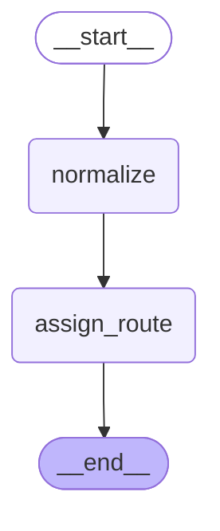

# B1 — LangGraph.js

> After this module you can port core claim workflows and the tool loop to TypeScript.

**Time:** 240 minutes · **Level:** Advanced · **LLM needed:** No live model · **Cost:** $0 with the included fakes.

**Larkspur Claims Copilot v11** · Practice takes additional time.

## Prerequisites

Complete [Deployment](../../22_deployment/README.md). Read dictionary keys, functions, and Python type hints comfortably. Run uv sync from the repository root.

Optional installation requirements are listed in [the setup guide](../../../docs/OPTIONAL_DEPENDENCIES.md). Use `uv run --no-sync` after installing extras so subsequent commands retain that environment.

New to pytest, type validation, chat messages, tools, or async Python? Read the relevant section of [the beginner bridge](../../../docs/BEGINNER_BRIDGE.md) when that concept first appears.

## Learning objectives

- Implement and explain TypeScript primer; LangGraph.js state schema; nodes and reducers; graph compilation; Python behavior parity.
- Implement and explain JavaScript conditional routing and Send; persistence; interrupts; stream formats; language API differences.
- Implement and explain JavaScript fake chat models; tool calls; manual agent loop; createAgent; cross-language trajectory parity.

## The big idea

Port core claim workflows and the tool loop to TypeScript. Predict the state before running code, then compare the observed result. A state is the data visible to a node; a node is one unit of work; an edge selects later work. A checkpoint is a saved state boundary, not a promise that an external effect happened exactly once.

## How it works

### Typescript State

TypeScript adds static types to JavaScript; StateSchema uses Zod schemas for graph state and ReducedValue declares merges. Nodes return partial objects, await obtains a Promise result, and integer cents preserve Python parity. The JavaScript API returns state directly here; do not assume Python's v2 result wrapper exists in another language.

The same claim folder can use different language labels while keeping its business rules unchanged.

### Typescript Durable

JavaScript Send fans out document work, SqliteSaver retains the approval pause, and Command resumes it. The saver connection is explicitly closed. JavaScript uses camelCase options such as streamMode and returns its documented update shape; this lesson intentionally does not copy Python invocation parameters.

The same waiting shelf works across languages, but each desk's form has its own field names.

### Typescript Agents

The TypeScript model factory returns a scripted LangChain fake with tool calls. A manual StateGraph loop and createAgent consume the same trajectory, making their roles and call identities directly comparable. The Python gym bridge executes the selected TypeScript file in Node; it never supplies the business answer itself.

Two service-desk layouts must produce the same numbered work orders and final explanation.

The checked-in diagram was generated from the executable lesson or cumulative Copilot graph. Edges describe possible work; inspect the runtime trace to see what ran.



## Key APIs at a glance

| API / executable example | What it does | When to use it |
| --- | --- | --- |
| run(case) — [01_typescript_state.ts](examples/01_typescript_state.ts) | TypeScript primer; LangGraph.js state schema; nodes and reducers; graph compilation; Python behavior parity | TypeScript adds static types to JavaScript; StateSchema uses Zod schemas for graph state and ReducedValue declares merges. |
| run(case) — [02_typescript_durable.ts](examples/02_typescript_durable.ts) | JavaScript conditional routing and Send; persistence; interrupts; stream formats; language API differences | JavaScript Send fans out document work, SqliteSaver retains the approval pause, and Command resumes it. |
| run(case) — [03_typescript_agents.ts](examples/03_typescript_agents.ts) | JavaScript fake chat models; tool calls; manual agent loop; createAgent; cross-language trajectory parity | The TypeScript model factory returns a scripted LangChain fake with tool calls. |

## Walkthrough

Run commands from the repository root; the same commands work in PowerShell, macOS, and Linux. Open the source alongside the output. Find the state declaration, node functions, graph connections, and invocation. For a failure, start with the earliest changed field or scheduled node.

```text
node modules/bonus/B1_langgraph_js/examples/01_typescript_state.ts
```

**Predict, then run:** for {"claim_id": "CLM-0001", "description": "  Pipe burst  ", "amount_cents": 125000}, write the resulting fields and any expected error. Then test the boundary cases in tests/typescript_state.json.

<details>
<summary>Reveal the checked result</summary>

```json
{
  "value": {
    "claim_id": "CLM-0001",
    "description": "Pipe burst",
    "amount_cents": 125000,
    "route": "standard",
    "audit": [
      "normalized",
      "routed"
    ]
  }
}
```

TypeScript adds static types to JavaScript; StateSchema uses Zod schemas for graph state and ReducedValue declares merges. Nodes return partial objects, await obtains a Promise result, and integer cents preserve Python parity. The JavaScript API returns state directly here; do not assume Python's v2 result wrapper exists in another language.

</details>

```text
node modules/bonus/B1_langgraph_js/examples/02_typescript_durable.ts
```

**Predict, then run:** for {"documents": ["estimate", "receipt"], "approved": false}, write the resulting fields and any expected error. Then test the boundary cases in tests/typescript_durable.json.

<details>
<summary>Reveal the checked result</summary>

```json
{
  "value": {
    "findings": [
      "reviewed:estimate",
      "reviewed:receipt"
    ],
    "approved": false,
    "pending_before": [
      "approve"
    ],
    "stream_parts": 3
  }
}
```

JavaScript Send fans out document work, SqliteSaver retains the approval pause, and Command resumes it. The saver connection is explicitly closed. JavaScript uses camelCase options such as streamMode and returns its documented update shape; this lesson intentionally does not copy Python invocation parameters.

</details>

```text
node modules/bonus/B1_langgraph_js/examples/03_typescript_agents.ts
```

**Predict, then run:** for {"policy_id": "POL-0001", "recursion_limit": 12}, write the resulting fields and any expected error. Then test the boundary cases in tests/typescript_agents.json.

<details>
<summary>Reveal the checked result</summary>

```json
{
  "value": {
    "roles": [
      "human",
      "ai",
      "tool",
      "ai"
    ],
    "prebuilt_roles": [
      "human",
      "ai",
      "tool",
      "ai"
    ],
    "final": "Policy evidence checked; no payment authorized.",
    "tool_ids": [
      "lookup-1"
    ]
  }
}
```

The TypeScript model factory returns a scripted LangChain fake with tool calls. A manual StateGraph loop and createAgent consume the same trajectory, making their roles and call identities directly comparable. The Python gym bridge executes the selected TypeScript file in Node; it never supplies the business answer itself.

</details>

When build_graph needs no arguments, its generated Mermaid diagram is saved beside the example. A diagram records possible edges; a runtime stream records executed work. A single sequence advances one node per superstep. Parallel nodes see the same previous boundary, so they cannot read a sibling's unfinished update.

## When to use it, and when not to

Use these contracts when the claim needs the state or control-flow behavior described above. Keep pure arithmetic and validation in ordinary functions that can be tested independently. A graph, checkpoint, or extra agent adds operational choices; justify it with a concrete failure, pause, branch, or reuse requirement.

## Real-world use case

Port core claim workflows and the tool loop to TypeScript. The executable milestone uses only fictional records and the shared v11 implementation. [Read the use case](use_case/claims_copilot.py).

```text
uv run python modules/bonus/B1_langgraph_js/use_case/claims_copilot.py
```

Sample output from the synthetic default case:

```json
{
  "roles": [
    "human",
    "ai",
    "tool",
    "ai"
  ],
  "prebuilt_roles": [
    "human",
    "ai",
    "tool",
    "ai"
  ],
  "final": "Policy evidence checked; no payment authorized.",
  "tool_ids": [
    "lookup-1"
  ]
}
```

A real team would connect this boundary to validated records and authenticated roles, then retain the same rejection, ownership, and recovery checks.

## Common bugs

| Symptom or broken contract | Cause and repair | Practice |
| --- | --- | --- |
| Observed `{"value": {"claim_id": "CLM-0001", "description": "  Pipe burst  ", "amount_cents": 125000, "route": "standard", "audit": ["normalized", "routed"]}}`. Trim the input description before testing completeness. | Restore `state.description.trim()` and check the boundary cases. | [B1-01](../../../gym/tasks/B1/B1-01_typescript_state_build/task.md) · Related Fix: [B1-02](../../../gym/tasks/B1/B1-02_typescript_state_fix/task.md) |
| Observed `{"value": {"claim_id": "CLM-0001", "description": "Pipe burst", "amount_cents": 125000, "route": "standard", "audit": ["normalized", "routed"]}}`. Preserve Python's inclusive fast-track boundary. | Restore `state.amount_cents <= 100000` and check the boundary cases. | [B1-02](../../../gym/tasks/B1/B1-02_typescript_state_fix/task.md) · Related Fix: [B1-02](../../../gym/tasks/B1/B1-02_typescript_state_fix/task.md) |
| Observed `{"value": {"findings": ["reviewed:estimate"], "approved": false, "pending_before": ["approve"], "stream_parts": 2}}`. Review every document before the approval step. | Restore `state.documents.map((document)` and check the boundary cases. | [B1-07](../../../gym/tasks/B1/B1-07_typescript_durable_build/task.md) · Related Fix: [B1-08](../../../gym/tasks/B1/B1-08_typescript_durable_fix/task.md) |
| Observed `{"error": "TypeScriptError"}`. Accept explicit boolean decisions and reject strings at the interrupt boundary. | Restore `typeof decision !== "boolean"` and check the boundary cases. | [B1-08](../../../gym/tasks/B1/B1-08_typescript_durable_fix/task.md) · Related Fix: [B1-08](../../../gym/tasks/B1/B1-08_typescript_durable_fix/task.md) |
| Observed `{"value": {"roles": ["human", "ai", "tool"], "prebuilt_roles": ["human", "ai", "tool", "ai"], "final": "Deductible: 100000 cents", "tool_ids": ["lookup-1"]}}`. Return the tool result to the manual agent before ending. | Restore `.addEdge("tools", "model")` and check the boundary cases. | [B1-13](../../../gym/tasks/B1/B1-13_typescript_agents_build/task.md) · Related Fix: [B1-14](../../../gym/tasks/B1/B1-14_typescript_agents_fix/task.md) |
| Observed `{"value": {"roles": ["human", "ai", "tool", "ai"], "prebuilt_roles": ["human", "ai", "tool", "ai"], "final": "Policy evidence checked; no payment authorized.", "tool_ids": ["lookup-1"]}}`. Respect the configured loop budget in both JavaScript agents. | Restore `recursionLimit: input.recursion_limit` and check the boundary cases. | [B1-14](../../../gym/tasks/B1/B1-14_typescript_agents_fix/task.md) · Related Fix: [B1-14](../../../gym/tasks/B1/B1-14_typescript_agents_fix/task.md) |

## Practice

- [B1-01 — build, easy](../../../gym/tasks/B1/B1-01_typescript_state_build/task.md): Build typescript state: Trim the input description before testing completeness.
- [B1-02 — fix, medium](../../../gym/tasks/B1/B1-02_typescript_state_fix/task.md): Fix typescript state: Preserve Python's inclusive fast-track boundary.
- [B1-03 — predict, easy](../../../gym/tasks/B1/B1-03_typescript_state_predict/task.md): Predict typescript state across the declared cases
- [B1-04 — trace, medium](../../../gym/tasks/B1/B1-04_typescript_state_trace/task.md): Diagnose typescript state from execution evidence
- [B1-05 — extend, hard](../../../gym/tasks/B1/B1-05_typescript_state_extend/task.md): Extend typescript state: Add run_batch(cases) to preview independent claims in input order. Preserve run(case), isolate mutable inputs, return value/error records, handle an empty batch, and continue after a rejected claim.
- [B1-06 — refactor, hard](../../../gym/tasks/B1/B1-06_typescript_state_refactor/task.md): Refactor typescript state: Extract reusable graph construction into buildGraph; keep invocation, saver lifetime, stream counts, and all old behavior unchanged.
- [B1-07 — build, easy](../../../gym/tasks/B1/B1-07_typescript_durable_build/task.md): Build typescript durable: Review every document before the approval step.
- [B1-08 — fix, medium](../../../gym/tasks/B1/B1-08_typescript_durable_fix/task.md): Fix typescript durable: Accept explicit boolean decisions and reject strings at the interrupt boundary.
- [B1-09 — predict, easy](../../../gym/tasks/B1/B1-09_typescript_durable_predict/task.md): Predict typescript durable across the declared cases
- [B1-10 — trace, medium](../../../gym/tasks/B1/B1-10_typescript_durable_trace/task.md): Diagnose typescript durable from execution evidence
- [B1-11 — extend, hard](../../../gym/tasks/B1/B1-11_typescript_durable_extend/task.md): Extend typescript durable: Add run_batch(cases) to preview independent claims in input order. Preserve run(case), isolate mutable inputs, return value/error records, handle an empty batch, and continue after a rejected claim.
- [B1-12 — refactor, hard](../../../gym/tasks/B1/B1-12_typescript_durable_refactor/task.md): Refactor typescript durable: Extract reusable graph construction into buildGraph; keep invocation, saver lifetime, stream counts, and all old behavior unchanged.
- [B1-13 — build, easy](../../../gym/tasks/B1/B1-13_typescript_agents_build/task.md): Build typescript agents: Return the tool result to the manual agent before ending.
- [B1-14 — fix, medium](../../../gym/tasks/B1/B1-14_typescript_agents_fix/task.md): Fix typescript agents: Respect the configured loop budget in both JavaScript agents.
- [B1-15 — predict, easy](../../../gym/tasks/B1/B1-15_typescript_agents_predict/task.md): Predict typescript agents across the declared cases
- [B1-16 — trace, medium](../../../gym/tasks/B1/B1-16_typescript_agents_trace/task.md): Diagnose typescript agents from execution evidence
- [B1-17 — extend, hard](../../../gym/tasks/B1/B1-17_typescript_agents_extend/task.md): Extend typescript agents: Add run_batch(cases) to preview independent claims in input order. Preserve run(case), isolate mutable inputs, return value/error records, handle an empty batch, and continue after a rejected claim.
- [B1-18 — refactor, hard](../../../gym/tasks/B1/B1-18_typescript_agents_refactor/task.md): Refactor typescript agents: Replace the manual model/tool loop with createAgent, keeping message roles, call IDs, errors, and final text unchanged.

Start with tasks 01, 02, 09, 10, 17, and 18 in this module. Finish the other tasks for full practice. Hints are progressive; solution exposure is recorded. Predict and Trace tasks use answer JSON, not a code starter.

## Quiz

Predict first; explain in your own words.

1. Explain the contract in 01_typescript_state.ts using one claim from its input cases.
2. Diagnose this broken behavior: Preserve Python's inclusive fast-track boundary. Which observation distinguishes the repair from a default-case-only fix?
3. Explain the contract in 02_typescript_durable.ts using one claim from its input cases.
4. Diagnose this broken behavior: Accept explicit boolean decisions and reject strings at the interrupt boundary. Which observation distinguishes the repair from a default-case-only fix?
5. Explain the contract in 03_typescript_agents.ts using one claim from its input cases.
6. Diagnose this broken behavior: Respect the configured loop budget in both JavaScript agents. Which observation distinguishes the repair from a default-case-only fix?

<details>
<summary>Answers</summary>

1. TypeScript adds static types to JavaScript; StateSchema uses Zod schemas for graph state and ReducedValue declares merges. Nodes return partial objects, await obtains a Promise result, and integer cents preserve Python parity. The JavaScript API returns state directly here; do not assume Python's v2 result wrapper exists in another language.
2. Preserve Python's inclusive fast-track boundary. Compare the normal case with the boundary fixtures and identify the first differing update.
3. JavaScript Send fans out document work, SqliteSaver retains the approval pause, and Command resumes it. The saver connection is explicitly closed. JavaScript uses camelCase options such as streamMode and returns its documented update shape; this lesson intentionally does not copy Python invocation parameters.
4. Accept explicit boolean decisions and reject strings at the interrupt boundary. Compare the normal case with the boundary fixtures and identify the first differing update.
5. The TypeScript model factory returns a scripted LangChain fake with tool calls. A manual StateGraph loop and createAgent consume the same trajectory, making their roles and call identities directly comparable. The Python gym bridge executes the selected TypeScript file in Node; it never supplies the business answer itself.
6. Respect the configured loop budget in both JavaScript agents. Compare the normal case with the boundary fixtures and identify the first differing update.

</details>

## Cost and safety

The default commands cost $0: deterministic Python and, in model lessons, scripted local fakes. They consume no hosted tokens and make no real payments or emails. Optional live experiments use the provider configured in .env; a short one-to-four-call exercise is usually cents, but verify your provider's current token prices and set a budget. Ollama can run locally without a hosted bill. Temporary checkpoint files are isolated from the committed dataset. Keep real customer details and credentials out of graph state.

## Key takeaways

- State visibility and update rules determine what a node can safely assume.
- Check normal, missing, boundary, and failure cases before trusting a workflow.
- Separate observed execution from diagrams, predictions, and durable history.
- Model output is evidence to validate, never an authorization grant.
- A saved checkpoint and an external effect have separate durability boundaries.

## Go deeper

- [typescript state official guide](https://docs.langchain.com/oss/javascript/langgraph/overview)
- [typescript durable official guide](https://docs.langchain.com/oss/javascript/langgraph/interrupts)
- [typescript agents official guide](https://docs.langchain.com/oss/javascript/langchain/agents)

## Next:

Continue to [module B2: Deep agents on LangGraph](../../../modules/bonus/B2_deep_agents/README.md).
