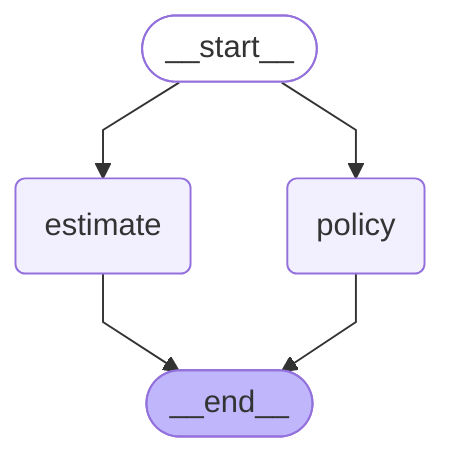

# B3 — Build a mini-LangGraph

> After this module you can implement a small superstep runner to understand the real runtime.

**Time:** 180 minutes · **Level:** Advanced · **LLM needed:** No live model · **Cost:** $0 with the included fakes.

**Larkspur Claims Copilot v11** · Practice takes additional time.

## Prerequisites

Complete [Deep agents on LangGraph](../B2_deep_agents/README.md). Read dictionary keys, functions, and Python type hints comfortably. Run uv sync from the repository root.

Optional installation requirements are listed in [the setup guide](../../../docs/OPTIONAL_DEPENDENCIES.md). Use `uv run --no-sync` after installing extras so subsequent commands retain that environment.

New to pytest, type validation, chat messages, tools, or async Python? Read the relevant section of [the beginner bridge](../../../docs/BEGINNER_BRIDGE.md) when that concept first appears.

## Learning objectives

- Implement and explain Educational superstep runner; channel snapshots; pending writes; barrier synchronization; deterministic scheduling.
- Implement and explain Reducer application; overwrite conflict detection; associative merge; parallel result ordering; runtime conformance.
- Implement and explain Checkpoint snapshots; thread identities; resume positions; educational interrupt representation; implementation limits.

## The big idea

Implement a small superstep runner to understand the real runtime. Predict the state before running code, then compare the observed result. A state is the data visible to a node; a node is one unit of work; an edge selects later work. A checkpoint is a saved state boundary, not a promise that an external effect happened exactly once.

## How it works

### Channels And Steps

The educational runner snapshots state before a superstep, collects writes from every sibling, then applies them at a barrier. Thus both workers see zero prior findings while the next-step summary sees both. This small runner explains visibility; it deliberately omits production concurrency, async execution, pending-write recovery, and serialization.

Every inspector receives a photocopy from the same morning; their notes are combined only at the afternoon collection desk.

### Mini Reducers

An overwrite channel accepts one update per superstep; multiple writers need a reducer. This comparison runs the same policy and estimate findings in the mini runner and real LangGraph, normalizing their different exception classes to one conflict observation. Canonical output order is separate from the algebra used to merge writes.

Two people cannot independently replace the same page without an agreed rule for combining their edits.

### Mini Checkpoints

A checkpoint stores state and the next scheduled work for one thread. The mini runner copies snapshots so external mutation cannot corrupt history. Its single-node pause records a request and resumes the same pending node with a checked decision; another thread remains independent. This is a teaching representation, not LangGraph's full interrupt protocol.

Each customer has a separate waiting folder, and an inspection copy cannot alter the archived original.

The checked-in diagram was generated from the executable lesson or cumulative Copilot graph. Edges describe possible work; inspect the runtime trace to see what ran.



## Key APIs at a glance

| API / executable example | What it does | When to use it |
| --- | --- | --- |
| run(case) — [01_channels_and_steps.py](examples/01_channels_and_steps.py) | Educational superstep runner; channel snapshots; pending writes; barrier synchronization; deterministic scheduling | The educational runner snapshots state before a superstep, collects writes from every sibling, then applies them at a barrier. |
| InvalidUpdateError, StateGraph — [02_mini_reducers.py](examples/02_mini_reducers.py) | Reducer application; overwrite conflict detection; associative merge; parallel result ordering; runtime conformance | An overwrite channel accepts one update per superstep; multiple writers need a reducer. |
| run(case) — [03_mini_checkpoints.py](examples/03_mini_checkpoints.py) | Checkpoint snapshots; thread identities; resume positions; educational interrupt representation; implementation limits | A checkpoint stores state and the next scheduled work for one thread. |

## Walkthrough

Run commands from the repository root; the same commands work in PowerShell, macOS, and Linux. Open the source alongside the output. Find the state declaration, node functions, graph connections, and invocation. For a failure, start with the earliest changed field or scheduled node.

```text
uv run --no-sync python modules/bonus/B3_mini_langgraph/examples/01_channels_and_steps.py
```

**Predict, then run:** for {"documents": ["estimate", "receipt"]}, write the resulting fields and any expected error. Then test the boundary cases in tests/channels_and_steps.json.

<details>
<summary>Reveal the checked result</summary>

```json
{
  "value": {
    "worker_views": [
      0,
      0
    ],
    "findings": [
      "reviewed:estimate",
      "reviewed:receipt"
    ],
    "count": 2,
    "steps": 2
  }
}
```

The educational runner snapshots state before a superstep, collects writes from every sibling, then applies them at a barrier. Thus both workers see zero prior findings while the next-step summary sees both. This small runner explains visibility; it deliberately omits production concurrency, async execution, pending-write recovery, and serialization.

</details>

```text
uv run --no-sync python modules/bonus/B3_mini_langgraph/examples/02_mini_reducers.py
```

**Predict, then run:** for {"use_reducer": true}, write the resulting fields and any expected error. Then test the boundary cases in tests/mini_reducers.json.

<details>
<summary>Reveal the checked result</summary>

```json
{
  "value": {
    "mini": {
      "findings": [
        "estimate",
        "policy"
      ]
    },
    "langgraph": {
      "findings": [
        "estimate",
        "policy"
      ]
    },
    "equal": true
  }
}
```

An overwrite channel accepts one update per superstep; multiple writers need a reducer. This comparison runs the same policy and estimate findings in the mini runner and real LangGraph, normalizing their different exception classes to one conflict observation. Canonical output order is separate from the algebra used to merge writes.

</details>

```text
uv run --no-sync python modules/bonus/B3_mini_langgraph/examples/03_mini_checkpoints.py
```

**Predict, then run:** for {"approved": false, "claim_id": "CLM-0001"}, write the resulting fields and any expected error. Then test the boundary cases in tests/mini_checkpoints.json.

<details>
<summary>Reveal the checked result</summary>

```json
{
  "value": {
    "request": {
      "claim_id": "CLM-0001",
      "question": "Approve?"
    },
    "approved": false,
    "other_pending": [
      "review"
    ],
    "original_id": "CLM-0001",
    "completed": true
  }
}
```

A checkpoint stores state and the next scheduled work for one thread. The mini runner copies snapshots so external mutation cannot corrupt history. Its single-node pause records a request and resumes the same pending node with a checked decision; another thread remains independent. This is a teaching representation, not LangGraph's full interrupt protocol.

</details>

When build_graph needs no arguments, its generated Mermaid diagram is saved beside the example. A diagram records possible edges; a runtime stream records executed work. A single sequence advances one node per superstep. Parallel nodes see the same previous boundary, so they cannot read a sibling's unfinished update.

## When to use it, and when not to

Use these contracts when the claim needs the state or control-flow behavior described above. Keep pure arithmetic and validation in ordinary functions that can be tested independently. A graph, checkpoint, or extra agent adds operational choices; justify it with a concrete failure, pause, branch, or reuse requirement.

## Real-world use case

Implement a small superstep runner to understand the real runtime. The executable milestone uses only fictional records and the shared v11 implementation. [Read the use case](use_case/claims_copilot.py).

```text
uv run python modules/bonus/B3_mini_langgraph/use_case/claims_copilot.py
```

Sample output from the synthetic default case:

```json
{
  "mini": {
    "findings": [
      "estimate",
      "policy"
    ]
  },
  "langgraph": {
    "findings": [
      "estimate",
      "policy"
    ]
  },
  "equal": true
}
```

A real team would connect this boundary to validated records and authenticated roles, then retain the same rejection, ownership, and recovery checks.

## Common bugs

| Symptom or broken contract | Cause and repair | Practice |
| --- | --- | --- |
| Observed `{"value": {"worker_views": [0, 0], "findings": ["reviewed:receipt"], "count": 1, "steps": 2}}`. Merge all sibling findings at the barrier. | Restore `(old or []) + new` and check the boundary cases. | [B3-01](../../../gym/tasks/B3/B3-01_channels_and_steps_build/task.md) · Related Fix: [B3-02](../../../gym/tasks/B3/B3-02_channels_and_steps_fix/task.md) |
| Observed `{"value": {"worker_views": [1, 1], "findings": ["reviewed:estimate", "reviewed:receipt"], "count": 2, "steps": 2}}`. Report the previous-boundary view seen by each worker. | Restore `len(state["findings"])` and check the boundary cases. | [B3-02](../../../gym/tasks/B3/B3-02_channels_and_steps_fix/task.md) · Related Fix: [B3-02](../../../gym/tasks/B3/B3-02_channels_and_steps_fix/task.md) |
| Observed `{"value": {"mini": {"conflict": true}, "langgraph": {"findings": ["estimate", "policy"]}, "equal": false}}`. Install the mini-runner reducer when parallel accumulation is required. | Restore `{"findings": operator.add} if case["use_reducer"] else {}` and check the boundary cases. | [B3-07](../../../gym/tasks/B3/B3-07_mini_reducers_build/task.md) · Related Fix: [B3-08](../../../gym/tasks/B3/B3-08_mini_reducers_fix/task.md) |
| Observed `{"value": {"mini": {"findings": ["estimate", "policy"]}, "langgraph": {"findings": ["estimate", "policy"]}, "equal": true}}`. Retain the overwrite-conflict case in the real runtime comparison. | Restore `StateGraph(Reduced if case["use_reducer"] else Overwrite)` and check the boundary cases. | [B3-08](../../../gym/tasks/B3/B3-08_mini_reducers_fix/task.md) · Related Fix: [B3-08](../../../gym/tasks/B3/B3-08_mini_reducers_fix/task.md) |
| Observed `{"value": {"request": {"claim_id": "CLM-0001", "question": "Approve?"}, "approved": true, "other_pending": ["review"], "original_id": "CLM-0001", "completed": true}}`. Preserve rejection when resuming the waiting teaching thread. | Restore `resume=case["approved"]` and check the boundary cases. | [B3-13](../../../gym/tasks/B3/B3-13_mini_checkpoints_build/task.md) · Related Fix: [B3-14](../../../gym/tasks/B3/B3-14_mini_checkpoints_fix/task.md) |
| Observed `{"value": {"request": {"claim_id": "CLM-0001", "question": "Approve?"}, "approved": false, "other_pending": ["review"], "original_id": "CLM-0001", "completed": true}}`. Validate the resumed decision before updating approval state. | Restore `type(resume) is not bool` and check the boundary cases. | [B3-14](../../../gym/tasks/B3/B3-14_mini_checkpoints_fix/task.md) · Related Fix: [B3-14](../../../gym/tasks/B3/B3-14_mini_checkpoints_fix/task.md) |

## Practice

- [B3-01 — build, easy](../../../gym/tasks/B3/B3-01_channels_and_steps_build/task.md): Build channels and steps: Merge all sibling findings at the barrier.
- [B3-02 — fix, medium](../../../gym/tasks/B3/B3-02_channels_and_steps_fix/task.md): Fix channels and steps: Report the previous-boundary view seen by each worker.
- [B3-03 — predict, easy](../../../gym/tasks/B3/B3-03_channels_and_steps_predict/task.md): Predict channels and steps across the declared cases
- [B3-04 — trace, medium](../../../gym/tasks/B3/B3-04_channels_and_steps_trace/task.md): Diagnose channels and steps from execution evidence
- [B3-05 — extend, hard](../../../gym/tasks/B3/B3-05_channels_and_steps_extend/task.md): Extend channels and steps: Add run_batch(cases) to preview independent claims in input order. Preserve run(case), isolate mutable inputs, return value/error records, handle an empty batch, and continue after a rejected claim.
- [B3-06 — refactor, hard](../../../gym/tasks/B3/B3-06_channels_and_steps_refactor/task.md): Refactor channels and steps: Separate input preparation from orchestration in prepare_case(case). Preserve all results/errors, distinguish None from {}, and copy nested inputs so caller data and shared defaults stay independent.
- [B3-07 — build, easy](../../../gym/tasks/B3/B3-07_mini_reducers_build/task.md): Build mini reducers: Install the mini-runner reducer when parallel accumulation is required.
- [B3-08 — fix, medium](../../../gym/tasks/B3/B3-08_mini_reducers_fix/task.md): Fix mini reducers: Retain the overwrite-conflict case in the real runtime comparison.
- [B3-09 — predict, easy](../../../gym/tasks/B3/B3-09_mini_reducers_predict/task.md): Predict mini reducers across the declared cases
- [B3-10 — trace, medium](../../../gym/tasks/B3/B3-10_mini_reducers_trace/task.md): Diagnose mini reducers from execution evidence
- [B3-11 — extend, hard](../../../gym/tasks/B3/B3-11_mini_reducers_extend/task.md): Extend mini reducers: Add run_batch(cases) to preview independent claims in input order. Preserve run(case), isolate mutable inputs, return value/error records, handle an empty batch, and continue after a rejected claim.
- [B3-12 — refactor, hard](../../../gym/tasks/B3/B3-12_mini_reducers_refactor/task.md): Refactor mini reducers: Separate input preparation from orchestration in prepare_case(case). Preserve all results/errors, distinguish None from {}, and copy nested inputs so caller data and shared defaults stay independent.
- [B3-13 — build, easy](../../../gym/tasks/B3/B3-13_mini_checkpoints_build/task.md): Build mini checkpoints: Preserve rejection when resuming the waiting teaching thread.
- [B3-14 — fix, medium](../../../gym/tasks/B3/B3-14_mini_checkpoints_fix/task.md): Fix mini checkpoints: Validate the resumed decision before updating approval state.
- [B3-15 — predict, easy](../../../gym/tasks/B3/B3-15_mini_checkpoints_predict/task.md): Predict mini checkpoints across the declared cases
- [B3-16 — trace, medium](../../../gym/tasks/B3/B3-16_mini_checkpoints_trace/task.md): Diagnose mini checkpoints from execution evidence
- [B3-17 — extend, hard](../../../gym/tasks/B3/B3-17_mini_checkpoints_extend/task.md): Extend mini checkpoints: Add run_batch(cases) to preview independent claims in input order. Preserve run(case), isolate mutable inputs, return value/error records, handle an empty batch, and continue after a rejected claim.
- [B3-18 — design, hard](../../../gym/tasks/B3/B3-18_mini_checkpoints_design/task.md): Design mini checkpoints and justify the boundary policies

Start with tasks 01, 02, 09, 10, 17, and 18 in this module. Finish the other tasks for full practice. Hints are progressive; solution exposure is recorded. Predict and Trace tasks use answer JSON, not a code starter.

## Quiz

Predict first; explain in your own words.

1. Explain the contract in 01_channels_and_steps.py using one claim from its input cases.
2. Diagnose this broken behavior: Report the previous-boundary view seen by each worker. Which observation distinguishes the repair from a default-case-only fix?
3. Explain the contract in 02_mini_reducers.py using one claim from its input cases.
4. Diagnose this broken behavior: Retain the overwrite-conflict case in the real runtime comparison. Which observation distinguishes the repair from a default-case-only fix?
5. Explain the contract in 03_mini_checkpoints.py using one claim from its input cases.
6. Diagnose this broken behavior: Validate the resumed decision before updating approval state. Which observation distinguishes the repair from a default-case-only fix?

<details>
<summary>Answers</summary>

1. The educational runner snapshots state before a superstep, collects writes from every sibling, then applies them at a barrier. Thus both workers see zero prior findings while the next-step summary sees both. This small runner explains visibility; it deliberately omits production concurrency, async execution, pending-write recovery, and serialization.
2. Report the previous-boundary view seen by each worker. Compare the normal case with the boundary fixtures and identify the first differing update.
3. An overwrite channel accepts one update per superstep; multiple writers need a reducer. This comparison runs the same policy and estimate findings in the mini runner and real LangGraph, normalizing their different exception classes to one conflict observation. Canonical output order is separate from the algebra used to merge writes.
4. Retain the overwrite-conflict case in the real runtime comparison. Compare the normal case with the boundary fixtures and identify the first differing update.
5. A checkpoint stores state and the next scheduled work for one thread. The mini runner copies snapshots so external mutation cannot corrupt history. Its single-node pause records a request and resumes the same pending node with a checked decision; another thread remains independent. This is a teaching representation, not LangGraph's full interrupt protocol.
6. Validate the resumed decision before updating approval state. Compare the normal case with the boundary fixtures and identify the first differing update.

</details>

## Cost and safety

The default commands cost $0: deterministic Python and, in model lessons, scripted local fakes. They consume no hosted tokens and make no real payments or emails. Optional live experiments use the provider configured in .env; a short one-to-four-call exercise is usually cents, but verify your provider's current token prices and set a budget. Ollama can run locally without a hosted bill. Temporary checkpoint files are isolated from the committed dataset. Keep real customer details and credentials out of graph state.

## Key takeaways

- State visibility and update rules determine what a node can safely assume.
- Check normal, missing, boundary, and failure cases before trusting a workflow.
- Separate observed execution from diagrams, predictions, and durable history.
- Model output is evidence to validate, never an authorization grant.
- A saved checkpoint and an external effect have separate durability boundaries.

## Go deeper

- [channels and steps official guide](https://docs.langchain.com/oss/python/langgraph/pregel)
- [mini reducers official guide](https://docs.langchain.com/oss/python/langgraph/graph-api)
- [mini checkpoints official guide](https://docs.langchain.com/oss/python/langgraph/checkpointers)

## Next:

Continue to [module B4: What's new](../../../modules/bonus/B4_whats_new/README.md).
