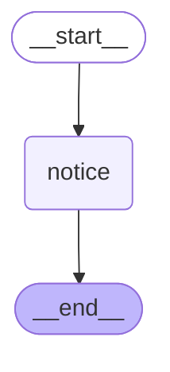
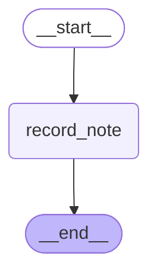

# B4 — What's new

> After this module you can evaluate recent changes without silently changing the core course contracts.

**Time:** 180 minutes · **Level:** Advanced · **LLM needed:** No live model · **Cost:** $0 with the included fakes.

**Larkspur Claims Copilot v11** · Practice takes additional time.

## Prerequisites

Complete [Build a mini-LangGraph](../B3_mini_langgraph/README.md). Read dictionary keys, functions, and Python type hints comfortably. Run uv sync from the repository root.

Optional installation requirements are listed in [the setup guide](../../../docs/OPTIONAL_DEPENDENCIES.md). Use `uv run --no-sync` after installing extras so subsequent commands retain that environment.

## Learning objectives

- Implement and explain Beta v3 event streaming; typed projections; lifecycle and subgraphs; tool-call deltas; version distinctions.
- Implement and explain Beta DeltaChannel; incremental checkpoint storage; snapshot_frequency; replay reconstruction; schema migration hazards.
- Implement and explain Per-call HumanInTheLoopMiddleware; response_schema; checked resume payloads; tool edit constraints; current changelog literacy.

## The big idea

Evaluate recent changes without silently changing the core course contracts. Predict the state before running code, then compare the observed result. A state is the data visible to a node; a node is one unit of work; an edge selects later work. A checkpoint is a saved state boundary, not a promise that an external effect happened exactly once.

## How it works

### Event Streaming Beta

Beta v3 event streaming exposes typed message, subgraph, value, and output projections. Child messages belong to the subgraph projection. The raw protocol uses method and params rather than the v2 type/ns/data shape. This example uses a fresh fake run for raw-event inspection so consuming one view does not pretend to replay already-consumed events.

The main case and specialist folders have separate progress feeds, even when one screen presents them together.



### Delta Channels Beta

Beta DeltaChannel stores incremental writes and reconstructs channel state through a deterministic batch reducer. snapshot_frequency bounds how often a full snapshot is written. The reducer must be invariant to regrouping write batches, because replay may batch differently from live execution. Schema and reducer changes require migration testing before reusing old threads.

Retain a ledger of additions with occasional full copies, then rebuild the current folder from those records.



### Typed Approvals

Per-call HumanInTheLoopMiddleware emits one approval request for each gated tool call. Its response_schema describes only permitted decisions; the runtime validates the answer before saving it. Resume by interrupt ID and keep tool editing disabled when the reviewer may approve or reject only. Typed approval validates shape, while real authorization still belongs to the application.

Each numbered work order carries its own approval form with only the choices that desk is allowed to accept.

## Key APIs at a glance

| API / executable example | What it does | When to use it |
| --- | --- | --- |
| AIMessage, HumanMessage, MessagesState, StateGraph — [01_event_streaming_beta.py](examples/01_event_streaming_beta.py) | Beta v3 event streaming; typed projections; lifecycle and subgraphs; tool-call deltas; version distinctions | Beta v3 event streaming exposes typed message, subgraph, value, and output projections. |
| DeltaChannel, InMemorySaver, StateGraph — [02_delta_channels_beta.py](examples/02_delta_channels_beta.py) | Beta DeltaChannel; incremental checkpoint storage; snapshot_frequency; replay reconstruction; schema migration hazards | Beta DeltaChannel stores incremental writes and reconstructs channel state through a deterministic batch reducer. |
| create_agent, HumanInTheLoopMiddleware, AIMessage, HumanMessage — [03_typed_approvals.py](examples/03_typed_approvals.py) | Per-call HumanInTheLoopMiddleware; response_schema; checked resume payloads; tool edit constraints; current changelog literacy | Per-call HumanInTheLoopMiddleware emits one approval request for each gated tool call. |

## Walkthrough

Run commands from the repository root; the same commands work in PowerShell, macOS, and Linux. Open the source alongside the output. Find the state declaration, node functions, graph connections, and invocation. For a failure, start with the earliest changed field or scheduled node.

```text
uv run python modules/bonus/B4_whats_new/examples/01_event_streaming_beta.py
```

**Predict, then run:** for {"text": "Synthetic claim review is complete."}, write the resulting fields and any expected error. Then test the boundary cases in tests/event_streaming_beta.json.

<details>
<summary>Reveal the checked result</summary>

```json
{
  "value": {
    "texts": [
      "Synthetic claim review is complete."
    ],
    "final": "Synthetic claim review is complete.",
    "tool_arguments": {
      "policy_id": "POL-0001"
    },
    "tool_delta_count": 2,
    "channels": [
      "lifecycle",
      "messages",
      "values"
    ],
    "nested": true,
    "beta": true
  }
}
```

Beta v3 event streaming exposes typed message, subgraph, value, and output projections. Child messages belong to the subgraph projection. The raw protocol uses method and params rather than the v2 type/ns/data shape. This example uses a fresh fake run for raw-event inspection so consuming one view does not pretend to replay already-consumed events.

</details>

```text
uv run python modules/bonus/B4_whats_new/examples/02_delta_channels_beta.py
```

**Predict, then run:** for {"notes": ["intake", "policy", "estimate"], "snapshot_frequency": 2}, write the resulting fields and any expected error. Then test the boundary cases in tests/delta_channels_beta.json.

<details>
<summary>Reveal the checked result</summary>

```json
{
  "value": {
    "notes": [
      "intake",
      "policy",
      "estimate"
    ],
    "reconstructed": true,
    "beta": true
  }
}
```

Beta DeltaChannel stores incremental writes and reconstructs channel state through a deterministic batch reducer. snapshot_frequency bounds how often a full snapshot is written. The reducer must be invariant to regrouping write batches, because replay may batch differently from live execution. Schema and reducer changes require migration testing before reusing old threads.

</details>

```text
uv run python modules/bonus/B4_whats_new/examples/03_typed_approvals.py
```

**Predict, then run:** for {"decision": "approve", "amount_cents": 50000}, write the resulting fields and any expected error. Then test the boundary cases in tests/typed_approvals.json.

<details>
<summary>Reveal the checked result</summary>

```json
{
  "value": {
    "schema_present": true,
    "effects": [
      50000
    ],
    "interrupt_type": "tool_approval"
  }
}
```

Per-call HumanInTheLoopMiddleware emits one approval request for each gated tool call. Its response_schema describes only permitted decisions; the runtime validates the answer before saving it. Resume by interrupt ID and keep tool editing disabled when the reviewer may approve or reject only. Typed approval validates shape, while real authorization still belongs to the application.

</details>

When build_graph needs no arguments, its generated Mermaid diagram is saved beside the example. A diagram records possible edges; a runtime stream records executed work. A single sequence advances one node per superstep. Parallel nodes see the same previous boundary, so they cannot read a sibling's unfinished update.

## When to use it, and when not to

Use these contracts when the claim needs the state or control-flow behavior described above. Keep pure arithmetic and validation in ordinary functions that can be tested independently. A graph, checkpoint, or extra agent adds operational choices; justify it with a concrete failure, pause, branch, or reuse requirement.

## Real-world use case

Evaluate recent changes without silently changing the core course contracts. The executable milestone uses only fictional records and the shared v11 implementation. [Read the use case](use_case/claims_copilot.py).

```text
uv run python modules/bonus/B4_whats_new/use_case/claims_copilot.py
```

Sample output from the synthetic default case:

```json
{
  "schema_present": true,
  "effects": [
    50000
  ],
  "interrupt_type": "tool_approval"
}
```

A real team would connect this boundary to validated records and authenticated roles, then retain the same rejection, ownership, and recovery checks.

## Common bugs

| Symptom or broken contract | Cause and repair | Practice |
| --- | --- | --- |
| Observed `{"value": {"texts": [], "final": "Synthetic claim review is complete.", "tool_arguments": {"policy_id": "POL-0001"}, "tool_delta_count": 2, "channels": ["lifecycle", "messages", "values"], "nested": true, "beta": true}}`. Read child model messages through their subgraph projection. | Restore `for child in stream.subgraphs for message in child.messages` and check the boundary cases. | [B4-01](../../../gym/tasks/B4/B4-01_event_streaming_beta_build/task.md) · [Related Fix B4-02](../../../gym/tasks/B4/B4-02_event_streaming_beta_fix/task.md) |
| Observed `{"value": {"texts": ["Synthetic claim review is complete."], "final": "Update this claim.", "tool_arguments": {"policy_id": "POL-0001"}, "tool_delta_count": 2, "channels": ["lifecycle", "messages", "values"], "nested": t`. Read the final model message from the completed output projection. | Restore `output["messages"][-1].text` and check the boundary cases. | [B4-02](../../../gym/tasks/B4/B4-02_event_streaming_beta_fix/task.md) |
| Observed `{"value": {"notes": ["estimate"], "reconstructed": false, "beta": true}}`. Retain earlier delta writes when applying a new batch. | Restore `result.extend(write)` and check the boundary cases. | [B4-07](../../../gym/tasks/B4/B4-07_delta_channels_beta_build/task.md) · [Related Fix B4-08](../../../gym/tasks/B4/B4-08_delta_channels_beta_fix/task.md) |
| Observed `{"value": {"notes": ["intake", "policy", "estimate"], "reconstructed": true, "beta": true}}`. Honor and validate the requested snapshot cadence. | Restore `snapshot_frequency=frequency` and check the boundary cases. | [B4-08](../../../gym/tasks/B4/B4-08_delta_channels_beta_fix/task.md) |
| Observed `{"error": "KeyError"}`. Use per-call requests when resuming individual interrupt IDs. | Restore `interrupt_mode="per_call"` and check the boundary cases. | [B4-13](../../../gym/tasks/B4/B4-13_typed_approvals_build/task.md) · [Related Fix B4-14](../../../gym/tasks/B4/B4-14_typed_approvals_fix/task.md) |
| Observed `{"value": {"schema_present": true, "effects": [50000], "interrupt_type": "tool_approval"}}`. Respect rejection instead of coercing every decision to approval. | Restore `decision = {"type": case["decision"]}` and check the boundary cases. | [B4-14](../../../gym/tasks/B4/B4-14_typed_approvals_fix/task.md) |

## Practice

- [B4-01 — build, easy](../../../gym/tasks/B4/B4-01_event_streaming_beta_build/task.md): Build event streaming beta: Read child model messages through their subgraph projection.
- [B4-02 — fix, medium](../../../gym/tasks/B4/B4-02_event_streaming_beta_fix/task.md): Fix event streaming beta: Read the final model message from the completed output projection.
- [B4-03 — predict, easy](../../../gym/tasks/B4/B4-03_event_streaming_beta_predict/task.md): Predict event streaming beta across the declared cases
- [B4-04 — trace, medium](../../../gym/tasks/B4/B4-04_event_streaming_beta_trace/task.md): Trace event streaming beta: Read the final model message from the completed output projection.
- [B4-05 — extend, hard](../../../gym/tasks/B4/B4-05_event_streaming_beta_extend/task.md): Extend event streaming beta: Consume the raw protocol when inspecting lifecycle channels.
- [B4-06 — refactor, hard](../../../gym/tasks/B4/B4-06_event_streaming_beta_refactor/task.md): Refactor event streaming beta: Use the v3 protocol namespace location rather than a guessed field.
- [B4-07 — build, easy](../../../gym/tasks/B4/B4-07_delta_channels_beta_build/task.md): Build delta channels beta: Retain earlier delta writes when applying a new batch.
- [B4-08 — fix, medium](../../../gym/tasks/B4/B4-08_delta_channels_beta_fix/task.md): Fix delta channels beta: Honor and validate the requested snapshot cadence.
- [B4-09 — predict, easy](../../../gym/tasks/B4/B4-09_delta_channels_beta_predict/task.md): Predict delta channels beta across the declared cases
- [B4-10 — trace, medium](../../../gym/tasks/B4/B4-10_delta_channels_beta_trace/task.md): Trace delta channels beta: Honor and validate the requested snapshot cadence.
- [B4-11 — extend, hard](../../../gym/tasks/B4/B4-11_delta_channels_beta_extend/task.md): Extend delta channels beta: Checkpoint every supplied note before reconstruction.
- [B4-12 — design, hard](../../../gym/tasks/B4/B4-12_delta_channels_beta_design/task.md): Design delta channels beta and justify the boundary policies
- [B4-13 — build, easy](../../../gym/tasks/B4/B4-13_typed_approvals_build/task.md): Build typed approvals: Use per-call requests when resuming individual interrupt IDs.
- [B4-14 — fix, medium](../../../gym/tasks/B4/B4-14_typed_approvals_fix/task.md): Fix typed approvals: Respect rejection instead of coercing every decision to approval.
- [B4-15 — predict, easy](../../../gym/tasks/B4/B4-15_typed_approvals_predict/task.md): Predict typed approvals across the declared cases
- [B4-16 — trace, medium](../../../gym/tasks/B4/B4-16_typed_approvals_trace/task.md): Trace typed approvals: Respect rejection instead of coercing every decision to approval.
- [B4-17 — extend, hard](../../../gym/tasks/B4/B4-17_typed_approvals_extend/task.md): Extend typed approvals: Bind the proposal to its requested amount.
- [B4-18 — design, hard](../../../gym/tasks/B4/B4-18_typed_approvals_design/task.md): Design typed approvals and justify the boundary policies

Start with tasks 01, 02, 09, 10, 17, and 18 in this module. Finish the other tasks for full practice. Hints are progressive; solution exposure is recorded. Predict and Trace tasks use answer JSON, not a code starter.

## Quiz

Predict first; explain in your own words.

1. Explain the contract in 01_event_streaming_beta.py using one claim from its input cases.
2. Diagnose this broken behavior: Read the final model message from the completed output projection. Which observation distinguishes the repair from a default-case-only fix?
3. Explain the contract in 02_delta_channels_beta.py using one claim from its input cases.
4. Diagnose this broken behavior: Honor and validate the requested snapshot cadence. Which observation distinguishes the repair from a default-case-only fix?
5. Explain the contract in 03_typed_approvals.py using one claim from its input cases.
6. Diagnose this broken behavior: Respect rejection instead of coercing every decision to approval. Which observation distinguishes the repair from a default-case-only fix?

<details>
<summary>Answers</summary>

1. Beta v3 event streaming exposes typed message, subgraph, value, and output projections. Child messages belong to the subgraph projection. The raw protocol uses method and params rather than the v2 type/ns/data shape. This example uses a fresh fake run for raw-event inspection so consuming one view does not pretend to replay already-consumed events.
2. Read the final model message from the completed output projection. Compare the normal case with the boundary fixtures and identify the first differing update.
3. Beta DeltaChannel stores incremental writes and reconstructs channel state through a deterministic batch reducer. snapshot_frequency bounds how often a full snapshot is written. The reducer must be invariant to regrouping write batches, because replay may batch differently from live execution. Schema and reducer changes require migration testing before reusing old threads.
4. Honor and validate the requested snapshot cadence. Compare the normal case with the boundary fixtures and identify the first differing update.
5. Per-call HumanInTheLoopMiddleware emits one approval request for each gated tool call. Its response_schema describes only permitted decisions; the runtime validates the answer before saving it. Resume by interrupt ID and keep tool editing disabled when the reviewer may approve or reject only. Typed approval validates shape, while real authorization still belongs to the application.
6. Respect rejection instead of coercing every decision to approval. Compare the normal case with the boundary fixtures and identify the first differing update.

</details>

## Cost and safety

The default commands cost $0: deterministic Python and, in model lessons, scripted local fakes. They consume no hosted tokens and make no real payments or emails. Optional live experiments use the provider configured in .env; a short one-to-four-call exercise is usually cents, but verify your provider's current token prices and set a budget. Ollama can run locally without a hosted bill. Temporary checkpoint files are isolated from the committed dataset. Keep real customer details and credentials out of graph state.

## Key takeaways

- State visibility and update rules determine what a node can safely assume.
- Check normal, missing, boundary, and failure cases before trusting a workflow.
- Separate observed execution from diagrams, predictions, and durable history.
- Model output is evidence to validate, never an authorization grant.
- A saved checkpoint and an external effect have separate durability boundaries.

## Go deeper

- [event streaming beta official guide](https://docs.langchain.com/oss/python/langgraph/event-streaming)
- [delta channels beta official guide](https://docs.langchain.com/oss/python/langgraph/graph-api)
- [typed approvals official guide](https://docs.langchain.com/oss/python/langchain/human-in-the-loop)

## Next:

Complete the capstones and revisit the full feature map.
